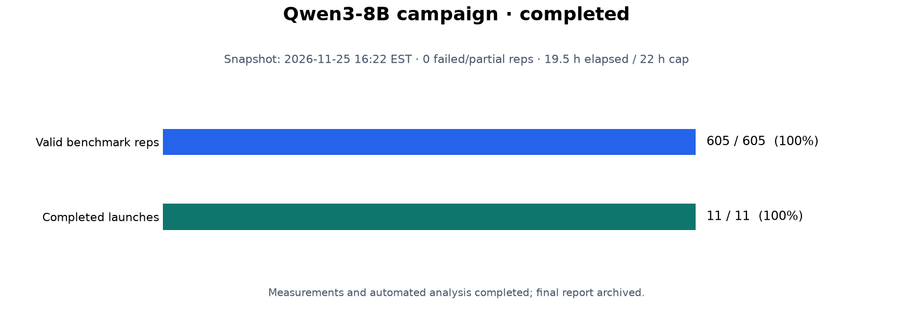
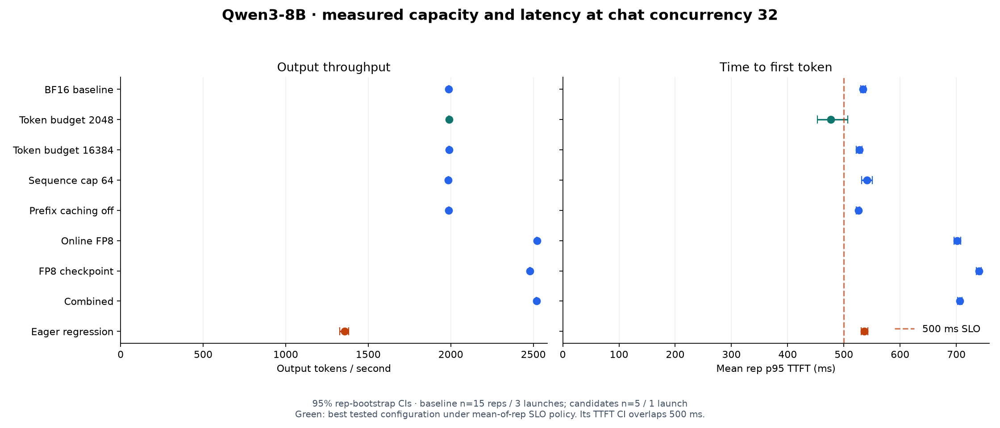
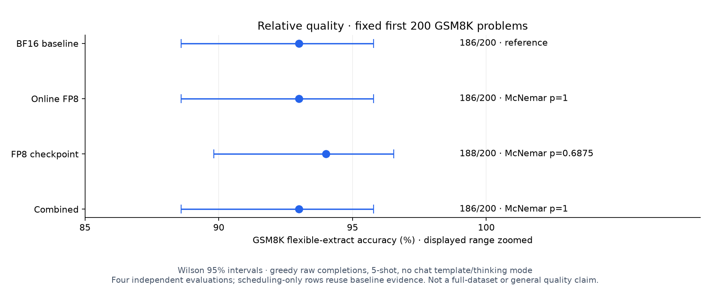
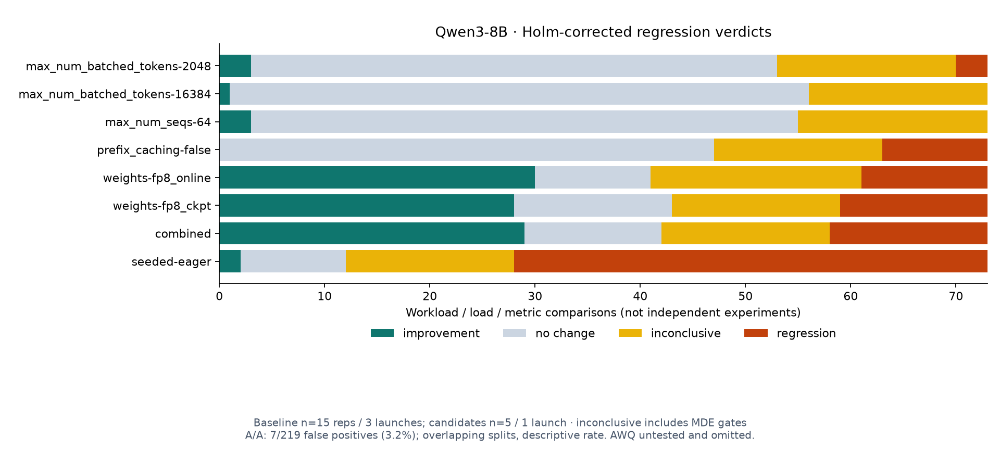
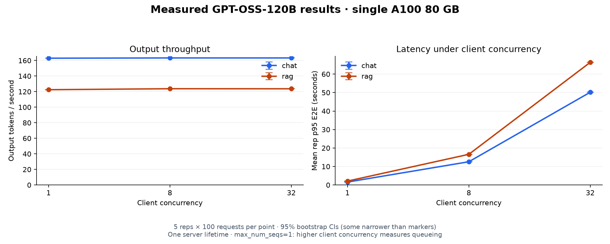
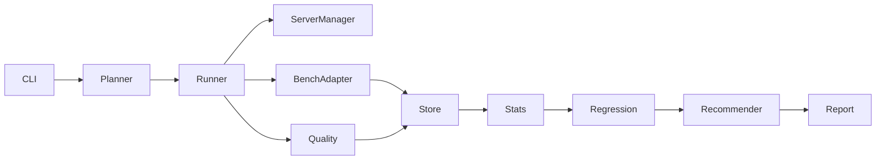

# InferencePilot

**Benchmark vLLM configurations, detect meaningful regressions, and recommend the
best tested configuration under latency and quality constraints.**

InferencePilot manages the experiment around `vllm bench serve`: independent server
launches, randomized configuration order, repeated measurements, raw-result
validation, statistical comparisons, model-quality checks, and reproducible reports.

Python 3.10–3.12 · MIT license · CLI · SQLite · Pure Python statistics

## Why I built it

A faster benchmark result is useful only if the difference survives run-to-run
noise and the configuration still meets latency and quality requirements.
InferencePilot turns individual measurements into comparisons with explicit
uncertainty, replication counts, and a minimum detectable effect (MDE).

vLLM already provides parameter sweeps, repeated runs, resume, SLA tuning, and
visualization. InferencePilot builds on that tooling with replicated-launch
comparisons, corrected regression tests, detector validation, paired quality
assessment, and constraint-based recommendations. See the
[compatibility and prior-art notes](docs/VLLM_COMPATIBILITY.md).

## What it does

- Designs one-factor-at-a-time experiments around a baseline, followed by a
  separately tested combined configuration. Three independent baseline launches
  expose drift; candidate comparisons use five reps per workload/load point.
- Starts and stops its own vLLM process groups, checks readiness, captures startup
  logs, and records resolved server settings. Preflight checks reject occupied
  ports, busy GPU memory, and existing vLLM processes.
- Wraps `vllm bench serve` and derives TTFT, pooled ITL, per-request TPOT, E2E latency,
  throughput, and SLO goodput from detailed request data. Raw-derived summaries
  must match the benchmark's reported values within 1%.
- Computes bootstrap confidence intervals, permutation tests, Holm correction,
  launch-aware MDE, and explicit regression/improvement/inconclusive verdicts.
- Evaluates GSM8K through a running server, compares paired correctness with exact
  McNemar tests, and checks greedy output-token agreement on fixed prompts.
- Checkpoints experiments in SQLite, resumes without duplicating completed reps,
  enforces a wall-clock budget, and records environment and GPU telemetry.
- Filters configurations by constraints, ranks eligible results, identifies a
  Pareto set, and explains every rejection in Markdown/JSON reports and plots.

## Project status

- [x] Complete offline pipeline: planning, lifecycle, metrics, statistics, quality,
  checkpoint/resume, regression detection, recommendation, and reporting.
- [x] Fake HTTP server, executable adapters, interruption tests, and reproducible
  detector power study.
- [x] CI on Linux and macOS with Python 3.10, 3.11, and 3.12.
- [x] GPT-OSS-120B performance validation: 30 reps, 3,000 requests, archived results.
- [x] Pinned Qwen3 baseline startup, detailed benchmark, and harness fixtures.
- [x] Qwen3-8B live campaign, verified archive, final comparisons and recommendation:
  605 valid reps, 110,000 requests, 11 launches.
- [ ] Complete optional GPT-OSS cold-start and context/OOM-boundary experiments.
- [ ] Final release review and `v0.1.0`.

The package is currently **0.0.1**. Latest local verification: **316 tests passed**
and `ruff check .` passed. The Qwen3 campaign completed on one A100 80 GB in
19.51 wall-clock hours, within its 22-hour cap. All performance points and five
reps were retained; quality used the same first 200 GSM8K problems. The final
archive and all 605 raw reps were checked locally. Optional GPU experiments remain
**not run (needs GPU)**; release gates are tracked in [project status](docs/PROJECT_STATUS.md).



The [completion snapshot](reports/readme/progress.json) records observed counts and
workflow duration, including interruption and analysis; rental setup is excluded.

## Quickstart

Run the complete offline pipeline without a GPU:

```sh
git clone https://github.com/Yaswanth2120/inferencepilot.git
cd inferencepilot
python3.12 -m venv venv
source venv/bin/activate
python -m pip install -e '.[dev,report]'
pytest
ruff check .
inferencepilot selftest
```

The report extra adds plots; Markdown and JSON reports also work without it.
The selftest covers six fake server lifetimes, 120 benchmark reps, quality and
agreement checks, resume, regression/A/A analysis, recommendation, and reporting.
Live tests are skipped by default. `doctor` exits 3 when NVIDIA tools, pinned
vLLM, or the evaluation harness are unavailable.

Generate a reproducible synthetic report:

```sh
python -m inferencepilot.fakes.demo --data data/my-demo --out reports/my-demo
inferencepilot power --out reports/my-power.json
```

Use fresh output paths. The fake benchmark emits seeded timing data; it does not
simulate real GPU performance. Agreement tests exercise the fake HTTP endpoint,
while fake quality outcomes are constructed fixtures.

## Running an experiment

The main pipeline pins **vLLM 0.15.1** and **lm-eval 0.4.9.2**. vLLM is invoked as
a subprocess and is never imported by the library. Install live dependencies on
the GPU host and follow the [GPU runbook](docs/RUNBOOK_GPU.md) for probes,
calibration, backups, and recovery.

The committed experiment YAML contains illustrative calibration. Preview it locally:

```sh
inferencepilot plan --config configs/experiment_qwen3_8b.yaml --out data/preview.json
inferencepilot run --plan data/preview.json --dry-run
```

For a live run, first replace that calibration with measured timings, record actual
load-probe evidence, and reserve time for open-loop tests, quality, and startup
variation. The campaign wrapper rejects synthetic calibration and pending probes.
With a prepared configuration:

```sh
inferencepilot doctor
inferencepilot plan --config data/measured.yaml --out data/plan.json
inferencepilot run --plan data/plan.json --dry-run
inferencepilot run --plan data/plan.json --db data/campaign.db \
  --constraints configs/constraints.yaml --evidence live
inferencepilot status --db data/campaign.db --experiment ID
inferencepilot resume --db data/campaign.db --experiment ID
```

Analyze and report the saved experiment:

```sh
inferencepilot analyze --db data/campaign.db --experiment ID
inferencepilot validate --db data/campaign.db --experiment ID
inferencepilot regress --db data/campaign.db --experiment ID --baseline baseline
inferencepilot recommend --db data/campaign.db --experiment ID \
  --constraints configs/constraints.yaml
inferencepilot report --db data/campaign.db --experiment ID --out reports/campaign
```

`regress` exits 1 when a regression is found; configuration errors exit 2 and
environment failures exit 3. The runtime budget includes paused time, so resume
cannot reset it. Interrupted slots restart with a new physical server lifetime
while preserving completed reps. Startup failures remain visible; an exhausted
schedule does not imply every configuration succeeded.

For unattended execution, `scripts/detached_campaign.py` runs independently of the
launching shell, records progress, enforces a workflow deadline, and supports
periodic consistent SQLite backups. A fixed `--quality-limit N` selects the first
N GSM8K problems consistently across comparisons. Runtime caps stop workloads;
they do not stop rental billing. See the [GPU runbook](docs/RUNBOOK_GPU.md).

## Qwen3-8B results

The completed campaign compared BF16, online FP8, a published FP8 checkpoint,
scheduling factors, a combined candidate and an eager seeded regression. Baseline
numbers pool **15 reps across three launches**; each candidate has **five reps in
one launch**. The requested forced-AWQ/BF16 combination was rejected and retained
with its exact software/dtype error.

**Best tested configuration under the saved constraints:** BF16 with
`max_num_batched_tokens=2048`, prefix caching on, `max_num_seqs=256`, chunked prefill
on and CUDA graphs enabled. At chat concurrency 32 it measured **1988.78 tokens/s**,
**476.91 ms mean rep-p95 TTFT**, and **3862.89 ms mean rep-p95 E2E** (n=5).

The TTFT policy tests the mean rep-p95 against 500 ms. Its 95% CI is
**452.70–507.26 ms**, overlapping that limit: eligibility is not a guaranteed SLO.
FP8 and the combined candidate had higher throughput but failed this TTFT constraint.



| Configuration | Output tokens/s | Mean rep p95 TTFT (ms) | Mean rep p95 E2E (ms) | Reps |
|---|---:|---:|---:|---:|
| BF16 baseline | 1987.54 | 534.10 | 3815.93 | 15 |
| BF16 token budget 2048 | 1988.78 | 476.91 | 3862.89 | 5 |
| Online FP8 | 2521.96 | 701.31 | 3043.08 | 5 |
| FP8 checkpoint | 2479.04 | 740.26 | 3102.43 | 5 |
| Combined | 2518.98 | 706.32 | 3042.96 | 5 |
| Eager regression | 1357.73 | 536.45 | 5659.91 | 5 |

These are observed rep-level means at `chat:closed:32`; full confidence intervals,
MDEs and corrected comparisons are in the [final report](reports/qwen3-20261125/README.md).

Four independent quality evaluations measured BF16 **186/200**, online FP8
**186/200**, FP8 checkpoint **188/200**, and combined **186/200**. Paired McNemar
p-values versus BF16 were 1, 0.6875 and 1. These subset results do not establish
quality equivalence; scheduling-only rows reuse named baseline evidence.



The eager seeded regression was detected: throughput **−31.69%** and p95 E2E
**+48.32%** at chat concurrency 32 (Holm-adjusted p=0.004708, baseline n=15,
candidate n=5). A/A validation recorded **7/219 false positives (3.20%)**, with
45 inconclusive comparisons; overlapping launch splits make that rate descriptive.



[Final Qwen report](reports/qwen3-20261125/README.md) ·
[Detailed Markdown](reports/qwen3-20261125/report.md) ·
[JSON results](reports/qwen3-20261125/report.json) ·
[Archive verification](reports/qwen3-20261125/verification.json)

## GPT-OSS performance validation

The separate GPT-OSS-120B experiment completed **30/30 reps** and **3,000 requests**
in **108.4 minutes** on one A100 80 GB with vLLM 0.32.0. Each point below has
**five reps of 100 requests**, within one existing server lifetime.

The server used **`max_num_seqs=1`**. Higher client concurrency therefore measures
queueing behind that limit; these results do not establish optimized batching,
paired model quality, or regression power across independent server launches.
All raw files were checked locally and the archived database passed integrity checks.



These plots use the published GPT-OSS measurements, with five reps per point.
The single-sequence server limit explains the rising queueing latency; the plots
are separate from the Qwen campaign below.

| Workload | Client concurrency | Output tokens/s [95% CI] | Mean rep p95 E2E ms [95% CI] | Reps |
|---|---:|---|---|---:|
| chat | 1 | 162.98 [162.86, 163.06] | 1573.97 [1572.17, 1577.30] | 5 |
| rag | 1 | 122.48 [122.42, 122.53] | 2099.42 [2098.10, 2101.16] | 5 |
| chat | 8 | 163.31 [163.24, 163.38] | 12569.09 [12542.29, 12595.90] | 5 |
| rag | 8 | 123.74 [123.70, 123.78] | 16590.67 [16576.76, 16606.69] | 5 |
| chat | 32 | 163.30 [163.26, 163.34] | 50180.99 [50159.78, 50204.42] | 5 |
| rag | 32 | 123.66 [123.65, 123.68] | 66362.15 [66333.44, 66393.70] | 5 |

[Full GPT-OSS report](reports/gptoss-20261124/report.md) ·
[JSON results](reports/gptoss-20261124/report.json)

## Statistics and detector validation

Percentiles use type-7 linear interpolation. Confidence intervals use 10,000 seeded
bootstrap resamples with the **rep as the resampling unit**. Requests sharing a
server state are not treated as independent experiment replicates. Permutation
tests are exact up to 20,000 label assignments; larger comparisons use 100,000
seeded Monte Carlo draws. Holm correction covers the workload/point/metric family
within each candidate comparison.

MDE accounts for between-launch and within-launch variability using a nominal
α=0.05, 80%-power approximation. Fewer than five comparable reps or an MDE above
the configured minimum effect forces an `inconclusive` verdict. A rep with more
than 1% failed or invalid fixed-length requests is excluded from comparisons,
with the counts retained. See [statistical decisions](DECISIONS.md) for derivations.

The committed synthetic power study uses a fixed 5% decision threshold:

| Injected latency | Regression detections | Trials |
|---|---:|---:|
| +2% | 0 | 20 |
| +5% | 9 | 20 |
| +10% | 20 | 20 |
| +20% | 20 | 20 |

These are simulated single-metric detection rates, not measured GPU power across
all corrected workload metrics. Wilson intervals, seeds, and settings are in the
[power artifact](reports/power.json). Overlapping A/A splits provide a descriptive
false-positive rate. No decision thresholds were tuned to the displayed outcomes.

[Synthetic report](reports/offline-demo/report.md) ·
[Machine-readable demonstration](reports/offline-demo/report.json)

## Architecture



Configuration and result summaries live in SQLite with WAL checkpoints. Detailed
request arrays and logs remain in adjacent `raw/` and `logs/` directories.
Core dependencies are Pydantic, PyYAML, and HTTPX; statistics use the Python standard
library. FastAPI/Uvicorn support the test server, Matplotlib adds plots, and the
live extra installs the evaluation harness.

## Limitations

- Shared-host noise and server restarts can obscure small effects. Changes below
  the MDE remain inconclusive; rankings do not prove superiority or quality equivalence.
- Closed-loop tests measure capacity. Open-loop chat tests use arrival rates at
  50%, 80%, and 95% of measured baseline capacity to examine latency under load.
- Random-token and prefix-repetition prompts are synthetic workloads.
- A100 has no native FP8/FP4 compute. Quantization can save memory without improving
  speed; hardware probes and resolved logs determine which paths are supported.
  The pinned engine rejected the requested forced-AWQ/BF16 combination; this does
  not imply general A100 incompatibility with AWQ.
- GSM8K uses greedy raw completions without a chat template or thinking mode. It
  measures relative quality on one task and, for this campaign, a fixed 200-item subset.
- Results apply to the tested software versions, GPU, and model. OFAT does not
  resolve interactions beyond the separately validated combined configuration.
- Streaming can bundle tokens; reconstructed E2E uses TTFT plus observed gaps.
  Real fixtures cover pinned baseline startup, detailed metrics, and harness output;
  documented synthetic edge cases and remaining parser coverage stay provisional.
- Budget estimates are approximate. Scope reductions must be explicit; replication
  and statistical thresholds are not silently relaxed to fit a rental window.

The implemented scope is single-GPU vLLM serving. Multi-GPU orchestration, other
engines, training or producing quantized checkpoints, Kubernetes, rental management, and a
web UI are outside the project scope. Recommendations always refer to the
**best tested configuration under the stated constraints**, with uncertainty visible.

## Documentation and license

[Design](docs/DESIGN.md) · [GPU runbook](docs/RUNBOOK_GPU.md) ·
[Project status](docs/PROJECT_STATUS.md) · [Decisions](DECISIONS.md) ·
[Function explanations](EXPLAINED.md) · [Contributing](CONTRIBUTING.md) ·
[Specification](AGENTS.md)

Rebuild the README images with `python scripts/readme_figures.py` after installing
the report extra. The script reads the committed report and progress JSON; it does
not rerun benchmarks or recompute confidence intervals. It renders both campaigns,
Qwen quality and corrected-verdict plots, and the final completion snapshot.

Released under the [MIT License](LICENSE).
