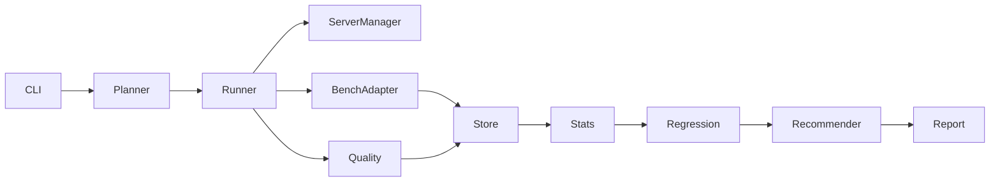

# InferencePilot

Compare **tested** vLLM serving configurations using replicated server launches,
rep-level statistics, paired quality checks, and constraint-based recommendations.
**M0–M8 are implemented and verified offline. GPT-OSS live performance validation is complete; the required Qwen campaign remains unrun.**
MIT licensed. Python 3.10–3.12. vLLM is invoked as a subprocess, never imported.

## Quickstart without a GPU

```sh
python3.12 -m venv venv
source venv/bin/activate
python -m pip install -e '.[dev,report]'
pytest
ruff check .
inferencepilot selftest
```

The report extra is optional; without it, Markdown/JSON still work and plots are
omitted. The selftest runs six fake server lifetimes, 120 benchmark reps, quality,
agreement, an idempotent resume, regression/A/A analysis, recommendation, and report.
Tests additionally interrupt a real runner subprocess with SIGTERM and resume it,
checking saved rep identities, seeds, physical launch ownership, and no duplicates.
`doctor` is expected to exit 3 on a development Mac without NVIDIA/vLLM/lm-eval.
Use `venv/` here: this workspace hides `.venv` files and skips editable `.pth` setup.

## Status

- [x] M0 package, environment inspection, fake HTTP server and executable, offline CI.
- [x] M1 validated configurations, deterministic randomized OFAT plan and budget estimates.
- [x] M2 pure Python bootstrap/permutation statistics, Holm, Wilson, McNemar, launch-aware MDE.
- [x] M3 owned server groups, readiness, teardown, probes and provisional resolved settings.
- [x] M4 benchmark argv/parser, raw-derived metrics, cross-checks and partial-rep exclusion.
- [x] M5 pinned harness command, paired quality and greedy generated-token agreement.
- [x] M6 exact SQLite schema, WAL checkpoints, interrupt/resume and wall-clock cap.
- [x] M7 regression verdicts, count-backed A/A and reproducible synthetic power study.
- [x] M8 constraint filtering, Pareto/ranking, persisted Markdown/JSON reports and plots.
- [x] M9 handoff scripts/runbook prepared and tested **offline**.
- [ ] M9 owner-run Qwen3 live campaign and replacement of provisional fixtures.
- [x] Owner-selected GPT-OSS existing-server performance subset (30 reps, archived real results).
- [ ] Remaining optional M10 startup/context/OOM-boundary validation.
- [ ] M11 final release documentation and v0.1.0 release.

Latest local verification and milestone counts are recorded below. GitHub requires
six macOS/Linux × Python 3.10/3.11/3.12 checks before squash-merging each milestone PR.

## Synthetic results and reproduction

[Demonstration report](reports/offline-demo/report.md) ·
[Machine-readable evidence](reports/offline-demo/report.json) ·
[Detector power study](reports/power.json)

```sh
# Use a fresh data directory; this explicitly invokes fake tooling.
python -m inferencepilot.fakes.demo --data data/my-demo --out reports/my-demo
inferencepilot power --out reports/power.json
```

The fake benchmark generates seeded timing JSON; it does not generate HTTP load.
The agreement check uses the actual fake HTTP endpoint. Fake quality is fabricated
correctness data and never evidence about Qwen capability. The timing power study
uses an ASGI endpoint exposing simulated scheduler time, excluding OS sleep noise.

| Injected synthetic latency | Regression detections | Trials |
|---|---:|---:|
| +2% | 0 | 20 |
| +5% | 9 | 20 |
| +10% | 20 | 20 |
| +20% | 20 | 20 |

Wilson intervals and fixed settings/seeds are in the power artifact. This is a
one-metric simulated family, not GPU power under all corrected workload metrics.
A 2% effect is below the fixed 5% decision threshold; an injected 5% effect crosses
that boundary only in some noisy trials. No thresholds were tuned to these results.

## Experiment commands

```sh
inferencepilot plan --config configs/experiment_qwen3_8b.yaml --out data/plan.json
inferencepilot run --plan data/plan.json --dry-run
# On the prepared GPU host only, after probes and measured calibration:
inferencepilot run --plan data/plan.json --db data/campaign.db --constraints configs/constraints.yaml
inferencepilot status --db data/campaign.db --experiment ID
inferencepilot resume --db data/campaign.db --experiment ID
inferencepilot analyze --db data/campaign.db --experiment ID
inferencepilot validate --db data/campaign.db --experiment ID
inferencepilot regress --db data/campaign.db --experiment ID --baseline baseline
inferencepilot recommend --db data/campaign.db --experiment ID --constraints configs/constraints.yaml
inferencepilot report --db data/campaign.db --experiment ID --out reports/campaign
```

The committed experiment uses **synthetic calibration**. The owner must measure it
on the rental host; the campaign wrapper refuses synthetic calibration and pending
probes. `--max-gpu-hours` sets a positive wall-clock cap at experiment creation.
It includes paused time; resume does not reset it. Open-loop chat loads are fixed
at 50/80/95% of the first baseline's measured closed-loop capacity. The original
closed-loop estimate excludes open-loop duration; reserve additional time for it,
quality, startup variation, and downloads.

Completed reps commit atomically with their logical checkpoints. An interrupted
slot restarts with a new physical server lifetime while preserving previous reps.
SIGTERM/SIGINT clean up owned groups; SIGKILL/machine loss cannot guarantee that.
Foreign surviving servers are never adopted or killed. Failed startups are stored
and scheduling continues; `completed` means the schedule was exhausted, not that
every launch succeeded. SQLite schema mismatches fail explicitly. Benchmark raw
artifacts and logs live next to the DB under `raw/` and `logs/`.

`regress` exits 1 if any regression is found; 0 otherwise. Configuration errors exit
2, doctor/environment failures exit 3. Missing or noisy evidence produces explicit
inconclusive findings. The recommender requires five comparable reps for SLO/objective
metrics, paired quality with drop ≤1 pp and McNemar p≥0.05 by default, and ranks
survivors by measured output throughput at the stated point. Mean-of-rep p95 values
are compared to SLOs; bootstrap intervals and replication counts remain visible.
Request-level goodput thresholds come from optional `request_slos` when passed to
`run --constraints`; absent thresholds do not fabricate a goodput measurement.

## Statistical interpretation

Percentiles use type-7 linear interpolation. Intervals use 10,000 fixed-seed
bootstrap resamples of reps; pooled requests are not independent replicates.
Permutation tests are exact up to 20,000 assignments, otherwise 100,000 seeded
Monte Carlo draws. Holm correction covers every workload/point/metric in one
candidate comparison. Physical throughput includes transport-successful tokens;
latency/goodput exclude invalid fixed-length outputs. More than 1% invalid requests
makes the rep partial and excludes it from comparisons, with counts retained.

MDE uses a random-intercept between/within-launch variance estimate and a nominal
normal α=.05/80%-power approximation, derived in [DECISIONS.md](DECISIONS.md).
MDE above the minimum effect or fewer than five reps forces `inconclusive`. A/A
splits overlap, so its count-backed false-positive rate is descriptive. Rankings
are observations among tested configurations, not proof of superiority or quality
equivalence. The recommendation includes MDEs and inconclusive comparisons.

## Prior art and limits

vLLM 0.15.1 already has [parameter sweeps](https://docs.vllm.ai/en/v0.15.1/benchmarking/sweeps/),
server startup, repeated runs, resume, SLA tuning, and visualization. InferencePilot
claims no novelty for those. Its focus is replicated-launch comparison, explicit
noise/MDE, corrected regression detection with measured synthetic validation,
paired quality, and constrained recommendations. See [compatibility notes](docs/VLLM_COMPATIBILITY.md).

Shared-host noise and server restarts can overwhelm small effects. Closed-loop
concurrency measures capacity; the open-loop stage measures latency at specified
arrival rates. Random-token and prefix workloads remain synthetic. A100 has no
native FP8/FP4 compute; supported quantization may save memory without speeding up
inference. Load probes and resolved logs determine what actually works.

GSM8K raw completions without chat templates/thinking mode measure relative quality
on one task, not general capability. Findings are specific to pinned software,
one GPU type and one model family. OFAT misses interactions except those tested in
the combined candidate. Fixture/parsing compatibility remains provisional until
checked against real output; E2E is reconstructed from TTFT plus streaming gaps,
which can bundle tokens. If budget is tight, reduce scope explicitly; never silently
lower replication standards or treat an underpowered result as no change.

No multi-GPU serving, other engines, cloud rental orchestration, or web UI is built.
M9 remains the live cost/time risk. **Unrun main-pipeline live paths: not run (needs GPU).**

## GPU handoff and project guides

The next hardware stage is the owner-driven M9 campaign. Follow
[the GPU runbook](docs/RUNBOOK_GPU.md) for the specified single A100 80 GB host,
150 GB disk, vLLM 0.15.1, probes, calibration, tmux, backup, resume, and teardown.
The 8–14-hour campaign allowance excludes rental setup overhead; check current
provider costs before renting. Backups use SQLite's backup API before rsync.

`make campaign PLAN=data/plan.json DB=data/campaign.db` previews the schedule;
actual execution requires `EXECUTE=--execute`. `make report DB=... EXPERIMENT=...`
renders into `reports/generated` (override `OUT=...`).

[Master specification](AGENTS.md) · [Design](docs/DESIGN.md) ·
[Decisions](DECISIONS.md) · [Function explanations](EXPLAINED.md) · [Contributing](CONTRIBUTING.md)

Verification history: M5 243 tests; M6 246 tests; M7 260 tests. M8 adds full report,
constraint, calibration, preview, and backup checks. All are offline; see the M8
verification entry below for the final count.

M8 local verification: full suite **274 passed**; the final goodput-direction and
deadline checks **15 passed** (overlapping focused suite); `ruff check .` passed.
The complete synthetic report and both plots were generated and visually checked.
Campaign preview, fake calibration and WAL-safe backup have offline test coverage.

Detached M9 automation is available through `scripts/detached_campaign.py`: it runs
on the GPU host independently of this chat, saves progress/logs, runs report stages,
and optionally backs up hourly. See the [detached workflow](docs/RUNBOOK_GPU.md#detached-automation-across-an-assistant-usage-reset).
It enforces an explicit runtime cap but does not terminate rental billing or
reconnect an assistant automatically. Live: not run (needs GPU).

Detached-automation verification: full offline suite **278 passed**, plus **4 passed**
in the final focused suite (overlapping coverage, including final WAL-safe backup).
Ruff passed. No rental host was contacted and live execution is not run (needs GPU).

On 2026-11-24 the owner selected the already running GPT-OSS-120B server for a
separate live validation. The real vLLM 0.32.0 smoke result passed adapter cross-checks;
its fixture is tested offline. The larger benchmark is tracked in
[the live validation note](reports/gptoss-20261124/README.md). This does not complete
the pinned Qwen campaign. Local verification: **283 passed**, Ruff passed.

GPT-OSS live validation completed: **30/30 reps**, **3,000 requests**, **108.4 minutes**.
All raw files were rechecked locally and the archived DB passed integrity checks.
[Final report](reports/gptoss-20261124/report.md) records the single-lifetime,
max_num_seqs=1 queueing limitation; quality and the Qwen campaign remain unrun.

## Verified live results and remaining work

See [the project audit](docs/PROJECT_STATUS.md) for release blockers and the GPU/offline split.
The following are observed means of rep-level statistics with 95% bootstrap CIs;
each point has **5 reps of 100 requests** in **one existing server lifetime**.
The server had **max_num_seqs=1**, so higher client concurrency measures queueing.

| Workload | Client concurrency | Output tokens/s [95% CI] | Mean rep p95 E2E ms [95% CI] | n reps |
|---|---:|---|---|---:|
| chat | 1 | 162.98 [162.86, 163.06] | 1573.97 [1572.17, 1577.30] | 5 |
| rag | 1 | 122.48 [122.42, 122.53] | 2099.42 [2098.10, 2101.16] | 5 |
| chat | 8 | 163.31 [163.24, 163.38] | 12569.09 [12542.29, 12595.90] | 5 |
| rag | 8 | 123.74 [123.70, 123.78] | 16590.67 [16576.76, 16606.69] | 5 |
| chat | 32 | 163.30 [163.26, 163.34] | 50180.99 [50159.78, 50204.42] | 5 |
| rag | 32 | 123.66 [123.65, 123.68] | 66362.15 [66333.44, 66393.70] | 5 |

## Architecture



The existing-server GPT-OSS path attaches to a running endpoint and bypasses server
ownership; its single-lifetime results do not establish main-campaign regression
power, paired model quality or optimized configurations.

Fresh-clone audit (2026-11-24): new virtualenv install with `.[dev,report]`, **283
tests passed**, Ruff passed, standalone selftest passed. M11's install/quickstart
check is verified; the release remains gated on the pending work in the audit.
