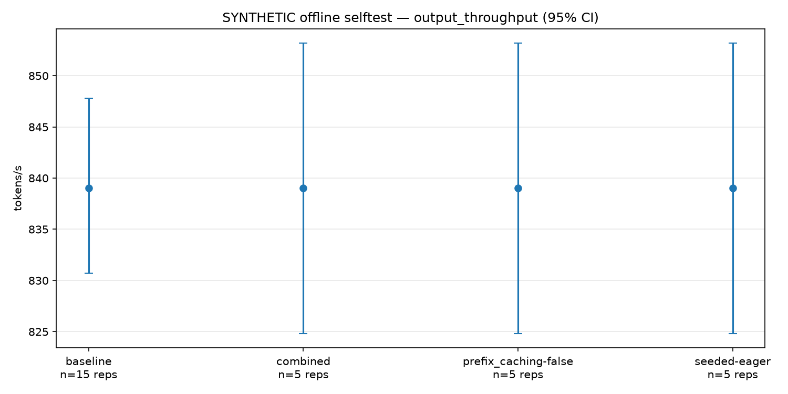
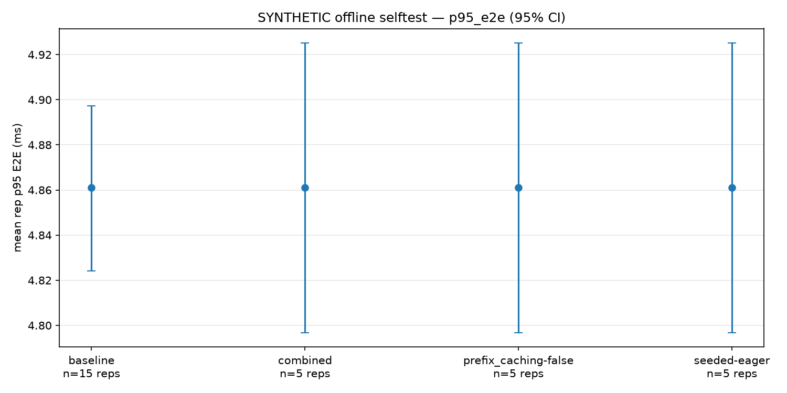

# InferencePilot experiment report

SYNTHETIC offline selftest

**Evidence scope:** not run (needs GPU). Synthetic experiments are demonstrations only.

## Environment

```json
{
  "cpu": "Apple M2",
  "cuda_driver_report": {
    "available": true,
    "output": "FAKE GPU: offline synthetic environment"
  },
  "cuda_runtime_note": "read from torch/version.py without importing torch; null if unavailable",
  "cuda_runtime_version": null,
  "git": {
    "available": true,
    "output": "9a724f6821d5403878277d6717a2477d3b3ada22"
  },
  "gpu": {
    "available": true,
    "output": "FAKE GPU: offline synthetic environment"
  },
  "lm_eval_version": null,
  "pip_freeze_sha256": "f08115d6707398fa13c4db38cbfd9f69f83b1f2f65704447b8d019b897a38d24",
  "platform": "macOS-26.7.4-arm64-arm-64bit",
  "python": "3.12.9",
  "ram_bytes": 8589934592,
  "torch_version": null,
  "vast": {},
  "vllm_version": null
}
```

## Requested and resolved configurations

| Label / role | Requested | Actual launch / status / resolved |
|---|---|---|
| baseline / baseline | `{"chunked_prefill": true, "dtype": "bfloat16", "enforce_eager": false, "gpu_memory_utilization": 0.9, "host": "127.0.0.1", "kv_cache_dtype": "auto", "max_model_len": 8192, "max_num_batched_tokens": 8192, "max_num_seqs": 256, "model": "Qwen/Qwen3-8B", "port": 61221, "prefix_caching": true, "quantization": null, "seed": 0, "variant": "bf16"}` | `[{"error": null, "id": "2f4e5c4509244db0b8c5236d50177ec6", "log_path": "/Users/yaswanth/Desktop/InferencePilot/data/offline-demo-m8-final/logs/2f4e5c4509244db0b8c5236d50177ec6.log", "resolved_args": "{\"attention_backend\": \"FAKE\", \"chunked_prefill\": true, \"cuda_graph_mode\": \"FULL_AND_PIECEWISE\", \"enforce_eager\": false, \"kv_cache_dtype\": \"auto\", \"kv_cache_tokens\": 65536, \"max_concurrency\": 8.0, \"max_concurrency_tokens_per_request\": 8192, \"max_model_len\": 8192, \"max_num_batched_tokens\": 8192, \"parser_status\": \"provisional\", \"prefix_caching\": true, \"quantization\": null, \"raw_matched_lines\": [\"PROVISIONAL resolved config: {\\\"model\\\": \\\"Qwen/Qwen3-8B\\\", \\\"max_model_len\\\": 8192, \\\"enable_prefix_caching\\\": true, \\\"enable_chunked_prefill\\\": true, \\\"kv_cache_dtype\\\": \\\"auto\\\", \\\"max_num_batched_tokens\\\": 8192, \\\"quantization\\\": null, \\\"enforce_eager\\\": false}\", \"INFO [core.py:0] Initializing a V1 LLM engine (vFAKE) with config: model='Qwen/Qwen3-8B', max_seq_len=8192, quantization=None, enforce_eager=False, enable_prefix_caching=True, enable_chunked_prefill=True\", \"INFO [scheduler.py:0] Chunked prefill is enabled with max_num_batched_tokens=8192.\", \"INFO [kv_cache_utils.py:0] GPU KV cache size: 65,536 tokens\", \"INFO [kv_cache_utils.py:0] Maximum concurrency for 8,192 tokens per request: 8.00x\", \"INFO [backend.py:0] Using FAKE attention backend\", \"INFO compilation_config={\\\"cudagraph_mode\\\": \\\"FULL_AND_PIECEWISE\\\"}\"], \"schedule_slot\": 0}", "status": "ok"}, {"error": null, "id": "93ffb15f80494bd9a720da6987d4e81f", "log_path": "/Users/yaswanth/Desktop/InferencePilot/data/offline-demo-m8-final/logs/93ffb15f80494bd9a720da6987d4e81f.log", "resolved_args": "{\"attention_backend\": \"FAKE\", \"chunked_prefill\": true, \"cuda_graph_mode\": \"FULL_AND_PIECEWISE\", \"enforce_eager\": false, \"kv_cache_dtype\": \"auto\", \"kv_cache_tokens\": 65536, \"max_concurrency\": 8.0, \"max_concurrency_tokens_per_request\": 8192, \"max_model_len\": 8192, \"max_num_batched_tokens\": 8192, \"parser_status\": \"provisional\", \"prefix_caching\": true, \"quantization\": null, \"raw_matched_lines\": [\"PROVISIONAL resolved config: {\\\"model\\\": \\\"Qwen/Qwen3-8B\\\", \\\"max_model_len\\\": 8192, \\\"enable_prefix_caching\\\": true, \\\"enable_chunked_prefill\\\": true, \\\"kv_cache_dtype\\\": \\\"auto\\\", \\\"max_num_batched_tokens\\\": 8192, \\\"quantization\\\": null, \\\"enforce_eager\\\": false}\", \"INFO [core.py:0] Initializing a V1 LLM engine (vFAKE) with config: model='Qwen/Qwen3-8B', max_seq_len=8192, quantization=None, enforce_eager=False, enable_prefix_caching=True, enable_chunked_prefill=True\", \"INFO [scheduler.py:0] Chunked prefill is enabled with max_num_batched_tokens=8192.\", \"INFO [kv_cache_utils.py:0] GPU KV cache size: 65,536 tokens\", \"INFO [kv_cache_utils.py:0] Maximum concurrency for 8,192 tokens per request: 8.00x\", \"INFO [backend.py:0] Using FAKE attention backend\", \"INFO compilation_config={\\\"cudagraph_mode\\\": \\\"FULL_AND_PIECEWISE\\\"}\"], \"schedule_slot\": 3}", "status": "ok"}, {"error": null, "id": "6232005a4b634e859a055eb2d2682bd6", "log_path": "/Users/yaswanth/Desktop/InferencePilot/data/offline-demo-m8-final/logs/6232005a4b634e859a055eb2d2682bd6.log", "resolved_args": "{\"attention_backend\": \"FAKE\", \"chunked_prefill\": true, \"cuda_graph_mode\": \"FULL_AND_PIECEWISE\", \"enforce_eager\": false, \"kv_cache_dtype\": \"auto\", \"kv_cache_tokens\": 65536, \"max_concurrency\": 8.0, \"max_concurrency_tokens_per_request\": 8192, \"max_model_len\": 8192, \"max_num_batched_tokens\": 8192, \"parser_status\": \"provisional\", \"prefix_caching\": true, \"quantization\": null, \"raw_matched_lines\": [\"PROVISIONAL resolved config: {\\\"model\\\": \\\"Qwen/Qwen3-8B\\\", \\\"max_model_len\\\": 8192, \\\"enable_prefix_caching\\\": true, \\\"enable_chunked_prefill\\\": true, \\\"kv_cache_dtype\\\": \\\"auto\\\", \\\"max_num_batched_tokens\\\": 8192, \\\"quantization\\\": null, \\\"enforce_eager\\\": false}\", \"INFO [core.py:0] Initializing a V1 LLM engine (vFAKE) with config: model='Qwen/Qwen3-8B', max_seq_len=8192, quantization=None, enforce_eager=False, enable_prefix_caching=True, enable_chunked_prefill=True\", \"INFO [scheduler.py:0] Chunked prefill is enabled with max_num_batched_tokens=8192.\", \"INFO [kv_cache_utils.py:0] GPU KV cache size: 65,536 tokens\", \"INFO [kv_cache_utils.py:0] Maximum concurrency for 8,192 tokens per request: 8.00x\", \"INFO [backend.py:0] Using FAKE attention backend\", \"INFO compilation_config={\\\"cudagraph_mode\\\": \\\"FULL_AND_PIECEWISE\\\"}\"], \"schedule_slot\": 5}", "status": "ok"}]` |
| combined / combined | `{"chunked_prefill": true, "dtype": "bfloat16", "enforce_eager": false, "gpu_memory_utilization": 0.9, "host": "127.0.0.1", "kv_cache_dtype": "auto", "max_model_len": 8192, "max_num_batched_tokens": 8192, "max_num_seqs": 256, "model": "Qwen/Qwen3-8B", "port": 61221, "prefix_caching": true, "quantization": null, "seed": 0, "variant": "bf16"}` | `[{"error": null, "id": "9851682b5e1941d180549f2f4f000828", "log_path": "/Users/yaswanth/Desktop/InferencePilot/data/offline-demo-m8-final/logs/9851682b5e1941d180549f2f4f000828.log", "resolved_args": "{\"attention_backend\": \"FAKE\", \"chunked_prefill\": true, \"cuda_graph_mode\": \"FULL_AND_PIECEWISE\", \"enforce_eager\": false, \"kv_cache_dtype\": \"auto\", \"kv_cache_tokens\": 65536, \"max_concurrency\": 8.0, \"max_concurrency_tokens_per_request\": 8192, \"max_model_len\": 8192, \"max_num_batched_tokens\": 8192, \"parser_status\": \"provisional\", \"prefix_caching\": true, \"quantization\": null, \"raw_matched_lines\": [\"PROVISIONAL resolved config: {\\\"model\\\": \\\"Qwen/Qwen3-8B\\\", \\\"max_model_len\\\": 8192, \\\"enable_prefix_caching\\\": true, \\\"enable_chunked_prefill\\\": true, \\\"kv_cache_dtype\\\": \\\"auto\\\", \\\"max_num_batched_tokens\\\": 8192, \\\"quantization\\\": null, \\\"enforce_eager\\\": false}\", \"INFO [core.py:0] Initializing a V1 LLM engine (vFAKE) with config: model='Qwen/Qwen3-8B', max_seq_len=8192, quantization=None, enforce_eager=False, enable_prefix_caching=True, enable_chunked_prefill=True\", \"INFO [scheduler.py:0] Chunked prefill is enabled with max_num_batched_tokens=8192.\", \"INFO [kv_cache_utils.py:0] GPU KV cache size: 65,536 tokens\", \"INFO [kv_cache_utils.py:0] Maximum concurrency for 8,192 tokens per request: 8.00x\", \"INFO [backend.py:0] Using FAKE attention backend\", \"INFO compilation_config={\\\"cudagraph_mode\\\": \\\"FULL_AND_PIECEWISE\\\"}\"], \"schedule_slot\": 2}", "status": "ok"}]` |
| prefix_caching-false / candidate | `{"chunked_prefill": true, "dtype": "bfloat16", "enforce_eager": false, "gpu_memory_utilization": 0.9, "host": "127.0.0.1", "kv_cache_dtype": "auto", "max_model_len": 8192, "max_num_batched_tokens": 8192, "max_num_seqs": 256, "model": "Qwen/Qwen3-8B", "port": 61221, "prefix_caching": false, "quantization": null, "seed": 0, "variant": "bf16"}` | `[{"error": null, "id": "57467011dcf446cdbe8421a9d8699be6", "log_path": "/Users/yaswanth/Desktop/InferencePilot/data/offline-demo-m8-final/logs/57467011dcf446cdbe8421a9d8699be6.log", "resolved_args": "{\"attention_backend\": \"FAKE\", \"chunked_prefill\": true, \"cuda_graph_mode\": \"FULL_AND_PIECEWISE\", \"enforce_eager\": false, \"kv_cache_dtype\": \"auto\", \"kv_cache_tokens\": 65536, \"max_concurrency\": 8.0, \"max_concurrency_tokens_per_request\": 8192, \"max_model_len\": 8192, \"max_num_batched_tokens\": 8192, \"parser_status\": \"provisional\", \"prefix_caching\": false, \"quantization\": null, \"raw_matched_lines\": [\"PROVISIONAL resolved config: {\\\"model\\\": \\\"Qwen/Qwen3-8B\\\", \\\"max_model_len\\\": 8192, \\\"enable_prefix_caching\\\": false, \\\"enable_chunked_prefill\\\": true, \\\"kv_cache_dtype\\\": \\\"auto\\\", \\\"max_num_batched_tokens\\\": 8192, \\\"quantization\\\": null, \\\"enforce_eager\\\": false}\", \"INFO [core.py:0] Initializing a V1 LLM engine (vFAKE) with config: model='Qwen/Qwen3-8B', max_seq_len=8192, quantization=None, enforce_eager=False, enable_prefix_caching=False, enable_chunked_prefill=True\", \"INFO [scheduler.py:0] Chunked prefill is enabled with max_num_batched_tokens=8192.\", \"INFO [kv_cache_utils.py:0] GPU KV cache size: 65,536 tokens\", \"INFO [kv_cache_utils.py:0] Maximum concurrency for 8,192 tokens per request: 8.00x\", \"INFO [backend.py:0] Using FAKE attention backend\", \"INFO compilation_config={\\\"cudagraph_mode\\\": \\\"FULL_AND_PIECEWISE\\\"}\"], \"schedule_slot\": 1}", "status": "ok"}]` |
| seeded-eager / seeded_regression | `{"chunked_prefill": true, "dtype": "bfloat16", "enforce_eager": true, "gpu_memory_utilization": 0.9, "host": "127.0.0.1", "kv_cache_dtype": "auto", "max_model_len": 8192, "max_num_batched_tokens": 8192, "max_num_seqs": 256, "model": "Qwen/Qwen3-8B", "port": 61221, "prefix_caching": true, "quantization": null, "seed": 0, "variant": "bf16"}` | `[{"error": null, "id": "34ea60ecf1d544f785d8c583e2cf2fe2", "log_path": "/Users/yaswanth/Desktop/InferencePilot/data/offline-demo-m8-final/logs/34ea60ecf1d544f785d8c583e2cf2fe2.log", "resolved_args": "{\"attention_backend\": \"FAKE\", \"chunked_prefill\": true, \"cuda_graph_mode\": \"NONE\", \"enforce_eager\": true, \"kv_cache_dtype\": \"auto\", \"kv_cache_tokens\": 65536, \"max_concurrency\": 8.0, \"max_concurrency_tokens_per_request\": 8192, \"max_model_len\": 8192, \"max_num_batched_tokens\": 8192, \"parser_status\": \"provisional\", \"prefix_caching\": true, \"quantization\": null, \"raw_matched_lines\": [\"PROVISIONAL resolved config: {\\\"model\\\": \\\"Qwen/Qwen3-8B\\\", \\\"max_model_len\\\": 8192, \\\"enable_prefix_caching\\\": true, \\\"enable_chunked_prefill\\\": true, \\\"kv_cache_dtype\\\": \\\"auto\\\", \\\"max_num_batched_tokens\\\": 8192, \\\"quantization\\\": null, \\\"enforce_eager\\\": true}\", \"INFO [core.py:0] Initializing a V1 LLM engine (vFAKE) with config: model='Qwen/Qwen3-8B', max_seq_len=8192, quantization=None, enforce_eager=True, enable_prefix_caching=True, enable_chunked_prefill=True\", \"INFO [scheduler.py:0] Chunked prefill is enabled with max_num_batched_tokens=8192.\", \"INFO [kv_cache_utils.py:0] GPU KV cache size: 65,536 tokens\", \"INFO [kv_cache_utils.py:0] Maximum concurrency for 8,192 tokens per request: 8.00x\", \"INFO [backend.py:0] Using FAKE attention backend\", \"INFO compilation_config={\\\"cudagraph_mode\\\": \\\"NONE\\\"}\"], \"schedule_slot\": 4}", "status": "ok"}]` |
| weights-awq / candidate | `{"chunked_prefill": true, "dtype": "bfloat16", "enforce_eager": false, "gpu_memory_utilization": 0.9, "host": "127.0.0.1", "kv_cache_dtype": "auto", "max_model_len": 8192, "max_num_batched_tokens": 8192, "max_num_seqs": 256, "model": "Qwen/Qwen3-8B-AWQ", "port": 61221, "prefix_caching": true, "quantization": "awq", "seed": 0, "variant": "awq"}` | `[]` |

## Per-workload metrics

Mean of rep statistics; 95% bootstrap CI. n is the number of reps, not independent requests.

| Config | Workload / mode / load | Metric | Mean (n reps) | CI low / high | Launches |
|---|---|---|---|---|---|
| baseline | chat:closed:1 | request_throughput | 209.752 (n=15) | 207.677 (n=15) / 211.953 (n=15) | 3 |
| baseline | chat:closed:1 | output_throughput | 839.008 (n=15) | 830.71 (n=15) / 847.814 (n=15) | 3 |
| baseline | chat:closed:1 | goodput | 209.752 (n=15) | 207.677 (n=15) / 211.953 (n=15) | 3 |
| baseline | chat:closed:1 | p95_e2e | 4.86098 (n=15) | 4.82416 (n=15) / 4.8972 (n=15) | 3 |
| baseline | chat:closed:1 | p95_itl_pooled | 1.06847 (n=15) | 1.05505 (n=15) / 1.07997 (n=15) | 3 |
| baseline | chat:closed:1 | p95_tpot_per_request | 1.01979 (n=15) | 1.0037 (n=15) / 1.03424 (n=15) | 3 |
| baseline | chat:closed:1 | p95_ttft | 1.80686 (n=15) | 1.77587 (n=15) / 1.8363 (n=15) | 3 |
| baseline | chat:open:104.87602151392143 | request_throughput | 139.46 (n=15) | 138.701 (n=15) / 140.319 (n=15) | 3 |
| baseline | chat:open:104.87602151392143 | output_throughput | 557.839 (n=15) | 554.805 (n=15) / 561.276 (n=15) | 3 |
| baseline | chat:open:104.87602151392143 | goodput | 139.46 (n=15) | 138.701 (n=15) / 140.319 (n=15) | 3 |
| baseline | chat:open:104.87602151392143 | p95_e2e | 4.86098 (n=15) | 4.82416 (n=15) / 4.8972 (n=15) | 3 |
| baseline | chat:open:104.87602151392143 | p95_itl_pooled | 1.06847 (n=15) | 1.05505 (n=15) / 1.07997 (n=15) | 3 |
| baseline | chat:open:104.87602151392143 | p95_tpot_per_request | 1.01979 (n=15) | 1.0037 (n=15) / 1.03424 (n=15) | 3 |
| baseline | chat:open:104.87602151392143 | p95_ttft | 1.80686 (n=15) | 1.77587 (n=15) / 1.8363 (n=15) | 3 |
| baseline | chat:open:167.8016344222743 | request_throughput | 185.791 (n=15) | 184.44 (n=15) / 187.322 (n=15) | 3 |
| baseline | chat:open:167.8016344222743 | output_throughput | 743.165 (n=15) | 737.759 (n=15) / 749.289 (n=15) | 3 |
| baseline | chat:open:167.8016344222743 | goodput | 185.791 (n=15) | 184.44 (n=15) / 187.322 (n=15) | 3 |
| baseline | chat:open:167.8016344222743 | p95_e2e | 4.86098 (n=15) | 4.82416 (n=15) / 4.8972 (n=15) | 3 |
| baseline | chat:open:167.8016344222743 | p95_itl_pooled | 1.06847 (n=15) | 1.05505 (n=15) / 1.07997 (n=15) | 3 |
| baseline | chat:open:167.8016344222743 | p95_tpot_per_request | 1.01979 (n=15) | 1.0037 (n=15) / 1.03424 (n=15) | 3 |
| baseline | chat:open:167.8016344222743 | p95_ttft | 1.80686 (n=15) | 1.77587 (n=15) / 1.8363 (n=15) | 3 |
| baseline | chat:open:199.26444087645072 | request_throughput | 203.592 (n=15) | 201.968 (n=15) / 205.433 (n=15) | 3 |
| baseline | chat:open:199.26444087645072 | output_throughput | 814.369 (n=15) | 807.872 (n=15) / 821.734 (n=15) | 3 |
| baseline | chat:open:199.26444087645072 | goodput | 203.592 (n=15) | 201.968 (n=15) / 205.433 (n=15) | 3 |
| baseline | chat:open:199.26444087645072 | p95_e2e | 4.86098 (n=15) | 4.82416 (n=15) / 4.8972 (n=15) | 3 |
| baseline | chat:open:199.26444087645072 | p95_itl_pooled | 1.06847 (n=15) | 1.05505 (n=15) / 1.07997 (n=15) | 3 |
| baseline | chat:open:199.26444087645072 | p95_tpot_per_request | 1.01979 (n=15) | 1.0037 (n=15) / 1.03424 (n=15) | 3 |
| baseline | chat:open:199.26444087645072 | p95_ttft | 1.80686 (n=15) | 1.77587 (n=15) / 1.8363 (n=15) | 3 |
| combined | chat:closed:1 | request_throughput | 209.752 (n=5) | 206.208 (n=5) / 213.296 (n=5) | 1 |
| combined | chat:closed:1 | output_throughput | 839.008 (n=5) | 824.832 (n=5) / 853.184 (n=5) | 1 |
| combined | chat:closed:1 | goodput | 209.752 (n=5) | 206.208 (n=5) / 213.296 (n=5) | 1 |
| combined | chat:closed:1 | p95_e2e | 4.86098 (n=5) | 4.79682 (n=5) / 4.92514 (n=5) | 1 |
| combined | chat:closed:1 | p95_itl_pooled | 1.06847 (n=5) | 1.04345 (n=5) / 1.08562 (n=5) | 1 |
| combined | chat:closed:1 | p95_tpot_per_request | 1.01979 (n=5) | 0.990748 (n=5) / 1.04379 (n=5) | 1 |
| combined | chat:closed:1 | p95_ttft | 1.80686 (n=5) | 1.75529 (n=5) / 1.85611 (n=5) | 1 |
| combined | chat:open:104.87602151392143 | request_throughput | 139.46 (n=5) | 138.286 (n=5) / 140.973 (n=5) | 1 |
| combined | chat:open:104.87602151392143 | output_throughput | 557.839 (n=5) | 553.143 (n=5) / 563.894 (n=5) | 1 |
| combined | chat:open:104.87602151392143 | goodput | 139.46 (n=5) | 138.286 (n=5) / 140.973 (n=5) | 1 |
| combined | chat:open:104.87602151392143 | p95_e2e | 4.86098 (n=5) | 4.79682 (n=5) / 4.92514 (n=5) | 1 |
| combined | chat:open:104.87602151392143 | p95_itl_pooled | 1.06847 (n=5) | 1.04345 (n=5) / 1.08562 (n=5) | 1 |
| combined | chat:open:104.87602151392143 | p95_tpot_per_request | 1.01979 (n=5) | 0.990748 (n=5) / 1.04379 (n=5) | 1 |
| combined | chat:open:104.87602151392143 | p95_ttft | 1.80686 (n=5) | 1.75529 (n=5) / 1.85611 (n=5) | 1 |
| combined | chat:open:167.8016344222743 | request_throughput | 185.791 (n=5) | 183.704 (n=5) / 188.491 (n=5) | 1 |
| combined | chat:open:167.8016344222743 | output_throughput | 743.165 (n=5) | 734.815 (n=5) / 753.964 (n=5) | 1 |
| combined | chat:open:167.8016344222743 | goodput | 185.791 (n=5) | 183.704 (n=5) / 188.491 (n=5) | 1 |
| combined | chat:open:167.8016344222743 | p95_e2e | 4.86098 (n=5) | 4.79682 (n=5) / 4.92514 (n=5) | 1 |
| combined | chat:open:167.8016344222743 | p95_itl_pooled | 1.06847 (n=5) | 1.04345 (n=5) / 1.08562 (n=5) | 1 |
| combined | chat:open:167.8016344222743 | p95_tpot_per_request | 1.01979 (n=5) | 0.990748 (n=5) / 1.04379 (n=5) | 1 |
| combined | chat:open:167.8016344222743 | p95_ttft | 1.80686 (n=5) | 1.75529 (n=5) / 1.85611 (n=5) | 1 |
| combined | chat:open:199.26444087645072 | request_throughput | 203.592 (n=5) | 201.084 (n=5) / 206.84 (n=5) | 1 |
| combined | chat:open:199.26444087645072 | output_throughput | 814.369 (n=5) | 804.335 (n=5) / 827.361 (n=5) | 1 |
| combined | chat:open:199.26444087645072 | goodput | 203.592 (n=5) | 201.084 (n=5) / 206.84 (n=5) | 1 |
| combined | chat:open:199.26444087645072 | p95_e2e | 4.86098 (n=5) | 4.79682 (n=5) / 4.92514 (n=5) | 1 |
| combined | chat:open:199.26444087645072 | p95_itl_pooled | 1.06847 (n=5) | 1.04345 (n=5) / 1.08562 (n=5) | 1 |
| combined | chat:open:199.26444087645072 | p95_tpot_per_request | 1.01979 (n=5) | 0.990748 (n=5) / 1.04379 (n=5) | 1 |
| combined | chat:open:199.26444087645072 | p95_ttft | 1.80686 (n=5) | 1.75529 (n=5) / 1.85611 (n=5) | 1 |
| prefix_caching-false | chat:closed:1 | request_throughput | 209.752 (n=5) | 206.208 (n=5) / 213.296 (n=5) | 1 |
| prefix_caching-false | chat:closed:1 | output_throughput | 839.008 (n=5) | 824.832 (n=5) / 853.184 (n=5) | 1 |
| prefix_caching-false | chat:closed:1 | goodput | 209.752 (n=5) | 206.208 (n=5) / 213.296 (n=5) | 1 |
| prefix_caching-false | chat:closed:1 | p95_e2e | 4.86098 (n=5) | 4.79682 (n=5) / 4.92514 (n=5) | 1 |
| prefix_caching-false | chat:closed:1 | p95_itl_pooled | 1.06847 (n=5) | 1.04345 (n=5) / 1.08562 (n=5) | 1 |
| prefix_caching-false | chat:closed:1 | p95_tpot_per_request | 1.01979 (n=5) | 0.990748 (n=5) / 1.04379 (n=5) | 1 |
| prefix_caching-false | chat:closed:1 | p95_ttft | 1.80686 (n=5) | 1.75529 (n=5) / 1.85611 (n=5) | 1 |
| prefix_caching-false | chat:open:104.87602151392143 | request_throughput | 139.46 (n=5) | 138.286 (n=5) / 140.973 (n=5) | 1 |
| prefix_caching-false | chat:open:104.87602151392143 | output_throughput | 557.839 (n=5) | 553.143 (n=5) / 563.894 (n=5) | 1 |
| prefix_caching-false | chat:open:104.87602151392143 | goodput | 139.46 (n=5) | 138.286 (n=5) / 140.973 (n=5) | 1 |
| prefix_caching-false | chat:open:104.87602151392143 | p95_e2e | 4.86098 (n=5) | 4.79682 (n=5) / 4.92514 (n=5) | 1 |
| prefix_caching-false | chat:open:104.87602151392143 | p95_itl_pooled | 1.06847 (n=5) | 1.04345 (n=5) / 1.08562 (n=5) | 1 |
| prefix_caching-false | chat:open:104.87602151392143 | p95_tpot_per_request | 1.01979 (n=5) | 0.990748 (n=5) / 1.04379 (n=5) | 1 |
| prefix_caching-false | chat:open:104.87602151392143 | p95_ttft | 1.80686 (n=5) | 1.75529 (n=5) / 1.85611 (n=5) | 1 |
| prefix_caching-false | chat:open:167.8016344222743 | request_throughput | 185.791 (n=5) | 183.704 (n=5) / 188.491 (n=5) | 1 |
| prefix_caching-false | chat:open:167.8016344222743 | output_throughput | 743.165 (n=5) | 734.815 (n=5) / 753.964 (n=5) | 1 |
| prefix_caching-false | chat:open:167.8016344222743 | goodput | 185.791 (n=5) | 183.704 (n=5) / 188.491 (n=5) | 1 |
| prefix_caching-false | chat:open:167.8016344222743 | p95_e2e | 4.86098 (n=5) | 4.79682 (n=5) / 4.92514 (n=5) | 1 |
| prefix_caching-false | chat:open:167.8016344222743 | p95_itl_pooled | 1.06847 (n=5) | 1.04345 (n=5) / 1.08562 (n=5) | 1 |
| prefix_caching-false | chat:open:167.8016344222743 | p95_tpot_per_request | 1.01979 (n=5) | 0.990748 (n=5) / 1.04379 (n=5) | 1 |
| prefix_caching-false | chat:open:167.8016344222743 | p95_ttft | 1.80686 (n=5) | 1.75529 (n=5) / 1.85611 (n=5) | 1 |
| prefix_caching-false | chat:open:199.26444087645072 | request_throughput | 203.592 (n=5) | 201.084 (n=5) / 206.84 (n=5) | 1 |
| prefix_caching-false | chat:open:199.26444087645072 | output_throughput | 814.369 (n=5) | 804.335 (n=5) / 827.361 (n=5) | 1 |
| prefix_caching-false | chat:open:199.26444087645072 | goodput | 203.592 (n=5) | 201.084 (n=5) / 206.84 (n=5) | 1 |
| prefix_caching-false | chat:open:199.26444087645072 | p95_e2e | 4.86098 (n=5) | 4.79682 (n=5) / 4.92514 (n=5) | 1 |
| prefix_caching-false | chat:open:199.26444087645072 | p95_itl_pooled | 1.06847 (n=5) | 1.04345 (n=5) / 1.08562 (n=5) | 1 |
| prefix_caching-false | chat:open:199.26444087645072 | p95_tpot_per_request | 1.01979 (n=5) | 0.990748 (n=5) / 1.04379 (n=5) | 1 |
| prefix_caching-false | chat:open:199.26444087645072 | p95_ttft | 1.80686 (n=5) | 1.75529 (n=5) / 1.85611 (n=5) | 1 |
| seeded-eager | chat:closed:1 | request_throughput | 209.752 (n=5) | 206.208 (n=5) / 213.296 (n=5) | 1 |
| seeded-eager | chat:closed:1 | output_throughput | 839.008 (n=5) | 824.832 (n=5) / 853.184 (n=5) | 1 |
| seeded-eager | chat:closed:1 | goodput | 209.752 (n=5) | 206.208 (n=5) / 213.296 (n=5) | 1 |
| seeded-eager | chat:closed:1 | p95_e2e | 4.86098 (n=5) | 4.79682 (n=5) / 4.92514 (n=5) | 1 |
| seeded-eager | chat:closed:1 | p95_itl_pooled | 1.06847 (n=5) | 1.04345 (n=5) / 1.08562 (n=5) | 1 |
| seeded-eager | chat:closed:1 | p95_tpot_per_request | 1.01979 (n=5) | 0.990748 (n=5) / 1.04379 (n=5) | 1 |
| seeded-eager | chat:closed:1 | p95_ttft | 1.80686 (n=5) | 1.75529 (n=5) / 1.85611 (n=5) | 1 |
| seeded-eager | chat:open:104.87602151392143 | request_throughput | 139.46 (n=5) | 138.286 (n=5) / 140.973 (n=5) | 1 |
| seeded-eager | chat:open:104.87602151392143 | output_throughput | 557.839 (n=5) | 553.143 (n=5) / 563.894 (n=5) | 1 |
| seeded-eager | chat:open:104.87602151392143 | goodput | 139.46 (n=5) | 138.286 (n=5) / 140.973 (n=5) | 1 |
| seeded-eager | chat:open:104.87602151392143 | p95_e2e | 4.86098 (n=5) | 4.79682 (n=5) / 4.92514 (n=5) | 1 |
| seeded-eager | chat:open:104.87602151392143 | p95_itl_pooled | 1.06847 (n=5) | 1.04345 (n=5) / 1.08562 (n=5) | 1 |
| seeded-eager | chat:open:104.87602151392143 | p95_tpot_per_request | 1.01979 (n=5) | 0.990748 (n=5) / 1.04379 (n=5) | 1 |
| seeded-eager | chat:open:104.87602151392143 | p95_ttft | 1.80686 (n=5) | 1.75529 (n=5) / 1.85611 (n=5) | 1 |
| seeded-eager | chat:open:167.8016344222743 | request_throughput | 185.791 (n=5) | 183.704 (n=5) / 188.491 (n=5) | 1 |
| seeded-eager | chat:open:167.8016344222743 | output_throughput | 743.165 (n=5) | 734.815 (n=5) / 753.964 (n=5) | 1 |
| seeded-eager | chat:open:167.8016344222743 | goodput | 185.791 (n=5) | 183.704 (n=5) / 188.491 (n=5) | 1 |
| seeded-eager | chat:open:167.8016344222743 | p95_e2e | 4.86098 (n=5) | 4.79682 (n=5) / 4.92514 (n=5) | 1 |
| seeded-eager | chat:open:167.8016344222743 | p95_itl_pooled | 1.06847 (n=5) | 1.04345 (n=5) / 1.08562 (n=5) | 1 |
| seeded-eager | chat:open:167.8016344222743 | p95_tpot_per_request | 1.01979 (n=5) | 0.990748 (n=5) / 1.04379 (n=5) | 1 |
| seeded-eager | chat:open:167.8016344222743 | p95_ttft | 1.80686 (n=5) | 1.75529 (n=5) / 1.85611 (n=5) | 1 |
| seeded-eager | chat:open:199.26444087645072 | request_throughput | 203.592 (n=5) | 201.084 (n=5) / 206.84 (n=5) | 1 |
| seeded-eager | chat:open:199.26444087645072 | output_throughput | 814.369 (n=5) | 804.335 (n=5) / 827.361 (n=5) | 1 |
| seeded-eager | chat:open:199.26444087645072 | goodput | 203.592 (n=5) | 201.084 (n=5) / 206.84 (n=5) | 1 |
| seeded-eager | chat:open:199.26444087645072 | p95_e2e | 4.86098 (n=5) | 4.79682 (n=5) / 4.92514 (n=5) | 1 |
| seeded-eager | chat:open:199.26444087645072 | p95_itl_pooled | 1.06847 (n=5) | 1.04345 (n=5) / 1.08562 (n=5) | 1 |
| seeded-eager | chat:open:199.26444087645072 | p95_tpot_per_request | 1.01979 (n=5) | 0.990748 (n=5) / 1.04379 (n=5) | 1 |
| seeded-eager | chat:open:199.26444087645072 | p95_ttft | 1.80686 (n=5) | 1.75529 (n=5) / 1.85611 (n=5) | 1 |

Excluded reps: `[]`

## Regression evidence

| Candidate | Point | Metric | Effect % / CI % | Adjusted p | MDE % | Baseline / candidate reps | Verdict |
|---|---|---|---|---|---|---|---|
| combined | chat:closed:1 | goodput | 0.0 / [-1.9888720455618971, 2.0951187403926723] | 1.0 | 3.2204717372222937 | 15 / 5 | no_change |
| combined | chat:closed:1 | output_throughput | 0.0 / [-1.9575047393727572, 2.0531122162863062] | 1.0 | 3.2204717372222937 | 15 / 5 | no_change |
| combined | chat:closed:1 | p95_e2e | 0.0 / [-1.4793688388213613, 1.4747547910656849] | 1.0 | 2.3920526811818434 | 15 / 5 | no_change |
| combined | chat:closed:1 | p95_itl_pooled | 0.0 / [-2.5477975443594927, 2.097970760424607] | 1.0 | 3.767644643490045 | 15 / 5 | no_change |
| combined | chat:closed:1 | p95_tpot_per_request | 2.220446049250313e-14 / [-3.0857981247447066, 2.810942366691553] | 1.0 | 4.818223910609215 | 15 / 5 | no_change |
| combined | chat:closed:1 | p95_ttft | 0.0 / [-3.382053863964493, 3.2928771671191472] | 1.0 | 5.41616401236776 | 15 / 5 | inconclusive |
| combined | chat:closed:1 | request_throughput | 0.0 / [-1.8929797288196548, 2.079991866126119] | 1.0 | 3.2204717372222937 | 15 / 5 | no_change |
| combined | chat:open:104.87602151392143 | goodput | 0.0 / [-1.093891141837457, 1.210716438395548] | 1.0 | 1.8678544561775967 | 15 / 5 | no_change |
| combined | chat:open:104.87602151392143 | output_throughput | 0.0 / [-1.111452460065898, 1.2748046993058226] | 1.0 | 1.8678544561775967 | 15 / 5 | no_change |
| combined | chat:open:104.87602151392143 | p95_e2e | 0.0 / [-1.492521810598959, 1.4729318752922183] | 1.0 | 2.3920526811818434 | 15 / 5 | no_change |
| combined | chat:open:104.87602151392143 | p95_itl_pooled | 0.0 / [-2.4841539362052596, 2.140009661565363] | 1.0 | 3.767644643490045 | 15 / 5 | no_change |
| combined | chat:open:104.87602151392143 | p95_tpot_per_request | 2.220446049250313e-14 / [-3.179799119244258, 2.8759017695290723] | 1.0 | 4.818223910609215 | 15 / 5 | no_change |
| combined | chat:open:104.87602151392143 | p95_ttft | 0.0 / [-3.4456981136952907, 3.3333433980841267] | 1.0 | 5.41616401236776 | 15 / 5 | inconclusive |
| combined | chat:open:104.87602151392143 | request_throughput | 0.0 / [-1.0890222129106626, 1.243570183613159] | 1.0 | 1.8678544561775967 | 15 / 5 | no_change |
| combined | chat:open:167.8016344222743 | goodput | 2.220446049250313e-14 / [-1.4132702842681344, 1.6523823367890345] | 1.0 | 2.4979005382852866 | 15 / 5 | no_change |
| combined | chat:open:167.8016344222743 | output_throughput | 2.220446049250313e-14 / [-1.4121031291908999, 1.6653868630686741] | 1.0 | 2.4979005382852866 | 15 / 5 | no_change |
| combined | chat:open:167.8016344222743 | p95_e2e | 0.0 / [-1.4789329686963895, 1.4963752703800188] | 1.0 | 2.3920526811818434 | 15 / 5 | no_change |
| combined | chat:open:167.8016344222743 | p95_itl_pooled | 0.0 / [-2.566752483001889, 2.166411724733408] | 1.0 | 3.767644643490045 | 15 / 5 | no_change |
| combined | chat:open:167.8016344222743 | p95_tpot_per_request | 2.220446049250313e-14 / [-3.109308828571116, 2.774761840548497] | 1.0 | 4.818223910609215 | 15 / 5 | no_change |
| combined | chat:open:167.8016344222743 | p95_ttft | 0.0 / [-3.3955979503325566, 3.36376829309899] | 1.0 | 5.41616401236776 | 15 / 5 | inconclusive |
| combined | chat:open:167.8016344222743 | request_throughput | 2.220446049250313e-14 / [-1.422198189594268, 1.7003224145830766] | 1.0 | 2.4979005382852866 | 15 / 5 | no_change |
| combined | chat:open:199.26444087645072 | goodput | 2.220446049250313e-14 / [-1.602177611611174, 1.8300154433012752] | 1.0 | 2.7412466823092942 | 15 / 5 | no_change |
| combined | chat:open:199.26444087645072 | output_throughput | 2.220446049250313e-14 / [-1.5669464552097145, 1.83862637580512] | 1.0 | 2.7412466823092942 | 15 / 5 | no_change |
| combined | chat:open:199.26444087645072 | p95_e2e | 0.0 / [-1.4830791001262658, 1.454047361188794] | 1.0 | 2.3920526811818434 | 15 / 5 | no_change |
| combined | chat:open:199.26444087645072 | p95_itl_pooled | 0.0 / [-2.448029210981495, 2.1666156657069027] | 1.0 | 3.767644643490045 | 15 / 5 | no_change |
| combined | chat:open:199.26444087645072 | p95_tpot_per_request | 2.220446049250313e-14 / [-3.1208939138927025, 2.7635217459609356] | 1.0 | 4.818223910609215 | 15 / 5 | no_change |
| combined | chat:open:199.26444087645072 | p95_ttft | 0.0 / [-3.394360691323924, 3.2867528122734333] | 1.0 | 5.41616401236776 | 15 / 5 | inconclusive |
| combined | chat:open:199.26444087645072 | request_throughput | 2.220446049250313e-14 / [-1.597038645702297, 1.7944936854678284] | 1.0 | 2.7412466823092942 | 15 / 5 | no_change |
| prefix_caching-false | chat:closed:1 | goodput | 0.0 / [-1.9888720455618971, 2.0951187403926723] | 1.0 | 3.2204717372222937 | 15 / 5 | no_change |
| prefix_caching-false | chat:closed:1 | output_throughput | 0.0 / [-1.9575047393727572, 2.0531122162863062] | 1.0 | 3.2204717372222937 | 15 / 5 | no_change |
| prefix_caching-false | chat:closed:1 | p95_e2e | 0.0 / [-1.4793688388213613, 1.4747547910656849] | 1.0 | 2.3920526811818434 | 15 / 5 | no_change |
| prefix_caching-false | chat:closed:1 | p95_itl_pooled | 0.0 / [-2.5477975443594927, 2.097970760424607] | 1.0 | 3.767644643490045 | 15 / 5 | no_change |
| prefix_caching-false | chat:closed:1 | p95_tpot_per_request | 2.220446049250313e-14 / [-3.0857981247447066, 2.810942366691553] | 1.0 | 4.818223910609215 | 15 / 5 | no_change |
| prefix_caching-false | chat:closed:1 | p95_ttft | 0.0 / [-3.382053863964493, 3.2928771671191472] | 1.0 | 5.41616401236776 | 15 / 5 | inconclusive |
| prefix_caching-false | chat:closed:1 | request_throughput | 0.0 / [-1.8929797288196548, 2.079991866126119] | 1.0 | 3.2204717372222937 | 15 / 5 | no_change |
| prefix_caching-false | chat:open:104.87602151392143 | goodput | 0.0 / [-1.093891141837457, 1.210716438395548] | 1.0 | 1.8678544561775967 | 15 / 5 | no_change |
| prefix_caching-false | chat:open:104.87602151392143 | output_throughput | 0.0 / [-1.111452460065898, 1.2748046993058226] | 1.0 | 1.8678544561775967 | 15 / 5 | no_change |
| prefix_caching-false | chat:open:104.87602151392143 | p95_e2e | 0.0 / [-1.492521810598959, 1.4729318752922183] | 1.0 | 2.3920526811818434 | 15 / 5 | no_change |
| prefix_caching-false | chat:open:104.87602151392143 | p95_itl_pooled | 0.0 / [-2.4841539362052596, 2.140009661565363] | 1.0 | 3.767644643490045 | 15 / 5 | no_change |
| prefix_caching-false | chat:open:104.87602151392143 | p95_tpot_per_request | 2.220446049250313e-14 / [-3.179799119244258, 2.8759017695290723] | 1.0 | 4.818223910609215 | 15 / 5 | no_change |
| prefix_caching-false | chat:open:104.87602151392143 | p95_ttft | 0.0 / [-3.4456981136952907, 3.3333433980841267] | 1.0 | 5.41616401236776 | 15 / 5 | inconclusive |
| prefix_caching-false | chat:open:104.87602151392143 | request_throughput | 0.0 / [-1.0890222129106626, 1.243570183613159] | 1.0 | 1.8678544561775967 | 15 / 5 | no_change |
| prefix_caching-false | chat:open:167.8016344222743 | goodput | 2.220446049250313e-14 / [-1.4132702842681344, 1.6523823367890345] | 1.0 | 2.4979005382852866 | 15 / 5 | no_change |
| prefix_caching-false | chat:open:167.8016344222743 | output_throughput | 2.220446049250313e-14 / [-1.4121031291908999, 1.6653868630686741] | 1.0 | 2.4979005382852866 | 15 / 5 | no_change |
| prefix_caching-false | chat:open:167.8016344222743 | p95_e2e | 0.0 / [-1.4789329686963895, 1.4963752703800188] | 1.0 | 2.3920526811818434 | 15 / 5 | no_change |
| prefix_caching-false | chat:open:167.8016344222743 | p95_itl_pooled | 0.0 / [-2.566752483001889, 2.166411724733408] | 1.0 | 3.767644643490045 | 15 / 5 | no_change |
| prefix_caching-false | chat:open:167.8016344222743 | p95_tpot_per_request | 2.220446049250313e-14 / [-3.109308828571116, 2.774761840548497] | 1.0 | 4.818223910609215 | 15 / 5 | no_change |
| prefix_caching-false | chat:open:167.8016344222743 | p95_ttft | 0.0 / [-3.3955979503325566, 3.36376829309899] | 1.0 | 5.41616401236776 | 15 / 5 | inconclusive |
| prefix_caching-false | chat:open:167.8016344222743 | request_throughput | 2.220446049250313e-14 / [-1.422198189594268, 1.7003224145830766] | 1.0 | 2.4979005382852866 | 15 / 5 | no_change |
| prefix_caching-false | chat:open:199.26444087645072 | goodput | 2.220446049250313e-14 / [-1.602177611611174, 1.8300154433012752] | 1.0 | 2.7412466823092942 | 15 / 5 | no_change |
| prefix_caching-false | chat:open:199.26444087645072 | output_throughput | 2.220446049250313e-14 / [-1.5669464552097145, 1.83862637580512] | 1.0 | 2.7412466823092942 | 15 / 5 | no_change |
| prefix_caching-false | chat:open:199.26444087645072 | p95_e2e | 0.0 / [-1.4830791001262658, 1.454047361188794] | 1.0 | 2.3920526811818434 | 15 / 5 | no_change |
| prefix_caching-false | chat:open:199.26444087645072 | p95_itl_pooled | 0.0 / [-2.448029210981495, 2.1666156657069027] | 1.0 | 3.767644643490045 | 15 / 5 | no_change |
| prefix_caching-false | chat:open:199.26444087645072 | p95_tpot_per_request | 2.220446049250313e-14 / [-3.1208939138927025, 2.7635217459609356] | 1.0 | 4.818223910609215 | 15 / 5 | no_change |
| prefix_caching-false | chat:open:199.26444087645072 | p95_ttft | 0.0 / [-3.394360691323924, 3.2867528122734333] | 1.0 | 5.41616401236776 | 15 / 5 | inconclusive |
| prefix_caching-false | chat:open:199.26444087645072 | request_throughput | 2.220446049250313e-14 / [-1.597038645702297, 1.7944936854678284] | 1.0 | 2.7412466823092942 | 15 / 5 | no_change |
| seeded-eager | chat:closed:1 | goodput | 0.0 / [-1.9888720455618971, 2.0951187403926723] | 1.0 | 3.2204717372222937 | 15 / 5 | no_change |
| seeded-eager | chat:closed:1 | output_throughput | 0.0 / [-1.9575047393727572, 2.0531122162863062] | 1.0 | 3.2204717372222937 | 15 / 5 | no_change |
| seeded-eager | chat:closed:1 | p95_e2e | 0.0 / [-1.4793688388213613, 1.4747547910656849] | 1.0 | 2.3920526811818434 | 15 / 5 | no_change |
| seeded-eager | chat:closed:1 | p95_itl_pooled | 0.0 / [-2.5477975443594927, 2.097970760424607] | 1.0 | 3.767644643490045 | 15 / 5 | no_change |
| seeded-eager | chat:closed:1 | p95_tpot_per_request | 2.220446049250313e-14 / [-3.0857981247447066, 2.810942366691553] | 1.0 | 4.818223910609215 | 15 / 5 | no_change |
| seeded-eager | chat:closed:1 | p95_ttft | 0.0 / [-3.382053863964493, 3.2928771671191472] | 1.0 | 5.41616401236776 | 15 / 5 | inconclusive |
| seeded-eager | chat:closed:1 | request_throughput | 0.0 / [-1.8929797288196548, 2.079991866126119] | 1.0 | 3.2204717372222937 | 15 / 5 | no_change |
| seeded-eager | chat:open:104.87602151392143 | goodput | 0.0 / [-1.093891141837457, 1.210716438395548] | 1.0 | 1.8678544561775967 | 15 / 5 | no_change |
| seeded-eager | chat:open:104.87602151392143 | output_throughput | 0.0 / [-1.111452460065898, 1.2748046993058226] | 1.0 | 1.8678544561775967 | 15 / 5 | no_change |
| seeded-eager | chat:open:104.87602151392143 | p95_e2e | 0.0 / [-1.492521810598959, 1.4729318752922183] | 1.0 | 2.3920526811818434 | 15 / 5 | no_change |
| seeded-eager | chat:open:104.87602151392143 | p95_itl_pooled | 0.0 / [-2.4841539362052596, 2.140009661565363] | 1.0 | 3.767644643490045 | 15 / 5 | no_change |
| seeded-eager | chat:open:104.87602151392143 | p95_tpot_per_request | 2.220446049250313e-14 / [-3.179799119244258, 2.8759017695290723] | 1.0 | 4.818223910609215 | 15 / 5 | no_change |
| seeded-eager | chat:open:104.87602151392143 | p95_ttft | 0.0 / [-3.4456981136952907, 3.3333433980841267] | 1.0 | 5.41616401236776 | 15 / 5 | inconclusive |
| seeded-eager | chat:open:104.87602151392143 | request_throughput | 0.0 / [-1.0890222129106626, 1.243570183613159] | 1.0 | 1.8678544561775967 | 15 / 5 | no_change |
| seeded-eager | chat:open:167.8016344222743 | goodput | 2.220446049250313e-14 / [-1.4132702842681344, 1.6523823367890345] | 1.0 | 2.4979005382852866 | 15 / 5 | no_change |
| seeded-eager | chat:open:167.8016344222743 | output_throughput | 2.220446049250313e-14 / [-1.4121031291908999, 1.6653868630686741] | 1.0 | 2.4979005382852866 | 15 / 5 | no_change |
| seeded-eager | chat:open:167.8016344222743 | p95_e2e | 0.0 / [-1.4789329686963895, 1.4963752703800188] | 1.0 | 2.3920526811818434 | 15 / 5 | no_change |
| seeded-eager | chat:open:167.8016344222743 | p95_itl_pooled | 0.0 / [-2.566752483001889, 2.166411724733408] | 1.0 | 3.767644643490045 | 15 / 5 | no_change |
| seeded-eager | chat:open:167.8016344222743 | p95_tpot_per_request | 2.220446049250313e-14 / [-3.109308828571116, 2.774761840548497] | 1.0 | 4.818223910609215 | 15 / 5 | no_change |
| seeded-eager | chat:open:167.8016344222743 | p95_ttft | 0.0 / [-3.3955979503325566, 3.36376829309899] | 1.0 | 5.41616401236776 | 15 / 5 | inconclusive |
| seeded-eager | chat:open:167.8016344222743 | request_throughput | 2.220446049250313e-14 / [-1.422198189594268, 1.7003224145830766] | 1.0 | 2.4979005382852866 | 15 / 5 | no_change |
| seeded-eager | chat:open:199.26444087645072 | goodput | 2.220446049250313e-14 / [-1.602177611611174, 1.8300154433012752] | 1.0 | 2.7412466823092942 | 15 / 5 | no_change |
| seeded-eager | chat:open:199.26444087645072 | output_throughput | 2.220446049250313e-14 / [-1.5669464552097145, 1.83862637580512] | 1.0 | 2.7412466823092942 | 15 / 5 | no_change |
| seeded-eager | chat:open:199.26444087645072 | p95_e2e | 0.0 / [-1.4830791001262658, 1.454047361188794] | 1.0 | 2.3920526811818434 | 15 / 5 | no_change |
| seeded-eager | chat:open:199.26444087645072 | p95_itl_pooled | 0.0 / [-2.448029210981495, 2.1666156657069027] | 1.0 | 3.767644643490045 | 15 / 5 | no_change |
| seeded-eager | chat:open:199.26444087645072 | p95_tpot_per_request | 2.220446049250313e-14 / [-3.1208939138927025, 2.7635217459609356] | 1.0 | 4.818223910609215 | 15 / 5 | no_change |
| seeded-eager | chat:open:199.26444087645072 | p95_ttft | 0.0 / [-3.394360691323924, 3.2867528122734333] | 1.0 | 5.41616401236776 | 15 / 5 | inconclusive |
| seeded-eager | chat:open:199.26444087645072 | request_throughput | 2.220446049250313e-14 / [-1.597038645702297, 1.7944936854678284] | 1.0 | 2.7412466823092942 | 15 / 5 | no_change |
| weights-awq | chat:closed:1 | goodput | None / [None, None] | 1.0 | None | 15 / 0 | inconclusive |
| weights-awq | chat:closed:1 | output_throughput | None / [None, None] | 1.0 | None | 15 / 0 | inconclusive |
| weights-awq | chat:closed:1 | p95_e2e | None / [None, None] | 1.0 | None | 15 / 0 | inconclusive |
| weights-awq | chat:closed:1 | p95_itl_pooled | None / [None, None] | 1.0 | None | 15 / 0 | inconclusive |
| weights-awq | chat:closed:1 | p95_tpot_per_request | None / [None, None] | 1.0 | None | 15 / 0 | inconclusive |
| weights-awq | chat:closed:1 | p95_ttft | None / [None, None] | 1.0 | None | 15 / 0 | inconclusive |
| weights-awq | chat:closed:1 | request_throughput | None / [None, None] | 1.0 | None | 15 / 0 | inconclusive |
| weights-awq | chat:open:104.87602151392143 | goodput | None / [None, None] | 1.0 | None | 15 / 0 | inconclusive |
| weights-awq | chat:open:104.87602151392143 | output_throughput | None / [None, None] | 1.0 | None | 15 / 0 | inconclusive |
| weights-awq | chat:open:104.87602151392143 | p95_e2e | None / [None, None] | 1.0 | None | 15 / 0 | inconclusive |
| weights-awq | chat:open:104.87602151392143 | p95_itl_pooled | None / [None, None] | 1.0 | None | 15 / 0 | inconclusive |
| weights-awq | chat:open:104.87602151392143 | p95_tpot_per_request | None / [None, None] | 1.0 | None | 15 / 0 | inconclusive |
| weights-awq | chat:open:104.87602151392143 | p95_ttft | None / [None, None] | 1.0 | None | 15 / 0 | inconclusive |
| weights-awq | chat:open:104.87602151392143 | request_throughput | None / [None, None] | 1.0 | None | 15 / 0 | inconclusive |
| weights-awq | chat:open:167.8016344222743 | goodput | None / [None, None] | 1.0 | None | 15 / 0 | inconclusive |
| weights-awq | chat:open:167.8016344222743 | output_throughput | None / [None, None] | 1.0 | None | 15 / 0 | inconclusive |
| weights-awq | chat:open:167.8016344222743 | p95_e2e | None / [None, None] | 1.0 | None | 15 / 0 | inconclusive |
| weights-awq | chat:open:167.8016344222743 | p95_itl_pooled | None / [None, None] | 1.0 | None | 15 / 0 | inconclusive |
| weights-awq | chat:open:167.8016344222743 | p95_tpot_per_request | None / [None, None] | 1.0 | None | 15 / 0 | inconclusive |
| weights-awq | chat:open:167.8016344222743 | p95_ttft | None / [None, None] | 1.0 | None | 15 / 0 | inconclusive |
| weights-awq | chat:open:167.8016344222743 | request_throughput | None / [None, None] | 1.0 | None | 15 / 0 | inconclusive |
| weights-awq | chat:open:199.26444087645072 | goodput | None / [None, None] | 1.0 | None | 15 / 0 | inconclusive |
| weights-awq | chat:open:199.26444087645072 | output_throughput | None / [None, None] | 1.0 | None | 15 / 0 | inconclusive |
| weights-awq | chat:open:199.26444087645072 | p95_e2e | None / [None, None] | 1.0 | None | 15 / 0 | inconclusive |
| weights-awq | chat:open:199.26444087645072 | p95_itl_pooled | None / [None, None] | 1.0 | None | 15 / 0 | inconclusive |
| weights-awq | chat:open:199.26444087645072 | p95_tpot_per_request | None / [None, None] | 1.0 | None | 15 / 0 | inconclusive |
| weights-awq | chat:open:199.26444087645072 | p95_ttft | None / [None, None] | 1.0 | None | 15 / 0 | inconclusive |
| weights-awq | chat:open:199.26444087645072 | request_throughput | None / [None, None] | 1.0 | None | 15 / 0 | inconclusive |

A/A false directional findings: 0/84; inconclusive: 24. Splits overlap.

## Quality and McNemar

| Config / launch | Task | n | Evidence (accuracy CI and paired McNemar) |
|---|---|---|---|
| baseline / 2f4e5c4509244db0b8c5236d50177ec6 | gsm8k | 4 | `{"filters": {"flexible-extract": {"accuracy": 0.75, "ci_high": 0.9544127391902993, "ci_low": 0.3006418425824019, "correct": 3, "n": 4}, "strict-match": {"accuracy": 0.75, "ci_high": 0.9544127391902993, "ci_low": 0.3006418425824019, "correct": 3, "n": 4}}, "status": "ok"}` |
| baseline / 93ffb15f80494bd9a720da6987d4e81f | gsm8k | 4 | `{"filters": {"flexible-extract": {"accuracy": 0.75, "ci_high": 0.9544127391902993, "ci_low": 0.3006418425824019, "correct": 3, "n": 4}, "strict-match": {"accuracy": 0.75, "ci_high": 0.9544127391902993, "ci_low": 0.3006418425824019, "correct": 3, "n": 4}}, "paired": {"flexible-extract": {"baseline_only_correct": 0, "candidate_only_correct": 0, "drop_percentage_points": 0.0, "mcnemar_p": 1.0, "n": 4}, "strict-match": {"baseline_only_correct": 0, "candidate_only_correct": 0, "drop_percentage_points": 0.0, "mcnemar_p": 1.0, "n": 4}}, "status": "ok"}` |
| baseline / 6232005a4b634e859a055eb2d2682bd6 | gsm8k | 4 | `{"filters": {"flexible-extract": {"accuracy": 0.75, "ci_high": 0.9544127391902993, "ci_low": 0.3006418425824019, "correct": 3, "n": 4}, "strict-match": {"accuracy": 0.75, "ci_high": 0.9544127391902993, "ci_low": 0.3006418425824019, "correct": 3, "n": 4}}, "paired": {"flexible-extract": {"baseline_only_correct": 0, "candidate_only_correct": 0, "drop_percentage_points": 0.0, "mcnemar_p": 1.0, "n": 4}, "strict-match": {"baseline_only_correct": 0, "candidate_only_correct": 0, "drop_percentage_points": 0.0, "mcnemar_p": 1.0, "n": 4}}, "status": "ok"}` |
| combined / 9851682b5e1941d180549f2f4f000828 | gsm8k | 4 | `{"filters": {"flexible-extract": {"accuracy": 0.75, "ci_high": 0.9544127391902993, "ci_low": 0.3006418425824019, "correct": 3, "n": 4}, "strict-match": {"accuracy": 0.75, "ci_high": 0.9544127391902993, "ci_low": 0.3006418425824019, "correct": 3, "n": 4}}, "paired": {"flexible-extract": {"baseline_only_correct": 0, "candidate_only_correct": 0, "drop_percentage_points": 0.0, "mcnemar_p": 1.0, "n": 4}, "strict-match": {"baseline_only_correct": 0, "candidate_only_correct": 0, "drop_percentage_points": 0.0, "mcnemar_p": 1.0, "n": 4}}, "status": "ok"}` |
| prefix_caching-false / 57467011dcf446cdbe8421a9d8699be6 | gsm8k | 4 | `{"filters": {"flexible-extract": {"accuracy": 0.75, "ci_high": 0.9544127391902993, "ci_low": 0.3006418425824019, "correct": 3, "n": 4}, "strict-match": {"accuracy": 0.75, "ci_high": 0.9544127391902993, "ci_low": 0.3006418425824019, "correct": 3, "n": 4}}, "paired": {"flexible-extract": {"baseline_only_correct": 0, "candidate_only_correct": 0, "drop_percentage_points": 0.0, "mcnemar_p": 1.0, "n": 4}, "strict-match": {"baseline_only_correct": 0, "candidate_only_correct": 0, "drop_percentage_points": 0.0, "mcnemar_p": 1.0, "n": 4}}, "status": "ok"}` |
| seeded-eager / 34ea60ecf1d544f785d8c583e2cf2fe2 | gsm8k | 4 | `{"filters": {"flexible-extract": {"accuracy": 0.75, "ci_high": 0.9544127391902993, "ci_low": 0.3006418425824019, "correct": 3, "n": 4}, "strict-match": {"accuracy": 0.75, "ci_high": 0.9544127391902993, "ci_low": 0.3006418425824019, "correct": 3, "n": 4}}, "paired": {"flexible-extract": {"baseline_only_correct": 0, "candidate_only_correct": 0, "drop_percentage_points": 0.0, "mcnemar_p": 1.0, "n": 4}, "strict-match": {"baseline_only_correct": 0, "candidate_only_correct": 0, "drop_percentage_points": 0.0, "mcnemar_p": 1.0, "n": 4}}, "status": "ok"}` |

## Greedy token agreement

| Config | Exact match rate (n prompts) | Mean first divergent token position |
|---|---|---|
| baseline | 1 (n=2) | None |
| baseline | 1 (n=2) | None |
| combined | 1 (n=2) | None |
| prefix_caching-false | 1 (n=2) | None |
| seeded-eager | 1 (n=2) | None |

Position is zero-based; matching outputs are excluded, strict prefixes diverge at the shorter length.

## Recommendation

best tested configuration under these constraints

```json
{
  "description": "best tested configuration under these constraints",
  "chosen_config_id": "499de583f8fe4fc1b28260453f99902e",
  "ranking": [
    {
      "config_id": "499de583f8fe4fc1b28260453f99902e",
      "label": "baseline",
      "throughput": 839.0081721113714,
      "e2e": 4.860979701387011,
      "quality": 0.75,
      "n_reps": 15,
      "quality_n": 4,
      "warnings": []
    },
    {
      "config_id": "f8385cac3ccf483a8d21e23449676d2a",
      "label": "combined",
      "throughput": 839.0081721113714,
      "e2e": 4.860979701387011,
      "quality": 0.75,
      "n_reps": 5,
      "quality_n": 4,
      "warnings": [
        {
          "point": "chat:closed:1",
          "metric": "goodput",
          "verdict": "no_change",
          "mde_pct": 3.2204717372222937,
          "n_baseline": 15,
          "n_candidate": 5
        },
        {
          "point": "chat:closed:1",
          "metric": "output_throughput",
          "verdict": "no_change",
          "mde_pct": 3.2204717372222937,
          "n_baseline": 15,
          "n_candidate": 5
        },
        {
          "point": "chat:closed:1",
          "metric": "p95_e2e",
          "verdict": "no_change",
          "mde_pct": 2.3920526811818434,
          "n_baseline": 15,
          "n_candidate": 5
        },
        {
          "point": "chat:closed:1",
          "metric": "p95_itl_pooled",
          "verdict": "no_change",
          "mde_pct": 3.767644643490045,
          "n_baseline": 15,
          "n_candidate": 5
        },
        {
          "point": "chat:closed:1",
          "metric": "p95_tpot_per_request",
          "verdict": "no_change",
          "mde_pct": 4.818223910609215,
          "n_baseline": 15,
          "n_candidate": 5
        },
        {
          "point": "chat:closed:1",
          "metric": "p95_ttft",
          "verdict": "inconclusive",
          "mde_pct": 5.41616401236776,
          "n_baseline": 15,
          "n_candidate": 5
        },
        {
          "point": "chat:closed:1",
          "metric": "request_throughput",
          "verdict": "no_change",
          "mde_pct": 3.2204717372222937,
          "n_baseline": 15,
          "n_candidate": 5
        },
        {
          "point": "chat:open:104.87602151392143",
          "metric": "goodput",
          "verdict": "no_change",
          "mde_pct": 1.8678544561775967,
          "n_baseline": 15,
          "n_candidate": 5
        },
        {
          "point": "chat:open:104.87602151392143",
          "metric": "output_throughput",
          "verdict": "no_change",
          "mde_pct": 1.8678544561775967,
          "n_baseline": 15,
          "n_candidate": 5
        },
        {
          "point": "chat:open:104.87602151392143",
          "metric": "p95_e2e",
          "verdict": "no_change",
          "mde_pct": 2.3920526811818434,
          "n_baseline": 15,
          "n_candidate": 5
        },
        {
          "point": "chat:open:104.87602151392143",
          "metric": "p95_itl_pooled",
          "verdict": "no_change",
          "mde_pct": 3.767644643490045,
          "n_baseline": 15,
          "n_candidate": 5
        },
        {
          "point": "chat:open:104.87602151392143",
          "metric": "p95_tpot_per_request",
          "verdict": "no_change",
          "mde_pct": 4.818223910609215,
          "n_baseline": 15,
          "n_candidate": 5
        },
        {
          "point": "chat:open:104.87602151392143",
          "metric": "p95_ttft",
          "verdict": "inconclusive",
          "mde_pct": 5.41616401236776,
          "n_baseline": 15,
          "n_candidate": 5
        },
        {
          "point": "chat:open:104.87602151392143",
          "metric": "request_throughput",
          "verdict": "no_change",
          "mde_pct": 1.8678544561775967,
          "n_baseline": 15,
          "n_candidate": 5
        },
        {
          "point": "chat:open:167.8016344222743",
          "metric": "goodput",
          "verdict": "no_change",
          "mde_pct": 2.4979005382852866,
          "n_baseline": 15,
          "n_candidate": 5
        },
        {
          "point": "chat:open:167.8016344222743",
          "metric": "output_throughput",
          "verdict": "no_change",
          "mde_pct": 2.4979005382852866,
          "n_baseline": 15,
          "n_candidate": 5
        },
        {
          "point": "chat:open:167.8016344222743",
          "metric": "p95_e2e",
          "verdict": "no_change",
          "mde_pct": 2.3920526811818434,
          "n_baseline": 15,
          "n_candidate": 5
        },
        {
          "point": "chat:open:167.8016344222743",
          "metric": "p95_itl_pooled",
          "verdict": "no_change",
          "mde_pct": 3.767644643490045,
          "n_baseline": 15,
          "n_candidate": 5
        },
        {
          "point": "chat:open:167.8016344222743",
          "metric": "p95_tpot_per_request",
          "verdict": "no_change",
          "mde_pct": 4.818223910609215,
          "n_baseline": 15,
          "n_candidate": 5
        },
        {
          "point": "chat:open:167.8016344222743",
          "metric": "p95_ttft",
          "verdict": "inconclusive",
          "mde_pct": 5.41616401236776,
          "n_baseline": 15,
          "n_candidate": 5
        },
        {
          "point": "chat:open:167.8016344222743",
          "metric": "request_throughput",
          "verdict": "no_change",
          "mde_pct": 2.4979005382852866,
          "n_baseline": 15,
          "n_candidate": 5
        },
        {
          "point": "chat:open:199.26444087645072",
          "metric": "goodput",
          "verdict": "no_change",
          "mde_pct": 2.7412466823092942,
          "n_baseline": 15,
          "n_candidate": 5
        },
        {
          "point": "chat:open:199.26444087645072",
          "metric": "output_throughput",
          "verdict": "no_change",
          "mde_pct": 2.7412466823092942,
          "n_baseline": 15,
          "n_candidate": 5
        },
        {
          "point": "chat:open:199.26444087645072",
          "metric": "p95_e2e",
          "verdict": "no_change",
          "mde_pct": 2.3920526811818434,
          "n_baseline": 15,
          "n_candidate": 5
        },
        {
          "point": "chat:open:199.26444087645072",
          "metric": "p95_itl_pooled",
          "verdict": "no_change",
          "mde_pct": 3.767644643490045,
          "n_baseline": 15,
          "n_candidate": 5
        },
        {
          "point": "chat:open:199.26444087645072",
          "metric": "p95_tpot_per_request",
          "verdict": "no_change",
          "mde_pct": 4.818223910609215,
          "n_baseline": 15,
          "n_candidate": 5
        },
        {
          "point": "chat:open:199.26444087645072",
          "metric": "p95_ttft",
          "verdict": "inconclusive",
          "mde_pct": 5.41616401236776,
          "n_baseline": 15,
          "n_candidate": 5
        },
        {
          "point": "chat:open:199.26444087645072",
          "metric": "request_throughput",
          "verdict": "no_change",
          "mde_pct": 2.7412466823092942,
          "n_baseline": 15,
          "n_candidate": 5
        }
      ]
    },
    {
      "config_id": "356b3c9173bf44208e16397723d58681",
      "label": "prefix_caching-false",
      "throughput": 839.0081721113714,
      "e2e": 4.860979701387011,
      "quality": 0.75,
      "n_reps": 5,
      "quality_n": 4,
      "warnings": [
        {
          "point": "chat:closed:1",
          "metric": "goodput",
          "verdict": "no_change",
          "mde_pct": 3.2204717372222937,
          "n_baseline": 15,
          "n_candidate": 5
        },
        {
          "point": "chat:closed:1",
          "metric": "output_throughput",
          "verdict": "no_change",
          "mde_pct": 3.2204717372222937,
          "n_baseline": 15,
          "n_candidate": 5
        },
        {
          "point": "chat:closed:1",
          "metric": "p95_e2e",
          "verdict": "no_change",
          "mde_pct": 2.3920526811818434,
          "n_baseline": 15,
          "n_candidate": 5
        },
        {
          "point": "chat:closed:1",
          "metric": "p95_itl_pooled",
          "verdict": "no_change",
          "mde_pct": 3.767644643490045,
          "n_baseline": 15,
          "n_candidate": 5
        },
        {
          "point": "chat:closed:1",
          "metric": "p95_tpot_per_request",
          "verdict": "no_change",
          "mde_pct": 4.818223910609215,
          "n_baseline": 15,
          "n_candidate": 5
        },
        {
          "point": "chat:closed:1",
          "metric": "p95_ttft",
          "verdict": "inconclusive",
          "mde_pct": 5.41616401236776,
          "n_baseline": 15,
          "n_candidate": 5
        },
        {
          "point": "chat:closed:1",
          "metric": "request_throughput",
          "verdict": "no_change",
          "mde_pct": 3.2204717372222937,
          "n_baseline": 15,
          "n_candidate": 5
        },
        {
          "point": "chat:open:104.87602151392143",
          "metric": "goodput",
          "verdict": "no_change",
          "mde_pct": 1.8678544561775967,
          "n_baseline": 15,
          "n_candidate": 5
        },
        {
          "point": "chat:open:104.87602151392143",
          "metric": "output_throughput",
          "verdict": "no_change",
          "mde_pct": 1.8678544561775967,
          "n_baseline": 15,
          "n_candidate": 5
        },
        {
          "point": "chat:open:104.87602151392143",
          "metric": "p95_e2e",
          "verdict": "no_change",
          "mde_pct": 2.3920526811818434,
          "n_baseline": 15,
          "n_candidate": 5
        },
        {
          "point": "chat:open:104.87602151392143",
          "metric": "p95_itl_pooled",
          "verdict": "no_change",
          "mde_pct": 3.767644643490045,
          "n_baseline": 15,
          "n_candidate": 5
        },
        {
          "point": "chat:open:104.87602151392143",
          "metric": "p95_tpot_per_request",
          "verdict": "no_change",
          "mde_pct": 4.818223910609215,
          "n_baseline": 15,
          "n_candidate": 5
        },
        {
          "point": "chat:open:104.87602151392143",
          "metric": "p95_ttft",
          "verdict": "inconclusive",
          "mde_pct": 5.41616401236776,
          "n_baseline": 15,
          "n_candidate": 5
        },
        {
          "point": "chat:open:104.87602151392143",
          "metric": "request_throughput",
          "verdict": "no_change",
          "mde_pct": 1.8678544561775967,
          "n_baseline": 15,
          "n_candidate": 5
        },
        {
          "point": "chat:open:167.8016344222743",
          "metric": "goodput",
          "verdict": "no_change",
          "mde_pct": 2.4979005382852866,
          "n_baseline": 15,
          "n_candidate": 5
        },
        {
          "point": "chat:open:167.8016344222743",
          "metric": "output_throughput",
          "verdict": "no_change",
          "mde_pct": 2.4979005382852866,
          "n_baseline": 15,
          "n_candidate": 5
        },
        {
          "point": "chat:open:167.8016344222743",
          "metric": "p95_e2e",
          "verdict": "no_change",
          "mde_pct": 2.3920526811818434,
          "n_baseline": 15,
          "n_candidate": 5
        },
        {
          "point": "chat:open:167.8016344222743",
          "metric": "p95_itl_pooled",
          "verdict": "no_change",
          "mde_pct": 3.767644643490045,
          "n_baseline": 15,
          "n_candidate": 5
        },
        {
          "point": "chat:open:167.8016344222743",
          "metric": "p95_tpot_per_request",
          "verdict": "no_change",
          "mde_pct": 4.818223910609215,
          "n_baseline": 15,
          "n_candidate": 5
        },
        {
          "point": "chat:open:167.8016344222743",
          "metric": "p95_ttft",
          "verdict": "inconclusive",
          "mde_pct": 5.41616401236776,
          "n_baseline": 15,
          "n_candidate": 5
        },
        {
          "point": "chat:open:167.8016344222743",
          "metric": "request_throughput",
          "verdict": "no_change",
          "mde_pct": 2.4979005382852866,
          "n_baseline": 15,
          "n_candidate": 5
        },
        {
          "point": "chat:open:199.26444087645072",
          "metric": "goodput",
          "verdict": "no_change",
          "mde_pct": 2.7412466823092942,
          "n_baseline": 15,
          "n_candidate": 5
        },
        {
          "point": "chat:open:199.26444087645072",
          "metric": "output_throughput",
          "verdict": "no_change",
          "mde_pct": 2.7412466823092942,
          "n_baseline": 15,
          "n_candidate": 5
        },
        {
          "point": "chat:open:199.26444087645072",
          "metric": "p95_e2e",
          "verdict": "no_change",
          "mde_pct": 2.3920526811818434,
          "n_baseline": 15,
          "n_candidate": 5
        },
        {
          "point": "chat:open:199.26444087645072",
          "metric": "p95_itl_pooled",
          "verdict": "no_change",
          "mde_pct": 3.767644643490045,
          "n_baseline": 15,
          "n_candidate": 5
        },
        {
          "point": "chat:open:199.26444087645072",
          "metric": "p95_tpot_per_request",
          "verdict": "no_change",
          "mde_pct": 4.818223910609215,
          "n_baseline": 15,
          "n_candidate": 5
        },
        {
          "point": "chat:open:199.26444087645072",
          "metric": "p95_ttft",
          "verdict": "inconclusive",
          "mde_pct": 5.41616401236776,
          "n_baseline": 15,
          "n_candidate": 5
        },
        {
          "point": "chat:open:199.26444087645072",
          "metric": "request_throughput",
          "verdict": "no_change",
          "mde_pct": 2.7412466823092942,
          "n_baseline": 15,
          "n_candidate": 5
        }
      ]
    },
    {
      "config_id": "d41d0067f6954a5987ad4f60660360cf",
      "label": "seeded-eager",
      "throughput": 839.0081721113714,
      "e2e": 4.860979701387011,
      "quality": 0.75,
      "n_reps": 5,
      "quality_n": 4,
      "warnings": [
        {
          "point": "chat:closed:1",
          "metric": "goodput",
          "verdict": "no_change",
          "mde_pct": 3.2204717372222937,
          "n_baseline": 15,
          "n_candidate": 5
        },
        {
          "point": "chat:closed:1",
          "metric": "output_throughput",
          "verdict": "no_change",
          "mde_pct": 3.2204717372222937,
          "n_baseline": 15,
          "n_candidate": 5
        },
        {
          "point": "chat:closed:1",
          "metric": "p95_e2e",
          "verdict": "no_change",
          "mde_pct": 2.3920526811818434,
          "n_baseline": 15,
          "n_candidate": 5
        },
        {
          "point": "chat:closed:1",
          "metric": "p95_itl_pooled",
          "verdict": "no_change",
          "mde_pct": 3.767644643490045,
          "n_baseline": 15,
          "n_candidate": 5
        },
        {
          "point": "chat:closed:1",
          "metric": "p95_tpot_per_request",
          "verdict": "no_change",
          "mde_pct": 4.818223910609215,
          "n_baseline": 15,
          "n_candidate": 5
        },
        {
          "point": "chat:closed:1",
          "metric": "p95_ttft",
          "verdict": "inconclusive",
          "mde_pct": 5.41616401236776,
          "n_baseline": 15,
          "n_candidate": 5
        },
        {
          "point": "chat:closed:1",
          "metric": "request_throughput",
          "verdict": "no_change",
          "mde_pct": 3.2204717372222937,
          "n_baseline": 15,
          "n_candidate": 5
        },
        {
          "point": "chat:open:104.87602151392143",
          "metric": "goodput",
          "verdict": "no_change",
          "mde_pct": 1.8678544561775967,
          "n_baseline": 15,
          "n_candidate": 5
        },
        {
          "point": "chat:open:104.87602151392143",
          "metric": "output_throughput",
          "verdict": "no_change",
          "mde_pct": 1.8678544561775967,
          "n_baseline": 15,
          "n_candidate": 5
        },
        {
          "point": "chat:open:104.87602151392143",
          "metric": "p95_e2e",
          "verdict": "no_change",
          "mde_pct": 2.3920526811818434,
          "n_baseline": 15,
          "n_candidate": 5
        },
        {
          "point": "chat:open:104.87602151392143",
          "metric": "p95_itl_pooled",
          "verdict": "no_change",
          "mde_pct": 3.767644643490045,
          "n_baseline": 15,
          "n_candidate": 5
        },
        {
          "point": "chat:open:104.87602151392143",
          "metric": "p95_tpot_per_request",
          "verdict": "no_change",
          "mde_pct": 4.818223910609215,
          "n_baseline": 15,
          "n_candidate": 5
        },
        {
          "point": "chat:open:104.87602151392143",
          "metric": "p95_ttft",
          "verdict": "inconclusive",
          "mde_pct": 5.41616401236776,
          "n_baseline": 15,
          "n_candidate": 5
        },
        {
          "point": "chat:open:104.87602151392143",
          "metric": "request_throughput",
          "verdict": "no_change",
          "mde_pct": 1.8678544561775967,
          "n_baseline": 15,
          "n_candidate": 5
        },
        {
          "point": "chat:open:167.8016344222743",
          "metric": "goodput",
          "verdict": "no_change",
          "mde_pct": 2.4979005382852866,
          "n_baseline": 15,
          "n_candidate": 5
        },
        {
          "point": "chat:open:167.8016344222743",
          "metric": "output_throughput",
          "verdict": "no_change",
          "mde_pct": 2.4979005382852866,
          "n_baseline": 15,
          "n_candidate": 5
        },
        {
          "point": "chat:open:167.8016344222743",
          "metric": "p95_e2e",
          "verdict": "no_change",
          "mde_pct": 2.3920526811818434,
          "n_baseline": 15,
          "n_candidate": 5
        },
        {
          "point": "chat:open:167.8016344222743",
          "metric": "p95_itl_pooled",
          "verdict": "no_change",
          "mde_pct": 3.767644643490045,
          "n_baseline": 15,
          "n_candidate": 5
        },
        {
          "point": "chat:open:167.8016344222743",
          "metric": "p95_tpot_per_request",
          "verdict": "no_change",
          "mde_pct": 4.818223910609215,
          "n_baseline": 15,
          "n_candidate": 5
        },
        {
          "point": "chat:open:167.8016344222743",
          "metric": "p95_ttft",
          "verdict": "inconclusive",
          "mde_pct": 5.41616401236776,
          "n_baseline": 15,
          "n_candidate": 5
        },
        {
          "point": "chat:open:167.8016344222743",
          "metric": "request_throughput",
          "verdict": "no_change",
          "mde_pct": 2.4979005382852866,
          "n_baseline": 15,
          "n_candidate": 5
        },
        {
          "point": "chat:open:199.26444087645072",
          "metric": "goodput",
          "verdict": "no_change",
          "mde_pct": 2.7412466823092942,
          "n_baseline": 15,
          "n_candidate": 5
        },
        {
          "point": "chat:open:199.26444087645072",
          "metric": "output_throughput",
          "verdict": "no_change",
          "mde_pct": 2.7412466823092942,
          "n_baseline": 15,
          "n_candidate": 5
        },
        {
          "point": "chat:open:199.26444087645072",
          "metric": "p95_e2e",
          "verdict": "no_change",
          "mde_pct": 2.3920526811818434,
          "n_baseline": 15,
          "n_candidate": 5
        },
        {
          "point": "chat:open:199.26444087645072",
          "metric": "p95_itl_pooled",
          "verdict": "no_change",
          "mde_pct": 3.767644643490045,
          "n_baseline": 15,
          "n_candidate": 5
        },
        {
          "point": "chat:open:199.26444087645072",
          "metric": "p95_tpot_per_request",
          "verdict": "no_change",
          "mde_pct": 4.818223910609215,
          "n_baseline": 15,
          "n_candidate": 5
        },
        {
          "point": "chat:open:199.26444087645072",
          "metric": "p95_ttft",
          "verdict": "inconclusive",
          "mde_pct": 5.41616401236776,
          "n_baseline": 15,
          "n_candidate": 5
        },
        {
          "point": "chat:open:199.26444087645072",
          "metric": "request_throughput",
          "verdict": "no_change",
          "mde_pct": 2.7412466823092942,
          "n_baseline": 15,
          "n_candidate": 5
        }
      ]
    }
  ],
  "pareto": [
    "499de583f8fe4fc1b28260453f99902e",
    "f8385cac3ccf483a8d21e23449676d2a",
    "356b3c9173bf44208e16397723d58681",
    "d41d0067f6954a5987ad4f60660360cf"
  ],
  "rejected": [
    {
      "config_id": "69b3d3783fd640f48942c7f3c6df2f23",
      "label": "weights-awq",
      "reasons": [
        "No successful measured server launch; unsupported, failed, or untested configuration",
        "Missing paired gsm8k quality evidence",
        "Missing five comparable reps for chat:closed:1 p95_e2e",
        "Missing five comparable reps for chat:closed:1 p95_ttft",
        "Objective throughput and p95 E2E need five comparable reps"
      ]
    }
  ],
  "constraints": {
    "points": {
      "chat:closed:1": {
        "p95_e2e": 15000.0,
        "p95_ttft": 500.0
      }
    },
    "quality": {
      "filter": "flexible-extract",
      "max_drop_pp": 1.0,
      "min_mcnemar_p": 0.05
    },
    "objective": {
      "point": "chat:closed:1",
      "metric": "output_throughput"
    },
    "request_slos": {}
  },
  "policy": "SLOs compare the mean of rep p95 values against limits; intervals are reported separately. Ranking is observed, not a claim of significant superiority.",
  "limitations": [
    "Only tested configurations qualify; OFAT interactions are checked only in the combined run.",
    "Quality non-significance is a constraint, not proof of equivalence."
  ]
}
```

## Measurement limitations

Latency values are mean-of-rep percentiles in ms; intervals resample reps (10000 draws).
E2E is reconstructed from TTFT plus streaming gaps. Parser and fake fixtures remain provisional.
Inconclusive comparisons and MDE accompany ranking; no statistical superiority is inferred from rank.

OFAT does not explore all interactions. The combined candidate is independently measured. Live: not run (needs GPU).

## Plots




