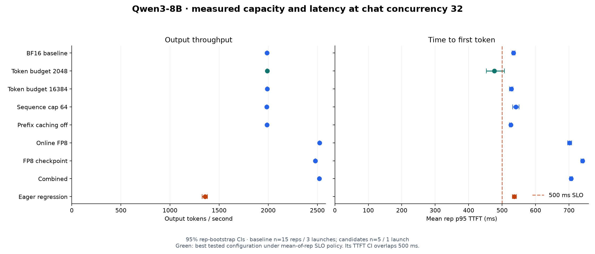
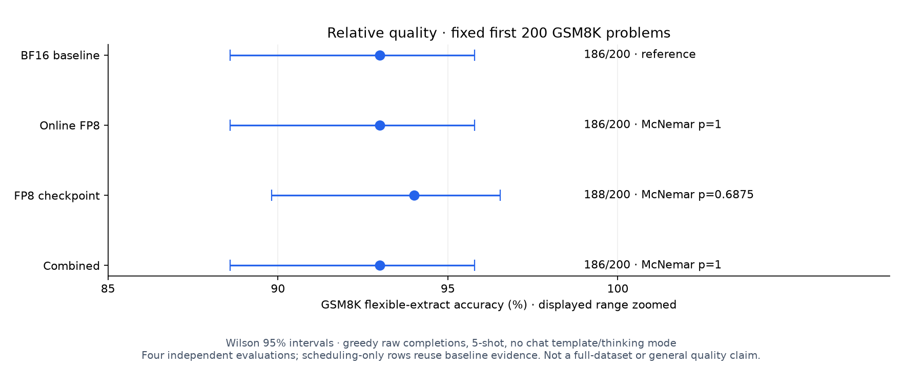
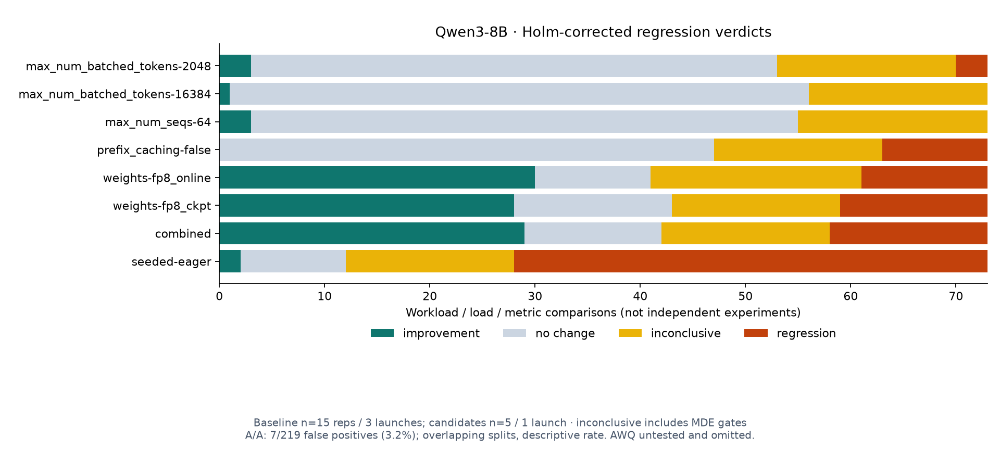

# Qwen3-8B: completed live campaign

**605 valid reps, 110,000 requests, 25,344,000 output tokens, 11 successful launches.**
The main workflow completed in 19.51 wall-clock hours, including its interruption
and automated analysis, within the approved 22-hour cap. Separate commissioning
and rental setup are excluded from that workflow time.

[Full report](report.md) · [Machine-readable results](report.json) ·
[Archive verification](verification.json) · [Probe evidence](probes/)

## Best tested configuration under the saved constraints

BF16 `Qwen/Qwen3-8B`, prefix caching on, token budget 2048, sequence ceiling 256,
chunked prefill on, KV cache dtype auto, CUDA graphs enabled, context 8192,
GPU memory utilization 0.90, seed 42. The objective is output tokens/s at
`chat:closed:32`; SLOs are mean rep-p95 TTFT ≤500 ms and E2E ≤15000 ms.

| Metric at chat concurrency 32 | Mean [95% rep-bootstrap CI] | Replication |
|---|---|---|
| Output tokens/s | 1988.78 [1987.43, 1989.94] | 5 reps, 1 launch |
| Mean rep p95 TTFT, ms | 476.91 [452.70, 507.26] | 5 reps, 1 launch |
| Mean rep p95 E2E, ms | 3862.89 [3845.44, 3877.96] | 5 reps, 1 launch |
| GSM8K flexible-extract | 186/200; Wilson CI 88.59–95.78% | Inherited BF16 source, not a new evaluation |

**The TTFT CI overlaps 500 ms.** Eligibility uses the pre-existing point-estimate
policy, so this is not a guaranteed SLO or proof of statistical superiority.
The baseline measured 534.10 ms TTFT [529.82, 538.60], n=15 across three launches.
FP8/combined configurations achieved more throughput at this point but failed the
TTFT constraint; faster throughput alone did not determine the recommendation.

## Detector validation and quality

The seeded eager configuration was flagged at chat concurrency 32: output
throughput −31.69% (CI −33.18 to −30.59), p95 E2E +48.32% (CI +43.46 to +56.39),
Holm-adjusted p=0.004708 for both, baseline n=15 / candidate n=5. Their reported
MDEs are 0.3203% and 0.4272%; the fixed 5% effect threshold was unchanged.

A/A validation recorded 7 false positives among 219 comparisons (3.20%), with
45 inconclusive results. Leave-one-launch splits overlap, so this is descriptive,
not a rate from independent experiments. The separate synthetic power curve is
unchanged; it is not a measured power curve across all GPU metric families.

Four independent GSM8K evaluations used the same first 200 problems, 5-shot greedy
raw completions and a 512-token generation cap: BF16 186/200, online FP8 186/200,
FP8 checkpoint 188/200, combined 186/200. Paired McNemar p-values were 1, 0.6875,
and 1 versus BF16. These results do not establish general quality equivalence.
Scheduling-only quality rows explicitly inherit source evidence.

## Provenance, recovery and limits

- One A100-SXM4-80GB, compute capability 8.0; vLLM 0.15.1, Torch 2.9.1/CUDA 12.8,
  lm-eval 0.4.9.2. Findings apply to these tested versions and settings.
- Three independent baseline launches; five reps per point; all eight closed-loop
  points plus chat open-loop at 50/80/95% of measured first-baseline capacity.
- The combined-candidate builder stopped after 440 valid reps. Commit `bfa5791`
  fixed precision-tuple selection; resume preserved every committed rep and the
  original creation-time deadline. Initial source was `a65db5d`. No thresholds,
  factor scores, constraints or statistical definitions changed after results.
- Both FP8 paths loaded; the requested forced-AWQ/BF16 path was rejected and
  retained as unsupported with its actual dtype error. No general A100 AWQ
  incompatibility is claimed. Alternative chunked-prefill/KV-cache levels were
  not evaluated; published checkpoints were not quantized by this project.
- Raw arrays, SQLite, startup/benchmark/harness logs and both job histories are
  saved off the rental under the gitignored local archive. SQLite integrity passed;
  all 605 raw reps were parsed and cross-checked again. All 657 aggregate means,
  10,000-resample CI endpoints and rep/launch counts were independently reproduced.
- Public copies redact the Vast container label only; measurements are unchanged.
  Source/public hashes are in verification.json. Full raw data remain outside Git;
  reproducible small fixtures are committed under tests/fixtures/real/.
- Parser markers and retained synthetic edge cases are documented in
  [fixture coverage](../../docs/FIXTURE_COVERAGE.md). Optional GPT-OSS startup/context
  experiments are **not run (needs GPU)**. No v0.1.0 release is implied by this report.
