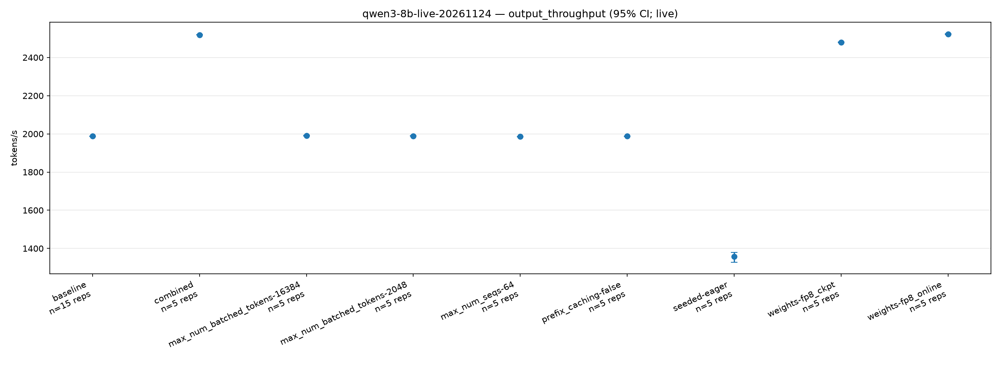
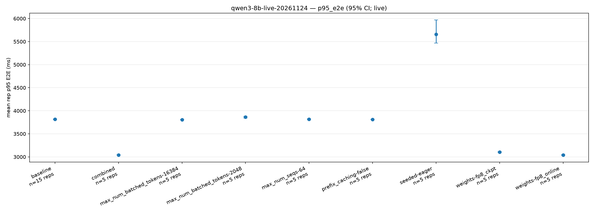

# InferencePilot experiment report

qwen3-8b-live-20261124

**Evidence scope:** live measurements declared; 605 successful measured reps; campaign status=completed. Synthetic experiments are demonstrations only.

## Environment

```json
{
  "cpu": "AMD EPYC 7513 32-Core Processor",
  "cuda_driver_report": {
    "available": true,
    "output": "Wed Nov 25 01:52:01 2026       \n+-----------------------------------------------------------------------------------------+\n| NVIDIA-SMI 595.91.07              Driver Version: 595.91.07      CUDA Version: 13.2     |\n+-----------------------------------------+------------------------+----------------------+\n| GPU  Name                 Persistence-M | Bus-Id          Disp.A | Volatile Uncorr. ECC |\n| Fan  Temp   Perf          Pwr:Usage/Cap |           Memory-Usage | GPU-Util  Compute M. |\n|                                         |                        |               MIG M. |\n|=========================================+========================+======================|\n|   0  NVIDIA A100-SXM4-80GB          On  |   00000000:41:00.0 Off |                    0 |\n| N/A   24C    P0             80W /  400W |       0MiB /  81920MiB |      0%      Default |\n|                                         |                        |             Disabled |\n+-----------------------------------------+------------------------+----------------------+\n\n+-----------------------------------------------------------------------------------------+\n| Processes:                                                                              |\n|  GPU   GI   CI              PID   Type   Process name                        GPU Memory |\n|        ID   ID                                                               Usage      |\n|=========================================================================================|\n|  No running processes found                                                             |\n+-----------------------------------------------------------------------------------------+"
  },
  "cuda_runtime_note": "read from torch/version.py without importing torch; null if unavailable",
  "cuda_runtime_version": "12.8",
  "git": {
    "available": true,
    "output": "a65db5d1313b28d303946063dfe85a8513899fb1"
  },
  "gpu": {
    "available": true,
    "output": "NVIDIA A100-SXM4-80GB, 8.0, 595.91.07"
  },
  "lm_eval_version": "0.4.9.2",
  "pip_freeze_sha256": "48890c2fcddc7393fd421954e6605bddeb1eba30520df4b2ea2930b2924c370f",
  "platform": "Linux-6.8.0-138-generic-x86_64-with-glibc2.39",
  "python": "3.12.3",
  "ram_bytes": 540590342144,
  "torch_version": "2.9.1",
  "vast": {
    "VAST_CONTAINERLABEL": "[redacted]"
  },
  "vllm_version": "0.15.1"
}
```

## Requested and resolved configurations

| Label / role | Requested | Actual launch / status / resolved |
|---|---|---|
| baseline / baseline | `{"chunked_prefill": true, "dtype": "bfloat16", "enforce_eager": false, "gpu_memory_utilization": 0.9, "host": "127.0.0.1", "kv_cache_dtype": "auto", "max_model_len": 8192, "max_num_batched_tokens": 8192, "max_num_seqs": 256, "model": "Qwen/Qwen3-8B", "port": 18000, "prefix_caching": true, "quantization": null, "seed": 42, "variant": "bf16"}` | `[{"error": null, "id": "6c68c2e630664ee495ae5cf40e2c442f", "log_path": "/workspace/inferencepilot-m9/data/m9-campaign/logs/6c68c2e630664ee495ae5cf40e2c442f.log", "resolved_args": "{\"attention_backend\": \"FLASH_ATTN\", \"chunked_prefill\": true, \"cuda_graph_mode\": \"FULL_AND_PIECEWISE\", \"enforce_eager\": false, \"kv_cache_dtype\": \"auto\", \"kv_cache_tokens\": 397344, \"max_concurrency\": 48.5, \"max_concurrency_tokens_per_request\": 8192, \"max_model_len\": 8192, \"max_num_batched_tokens\": 8192, \"parser_status\": \"provisional\", \"prefix_caching\": true, \"quantization\": null, \"raw_matched_lines\": [\"\\u001b[0;36m(APIServer pid=148545)\\u001b[0;0m INFO 11-25 01:52:45 [utils.py:261] non-default args: {'model_tag': 'Qwen/Qwen3-8B', 'api_server_count': 1, 'host': '127.0.0.1', 'port': 18000, 'model': 'Qwen/Qwen3-8B', 'dtype': 'bfloat16', 'seed': 42, 'max_model_len': 8192, 'enable_prefix_caching': True, 'max_num_batched_tokens': 8192, 'max_num_seqs': 256, 'enable_chunked_prefill': True}\", \"\\u001b[0;36m(APIServer pid=148545)\\u001b[0;0m INFO 11-25 01:52:46 [scheduler.py:226] Chunked prefill is enabled with max_num_batched_tokens=8192.\", \"\\u001b[0;36m(EngineCore_DP0 pid=148826)\\u001b[0;0m INFO 11-25 01:52:55 [core.py:96] Initializing a V1 LLM engine (v0.15.1) with config: model='Qwen/Qwen3-8B', speculative_config=None, tokenizer='Qwen/Qwen3-8B', skip_tokenizer_init=False, tokenizer_mode=auto, revision=None, tokenizer_revision=None, trust_remote_code=False, dtype=torch.bfloat16, max_seq_len=8192, download_dir=None, load_format=auto, tensor_parallel_size=1, pipeline_parallel_size=1, data_parallel_size=1, disable_custom_all_reduce=False, quantization=None, enforce_eager=False, enable_return_routed_experts=False, kv_cache_dtype=auto, device_config=cuda, structured_outputs_config=StructuredOutputsConfig(backend='auto', disable_fallback=False, disable_any_whitespace=False, disable_additional_properties=False, reasoning_parser='', reasoning_parser_plugin='', enable_in_reasoning=False), observability_config=ObservabilityConfig(show_hidden_metrics_for_version=None, otlp_traces_endpoint=None, collect_detailed_traces=None, kv_cache_metrics=False, kv_cache_metrics_sample=0.01, cudagraph_metrics=False, enable_layerwise_nvtx_tracing=False, enable_mfu_metrics=False, enable_mm_processor_stats=False, enable_logging_iteration_details=False), seed=42, served_model_name=Qwen/Qwen3-8B, enable_prefix_caching=True, enable_chunked_prefill=True, pooler_config=None, compilation_config={'level': None, 'mode': <CompilationMode.VLLM_COMPILE: 3>, 'debug_dump_path': None, 'cache_dir': '', 'compile_cache_save_format': 'binary', 'backend': 'inductor', 'custom_ops': ['none'], 'splitting_ops': ['vllm::unified_attention', 'vllm::unified_attention_with_output', 'vllm::unified_mla_attention', 'vllm::unified_mla_attention_with_output', 'vllm::mamba_mixer2', 'vllm::mamba_mixer', 'vllm::short_conv', 'vllm::linear_attention', 'vllm::plamo2_mamba_mixer', 'vllm::gdn_attention_core', 'vllm::kda_attention', 'vllm::sparse_attn_indexer', 'vllm::rocm_aiter_sparse_attn_indexer', 'vllm::unified_kv_cache_update'], 'compile_mm_encoder': False, 'compile_sizes': [], 'compile_ranges_split_points': [8192], 'inductor_compile_config': {'enable_auto_functionalized_v2': False, 'combo_kernels': True, 'benchmark_combo_kernel': True}, 'inductor_passes': {}, 'cudagraph_mode': <CUDAGraphMode.FULL_AND_PIECEWISE: (2, 1)>, 'cudagraph_num_of_warmups': 1, 'cudagraph_capture_sizes': [1, 2, 4, 8, 16, 24, 32, 40, 48, 56, 64, 72, 80, 88, 96, 104, 112, 120, 128, 136, 144, 152, 160, 168, 176, 184, 192, 200, 208, 216, 224, 232, 240, 248, 256, 272, 288, 304, 320, 336, 352, 368, 384, 400, 416, 432, 448, 464, 480, 496, 512], 'cudagraph_copy_inputs': False, 'cudagraph_specialize_lora': True, 'use_inductor_graph_partition': False, 'pass_config': {'fuse_norm_quant': False, 'fuse_act_quant': False, 'fuse_attn_quant': False, 'eliminate_noops': True, 'enable_sp': False, 'fuse_gemm_comms': False, 'fuse_allreduce_rms': False}, 'max_cudagraph_capture_size': 512, 'dynamic_shapes_config': {'type': <DynamicShapesType.BACKED: 'backed'>, 'evaluate_guards': False, 'assume_32_bit_indexing': True}, 'local_cache_dir': None, 'static_all_moe_layers': []}\", \"\\u001b[0;36m(EngineCore_DP0 pid=148826)\\u001b[0;0m INFO 11-25 01:52:57 [cuda.py:364] Using FLASH_ATTN attention backend out of potential backends: ('FLASH_ATTN', 'FLASHINFER', 'TRITON_ATTN', 'FLEX_ATTENTION')\", \"\\u001b[0;36m(EngineCore_DP0 pid=148826)\\u001b[0;0m INFO 11-25 01:53:19 [kv_cache_utils.py:1307] GPU KV cache size: 397,344 tokens\", \"\\u001b[0;36m(EngineCore_DP0 pid=148826)\\u001b[0;0m INFO 11-25 01:53:19 [kv_cache_utils.py:1312] Maximum concurrency for 8,192 tokens per request: 48.50x\"], \"schedule_slot\": 0}", "status": "ok"}, {"error": null, "id": "d48d465d88424020a7aac7dd938eb761", "log_path": "/workspace/inferencepilot-m9/data/m9-campaign/logs/d48d465d88424020a7aac7dd938eb761.log", "resolved_args": "{\"attention_backend\": \"FLASH_ATTN\", \"chunked_prefill\": true, \"cuda_graph_mode\": \"FULL_AND_PIECEWISE\", \"enforce_eager\": false, \"kv_cache_dtype\": \"auto\", \"kv_cache_tokens\": 397344, \"max_concurrency\": 48.5, \"max_concurrency_tokens_per_request\": 8192, \"max_model_len\": 8192, \"max_num_batched_tokens\": 8192, \"parser_status\": \"provisional\", \"prefix_caching\": true, \"quantization\": null, \"raw_matched_lines\": [\"\\u001b[0;36m(APIServer pid=262958)\\u001b[0;0m INFO 11-25 10:11:47 [utils.py:261] non-default args: {'model_tag': 'Qwen/Qwen3-8B', 'api_server_count': 1, 'host': '127.0.0.1', 'port': 18000, 'model': 'Qwen/Qwen3-8B', 'dtype': 'bfloat16', 'seed': 42, 'max_model_len': 8192, 'enable_prefix_caching': True, 'max_num_batched_tokens': 8192, 'max_num_seqs': 256, 'enable_chunked_prefill': True}\", \"\\u001b[0;36m(APIServer pid=262958)\\u001b[0;0m INFO 11-25 10:11:48 [scheduler.py:226] Chunked prefill is enabled with max_num_batched_tokens=8192.\", \"\\u001b[0;36m(EngineCore_DP0 pid=263249)\\u001b[0;0m INFO 11-25 10:11:57 [core.py:96] Initializing a V1 LLM engine (v0.15.1) with config: model='Qwen/Qwen3-8B', speculative_config=None, tokenizer='Qwen/Qwen3-8B', skip_tokenizer_init=False, tokenizer_mode=auto, revision=None, tokenizer_revision=None, trust_remote_code=False, dtype=torch.bfloat16, max_seq_len=8192, download_dir=None, load_format=auto, tensor_parallel_size=1, pipeline_parallel_size=1, data_parallel_size=1, disable_custom_all_reduce=False, quantization=None, enforce_eager=False, enable_return_routed_experts=False, kv_cache_dtype=auto, device_config=cuda, structured_outputs_config=StructuredOutputsConfig(backend='auto', disable_fallback=False, disable_any_whitespace=False, disable_additional_properties=False, reasoning_parser='', reasoning_parser_plugin='', enable_in_reasoning=False), observability_config=ObservabilityConfig(show_hidden_metrics_for_version=None, otlp_traces_endpoint=None, collect_detailed_traces=None, kv_cache_metrics=False, kv_cache_metrics_sample=0.01, cudagraph_metrics=False, enable_layerwise_nvtx_tracing=False, enable_mfu_metrics=False, enable_mm_processor_stats=False, enable_logging_iteration_details=False), seed=42, served_model_name=Qwen/Qwen3-8B, enable_prefix_caching=True, enable_chunked_prefill=True, pooler_config=None, compilation_config={'level': None, 'mode': <CompilationMode.VLLM_COMPILE: 3>, 'debug_dump_path': None, 'cache_dir': '', 'compile_cache_save_format': 'binary', 'backend': 'inductor', 'custom_ops': ['none'], 'splitting_ops': ['vllm::unified_attention', 'vllm::unified_attention_with_output', 'vllm::unified_mla_attention', 'vllm::unified_mla_attention_with_output', 'vllm::mamba_mixer2', 'vllm::mamba_mixer', 'vllm::short_conv', 'vllm::linear_attention', 'vllm::plamo2_mamba_mixer', 'vllm::gdn_attention_core', 'vllm::kda_attention', 'vllm::sparse_attn_indexer', 'vllm::rocm_aiter_sparse_attn_indexer', 'vllm::unified_kv_cache_update'], 'compile_mm_encoder': False, 'compile_sizes': [], 'compile_ranges_split_points': [8192], 'inductor_compile_config': {'enable_auto_functionalized_v2': False, 'combo_kernels': True, 'benchmark_combo_kernel': True}, 'inductor_passes': {}, 'cudagraph_mode': <CUDAGraphMode.FULL_AND_PIECEWISE: (2, 1)>, 'cudagraph_num_of_warmups': 1, 'cudagraph_capture_sizes': [1, 2, 4, 8, 16, 24, 32, 40, 48, 56, 64, 72, 80, 88, 96, 104, 112, 120, 128, 136, 144, 152, 160, 168, 176, 184, 192, 200, 208, 216, 224, 232, 240, 248, 256, 272, 288, 304, 320, 336, 352, 368, 384, 400, 416, 432, 448, 464, 480, 496, 512], 'cudagraph_copy_inputs': False, 'cudagraph_specialize_lora': True, 'use_inductor_graph_partition': False, 'pass_config': {'fuse_norm_quant': False, 'fuse_act_quant': False, 'fuse_attn_quant': False, 'eliminate_noops': True, 'enable_sp': False, 'fuse_gemm_comms': False, 'fuse_allreduce_rms': False}, 'max_cudagraph_capture_size': 512, 'dynamic_shapes_config': {'type': <DynamicShapesType.BACKED: 'backed'>, 'evaluate_guards': False, 'assume_32_bit_indexing': True}, 'local_cache_dir': None, 'static_all_moe_layers': []}\", \"\\u001b[0;36m(EngineCore_DP0 pid=263249)\\u001b[0;0m INFO 11-25 10:12:00 [cuda.py:364] Using FLASH_ATTN attention backend out of potential backends: ('FLASH_ATTN', 'FLASHINFER', 'TRITON_ATTN', 'FLEX_ATTENTION')\", \"\\u001b[0;36m(EngineCore_DP0 pid=263249)\\u001b[0;0m INFO 11-25 10:12:21 [kv_cache_utils.py:1307] GPU KV cache size: 397,344 tokens\", \"\\u001b[0;36m(EngineCore_DP0 pid=263249)\\u001b[0;0m INFO 11-25 10:12:21 [kv_cache_utils.py:1312] Maximum concurrency for 8,192 tokens per request: 48.50x\"], \"schedule_slot\": 5}", "status": "ok"}, {"error": null, "id": "60eb627fbdb743e9ab4c93410164ade3", "log_path": "/workspace/inferencepilot-m9/data/m9-campaign/logs/60eb627fbdb743e9ab4c93410164ade3.log", "resolved_args": "{\"attention_backend\": \"FLASH_ATTN\", \"chunked_prefill\": true, \"cuda_graph_mode\": \"FULL_AND_PIECEWISE\", \"enforce_eager\": false, \"kv_cache_dtype\": \"auto\", \"kv_cache_tokens\": 397344, \"max_concurrency\": 48.5, \"max_concurrency_tokens_per_request\": 8192, \"max_model_len\": 8192, \"max_num_batched_tokens\": 8192, \"parser_status\": \"provisional\", \"prefix_caching\": true, \"quantization\": null, \"raw_matched_lines\": [\"\\u001b[0;36m(APIServer pid=379700)\\u001b[0;0m INFO 11-25 19:34:50 [utils.py:261] non-default args: {'model_tag': 'Qwen/Qwen3-8B', 'api_server_count': 1, 'host': '127.0.0.1', 'port': 18000, 'model': 'Qwen/Qwen3-8B', 'dtype': 'bfloat16', 'seed': 42, 'max_model_len': 8192, 'enable_prefix_caching': True, 'max_num_batched_tokens': 8192, 'max_num_seqs': 256, 'enable_chunked_prefill': True}\", \"\\u001b[0;36m(APIServer pid=379700)\\u001b[0;0m INFO 11-25 19:34:51 [scheduler.py:226] Chunked prefill is enabled with max_num_batched_tokens=8192.\", \"\\u001b[0;36m(EngineCore_DP0 pid=379981)\\u001b[0;0m INFO 11-25 19:35:00 [core.py:96] Initializing a V1 LLM engine (v0.15.1) with config: model='Qwen/Qwen3-8B', speculative_config=None, tokenizer='Qwen/Qwen3-8B', skip_tokenizer_init=False, tokenizer_mode=auto, revision=None, tokenizer_revision=None, trust_remote_code=False, dtype=torch.bfloat16, max_seq_len=8192, download_dir=None, load_format=auto, tensor_parallel_size=1, pipeline_parallel_size=1, data_parallel_size=1, disable_custom_all_reduce=False, quantization=None, enforce_eager=False, enable_return_routed_experts=False, kv_cache_dtype=auto, device_config=cuda, structured_outputs_config=StructuredOutputsConfig(backend='auto', disable_fallback=False, disable_any_whitespace=False, disable_additional_properties=False, reasoning_parser='', reasoning_parser_plugin='', enable_in_reasoning=False), observability_config=ObservabilityConfig(show_hidden_metrics_for_version=None, otlp_traces_endpoint=None, collect_detailed_traces=None, kv_cache_metrics=False, kv_cache_metrics_sample=0.01, cudagraph_metrics=False, enable_layerwise_nvtx_tracing=False, enable_mfu_metrics=False, enable_mm_processor_stats=False, enable_logging_iteration_details=False), seed=42, served_model_name=Qwen/Qwen3-8B, enable_prefix_caching=True, enable_chunked_prefill=True, pooler_config=None, compilation_config={'level': None, 'mode': <CompilationMode.VLLM_COMPILE: 3>, 'debug_dump_path': None, 'cache_dir': '', 'compile_cache_save_format': 'binary', 'backend': 'inductor', 'custom_ops': ['none'], 'splitting_ops': ['vllm::unified_attention', 'vllm::unified_attention_with_output', 'vllm::unified_mla_attention', 'vllm::unified_mla_attention_with_output', 'vllm::mamba_mixer2', 'vllm::mamba_mixer', 'vllm::short_conv', 'vllm::linear_attention', 'vllm::plamo2_mamba_mixer', 'vllm::gdn_attention_core', 'vllm::kda_attention', 'vllm::sparse_attn_indexer', 'vllm::rocm_aiter_sparse_attn_indexer', 'vllm::unified_kv_cache_update'], 'compile_mm_encoder': False, 'compile_sizes': [], 'compile_ranges_split_points': [8192], 'inductor_compile_config': {'enable_auto_functionalized_v2': False, 'combo_kernels': True, 'benchmark_combo_kernel': True}, 'inductor_passes': {}, 'cudagraph_mode': <CUDAGraphMode.FULL_AND_PIECEWISE: (2, 1)>, 'cudagraph_num_of_warmups': 1, 'cudagraph_capture_sizes': [1, 2, 4, 8, 16, 24, 32, 40, 48, 56, 64, 72, 80, 88, 96, 104, 112, 120, 128, 136, 144, 152, 160, 168, 176, 184, 192, 200, 208, 216, 224, 232, 240, 248, 256, 272, 288, 304, 320, 336, 352, 368, 384, 400, 416, 432, 448, 464, 480, 496, 512], 'cudagraph_copy_inputs': False, 'cudagraph_specialize_lora': True, 'use_inductor_graph_partition': False, 'pass_config': {'fuse_norm_quant': False, 'fuse_act_quant': False, 'fuse_attn_quant': False, 'eliminate_noops': True, 'enable_sp': False, 'fuse_gemm_comms': False, 'fuse_allreduce_rms': False}, 'max_cudagraph_capture_size': 512, 'dynamic_shapes_config': {'type': <DynamicShapesType.BACKED: 'backed'>, 'evaluate_guards': False, 'assume_32_bit_indexing': True}, 'local_cache_dir': None, 'static_all_moe_layers': []}\", \"\\u001b[0;36m(EngineCore_DP0 pid=379981)\\u001b[0;0m INFO 11-25 19:35:02 [cuda.py:364] Using FLASH_ATTN attention backend out of potential backends: ('FLASH_ATTN', 'FLASHINFER', 'TRITON_ATTN', 'FLEX_ATTENTION')\", \"\\u001b[0;36m(EngineCore_DP0 pid=379981)\\u001b[0;0m INFO 11-25 19:35:22 [kv_cache_utils.py:1307] GPU KV cache size: 397,344 tokens\", \"\\u001b[0;36m(EngineCore_DP0 pid=379981)\\u001b[0;0m INFO 11-25 19:35:22 [kv_cache_utils.py:1312] Maximum concurrency for 8,192 tokens per request: 48.50x\"], \"schedule_slot\": 10}", "status": "ok"}]` |
| combined / combined | `{"chunked_prefill": true, "dtype": "bfloat16", "enforce_eager": false, "gpu_memory_utilization": 0.9, "host": "127.0.0.1", "kv_cache_dtype": "auto", "max_model_len": 8192, "max_num_batched_tokens": 16384, "max_num_seqs": 64, "model": "Qwen/Qwen3-8B", "port": 18000, "prefix_caching": false, "quantization": "fp8", "seed": 42, "variant": "fp8_online"}` | `[{"error": null, "id": "9e7109fc5cd245e8a440c8df268dd75f", "log_path": "/workspace/inferencepilot-m9/data/m9-campaign/logs/9e7109fc5cd245e8a440c8df268dd75f.log", "resolved_args": "{\"attention_backend\": \"FLASH_ATTN\", \"chunked_prefill\": true, \"cuda_graph_mode\": \"FULL_AND_PIECEWISE\", \"enforce_eager\": false, \"kv_cache_dtype\": \"auto\", \"kv_cache_tokens\": 442880, \"max_concurrency\": 54.06, \"max_concurrency_tokens_per_request\": 8192, \"max_model_len\": 8192, \"max_num_batched_tokens\": 16384, \"parser_status\": \"provisional\", \"prefix_caching\": false, \"quantization\": \"fp8\", \"raw_matched_lines\": [\"\\u001b[0;36m(APIServer pid=332657)\\u001b[0;0m INFO 11-25 15:34:21 [utils.py:261] non-default args: {'model_tag': 'Qwen/Qwen3-8B', 'api_server_count': 1, 'host': '127.0.0.1', 'port': 18000, 'model': 'Qwen/Qwen3-8B', 'dtype': 'bfloat16', 'seed': 42, 'max_model_len': 8192, 'quantization': 'fp8', 'enable_prefix_caching': False, 'max_num_batched_tokens': 16384, 'max_num_seqs': 64, 'enable_chunked_prefill': True}\", \"\\u001b[0;36m(APIServer pid=332657)\\u001b[0;0m INFO 11-25 15:34:22 [scheduler.py:226] Chunked prefill is enabled with max_num_batched_tokens=16384.\", \"\\u001b[0;36m(EngineCore_DP0 pid=332944)\\u001b[0;0m INFO 11-25 15:34:32 [core.py:96] Initializing a V1 LLM engine (v0.15.1) with config: model='Qwen/Qwen3-8B', speculative_config=None, tokenizer='Qwen/Qwen3-8B', skip_tokenizer_init=False, tokenizer_mode=auto, revision=None, tokenizer_revision=None, trust_remote_code=False, dtype=torch.bfloat16, max_seq_len=8192, download_dir=None, load_format=auto, tensor_parallel_size=1, pipeline_parallel_size=1, data_parallel_size=1, disable_custom_all_reduce=False, quantization=fp8, enforce_eager=False, enable_return_routed_experts=False, kv_cache_dtype=auto, device_config=cuda, structured_outputs_config=StructuredOutputsConfig(backend='auto', disable_fallback=False, disable_any_whitespace=False, disable_additional_properties=False, reasoning_parser='', reasoning_parser_plugin='', enable_in_reasoning=False), observability_config=ObservabilityConfig(show_hidden_metrics_for_version=None, otlp_traces_endpoint=None, collect_detailed_traces=None, kv_cache_metrics=False, kv_cache_metrics_sample=0.01, cudagraph_metrics=False, enable_layerwise_nvtx_tracing=False, enable_mfu_metrics=False, enable_mm_processor_stats=False, enable_logging_iteration_details=False), seed=42, served_model_name=Qwen/Qwen3-8B, enable_prefix_caching=False, enable_chunked_prefill=True, pooler_config=None, compilation_config={'level': None, 'mode': <CompilationMode.VLLM_COMPILE: 3>, 'debug_dump_path': None, 'cache_dir': '', 'compile_cache_save_format': 'binary', 'backend': 'inductor', 'custom_ops': ['none'], 'splitting_ops': ['vllm::unified_attention', 'vllm::unified_attention_with_output', 'vllm::unified_mla_attention', 'vllm::unified_mla_attention_with_output', 'vllm::mamba_mixer2', 'vllm::mamba_mixer', 'vllm::short_conv', 'vllm::linear_attention', 'vllm::plamo2_mamba_mixer', 'vllm::gdn_attention_core', 'vllm::kda_attention', 'vllm::sparse_attn_indexer', 'vllm::rocm_aiter_sparse_attn_indexer', 'vllm::unified_kv_cache_update'], 'compile_mm_encoder': False, 'compile_sizes': [], 'compile_ranges_split_points': [16384], 'inductor_compile_config': {'enable_auto_functionalized_v2': False, 'combo_kernels': True, 'benchmark_combo_kernel': True}, 'inductor_passes': {}, 'cudagraph_mode': <CUDAGraphMode.FULL_AND_PIECEWISE: (2, 1)>, 'cudagraph_num_of_warmups': 1, 'cudagraph_capture_sizes': [1, 2, 4, 8, 16, 24, 32, 40, 48, 56, 64, 72, 80, 88, 96, 104, 112, 120, 128], 'cudagraph_copy_inputs': False, 'cudagraph_specialize_lora': True, 'use_inductor_graph_partition': False, 'pass_config': {'fuse_norm_quant': False, 'fuse_act_quant': False, 'fuse_attn_quant': False, 'eliminate_noops': True, 'enable_sp': False, 'fuse_gemm_comms': False, 'fuse_allreduce_rms': False}, 'max_cudagraph_capture_size': 128, 'dynamic_shapes_config': {'type': <DynamicShapesType.BACKED: 'backed'>, 'evaluate_guards': False, 'assume_32_bit_indexing': True}, 'local_cache_dir': None, 'static_all_moe_layers': []}\", \"\\u001b[0;36m(EngineCore_DP0 pid=332944)\\u001b[0;0m INFO 11-25 15:34:34 [cuda.py:364] Using FLASH_ATTN attention backend out of potential backends: ('FLASH_ATTN', 'FLASHINFER', 'TRITON_ATTN', 'FLEX_ATTENTION')\", \"\\u001b[0;36m(EngineCore_DP0 pid=332944)\\u001b[0;0m INFO 11-25 15:34:58 [kv_cache_utils.py:1307] GPU KV cache size: 442,880 tokens\", \"\\u001b[0;36m(EngineCore_DP0 pid=332944)\\u001b[0;0m INFO 11-25 15:34:58 [kv_cache_utils.py:1312] Maximum concurrency for 8,192 tokens per request: 54.06x\"], \"schedule_slot\": 8}", "status": "ok"}]` |
| max_num_batched_tokens-16384 / candidate | `{"chunked_prefill": true, "dtype": "bfloat16", "enforce_eager": false, "gpu_memory_utilization": 0.9, "host": "127.0.0.1", "kv_cache_dtype": "auto", "max_model_len": 8192, "max_num_batched_tokens": 16384, "max_num_seqs": 256, "model": "Qwen/Qwen3-8B", "port": 18000, "prefix_caching": true, "quantization": null, "seed": 42, "variant": "bf16"}` | `[{"error": null, "id": "5c0a919a77ac4814838e550e8d4b2c2c", "log_path": "/workspace/inferencepilot-m9/data/m9-campaign/logs/5c0a919a77ac4814838e550e8d4b2c2c.log", "resolved_args": "{\"attention_backend\": \"FLASH_ATTN\", \"chunked_prefill\": true, \"cuda_graph_mode\": \"FULL_AND_PIECEWISE\", \"enforce_eager\": false, \"kv_cache_dtype\": \"auto\", \"kv_cache_tokens\": 395744, \"max_concurrency\": 48.31, \"max_concurrency_tokens_per_request\": 8192, \"max_model_len\": 8192, \"max_num_batched_tokens\": 16384, \"parser_status\": \"provisional\", \"prefix_caching\": true, \"quantization\": null, \"raw_matched_lines\": [\"\\u001b[0;36m(APIServer pid=240091)\\u001b[0;0m INFO 11-25 08:30:53 [utils.py:261] non-default args: {'model_tag': 'Qwen/Qwen3-8B', 'api_server_count': 1, 'host': '127.0.0.1', 'port': 18000, 'model': 'Qwen/Qwen3-8B', 'dtype': 'bfloat16', 'seed': 42, 'max_model_len': 8192, 'enable_prefix_caching': True, 'max_num_batched_tokens': 16384, 'max_num_seqs': 256, 'enable_chunked_prefill': True}\", \"\\u001b[0;36m(APIServer pid=240091)\\u001b[0;0m INFO 11-25 08:30:54 [scheduler.py:226] Chunked prefill is enabled with max_num_batched_tokens=16384.\", \"\\u001b[0;36m(EngineCore_DP0 pid=240374)\\u001b[0;0m INFO 11-25 08:31:04 [core.py:96] Initializing a V1 LLM engine (v0.15.1) with config: model='Qwen/Qwen3-8B', speculative_config=None, tokenizer='Qwen/Qwen3-8B', skip_tokenizer_init=False, tokenizer_mode=auto, revision=None, tokenizer_revision=None, trust_remote_code=False, dtype=torch.bfloat16, max_seq_len=8192, download_dir=None, load_format=auto, tensor_parallel_size=1, pipeline_parallel_size=1, data_parallel_size=1, disable_custom_all_reduce=False, quantization=None, enforce_eager=False, enable_return_routed_experts=False, kv_cache_dtype=auto, device_config=cuda, structured_outputs_config=StructuredOutputsConfig(backend='auto', disable_fallback=False, disable_any_whitespace=False, disable_additional_properties=False, reasoning_parser='', reasoning_parser_plugin='', enable_in_reasoning=False), observability_config=ObservabilityConfig(show_hidden_metrics_for_version=None, otlp_traces_endpoint=None, collect_detailed_traces=None, kv_cache_metrics=False, kv_cache_metrics_sample=0.01, cudagraph_metrics=False, enable_layerwise_nvtx_tracing=False, enable_mfu_metrics=False, enable_mm_processor_stats=False, enable_logging_iteration_details=False), seed=42, served_model_name=Qwen/Qwen3-8B, enable_prefix_caching=True, enable_chunked_prefill=True, pooler_config=None, compilation_config={'level': None, 'mode': <CompilationMode.VLLM_COMPILE: 3>, 'debug_dump_path': None, 'cache_dir': '', 'compile_cache_save_format': 'binary', 'backend': 'inductor', 'custom_ops': ['none'], 'splitting_ops': ['vllm::unified_attention', 'vllm::unified_attention_with_output', 'vllm::unified_mla_attention', 'vllm::unified_mla_attention_with_output', 'vllm::mamba_mixer2', 'vllm::mamba_mixer', 'vllm::short_conv', 'vllm::linear_attention', 'vllm::plamo2_mamba_mixer', 'vllm::gdn_attention_core', 'vllm::kda_attention', 'vllm::sparse_attn_indexer', 'vllm::rocm_aiter_sparse_attn_indexer', 'vllm::unified_kv_cache_update'], 'compile_mm_encoder': False, 'compile_sizes': [], 'compile_ranges_split_points': [16384], 'inductor_compile_config': {'enable_auto_functionalized_v2': False, 'combo_kernels': True, 'benchmark_combo_kernel': True}, 'inductor_passes': {}, 'cudagraph_mode': <CUDAGraphMode.FULL_AND_PIECEWISE: (2, 1)>, 'cudagraph_num_of_warmups': 1, 'cudagraph_capture_sizes': [1, 2, 4, 8, 16, 24, 32, 40, 48, 56, 64, 72, 80, 88, 96, 104, 112, 120, 128, 136, 144, 152, 160, 168, 176, 184, 192, 200, 208, 216, 224, 232, 240, 248, 256, 272, 288, 304, 320, 336, 352, 368, 384, 400, 416, 432, 448, 464, 480, 496, 512], 'cudagraph_copy_inputs': False, 'cudagraph_specialize_lora': True, 'use_inductor_graph_partition': False, 'pass_config': {'fuse_norm_quant': False, 'fuse_act_quant': False, 'fuse_attn_quant': False, 'eliminate_noops': True, 'enable_sp': False, 'fuse_gemm_comms': False, 'fuse_allreduce_rms': False}, 'max_cudagraph_capture_size': 512, 'dynamic_shapes_config': {'type': <DynamicShapesType.BACKED: 'backed'>, 'evaluate_guards': False, 'assume_32_bit_indexing': True}, 'local_cache_dir': None, 'static_all_moe_layers': []}\", \"\\u001b[0;36m(EngineCore_DP0 pid=240374)\\u001b[0;0m INFO 11-25 08:31:07 [cuda.py:364] Using FLASH_ATTN attention backend out of potential backends: ('FLASH_ATTN', 'FLASHINFER', 'TRITON_ATTN', 'FLEX_ATTENTION')\", \"\\u001b[0;36m(EngineCore_DP0 pid=240374)\\u001b[0;0m INFO 11-25 08:31:36 [kv_cache_utils.py:1307] GPU KV cache size: 395,744 tokens\", \"\\u001b[0;36m(EngineCore_DP0 pid=240374)\\u001b[0;0m INFO 11-25 08:31:36 [kv_cache_utils.py:1312] Maximum concurrency for 8,192 tokens per request: 48.31x\"], \"schedule_slot\": 4}", "status": "ok"}]` |
| max_num_batched_tokens-2048 / candidate | `{"chunked_prefill": true, "dtype": "bfloat16", "enforce_eager": false, "gpu_memory_utilization": 0.9, "host": "127.0.0.1", "kv_cache_dtype": "auto", "max_model_len": 8192, "max_num_batched_tokens": 2048, "max_num_seqs": 256, "model": "Qwen/Qwen3-8B", "port": 18000, "prefix_caching": true, "quantization": null, "seed": 42, "variant": "bf16"}` | `[{"error": null, "id": "3e30ec2089ed4742ad34f61fa3926bf4", "log_path": "/workspace/inferencepilot-m9/data/m9-campaign/logs/3e30ec2089ed4742ad34f61fa3926bf4.log", "resolved_args": "{\"attention_backend\": \"FLASH_ATTN\", \"chunked_prefill\": true, \"cuda_graph_mode\": \"FULL_AND_PIECEWISE\", \"enforce_eager\": false, \"kv_cache_dtype\": \"auto\", \"kv_cache_tokens\": 397696, \"max_concurrency\": 48.55, \"max_concurrency_tokens_per_request\": 8192, \"max_model_len\": 8192, \"max_num_batched_tokens\": 2048, \"parser_status\": \"provisional\", \"prefix_caching\": true, \"quantization\": null, \"raw_matched_lines\": [\"\\u001b[0;36m(APIServer pid=171905)\\u001b[0;0m INFO 11-25 03:39:28 [utils.py:261] non-default args: {'model_tag': 'Qwen/Qwen3-8B', 'api_server_count': 1, 'host': '127.0.0.1', 'port': 18000, 'model': 'Qwen/Qwen3-8B', 'dtype': 'bfloat16', 'seed': 42, 'max_model_len': 8192, 'enable_prefix_caching': True, 'max_num_batched_tokens': 2048, 'max_num_seqs': 256, 'enable_chunked_prefill': True}\", \"\\u001b[0;36m(APIServer pid=171905)\\u001b[0;0m INFO 11-25 03:39:29 [scheduler.py:226] Chunked prefill is enabled with max_num_batched_tokens=2048.\", \"\\u001b[0;36m(EngineCore_DP0 pid=172187)\\u001b[0;0m INFO 11-25 03:39:38 [core.py:96] Initializing a V1 LLM engine (v0.15.1) with config: model='Qwen/Qwen3-8B', speculative_config=None, tokenizer='Qwen/Qwen3-8B', skip_tokenizer_init=False, tokenizer_mode=auto, revision=None, tokenizer_revision=None, trust_remote_code=False, dtype=torch.bfloat16, max_seq_len=8192, download_dir=None, load_format=auto, tensor_parallel_size=1, pipeline_parallel_size=1, data_parallel_size=1, disable_custom_all_reduce=False, quantization=None, enforce_eager=False, enable_return_routed_experts=False, kv_cache_dtype=auto, device_config=cuda, structured_outputs_config=StructuredOutputsConfig(backend='auto', disable_fallback=False, disable_any_whitespace=False, disable_additional_properties=False, reasoning_parser='', reasoning_parser_plugin='', enable_in_reasoning=False), observability_config=ObservabilityConfig(show_hidden_metrics_for_version=None, otlp_traces_endpoint=None, collect_detailed_traces=None, kv_cache_metrics=False, kv_cache_metrics_sample=0.01, cudagraph_metrics=False, enable_layerwise_nvtx_tracing=False, enable_mfu_metrics=False, enable_mm_processor_stats=False, enable_logging_iteration_details=False), seed=42, served_model_name=Qwen/Qwen3-8B, enable_prefix_caching=True, enable_chunked_prefill=True, pooler_config=None, compilation_config={'level': None, 'mode': <CompilationMode.VLLM_COMPILE: 3>, 'debug_dump_path': None, 'cache_dir': '', 'compile_cache_save_format': 'binary', 'backend': 'inductor', 'custom_ops': ['none'], 'splitting_ops': ['vllm::unified_attention', 'vllm::unified_attention_with_output', 'vllm::unified_mla_attention', 'vllm::unified_mla_attention_with_output', 'vllm::mamba_mixer2', 'vllm::mamba_mixer', 'vllm::short_conv', 'vllm::linear_attention', 'vllm::plamo2_mamba_mixer', 'vllm::gdn_attention_core', 'vllm::kda_attention', 'vllm::sparse_attn_indexer', 'vllm::rocm_aiter_sparse_attn_indexer', 'vllm::unified_kv_cache_update'], 'compile_mm_encoder': False, 'compile_sizes': [], 'compile_ranges_split_points': [2048], 'inductor_compile_config': {'enable_auto_functionalized_v2': False, 'combo_kernels': True, 'benchmark_combo_kernel': True}, 'inductor_passes': {}, 'cudagraph_mode': <CUDAGraphMode.FULL_AND_PIECEWISE: (2, 1)>, 'cudagraph_num_of_warmups': 1, 'cudagraph_capture_sizes': [1, 2, 4, 8, 16, 24, 32, 40, 48, 56, 64, 72, 80, 88, 96, 104, 112, 120, 128, 136, 144, 152, 160, 168, 176, 184, 192, 200, 208, 216, 224, 232, 240, 248, 256, 272, 288, 304, 320, 336, 352, 368, 384, 400, 416, 432, 448, 464, 480, 496, 512], 'cudagraph_copy_inputs': False, 'cudagraph_specialize_lora': True, 'use_inductor_graph_partition': False, 'pass_config': {'fuse_norm_quant': False, 'fuse_act_quant': False, 'fuse_attn_quant': False, 'eliminate_noops': True, 'enable_sp': False, 'fuse_gemm_comms': False, 'fuse_allreduce_rms': False}, 'max_cudagraph_capture_size': 512, 'dynamic_shapes_config': {'type': <DynamicShapesType.BACKED: 'backed'>, 'evaluate_guards': False, 'assume_32_bit_indexing': True}, 'local_cache_dir': None, 'static_all_moe_layers': []}\", \"\\u001b[0;36m(EngineCore_DP0 pid=172187)\\u001b[0;0m INFO 11-25 03:39:41 [cuda.py:364] Using FLASH_ATTN attention backend out of potential backends: ('FLASH_ATTN', 'FLASHINFER', 'TRITON_ATTN', 'FLEX_ATTENTION')\", \"\\u001b[0;36m(EngineCore_DP0 pid=172187)\\u001b[0;0m INFO 11-25 03:40:09 [kv_cache_utils.py:1307] GPU KV cache size: 397,696 tokens\", \"\\u001b[0;36m(EngineCore_DP0 pid=172187)\\u001b[0;0m INFO 11-25 03:40:09 [kv_cache_utils.py:1312] Maximum concurrency for 8,192 tokens per request: 48.55x\"], \"schedule_slot\": 1}", "status": "ok"}]` |
| max_num_seqs-64 / candidate | `{"chunked_prefill": true, "dtype": "bfloat16", "enforce_eager": false, "gpu_memory_utilization": 0.9, "host": "127.0.0.1", "kv_cache_dtype": "auto", "max_model_len": 8192, "max_num_batched_tokens": 8192, "max_num_seqs": 64, "model": "Qwen/Qwen3-8B", "port": 18000, "prefix_caching": true, "quantization": null, "seed": 42, "variant": "bf16"}` | `[{"error": null, "id": "021193f0808241f9be869b9a4519a189", "log_path": "/workspace/inferencepilot-m9/data/m9-campaign/logs/021193f0808241f9be869b9a4519a189.log", "resolved_args": "{\"attention_backend\": \"FLASH_ATTN\", \"chunked_prefill\": true, \"cuda_graph_mode\": \"FULL_AND_PIECEWISE\", \"enforce_eager\": false, \"kv_cache_dtype\": \"auto\", \"kv_cache_tokens\": 402400, \"max_concurrency\": 49.12, \"max_concurrency_tokens_per_request\": 8192, \"max_model_len\": 8192, \"max_num_batched_tokens\": 8192, \"parser_status\": \"provisional\", \"prefix_caching\": true, \"quantization\": null, \"raw_matched_lines\": [\"\\u001b[0;36m(APIServer pid=308235)\\u001b[0;0m INFO 11-25 13:15:57 [utils.py:261] non-default args: {'model_tag': 'Qwen/Qwen3-8B', 'api_server_count': 1, 'host': '127.0.0.1', 'port': 18000, 'model': 'Qwen/Qwen3-8B', 'dtype': 'bfloat16', 'seed': 42, 'max_model_len': 8192, 'enable_prefix_caching': True, 'max_num_batched_tokens': 8192, 'max_num_seqs': 64, 'enable_chunked_prefill': True}\", \"\\u001b[0;36m(APIServer pid=308235)\\u001b[0;0m INFO 11-25 13:15:57 [scheduler.py:226] Chunked prefill is enabled with max_num_batched_tokens=8192.\", \"\\u001b[0;36m(EngineCore_DP0 pid=308516)\\u001b[0;0m INFO 11-25 13:16:07 [core.py:96] Initializing a V1 LLM engine (v0.15.1) with config: model='Qwen/Qwen3-8B', speculative_config=None, tokenizer='Qwen/Qwen3-8B', skip_tokenizer_init=False, tokenizer_mode=auto, revision=None, tokenizer_revision=None, trust_remote_code=False, dtype=torch.bfloat16, max_seq_len=8192, download_dir=None, load_format=auto, tensor_parallel_size=1, pipeline_parallel_size=1, data_parallel_size=1, disable_custom_all_reduce=False, quantization=None, enforce_eager=False, enable_return_routed_experts=False, kv_cache_dtype=auto, device_config=cuda, structured_outputs_config=StructuredOutputsConfig(backend='auto', disable_fallback=False, disable_any_whitespace=False, disable_additional_properties=False, reasoning_parser='', reasoning_parser_plugin='', enable_in_reasoning=False), observability_config=ObservabilityConfig(show_hidden_metrics_for_version=None, otlp_traces_endpoint=None, collect_detailed_traces=None, kv_cache_metrics=False, kv_cache_metrics_sample=0.01, cudagraph_metrics=False, enable_layerwise_nvtx_tracing=False, enable_mfu_metrics=False, enable_mm_processor_stats=False, enable_logging_iteration_details=False), seed=42, served_model_name=Qwen/Qwen3-8B, enable_prefix_caching=True, enable_chunked_prefill=True, pooler_config=None, compilation_config={'level': None, 'mode': <CompilationMode.VLLM_COMPILE: 3>, 'debug_dump_path': None, 'cache_dir': '', 'compile_cache_save_format': 'binary', 'backend': 'inductor', 'custom_ops': ['none'], 'splitting_ops': ['vllm::unified_attention', 'vllm::unified_attention_with_output', 'vllm::unified_mla_attention', 'vllm::unified_mla_attention_with_output', 'vllm::mamba_mixer2', 'vllm::mamba_mixer', 'vllm::short_conv', 'vllm::linear_attention', 'vllm::plamo2_mamba_mixer', 'vllm::gdn_attention_core', 'vllm::kda_attention', 'vllm::sparse_attn_indexer', 'vllm::rocm_aiter_sparse_attn_indexer', 'vllm::unified_kv_cache_update'], 'compile_mm_encoder': False, 'compile_sizes': [], 'compile_ranges_split_points': [8192], 'inductor_compile_config': {'enable_auto_functionalized_v2': False, 'combo_kernels': True, 'benchmark_combo_kernel': True}, 'inductor_passes': {}, 'cudagraph_mode': <CUDAGraphMode.FULL_AND_PIECEWISE: (2, 1)>, 'cudagraph_num_of_warmups': 1, 'cudagraph_capture_sizes': [1, 2, 4, 8, 16, 24, 32, 40, 48, 56, 64, 72, 80, 88, 96, 104, 112, 120, 128], 'cudagraph_copy_inputs': False, 'cudagraph_specialize_lora': True, 'use_inductor_graph_partition': False, 'pass_config': {'fuse_norm_quant': False, 'fuse_act_quant': False, 'fuse_attn_quant': False, 'eliminate_noops': True, 'enable_sp': False, 'fuse_gemm_comms': False, 'fuse_allreduce_rms': False}, 'max_cudagraph_capture_size': 128, 'dynamic_shapes_config': {'type': <DynamicShapesType.BACKED: 'backed'>, 'evaluate_guards': False, 'assume_32_bit_indexing': True}, 'local_cache_dir': None, 'static_all_moe_layers': []}\", \"\\u001b[0;36m(EngineCore_DP0 pid=308516)\\u001b[0;0m INFO 11-25 13:16:09 [cuda.py:364] Using FLASH_ATTN attention backend out of potential backends: ('FLASH_ATTN', 'FLASHINFER', 'TRITON_ATTN', 'FLEX_ATTENTION')\", \"\\u001b[0;36m(EngineCore_DP0 pid=308516)\\u001b[0;0m INFO 11-25 13:16:34 [kv_cache_utils.py:1307] GPU KV cache size: 402,400 tokens\", \"\\u001b[0;36m(EngineCore_DP0 pid=308516)\\u001b[0;0m INFO 11-25 13:16:34 [kv_cache_utils.py:1312] Maximum concurrency for 8,192 tokens per request: 49.12x\"], \"schedule_slot\": 7}", "status": "ok"}]` |
| prefix_caching-false / candidate | `{"chunked_prefill": true, "dtype": "bfloat16", "enforce_eager": false, "gpu_memory_utilization": 0.9, "host": "127.0.0.1", "kv_cache_dtype": "auto", "max_model_len": 8192, "max_num_batched_tokens": 8192, "max_num_seqs": 256, "model": "Qwen/Qwen3-8B", "port": 18000, "prefix_caching": false, "quantization": null, "seed": 42, "variant": "bf16"}` | `[{"error": null, "id": "59bc8de41295458baed3ba16ec6d0469", "log_path": "/workspace/inferencepilot-m9/data/m9-campaign/logs/59bc8de41295458baed3ba16ec6d0469.log", "resolved_args": "{\"attention_backend\": \"FLASH_ATTN\", \"chunked_prefill\": true, \"cuda_graph_mode\": \"FULL_AND_PIECEWISE\", \"enforce_eager\": false, \"kv_cache_dtype\": \"auto\", \"kv_cache_tokens\": 397344, \"max_concurrency\": 48.5, \"max_concurrency_tokens_per_request\": 8192, \"max_model_len\": 8192, \"max_num_batched_tokens\": 8192, \"parser_status\": \"provisional\", \"prefix_caching\": false, \"quantization\": null, \"raw_matched_lines\": [\"\\u001b[0;36m(APIServer pid=217200)\\u001b[0;0m INFO 11-25 06:44:30 [utils.py:261] non-default args: {'model_tag': 'Qwen/Qwen3-8B', 'api_server_count': 1, 'host': '127.0.0.1', 'port': 18000, 'model': 'Qwen/Qwen3-8B', 'dtype': 'bfloat16', 'seed': 42, 'max_model_len': 8192, 'enable_prefix_caching': False, 'max_num_batched_tokens': 8192, 'max_num_seqs': 256, 'enable_chunked_prefill': True}\", \"\\u001b[0;36m(APIServer pid=217200)\\u001b[0;0m INFO 11-25 06:44:31 [scheduler.py:226] Chunked prefill is enabled with max_num_batched_tokens=8192.\", \"\\u001b[0;36m(EngineCore_DP0 pid=217481)\\u001b[0;0m INFO 11-25 06:44:40 [core.py:96] Initializing a V1 LLM engine (v0.15.1) with config: model='Qwen/Qwen3-8B', speculative_config=None, tokenizer='Qwen/Qwen3-8B', skip_tokenizer_init=False, tokenizer_mode=auto, revision=None, tokenizer_revision=None, trust_remote_code=False, dtype=torch.bfloat16, max_seq_len=8192, download_dir=None, load_format=auto, tensor_parallel_size=1, pipeline_parallel_size=1, data_parallel_size=1, disable_custom_all_reduce=False, quantization=None, enforce_eager=False, enable_return_routed_experts=False, kv_cache_dtype=auto, device_config=cuda, structured_outputs_config=StructuredOutputsConfig(backend='auto', disable_fallback=False, disable_any_whitespace=False, disable_additional_properties=False, reasoning_parser='', reasoning_parser_plugin='', enable_in_reasoning=False), observability_config=ObservabilityConfig(show_hidden_metrics_for_version=None, otlp_traces_endpoint=None, collect_detailed_traces=None, kv_cache_metrics=False, kv_cache_metrics_sample=0.01, cudagraph_metrics=False, enable_layerwise_nvtx_tracing=False, enable_mfu_metrics=False, enable_mm_processor_stats=False, enable_logging_iteration_details=False), seed=42, served_model_name=Qwen/Qwen3-8B, enable_prefix_caching=False, enable_chunked_prefill=True, pooler_config=None, compilation_config={'level': None, 'mode': <CompilationMode.VLLM_COMPILE: 3>, 'debug_dump_path': None, 'cache_dir': '', 'compile_cache_save_format': 'binary', 'backend': 'inductor', 'custom_ops': ['none'], 'splitting_ops': ['vllm::unified_attention', 'vllm::unified_attention_with_output', 'vllm::unified_mla_attention', 'vllm::unified_mla_attention_with_output', 'vllm::mamba_mixer2', 'vllm::mamba_mixer', 'vllm::short_conv', 'vllm::linear_attention', 'vllm::plamo2_mamba_mixer', 'vllm::gdn_attention_core', 'vllm::kda_attention', 'vllm::sparse_attn_indexer', 'vllm::rocm_aiter_sparse_attn_indexer', 'vllm::unified_kv_cache_update'], 'compile_mm_encoder': False, 'compile_sizes': [], 'compile_ranges_split_points': [8192], 'inductor_compile_config': {'enable_auto_functionalized_v2': False, 'combo_kernels': True, 'benchmark_combo_kernel': True}, 'inductor_passes': {}, 'cudagraph_mode': <CUDAGraphMode.FULL_AND_PIECEWISE: (2, 1)>, 'cudagraph_num_of_warmups': 1, 'cudagraph_capture_sizes': [1, 2, 4, 8, 16, 24, 32, 40, 48, 56, 64, 72, 80, 88, 96, 104, 112, 120, 128, 136, 144, 152, 160, 168, 176, 184, 192, 200, 208, 216, 224, 232, 240, 248, 256, 272, 288, 304, 320, 336, 352, 368, 384, 400, 416, 432, 448, 464, 480, 496, 512], 'cudagraph_copy_inputs': False, 'cudagraph_specialize_lora': True, 'use_inductor_graph_partition': False, 'pass_config': {'fuse_norm_quant': False, 'fuse_act_quant': False, 'fuse_attn_quant': False, 'eliminate_noops': True, 'enable_sp': False, 'fuse_gemm_comms': False, 'fuse_allreduce_rms': False}, 'max_cudagraph_capture_size': 512, 'dynamic_shapes_config': {'type': <DynamicShapesType.BACKED: 'backed'>, 'evaluate_guards': False, 'assume_32_bit_indexing': True}, 'local_cache_dir': None, 'static_all_moe_layers': []}\", \"\\u001b[0;36m(EngineCore_DP0 pid=217481)\\u001b[0;0m INFO 11-25 06:44:43 [cuda.py:364] Using FLASH_ATTN attention backend out of potential backends: ('FLASH_ATTN', 'FLASHINFER', 'TRITON_ATTN', 'FLEX_ATTENTION')\", \"\\u001b[0;36m(EngineCore_DP0 pid=217481)\\u001b[0;0m INFO 11-25 06:45:04 [kv_cache_utils.py:1307] GPU KV cache size: 397,344 tokens\", \"\\u001b[0;36m(EngineCore_DP0 pid=217481)\\u001b[0;0m INFO 11-25 06:45:04 [kv_cache_utils.py:1312] Maximum concurrency for 8,192 tokens per request: 48.50x\"], \"schedule_slot\": 3}", "status": "ok"}]` |
| seeded-eager / seeded_regression | `{"chunked_prefill": true, "dtype": "bfloat16", "enforce_eager": true, "gpu_memory_utilization": 0.9, "host": "127.0.0.1", "kv_cache_dtype": "auto", "max_model_len": 8192, "max_num_batched_tokens": 8192, "max_num_seqs": 256, "model": "Qwen/Qwen3-8B", "port": 18000, "prefix_caching": true, "quantization": null, "seed": 42, "variant": "bf16"}` | `[{"error": null, "id": "be9223c4cb1c4a13b4e73a7185a5a2e4", "log_path": "/workspace/inferencepilot-m9/data/m9-campaign/logs/be9223c4cb1c4a13b4e73a7185a5a2e4.log", "resolved_args": "{\"attention_backend\": \"FLASH_ATTN\", \"chunked_prefill\": true, \"cuda_graph_mode\": \"NONE\", \"enforce_eager\": true, \"kv_cache_dtype\": \"auto\", \"kv_cache_tokens\": 397344, \"max_concurrency\": 48.5, \"max_concurrency_tokens_per_request\": 8192, \"max_model_len\": 8192, \"max_num_batched_tokens\": 8192, \"parser_status\": \"provisional\", \"prefix_caching\": true, \"quantization\": null, \"raw_matched_lines\": [\"\\u001b[0;36m(APIServer pid=355554)\\u001b[0;0m INFO 11-25 17:05:17 [utils.py:261] non-default args: {'model_tag': 'Qwen/Qwen3-8B', 'api_server_count': 1, 'host': '127.0.0.1', 'port': 18000, 'model': 'Qwen/Qwen3-8B', 'dtype': 'bfloat16', 'seed': 42, 'max_model_len': 8192, 'enforce_eager': True, 'enable_prefix_caching': True, 'max_num_batched_tokens': 8192, 'max_num_seqs': 256, 'enable_chunked_prefill': True}\", \"\\u001b[0;36m(APIServer pid=355554)\\u001b[0;0m INFO 11-25 17:05:19 [scheduler.py:226] Chunked prefill is enabled with max_num_batched_tokens=8192.\", \"\\u001b[0;36m(EngineCore_DP0 pid=355835)\\u001b[0;0m INFO 11-25 17:05:29 [core.py:96] Initializing a V1 LLM engine (v0.15.1) with config: model='Qwen/Qwen3-8B', speculative_config=None, tokenizer='Qwen/Qwen3-8B', skip_tokenizer_init=False, tokenizer_mode=auto, revision=None, tokenizer_revision=None, trust_remote_code=False, dtype=torch.bfloat16, max_seq_len=8192, download_dir=None, load_format=auto, tensor_parallel_size=1, pipeline_parallel_size=1, data_parallel_size=1, disable_custom_all_reduce=False, quantization=None, enforce_eager=True, enable_return_routed_experts=False, kv_cache_dtype=auto, device_config=cuda, structured_outputs_config=StructuredOutputsConfig(backend='auto', disable_fallback=False, disable_any_whitespace=False, disable_additional_properties=False, reasoning_parser='', reasoning_parser_plugin='', enable_in_reasoning=False), observability_config=ObservabilityConfig(show_hidden_metrics_for_version=None, otlp_traces_endpoint=None, collect_detailed_traces=None, kv_cache_metrics=False, kv_cache_metrics_sample=0.01, cudagraph_metrics=False, enable_layerwise_nvtx_tracing=False, enable_mfu_metrics=False, enable_mm_processor_stats=False, enable_logging_iteration_details=False), seed=42, served_model_name=Qwen/Qwen3-8B, enable_prefix_caching=True, enable_chunked_prefill=True, pooler_config=None, compilation_config={'level': None, 'mode': <CompilationMode.NONE: 0>, 'debug_dump_path': None, 'cache_dir': '', 'compile_cache_save_format': 'binary', 'backend': 'inductor', 'custom_ops': ['all'], 'splitting_ops': [], 'compile_mm_encoder': False, 'compile_sizes': [], 'compile_ranges_split_points': [8192], 'inductor_compile_config': {'enable_auto_functionalized_v2': False, 'combo_kernels': True, 'benchmark_combo_kernel': True}, 'inductor_passes': {}, 'cudagraph_mode': <CUDAGraphMode.NONE: 0>, 'cudagraph_num_of_warmups': 0, 'cudagraph_capture_sizes': [], 'cudagraph_copy_inputs': False, 'cudagraph_specialize_lora': True, 'use_inductor_graph_partition': False, 'pass_config': {'fuse_norm_quant': False, 'fuse_act_quant': False, 'fuse_attn_quant': False, 'eliminate_noops': False, 'enable_sp': False, 'fuse_gemm_comms': False, 'fuse_allreduce_rms': False}, 'max_cudagraph_capture_size': 0, 'dynamic_shapes_config': {'type': <DynamicShapesType.BACKED: 'backed'>, 'evaluate_guards': False, 'assume_32_bit_indexing': True}, 'local_cache_dir': None, 'static_all_moe_layers': []}\", \"\\u001b[0;36m(EngineCore_DP0 pid=355835)\\u001b[0;0m INFO 11-25 17:05:31 [cuda.py:364] Using FLASH_ATTN attention backend out of potential backends: ('FLASH_ATTN', 'FLASHINFER', 'TRITON_ATTN', 'FLEX_ATTENTION')\", \"\\u001b[0;36m(EngineCore_DP0 pid=355835)\\u001b[0;0m INFO 11-25 17:05:39 [kv_cache_utils.py:1307] GPU KV cache size: 397,344 tokens\", \"\\u001b[0;36m(EngineCore_DP0 pid=355835)\\u001b[0;0m INFO 11-25 17:05:39 [kv_cache_utils.py:1312] Maximum concurrency for 8,192 tokens per request: 48.50x\"], \"schedule_slot\": 9}", "status": "ok"}]` |
| weights-awq / candidate | `{"chunked_prefill": true, "dtype": "bfloat16", "enforce_eager": false, "gpu_memory_utilization": 0.9, "host": "127.0.0.1", "kv_cache_dtype": "auto", "max_model_len": 8192, "max_num_batched_tokens": 8192, "max_num_seqs": 256, "model": "Qwen/Qwen3-8B-AWQ", "port": 18000, "prefix_caching": true, "quantization": "awq", "seed": 42, "variant": "awq"}` | `[]` |
| weights-fp8_ckpt / candidate | `{"chunked_prefill": true, "dtype": "bfloat16", "enforce_eager": false, "gpu_memory_utilization": 0.9, "host": "127.0.0.1", "kv_cache_dtype": "auto", "max_model_len": 8192, "max_num_batched_tokens": 8192, "max_num_seqs": 256, "model": "Qwen/Qwen3-8B-FP8", "port": 18000, "prefix_caching": true, "quantization": "fp8", "seed": 42, "variant": "fp8_ckpt"}` | `[{"error": null, "id": "21d5ea78e8cf47938034987189347c26", "log_path": "/workspace/inferencepilot-m9/data/m9-campaign/logs/21d5ea78e8cf47938034987189347c26.log", "resolved_args": "{\"attention_backend\": \"FLASH_ATTN\", \"chunked_prefill\": true, \"cuda_graph_mode\": \"FULL_AND_PIECEWISE\", \"enforce_eager\": false, \"kv_cache_dtype\": \"auto\", \"kv_cache_tokens\": 443680, \"max_concurrency\": 54.16, \"max_concurrency_tokens_per_request\": 8192, \"max_model_len\": 8192, \"max_num_batched_tokens\": 8192, \"parser_status\": \"provisional\", \"prefix_caching\": true, \"quantization\": \"fp8\", \"raw_matched_lines\": [\"\\u001b[0;36m(APIServer pid=194627)\\u001b[0;0m INFO 11-25 05:21:04 [utils.py:261] non-default args: {'model_tag': 'Qwen/Qwen3-8B-FP8', 'api_server_count': 1, 'host': '127.0.0.1', 'port': 18000, 'model': 'Qwen/Qwen3-8B-FP8', 'dtype': 'bfloat16', 'seed': 42, 'max_model_len': 8192, 'quantization': 'fp8', 'enable_prefix_caching': True, 'max_num_batched_tokens': 8192, 'max_num_seqs': 256, 'enable_chunked_prefill': True}\", \"\\u001b[0;36m(APIServer pid=194627)\\u001b[0;0m INFO 11-25 05:21:05 [scheduler.py:226] Chunked prefill is enabled with max_num_batched_tokens=8192.\", \"\\u001b[0;36m(EngineCore_DP0 pid=194908)\\u001b[0;0m INFO 11-25 05:21:15 [core.py:96] Initializing a V1 LLM engine (v0.15.1) with config: model='Qwen/Qwen3-8B-FP8', speculative_config=None, tokenizer='Qwen/Qwen3-8B-FP8', skip_tokenizer_init=False, tokenizer_mode=auto, revision=None, tokenizer_revision=None, trust_remote_code=False, dtype=torch.bfloat16, max_seq_len=8192, download_dir=None, load_format=auto, tensor_parallel_size=1, pipeline_parallel_size=1, data_parallel_size=1, disable_custom_all_reduce=False, quantization=fp8, enforce_eager=False, enable_return_routed_experts=False, kv_cache_dtype=auto, device_config=cuda, structured_outputs_config=StructuredOutputsConfig(backend='auto', disable_fallback=False, disable_any_whitespace=False, disable_additional_properties=False, reasoning_parser='', reasoning_parser_plugin='', enable_in_reasoning=False), observability_config=ObservabilityConfig(show_hidden_metrics_for_version=None, otlp_traces_endpoint=None, collect_detailed_traces=None, kv_cache_metrics=False, kv_cache_metrics_sample=0.01, cudagraph_metrics=False, enable_layerwise_nvtx_tracing=False, enable_mfu_metrics=False, enable_mm_processor_stats=False, enable_logging_iteration_details=False), seed=42, served_model_name=Qwen/Qwen3-8B-FP8, enable_prefix_caching=True, enable_chunked_prefill=True, pooler_config=None, compilation_config={'level': None, 'mode': <CompilationMode.VLLM_COMPILE: 3>, 'debug_dump_path': None, 'cache_dir': '', 'compile_cache_save_format': 'binary', 'backend': 'inductor', 'custom_ops': ['+quant_fp8', 'none', '+quant_fp8'], 'splitting_ops': ['vllm::unified_attention', 'vllm::unified_attention_with_output', 'vllm::unified_mla_attention', 'vllm::unified_mla_attention_with_output', 'vllm::mamba_mixer2', 'vllm::mamba_mixer', 'vllm::short_conv', 'vllm::linear_attention', 'vllm::plamo2_mamba_mixer', 'vllm::gdn_attention_core', 'vllm::kda_attention', 'vllm::sparse_attn_indexer', 'vllm::rocm_aiter_sparse_attn_indexer', 'vllm::unified_kv_cache_update'], 'compile_mm_encoder': False, 'compile_sizes': [], 'compile_ranges_split_points': [8192], 'inductor_compile_config': {'enable_auto_functionalized_v2': False, 'combo_kernels': True, 'benchmark_combo_kernel': True}, 'inductor_passes': {}, 'cudagraph_mode': <CUDAGraphMode.FULL_AND_PIECEWISE: (2, 1)>, 'cudagraph_num_of_warmups': 1, 'cudagraph_capture_sizes': [1, 2, 4, 8, 16, 24, 32, 40, 48, 56, 64, 72, 80, 88, 96, 104, 112, 120, 128, 136, 144, 152, 160, 168, 176, 184, 192, 200, 208, 216, 224, 232, 240, 248, 256, 272, 288, 304, 320, 336, 352, 368, 384, 400, 416, 432, 448, 464, 480, 496, 512], 'cudagraph_copy_inputs': False, 'cudagraph_specialize_lora': True, 'use_inductor_graph_partition': False, 'pass_config': {'fuse_norm_quant': True, 'fuse_act_quant': True, 'fuse_attn_quant': False, 'eliminate_noops': True, 'enable_sp': False, 'fuse_gemm_comms': False, 'fuse_allreduce_rms': False}, 'max_cudagraph_capture_size': 512, 'dynamic_shapes_config': {'type': <DynamicShapesType.BACKED: 'backed'>, 'evaluate_guards': False, 'assume_32_bit_indexing': True}, 'local_cache_dir': None, 'static_all_moe_layers': []}\", \"\\u001b[0;36m(EngineCore_DP0 pid=194908)\\u001b[0;0m INFO 11-25 05:21:17 [cuda.py:364] Using FLASH_ATTN attention backend out of potential backends: ('FLASH_ATTN', 'FLASHINFER', 'TRITON_ATTN', 'FLEX_ATTENTION')\", \"\\u001b[0;36m(EngineCore_DP0 pid=194908)\\u001b[0;0m INFO 11-25 05:21:36 [kv_cache_utils.py:1307] GPU KV cache size: 443,680 tokens\", \"\\u001b[0;36m(EngineCore_DP0 pid=194908)\\u001b[0;0m INFO 11-25 05:21:36 [kv_cache_utils.py:1312] Maximum concurrency for 8,192 tokens per request: 54.16x\"], \"schedule_slot\": 2}", "status": "ok"}]` |
| weights-fp8_online / candidate | `{"chunked_prefill": true, "dtype": "bfloat16", "enforce_eager": false, "gpu_memory_utilization": 0.9, "host": "127.0.0.1", "kv_cache_dtype": "auto", "max_model_len": 8192, "max_num_batched_tokens": 8192, "max_num_seqs": 256, "model": "Qwen/Qwen3-8B", "port": 18000, "prefix_caching": true, "quantization": "fp8", "seed": 42, "variant": "fp8_online"}` | `[{"error": null, "id": "930233a2c725482685075267752d2673", "log_path": "/workspace/inferencepilot-m9/data/m9-campaign/logs/930233a2c725482685075267752d2673.log", "resolved_args": "{\"attention_backend\": \"FLASH_ATTN\", \"chunked_prefill\": true, \"cuda_graph_mode\": \"FULL_AND_PIECEWISE\", \"enforce_eager\": false, \"kv_cache_dtype\": \"auto\", \"kv_cache_tokens\": 444432, \"max_concurrency\": 54.25, \"max_concurrency_tokens_per_request\": 8192, \"max_model_len\": 8192, \"max_num_batched_tokens\": 8192, \"parser_status\": \"provisional\", \"prefix_caching\": true, \"quantization\": \"fp8\", \"raw_matched_lines\": [\"\\u001b[0;36m(APIServer pid=285689)\\u001b[0;0m INFO 11-25 11:52:41 [utils.py:261] non-default args: {'model_tag': 'Qwen/Qwen3-8B', 'api_server_count': 1, 'host': '127.0.0.1', 'port': 18000, 'model': 'Qwen/Qwen3-8B', 'dtype': 'bfloat16', 'seed': 42, 'max_model_len': 8192, 'quantization': 'fp8', 'enable_prefix_caching': True, 'max_num_batched_tokens': 8192, 'max_num_seqs': 256, 'enable_chunked_prefill': True}\", \"\\u001b[0;36m(APIServer pid=285689)\\u001b[0;0m INFO 11-25 11:52:42 [scheduler.py:226] Chunked prefill is enabled with max_num_batched_tokens=8192.\", \"\\u001b[0;36m(EngineCore_DP0 pid=285975)\\u001b[0;0m INFO 11-25 11:52:52 [core.py:96] Initializing a V1 LLM engine (v0.15.1) with config: model='Qwen/Qwen3-8B', speculative_config=None, tokenizer='Qwen/Qwen3-8B', skip_tokenizer_init=False, tokenizer_mode=auto, revision=None, tokenizer_revision=None, trust_remote_code=False, dtype=torch.bfloat16, max_seq_len=8192, download_dir=None, load_format=auto, tensor_parallel_size=1, pipeline_parallel_size=1, data_parallel_size=1, disable_custom_all_reduce=False, quantization=fp8, enforce_eager=False, enable_return_routed_experts=False, kv_cache_dtype=auto, device_config=cuda, structured_outputs_config=StructuredOutputsConfig(backend='auto', disable_fallback=False, disable_any_whitespace=False, disable_additional_properties=False, reasoning_parser='', reasoning_parser_plugin='', enable_in_reasoning=False), observability_config=ObservabilityConfig(show_hidden_metrics_for_version=None, otlp_traces_endpoint=None, collect_detailed_traces=None, kv_cache_metrics=False, kv_cache_metrics_sample=0.01, cudagraph_metrics=False, enable_layerwise_nvtx_tracing=False, enable_mfu_metrics=False, enable_mm_processor_stats=False, enable_logging_iteration_details=False), seed=42, served_model_name=Qwen/Qwen3-8B, enable_prefix_caching=True, enable_chunked_prefill=True, pooler_config=None, compilation_config={'level': None, 'mode': <CompilationMode.VLLM_COMPILE: 3>, 'debug_dump_path': None, 'cache_dir': '', 'compile_cache_save_format': 'binary', 'backend': 'inductor', 'custom_ops': ['none'], 'splitting_ops': ['vllm::unified_attention', 'vllm::unified_attention_with_output', 'vllm::unified_mla_attention', 'vllm::unified_mla_attention_with_output', 'vllm::mamba_mixer2', 'vllm::mamba_mixer', 'vllm::short_conv', 'vllm::linear_attention', 'vllm::plamo2_mamba_mixer', 'vllm::gdn_attention_core', 'vllm::kda_attention', 'vllm::sparse_attn_indexer', 'vllm::rocm_aiter_sparse_attn_indexer', 'vllm::unified_kv_cache_update'], 'compile_mm_encoder': False, 'compile_sizes': [], 'compile_ranges_split_points': [8192], 'inductor_compile_config': {'enable_auto_functionalized_v2': False, 'combo_kernels': True, 'benchmark_combo_kernel': True}, 'inductor_passes': {}, 'cudagraph_mode': <CUDAGraphMode.FULL_AND_PIECEWISE: (2, 1)>, 'cudagraph_num_of_warmups': 1, 'cudagraph_capture_sizes': [1, 2, 4, 8, 16, 24, 32, 40, 48, 56, 64, 72, 80, 88, 96, 104, 112, 120, 128, 136, 144, 152, 160, 168, 176, 184, 192, 200, 208, 216, 224, 232, 240, 248, 256, 272, 288, 304, 320, 336, 352, 368, 384, 400, 416, 432, 448, 464, 480, 496, 512], 'cudagraph_copy_inputs': False, 'cudagraph_specialize_lora': True, 'use_inductor_graph_partition': False, 'pass_config': {'fuse_norm_quant': False, 'fuse_act_quant': False, 'fuse_attn_quant': False, 'eliminate_noops': True, 'enable_sp': False, 'fuse_gemm_comms': False, 'fuse_allreduce_rms': False}, 'max_cudagraph_capture_size': 512, 'dynamic_shapes_config': {'type': <DynamicShapesType.BACKED: 'backed'>, 'evaluate_guards': False, 'assume_32_bit_indexing': True}, 'local_cache_dir': None, 'static_all_moe_layers': []}\", \"\\u001b[0;36m(EngineCore_DP0 pid=285975)\\u001b[0;0m INFO 11-25 11:52:54 [cuda.py:364] Using FLASH_ATTN attention backend out of potential backends: ('FLASH_ATTN', 'FLASHINFER', 'TRITON_ATTN', 'FLEX_ATTENTION')\", \"\\u001b[0;36m(EngineCore_DP0 pid=285975)\\u001b[0;0m INFO 11-25 11:53:14 [kv_cache_utils.py:1307] GPU KV cache size: 444,432 tokens\", \"\\u001b[0;36m(EngineCore_DP0 pid=285975)\\u001b[0;0m INFO 11-25 11:53:14 [kv_cache_utils.py:1312] Maximum concurrency for 8,192 tokens per request: 54.25x\"], \"schedule_slot\": 6}", "status": "ok"}]` |

## Per-workload metrics

Mean of rep statistics; 95% bootstrap CI. n is the number of reps, not independent requests.

| Config | Workload / mode / load | Metric | Mean (n reps) | CI low / high | Launches |
|---|---|---|---|---|---|
| baseline | chat:closed:1 | request_throughput | 0.352403 (n=15) | 0.352214 (n=15) / 0.352587 (n=15) | 3 |
| baseline | chat:closed:1 | output_throughput | 90.2153 (n=15) | 90.1667 (n=15) / 90.2622 (n=15) | 3 |
| baseline | chat:closed:1 | goodput | 0.352403 (n=15) | 0.352214 (n=15) / 0.352587 (n=15) | 3 |
| baseline | chat:closed:1 | p95_e2e | 2840.98 (n=15) | 2839.03 (n=15) / 2843.01 (n=15) | 3 |
| baseline | chat:closed:1 | p95_itl_pooled | 11.9892 (n=15) | 11.4614 (n=15) / 12.5898 (n=15) | 3 |
| baseline | chat:closed:1 | p95_tpot_per_request | 11.0245 (n=15) | 11.0211 (n=15) / 11.028 (n=15) | 3 |
| baseline | chat:closed:1 | p95_ttft | 31.4732 (n=15) | 29.8109 (n=15) / 33.2058 (n=15) | 3 |
| baseline | chat:closed:8 | request_throughput | 2.65661 (n=15) | 2.65376 (n=15) / 2.65928 (n=15) | 3 |
| baseline | chat:closed:8 | output_throughput | 680.092 (n=15) | 679.363 (n=15) / 680.776 (n=15) | 3 |
| baseline | chat:closed:8 | goodput | 2.65661 (n=15) | 2.65376 (n=15) / 2.65928 (n=15) | 3 |
| baseline | chat:closed:8 | p95_e2e | 3018.65 (n=15) | 3013.31 (n=15) / 3024.29 (n=15) | 3 |
| baseline | chat:closed:8 | p95_itl_pooled | 11.9437 (n=15) | 11.5997 (n=15) / 12.3441 (n=15) | 3 |
| baseline | chat:closed:8 | p95_tpot_per_request | 11.6217 (n=15) | 11.6061 (n=15) / 11.6331 (n=15) | 3 |
| baseline | chat:closed:8 | p95_ttft | 148.935 (n=15) | 146.298 (n=15) / 151.72 (n=15) | 3 |
| baseline | chat:closed:32 | request_throughput | 7.76384 (n=15) | 7.75807 (n=15) / 7.7695 (n=15) | 3 |
| baseline | chat:closed:32 | output_throughput | 1987.54 (n=15) | 1986.07 (n=15) / 1988.99 (n=15) | 3 |
| baseline | chat:closed:32 | goodput | 4.88453 (n=15) | 4.27339 (n=15) / 5.43234 (n=15) | 3 |
| baseline | chat:closed:32 | p95_e2e | 3815.93 (n=15) | 3811.18 (n=15) / 3821.75 (n=15) | 3 |
| baseline | chat:closed:32 | p95_itl_pooled | 14.197 (n=15) | 13.6723 (n=15) / 14.7854 (n=15) | 3 |
| baseline | chat:closed:32 | p95_tpot_per_request | 14.3214 (n=15) | 14.2456 (n=15) / 14.3898 (n=15) | 3 |
| baseline | chat:closed:32 | p95_ttft | 534.104 (n=15) | 529.819 (n=15) / 538.596 (n=15) | 3 |
| baseline | chat:closed:64 | request_throughput | 11.8906 (n=15) | 11.8827 (n=15) / 11.8984 (n=15) | 3 |
| baseline | chat:closed:64 | output_throughput | 3044.01 (n=15) | 3041.97 (n=15) / 3045.98 (n=15) | 3 |
| baseline | chat:closed:64 | goodput | 2.53649 (n=15) | 2.32759 (n=15) / 2.8004 (n=15) | 3 |
| baseline | chat:closed:64 | p95_e2e | 4667.57 (n=15) | 4648.53 (n=15) / 4688.05 (n=15) | 3 |
| baseline | chat:closed:64 | p95_itl_pooled | 15.6913 (n=15) | 15.1657 (n=15) / 16.297 (n=15) | 3 |
| baseline | chat:closed:64 | p95_tpot_per_request | 17.3004 (n=15) | 17.2586 (n=15) / 17.3513 (n=15) | 3 |
| baseline | chat:closed:64 | p95_ttft | 1018.16 (n=15) | 1013.34 (n=15) / 1023.29 (n=15) | 3 |
| baseline | rag:closed:4 | request_throughput | 0.937036 (n=15) | 0.936583 (n=15) / 0.937475 (n=15) | 3 |
| baseline | rag:closed:4 | output_throughput | 239.881 (n=15) | 239.765 (n=15) / 239.994 (n=15) | 3 |
| baseline | rag:closed:4 | p95_e2e | 4293.58 (n=15) | 4291.97 (n=15) / 4295.24 (n=15) | 3 |
| baseline | rag:closed:4 | p95_itl_pooled | 13.5112 (n=15) | 12.9343 (n=15) / 14.1742 (n=15) | 3 |
| baseline | rag:closed:4 | p95_tpot_per_request | 15.6021 (n=15) | 15.5988 (n=15) / 15.6056 (n=15) | 3 |
| baseline | rag:closed:4 | p95_ttft | 1103.86 (n=15) | 1102.46 (n=15) / 1105.37 (n=15) | 3 |
| baseline | rag:closed:16 | request_throughput | 1.76965 (n=15) | 1.7689 (n=15) / 1.77039 (n=15) | 3 |
| baseline | rag:closed:16 | output_throughput | 453.031 (n=15) | 452.839 (n=15) / 453.22 (n=15) | 3 |
| baseline | rag:closed:16 | p95_e2e | 9746.18 (n=15) | 9676.04 (n=15) / 9810.57 (n=15) | 3 |
| baseline | rag:closed:16 | p95_itl_pooled | 18.8263 (n=15) | 18.24 (n=15) / 19.5165 (n=15) | 3 |
| baseline | rag:closed:16 | p95_tpot_per_request | 32.3647 (n=15) | 32.1669 (n=15) / 32.562 (n=15) | 3 |
| baseline | rag:closed:16 | p95_ttft | 3248.8 (n=15) | 3193.77 (n=15) / 3299.3 (n=15) | 3 |
| baseline | prefix:closed:16 | request_throughput | 7.25958 (n=15) | 7.24951 (n=15) / 7.26921 (n=15) | 3 |
| baseline | prefix:closed:16 | output_throughput | 929.227 (n=15) | 927.937 (n=15) / 930.459 (n=15) | 3 |
| baseline | prefix:closed:16 | p95_e2e | 2172.78 (n=15) | 2167.51 (n=15) / 2178.53 (n=15) | 3 |
| baseline | prefix:closed:16 | p95_itl_pooled | 15.531 (n=15) | 15.2017 (n=15) / 15.8767 (n=15) | 3 |
| baseline | prefix:closed:16 | p95_tpot_per_request | 16.3924 (n=15) | 16.37 (n=15) / 16.4132 (n=15) | 3 |
| baseline | prefix:closed:16 | p95_ttft | 335.398 (n=15) | 333.159 (n=15) / 337.695 (n=15) | 3 |
| baseline | prefix:closed:64 | request_throughput | 17.3626 (n=15) | 17.3126 (n=15) / 17.4065 (n=15) | 3 |
| baseline | prefix:closed:64 | output_throughput | 2222.41 (n=15) | 2216.01 (n=15) / 2228.04 (n=15) | 3 |
| baseline | prefix:closed:64 | p95_e2e | 3350.18 (n=15) | 3331.29 (n=15) / 3375.32 (n=15) | 3 |
| baseline | prefix:closed:64 | p95_itl_pooled | 18.4378 (n=15) | 17.9707 (n=15) / 18.9319 (n=15) | 3 |
| baseline | prefix:closed:64 | p95_tpot_per_request | 23.7416 (n=15) | 23.4562 (n=15) / 23.9831 (n=15) | 3 |
| baseline | prefix:closed:64 | p95_ttft | 1203.62 (n=15) | 1187.51 (n=15) / 1222.96 (n=15) | 3 |
| baseline | chat:open:5.938784747922524 | request_throughput | 5.45378 (n=15) | 5.45131 (n=15) / 5.45627 (n=15) | 3 |
| baseline | chat:open:5.938784747922524 | output_throughput | 1396.17 (n=15) | 1395.53 (n=15) / 1396.8 (n=15) | 3 |
| baseline | chat:open:5.938784747922524 | goodput | 5.45378 (n=15) | 5.45131 (n=15) / 5.45627 (n=15) | 3 |
| baseline | chat:open:5.938784747922524 | p95_e2e | 3613.17 (n=15) | 3593.72 (n=15) / 3632.91 (n=15) | 3 |
| baseline | chat:open:5.938784747922524 | p95_itl_pooled | 27.2634 (n=15) | 27.1973 (n=15) / 27.3273 (n=15) | 3 |
| baseline | chat:open:5.938784747922524 | p95_tpot_per_request | 13.9386 (n=15) | 13.8588 (n=15) / 14.018 (n=15) | 3 |
| baseline | chat:open:5.938784747922524 | p95_ttft | 74.9815 (n=15) | 73.6927 (n=15) / 76.6978 (n=15) | 3 |
| baseline | chat:open:9.502055596676039 | request_throughput | 8.27129 (n=15) | 8.26565 (n=15) / 8.27693 (n=15) | 3 |
| baseline | chat:open:9.502055596676039 | output_throughput | 2117.45 (n=15) | 2116.01 (n=15) / 2118.9 (n=15) | 3 |
| baseline | chat:open:9.502055596676039 | goodput | 8.27129 (n=15) | 8.26565 (n=15) / 8.27693 (n=15) | 3 |
| baseline | chat:open:9.502055596676039 | p95_e2e | 4187.46 (n=15) | 4149.54 (n=15) / 4226.24 (n=15) | 3 |
| baseline | chat:open:9.502055596676039 | p95_itl_pooled | 30.0661 (n=15) | 29.9779 (n=15) / 30.1533 (n=15) | 3 |
| baseline | chat:open:9.502055596676039 | p95_tpot_per_request | 16.1474 (n=15) | 16.0133 (n=15) / 16.2864 (n=15) | 3 |
| baseline | chat:open:9.502055596676039 | p95_ttft | 88.3405 (n=15) | 86.3745 (n=15) / 90.1701 (n=15) | 3 |
| baseline | chat:open:11.283691021052794 | request_throughput | 9.55232 (n=15) | 9.54504 (n=15) / 9.55964 (n=15) | 3 |
| baseline | chat:open:11.283691021052794 | output_throughput | 2445.39 (n=15) | 2443.53 (n=15) / 2447.27 (n=15) | 3 |
| baseline | chat:open:11.283691021052794 | goodput | 9.55232 (n=15) | 9.54504 (n=15) / 9.55964 (n=15) | 3 |
| baseline | chat:open:11.283691021052794 | p95_e2e | 4520.08 (n=15) | 4463.98 (n=15) / 4576.67 (n=15) | 3 |
| baseline | chat:open:11.283691021052794 | p95_itl_pooled | 31.7002 (n=15) | 31.4851 (n=15) / 31.9122 (n=15) | 3 |
| baseline | chat:open:11.283691021052794 | p95_tpot_per_request | 17.4476 (n=15) | 17.2301 (n=15) / 17.6673 (n=15) | 3 |
| baseline | chat:open:11.283691021052794 | p95_ttft | 97.1236 (n=15) | 95.6466 (n=15) / 98.596 (n=15) | 3 |
| combined | chat:closed:1 | request_throughput | 0.518437 (n=5) | 0.518348 (n=5) / 0.518518 (n=5) | 1 |
| combined | chat:closed:1 | output_throughput | 132.72 (n=5) | 132.697 (n=5) / 132.741 (n=5) | 1 |
| combined | chat:closed:1 | goodput | 0.518437 (n=5) | 0.518348 (n=5) / 0.518518 (n=5) | 1 |
| combined | chat:closed:1 | p95_e2e | 1932.27 (n=5) | 1931.64 (n=5) / 1932.94 (n=5) | 1 |
| combined | chat:closed:1 | p95_itl_pooled | 7.64428 (n=5) | 7.62007 (n=5) / 7.66354 (n=5) | 1 |
| combined | chat:closed:1 | p95_tpot_per_request | 7.43554 (n=5) | 7.43535 (n=5) / 7.43582 (n=5) | 1 |
| combined | chat:closed:1 | p95_ttft | 36.6357 (n=5) | 35.4881 (n=5) / 37.7253 (n=5) | 1 |
| combined | chat:closed:8 | request_throughput | 3.69025 (n=5) | 3.68858 (n=5) / 3.69201 (n=5) | 1 |
| combined | chat:closed:8 | output_throughput | 944.704 (n=5) | 944.277 (n=5) / 945.153 (n=5) | 1 |
| combined | chat:closed:8 | goodput | 3.69025 (n=5) | 3.68858 (n=5) / 3.69201 (n=5) | 1 |
| combined | chat:closed:8 | p95_e2e | 2174.36 (n=5) | 2170.74 (n=5) / 2176.86 (n=5) | 1 |
| combined | chat:closed:8 | p95_itl_pooled | 8.27392 (n=5) | 8.03106 (n=5) / 8.59123 (n=5) | 1 |
| combined | chat:closed:8 | p95_tpot_per_request | 8.30478 (n=5) | 8.30276 (n=5) / 8.30739 (n=5) | 1 |
| combined | chat:closed:8 | p95_ttft | 187.213 (n=5) | 184.02 (n=5) / 189.184 (n=5) | 1 |
| combined | chat:closed:32 | request_throughput | 9.83975 (n=5) | 9.83653 (n=5) / 9.84278 (n=5) | 1 |
| combined | chat:closed:32 | output_throughput | 2518.98 (n=5) | 2518.15 (n=5) / 2519.75 (n=5) | 1 |
| combined | chat:closed:32 | goodput | 3.85699 (n=5) | 2.59793 (n=5) / 4.81175 (n=5) | 1 |
| combined | chat:closed:32 | p95_e2e | 3042.96 (n=5) | 3040.4 (n=5) / 3045.68 (n=5) | 1 |
| combined | chat:closed:32 | p95_itl_pooled | 9.82273 (n=5) | 9.7404 (n=5) / 9.93624 (n=5) | 1 |
| combined | chat:closed:32 | p95_tpot_per_request | 10.9446 (n=5) | 10.7695 (n=5) / 11.1954 (n=5) | 1 |
| combined | chat:closed:32 | p95_ttft | 706.325 (n=5) | 702.516 (n=5) / 710.589 (n=5) | 1 |
| combined | chat:closed:64 | request_throughput | 12.7659 (n=5) | 12.7636 (n=5) / 12.7684 (n=5) | 1 |
| combined | chat:closed:64 | output_throughput | 3268.06 (n=5) | 3267.48 (n=5) / 3268.72 (n=5) | 1 |
| combined | chat:closed:64 | goodput | 2.43828 (n=5) | 2.4254 (n=5) / 2.46352 (n=5) | 1 |
| combined | chat:closed:64 | p95_e2e | 4534.92 (n=5) | 4523.77 (n=5) / 4541.78 (n=5) | 1 |
| combined | chat:closed:64 | p95_itl_pooled | 13.2821 (n=5) | 13.059 (n=5) / 13.6379 (n=5) | 1 |
| combined | chat:closed:64 | p95_tpot_per_request | 16.6526 (n=5) | 16.6436 (n=5) / 16.6605 (n=5) | 1 |
| combined | chat:closed:64 | p95_ttft | 1388.4 (n=5) | 1386.49 (n=5) / 1390.52 (n=5) | 1 |
| combined | rag:closed:4 | request_throughput | 1.05875 (n=5) | 1.05845 (n=5) / 1.05906 (n=5) | 1 |
| combined | rag:closed:4 | output_throughput | 271.041 (n=5) | 270.963 (n=5) / 271.119 (n=5) | 1 |
| combined | rag:closed:4 | p95_e2e | 3784.55 (n=5) | 3782.4 (n=5) / 3786.64 (n=5) | 1 |
| combined | rag:closed:4 | p95_itl_pooled | 9.617 (n=5) | 9.35287 (n=5) / 9.91501 (n=5) | 1 |
| combined | rag:closed:4 | p95_tpot_per_request | 12.1359 (n=5) | 12.1315 (n=5) / 12.1407 (n=5) | 1 |
| combined | rag:closed:4 | p95_ttft | 1472.05 (n=5) | 1469.77 (n=5) / 1474.21 (n=5) | 1 |
| combined | rag:closed:16 | request_throughput | 1.66944 (n=5) | 1.66913 (n=5) / 1.66984 (n=5) | 1 |
| combined | rag:closed:16 | output_throughput | 427.376 (n=5) | 427.297 (n=5) / 427.478 (n=5) | 1 |
| combined | rag:closed:16 | p95_e2e | 10016.9 (n=5) | 10006.5 (n=5) / 10027.5 (n=5) | 1 |
| combined | rag:closed:16 | p95_itl_pooled | 14.313 (n=5) | 14.2546 (n=5) / 14.3754 (n=5) | 1 |
| combined | rag:closed:16 | p95_tpot_per_request | 33.1111 (n=5) | 33.0844 (n=5) / 33.1485 (n=5) | 1 |
| combined | rag:closed:16 | p95_ttft | 5462.09 (n=5) | 5221.7 (n=5) / 5703.94 (n=5) | 1 |
| combined | prefix:closed:16 | request_throughput | 3.44863 (n=5) | 3.44819 (n=5) / 3.44908 (n=5) | 1 |
| combined | prefix:closed:16 | output_throughput | 441.425 (n=5) | 441.368 (n=5) / 441.482 (n=5) | 1 |
| combined | prefix:closed:16 | p95_e2e | 4617.77 (n=5) | 4616.62 (n=5) / 4619.08 (n=5) | 1 |
| combined | prefix:closed:16 | p95_itl_pooled | 11.686 (n=5) | 11.666 (n=5) / 11.7071 (n=5) | 1 |
| combined | prefix:closed:16 | p95_tpot_per_request | 31.0453 (n=5) | 30.6989 (n=5) / 31.661 (n=5) | 1 |
| combined | prefix:closed:16 | p95_ttft | 3176.52 (n=5) | 3170.72 (n=5) / 3181.31 (n=5) | 1 |
| combined | prefix:closed:64 | request_throughput | 3.96305 (n=5) | 3.9601 (n=5) / 3.96599 (n=5) | 1 |
| combined | prefix:closed:64 | output_throughput | 507.27 (n=5) | 506.893 (n=5) / 507.647 (n=5) | 1 |
| combined | prefix:closed:64 | p95_e2e | 23045.6 (n=5) | 22575.7 (n=5) / 23462.3 (n=5) | 1 |
| combined | prefix:closed:64 | p95_itl_pooled | 371.948 (n=5) | 248.34 (n=5) / 524.874 (n=5) | 1 |
| combined | prefix:closed:64 | p95_tpot_per_request | 108.731 (n=5) | 107.343 (n=5) / 110.65 (n=5) | 1 |
| combined | prefix:closed:64 | p95_ttft | 11889.1 (n=5) | 11677.7 (n=5) / 12030.3 (n=5) | 1 |
| combined | chat:open:5.938784747922524 | request_throughput | 5.59586 (n=5) | 5.59177 (n=5) / 5.59994 (n=5) | 1 |
| combined | chat:open:5.938784747922524 | output_throughput | 1432.54 (n=5) | 1431.49 (n=5) / 1433.58 (n=5) | 1 |
| combined | chat:open:5.938784747922524 | goodput | 5.59586 (n=5) | 5.59177 (n=5) / 5.59994 (n=5) | 1 |
| combined | chat:open:5.938784747922524 | p95_e2e | 2657.33 (n=5) | 2624.28 (n=5) / 2684.09 (n=5) | 1 |
| combined | chat:open:5.938784747922524 | p95_itl_pooled | 19.7394 (n=5) | 19.5823 (n=5) / 19.9219 (n=5) | 1 |
| combined | chat:open:5.938784747922524 | p95_tpot_per_request | 10.2007 (n=5) | 10.0741 (n=5) / 10.3039 (n=5) | 1 |
| combined | chat:open:5.938784747922524 | p95_ttft | 75.2045 (n=5) | 73.5643 (n=5) / 76.8447 (n=5) | 1 |
| combined | chat:open:9.502055596676039 | request_throughput | 8.62156 (n=5) | 8.61191 (n=5) / 8.6324 (n=5) | 1 |
| combined | chat:open:9.502055596676039 | output_throughput | 2207.12 (n=5) | 2204.65 (n=5) / 2209.89 (n=5) | 1 |
| combined | chat:open:9.502055596676039 | goodput | 8.62156 (n=5) | 8.61191 (n=5) / 8.6324 (n=5) | 1 |
| combined | chat:open:9.502055596676039 | p95_e2e | 3381.58 (n=5) | 3295.77 (n=5) / 3476.64 (n=5) | 1 |
| combined | chat:open:9.502055596676039 | p95_itl_pooled | 23.2749 (n=5) | 23.0661 (n=5) / 23.4837 (n=5) | 1 |
| combined | chat:open:9.502055596676039 | p95_tpot_per_request | 13.021 (n=5) | 12.6876 (n=5) / 13.3946 (n=5) | 1 |
| combined | chat:open:9.502055596676039 | p95_ttft | 91.3273 (n=5) | 88.7617 (n=5) / 93.8065 (n=5) | 1 |
| combined | chat:open:11.283691021052794 | request_throughput | 10.007 (n=5) | 9.99109 (n=5) / 10.0205 (n=5) | 1 |
| combined | chat:open:11.283691021052794 | output_throughput | 2561.8 (n=5) | 2557.72 (n=5) / 2565.25 (n=5) | 1 |
| combined | chat:open:11.283691021052794 | goodput | 10.007 (n=5) | 9.99109 (n=5) / 10.0205 (n=5) | 1 |
| combined | chat:open:11.283691021052794 | p95_e2e | 3984.49 (n=5) | 3775.05 (n=5) / 4180.47 (n=5) | 1 |
| combined | chat:open:11.283691021052794 | p95_itl_pooled | 28.3798 (n=5) | 26.7192 (n=5) / 30.0403 (n=5) | 1 |
| combined | chat:open:11.283691021052794 | p95_tpot_per_request | 15.358 (n=5) | 14.5545 (n=5) / 16.1112 (n=5) | 1 |
| combined | chat:open:11.283691021052794 | p95_ttft | 102.22 (n=5) | 98.6878 (n=5) / 105.603 (n=5) | 1 |
| max_num_batched_tokens-16384 | chat:closed:1 | request_throughput | 0.353067 (n=5) | 0.352987 (n=5) / 0.353147 (n=5) | 1 |
| max_num_batched_tokens-16384 | chat:closed:1 | output_throughput | 90.3852 (n=5) | 90.3647 (n=5) / 90.4056 (n=5) | 1 |
| max_num_batched_tokens-16384 | chat:closed:1 | goodput | 0.353067 (n=5) | 0.352987 (n=5) / 0.353147 (n=5) | 1 |
| max_num_batched_tokens-16384 | chat:closed:1 | p95_e2e | 2836.45 (n=5) | 2835.39 (n=5) / 2837.51 (n=5) | 1 |
| max_num_batched_tokens-16384 | chat:closed:1 | p95_itl_pooled | 12.1568 (n=5) | 11.4936 (n=5) / 12.82 (n=5) | 1 |
| max_num_batched_tokens-16384 | chat:closed:1 | p95_tpot_per_request | 11.0057 (n=5) | 11.0046 (n=5) / 11.0074 (n=5) | 1 |
| max_num_batched_tokens-16384 | chat:closed:1 | p95_ttft | 31.3932 (n=5) | 30.3235 (n=5) / 32.4503 (n=5) | 1 |
| max_num_batched_tokens-16384 | chat:closed:8 | request_throughput | 2.6544 (n=5) | 2.65375 (n=5) / 2.65502 (n=5) | 1 |
| max_num_batched_tokens-16384 | chat:closed:8 | output_throughput | 679.527 (n=5) | 679.359 (n=5) / 679.686 (n=5) | 1 |
| max_num_batched_tokens-16384 | chat:closed:8 | goodput | 2.6544 (n=5) | 2.65375 (n=5) / 2.65502 (n=5) | 1 |
| max_num_batched_tokens-16384 | chat:closed:8 | p95_e2e | 3022.53 (n=5) | 3020.3 (n=5) / 3024.76 (n=5) | 1 |
| max_num_batched_tokens-16384 | chat:closed:8 | p95_itl_pooled | 11.5744 (n=5) | 11.5159 (n=5) / 11.6177 (n=5) | 1 |
| max_num_batched_tokens-16384 | chat:closed:8 | p95_tpot_per_request | 11.6386 (n=5) | 11.6291 (n=5) / 11.6457 (n=5) | 1 |
| max_num_batched_tokens-16384 | chat:closed:8 | p95_ttft | 149.739 (n=5) | 146.961 (n=5) / 153.791 (n=5) | 1 |
| max_num_batched_tokens-16384 | chat:closed:32 | request_throughput | 7.77371 (n=5) | 7.76689 (n=5) / 7.78009 (n=5) | 1 |
| max_num_batched_tokens-16384 | chat:closed:32 | output_throughput | 1990.07 (n=5) | 1988.32 (n=5) / 1991.7 (n=5) | 1 |
| max_num_batched_tokens-16384 | chat:closed:32 | goodput | 4.71158 (n=5) | 4.0549 (n=5) / 5.36826 (n=5) | 1 |
| max_num_batched_tokens-16384 | chat:closed:32 | p95_e2e | 3807.2 (n=5) | 3803.6 (n=5) / 3810.79 (n=5) | 1 |
| max_num_batched_tokens-16384 | chat:closed:32 | p95_itl_pooled | 13.5337 (n=5) | 13.3348 (n=5) / 13.7809 (n=5) | 1 |
| max_num_batched_tokens-16384 | chat:closed:32 | p95_tpot_per_request | 14.2936 (n=5) | 14.181 (n=5) / 14.3878 (n=5) | 1 |
| max_num_batched_tokens-16384 | chat:closed:32 | p95_ttft | 527.691 (n=5) | 522.426 (n=5) / 532.715 (n=5) | 1 |
| max_num_batched_tokens-16384 | chat:closed:64 | request_throughput | 11.9215 (n=5) | 11.9092 (n=5) / 11.9322 (n=5) | 1 |
| max_num_batched_tokens-16384 | chat:closed:64 | output_throughput | 3051.91 (n=5) | 3048.75 (n=5) / 3054.65 (n=5) | 1 |
| max_num_batched_tokens-16384 | chat:closed:64 | goodput | 2.30087 (n=5) | 2.26315 (n=5) / 2.37328 (n=5) | 1 |
| max_num_batched_tokens-16384 | chat:closed:64 | p95_e2e | 4622.38 (n=5) | 4616.74 (n=5) / 4627.03 (n=5) | 1 |
| max_num_batched_tokens-16384 | chat:closed:64 | p95_itl_pooled | 14.9266 (n=5) | 14.8492 (n=5) / 15.0215 (n=5) | 1 |
| max_num_batched_tokens-16384 | chat:closed:64 | p95_tpot_per_request | 17.2774 (n=5) | 17.198 (n=5) / 17.4035 (n=5) | 1 |
| max_num_batched_tokens-16384 | chat:closed:64 | p95_ttft | 1007.35 (n=5) | 1000.75 (n=5) / 1012.05 (n=5) | 1 |
| max_num_batched_tokens-16384 | rag:closed:4 | request_throughput | 0.938402 (n=5) | 0.938163 (n=5) / 0.938642 (n=5) | 1 |
| max_num_batched_tokens-16384 | rag:closed:4 | output_throughput | 240.231 (n=5) | 240.17 (n=5) / 240.292 (n=5) | 1 |
| max_num_batched_tokens-16384 | rag:closed:4 | p95_e2e | 4279 (n=5) | 4277.44 (n=5) / 4280.35 (n=5) | 1 |
| max_num_batched_tokens-16384 | rag:closed:4 | p95_itl_pooled | 12.6095 (n=5) | 12.5832 (n=5) / 12.6536 (n=5) | 1 |
| max_num_batched_tokens-16384 | rag:closed:4 | p95_tpot_per_request | 15.5982 (n=5) | 15.59 (n=5) / 15.6065 (n=5) | 1 |
| max_num_batched_tokens-16384 | rag:closed:4 | p95_ttft | 1096.44 (n=5) | 1094.63 (n=5) / 1097.74 (n=5) | 1 |
| max_num_batched_tokens-16384 | rag:closed:16 | request_throughput | 1.7801 (n=5) | 1.77963 (n=5) / 1.78058 (n=5) | 1 |
| max_num_batched_tokens-16384 | rag:closed:16 | output_throughput | 455.706 (n=5) | 455.585 (n=5) / 455.83 (n=5) | 1 |
| max_num_batched_tokens-16384 | rag:closed:16 | p95_e2e | 8946.38 (n=5) | 8747.18 (n=5) / 9263.66 (n=5) | 1 |
| max_num_batched_tokens-16384 | rag:closed:16 | p95_itl_pooled | 18.1395 (n=5) | 17.8036 (n=5) / 18.6411 (n=5) | 1 |
| max_num_batched_tokens-16384 | rag:closed:16 | p95_tpot_per_request | 32.4129 (n=5) | 32.0656 (n=5) / 32.5904 (n=5) | 1 |
| max_num_batched_tokens-16384 | rag:closed:16 | p95_ttft | 4037.11 (n=5) | 4020.65 (n=5) / 4055.27 (n=5) | 1 |
| max_num_batched_tokens-16384 | prefix:closed:16 | request_throughput | 7.22206 (n=5) | 7.20947 (n=5) / 7.23341 (n=5) | 1 |
| max_num_batched_tokens-16384 | prefix:closed:16 | output_throughput | 924.423 (n=5) | 922.812 (n=5) / 925.877 (n=5) | 1 |
| max_num_batched_tokens-16384 | prefix:closed:16 | p95_e2e | 2202.27 (n=5) | 2197.2 (n=5) / 2208.01 (n=5) | 1 |
| max_num_batched_tokens-16384 | prefix:closed:16 | p95_itl_pooled | 15.3906 (n=5) | 15.2069 (n=5) / 15.5848 (n=5) | 1 |
| max_num_batched_tokens-16384 | prefix:closed:16 | p95_tpot_per_request | 16.4613 (n=5) | 16.4079 (n=5) / 16.5087 (n=5) | 1 |
| max_num_batched_tokens-16384 | prefix:closed:16 | p95_ttft | 352.839 (n=5) | 340.543 (n=5) / 366.363 (n=5) | 1 |
| max_num_batched_tokens-16384 | prefix:closed:64 | request_throughput | 17.1354 (n=5) | 17.001 (n=5) / 17.2789 (n=5) | 1 |
| max_num_batched_tokens-16384 | prefix:closed:64 | output_throughput | 2193.33 (n=5) | 2176.13 (n=5) / 2211.7 (n=5) | 1 |
| max_num_batched_tokens-16384 | prefix:closed:64 | p95_e2e | 3400.43 (n=5) | 3342.18 (n=5) / 3469.21 (n=5) | 1 |
| max_num_batched_tokens-16384 | prefix:closed:64 | p95_itl_pooled | 20.3703 (n=5) | 18.481 (n=5) / 23.2615 (n=5) | 1 |
| max_num_batched_tokens-16384 | prefix:closed:64 | p95_tpot_per_request | 24.4983 (n=5) | 24.3336 (n=5) / 24.7014 (n=5) | 1 |
| max_num_batched_tokens-16384 | prefix:closed:64 | p95_ttft | 1200.33 (n=5) | 1178.6 (n=5) / 1223.57 (n=5) | 1 |
| max_num_batched_tokens-16384 | chat:open:5.938784747922524 | request_throughput | 5.45441 (n=5) | 5.45043 (n=5) / 5.45839 (n=5) | 1 |
| max_num_batched_tokens-16384 | chat:open:5.938784747922524 | output_throughput | 1396.33 (n=5) | 1395.31 (n=5) / 1397.35 (n=5) | 1 |
| max_num_batched_tokens-16384 | chat:open:5.938784747922524 | goodput | 5.45441 (n=5) | 5.45043 (n=5) / 5.45839 (n=5) | 1 |
| max_num_batched_tokens-16384 | chat:open:5.938784747922524 | p95_e2e | 3606.57 (n=5) | 3575.56 (n=5) / 3634.23 (n=5) | 1 |
| max_num_batched_tokens-16384 | chat:open:5.938784747922524 | p95_itl_pooled | 27.2174 (n=5) | 27.152 (n=5) / 27.2808 (n=5) | 1 |
| max_num_batched_tokens-16384 | chat:open:5.938784747922524 | p95_tpot_per_request | 13.9136 (n=5) | 13.784 (n=5) / 14.0238 (n=5) | 1 |
| max_num_batched_tokens-16384 | chat:open:5.938784747922524 | p95_ttft | 73.4523 (n=5) | 72.5388 (n=5) / 74.5924 (n=5) | 1 |
| max_num_batched_tokens-16384 | chat:open:9.502055596676039 | request_throughput | 8.27085 (n=5) | 8.26146 (n=5) / 8.28036 (n=5) | 1 |
| max_num_batched_tokens-16384 | chat:open:9.502055596676039 | output_throughput | 2117.34 (n=5) | 2114.93 (n=5) / 2119.77 (n=5) | 1 |
| max_num_batched_tokens-16384 | chat:open:9.502055596676039 | goodput | 8.27085 (n=5) | 8.26146 (n=5) / 8.28036 (n=5) | 1 |
| max_num_batched_tokens-16384 | chat:open:9.502055596676039 | p95_e2e | 4177.71 (n=5) | 4118.18 (n=5) / 4237.24 (n=5) | 1 |
| max_num_batched_tokens-16384 | chat:open:9.502055596676039 | p95_itl_pooled | 29.9731 (n=5) | 29.7971 (n=5) / 30.1367 (n=5) | 1 |
| max_num_batched_tokens-16384 | chat:open:9.502055596676039 | p95_tpot_per_request | 16.1307 (n=5) | 15.9027 (n=5) / 16.3587 (n=5) | 1 |
| max_num_batched_tokens-16384 | chat:open:9.502055596676039 | p95_ttft | 88.6469 (n=5) | 83.9886 (n=5) / 92.6238 (n=5) | 1 |
| max_num_batched_tokens-16384 | chat:open:11.283691021052794 | request_throughput | 9.55281 (n=5) | 9.53996 (n=5) / 9.56567 (n=5) | 1 |
| max_num_batched_tokens-16384 | chat:open:11.283691021052794 | output_throughput | 2445.52 (n=5) | 2442.23 (n=5) / 2448.81 (n=5) | 1 |
| max_num_batched_tokens-16384 | chat:open:11.283691021052794 | goodput | 9.55281 (n=5) | 9.53996 (n=5) / 9.56567 (n=5) | 1 |
| max_num_batched_tokens-16384 | chat:open:11.283691021052794 | p95_e2e | 4512.94 (n=5) | 4417.64 (n=5) / 4608.24 (n=5) | 1 |
| max_num_batched_tokens-16384 | chat:open:11.283691021052794 | p95_itl_pooled | 31.7104 (n=5) | 31.3899 (n=5) / 32.031 (n=5) | 1 |
| max_num_batched_tokens-16384 | chat:open:11.283691021052794 | p95_tpot_per_request | 17.4231 (n=5) | 17.058 (n=5) / 17.7882 (n=5) | 1 |
| max_num_batched_tokens-16384 | chat:open:11.283691021052794 | p95_ttft | 97.233 (n=5) | 95.0501 (n=5) / 99.2075 (n=5) | 1 |
| max_num_batched_tokens-2048 | chat:closed:1 | request_throughput | 0.353077 (n=5) | 0.352989 (n=5) / 0.353137 (n=5) | 1 |
| max_num_batched_tokens-2048 | chat:closed:1 | output_throughput | 90.3877 (n=5) | 90.3651 (n=5) / 90.4031 (n=5) | 1 |
| max_num_batched_tokens-2048 | chat:closed:1 | goodput | 0.353077 (n=5) | 0.352989 (n=5) / 0.353137 (n=5) | 1 |
| max_num_batched_tokens-2048 | chat:closed:1 | p95_e2e | 2835.02 (n=5) | 2833.8 (n=5) / 2836.92 (n=5) | 1 |
| max_num_batched_tokens-2048 | chat:closed:1 | p95_itl_pooled | 11.1758 (n=5) | 11.1632 (n=5) / 11.1913 (n=5) | 1 |
| max_num_batched_tokens-2048 | chat:closed:1 | p95_tpot_per_request | 11.007 (n=5) | 11.006 (n=5) / 11.008 (n=5) | 1 |
| max_num_batched_tokens-2048 | chat:closed:1 | p95_ttft | 29.6142 (n=5) | 28.6482 (n=5) / 31.1785 (n=5) | 1 |
| max_num_batched_tokens-2048 | chat:closed:8 | request_throughput | 2.65699 (n=5) | 2.65478 (n=5) / 2.6592 (n=5) | 1 |
| max_num_batched_tokens-2048 | chat:closed:8 | output_throughput | 680.189 (n=5) | 679.624 (n=5) / 680.755 (n=5) | 1 |
| max_num_batched_tokens-2048 | chat:closed:8 | goodput | 2.65699 (n=5) | 2.65478 (n=5) / 2.6592 (n=5) | 1 |
| max_num_batched_tokens-2048 | chat:closed:8 | p95_e2e | 3021.98 (n=5) | 3016.98 (n=5) / 3026.97 (n=5) | 1 |
| max_num_batched_tokens-2048 | chat:closed:8 | p95_itl_pooled | 11.9069 (n=5) | 11.6571 (n=5) / 12.2015 (n=5) | 1 |
| max_num_batched_tokens-2048 | chat:closed:8 | p95_tpot_per_request | 11.6311 (n=5) | 11.6111 (n=5) / 11.643 (n=5) | 1 |
| max_num_batched_tokens-2048 | chat:closed:8 | p95_ttft | 150.458 (n=5) | 149.384 (n=5) / 152.202 (n=5) | 1 |
| max_num_batched_tokens-2048 | chat:closed:32 | request_throughput | 7.76866 (n=5) | 7.76338 (n=5) / 7.77321 (n=5) | 1 |
| max_num_batched_tokens-2048 | chat:closed:32 | output_throughput | 1988.78 (n=5) | 1987.43 (n=5) / 1989.94 (n=5) | 1 |
| max_num_batched_tokens-2048 | chat:closed:32 | goodput | 7.38798 (n=5) | 7.21008 (n=5) / 7.49222 (n=5) | 1 |
| max_num_batched_tokens-2048 | chat:closed:32 | p95_e2e | 3862.89 (n=5) | 3845.44 (n=5) / 3877.96 (n=5) | 1 |
| max_num_batched_tokens-2048 | chat:closed:32 | p95_itl_pooled | 14.9924 (n=5) | 14.2253 (n=5) / 15.7594 (n=5) | 1 |
| max_num_batched_tokens-2048 | chat:closed:32 | p95_tpot_per_request | 14.4142 (n=5) | 14.2853 (n=5) / 14.4925 (n=5) | 1 |
| max_num_batched_tokens-2048 | chat:closed:32 | p95_ttft | 476.908 (n=5) | 452.702 (n=5) / 507.256 (n=5) | 1 |
| max_num_batched_tokens-2048 | chat:closed:64 | request_throughput | 11.8822 (n=5) | 11.8732 (n=5) / 11.89 (n=5) | 1 |
| max_num_batched_tokens-2048 | chat:closed:64 | output_throughput | 3041.86 (n=5) | 3039.54 (n=5) / 3043.85 (n=5) | 1 |
| max_num_batched_tokens-2048 | chat:closed:64 | goodput | 7.83033 (n=5) | 7.27401 (n=5) / 8.50655 (n=5) | 1 |
| max_num_batched_tokens-2048 | chat:closed:64 | p95_e2e | 5143.4 (n=5) | 5139.95 (n=5) / 5147.59 (n=5) | 1 |
| max_num_batched_tokens-2048 | chat:closed:64 | p95_itl_pooled | 16.8387 (n=5) | 16.0625 (n=5) / 17.5961 (n=5) | 1 |
| max_num_batched_tokens-2048 | chat:closed:64 | p95_tpot_per_request | 17.3049 (n=5) | 17.2826 (n=5) / 17.3305 (n=5) | 1 |
| max_num_batched_tokens-2048 | chat:closed:64 | p95_ttft | 959.771 (n=5) | 949.602 (n=5) / 969.872 (n=5) | 1 |
| max_num_batched_tokens-2048 | rag:closed:4 | request_throughput | 0.930725 (n=5) | 0.930274 (n=5) / 0.931177 (n=5) | 1 |
| max_num_batched_tokens-2048 | rag:closed:4 | output_throughput | 238.266 (n=5) | 238.15 (n=5) / 238.381 (n=5) | 1 |
| max_num_batched_tokens-2048 | rag:closed:4 | p95_e2e | 4427.21 (n=5) | 4417.45 (n=5) / 4435.51 (n=5) | 1 |
| max_num_batched_tokens-2048 | rag:closed:4 | p95_itl_pooled | 14.3184 (n=5) | 13.7058 (n=5) / 14.976 (n=5) | 1 |
| max_num_batched_tokens-2048 | rag:closed:4 | p95_tpot_per_request | 15.0898 (n=5) | 15.088 (n=5) / 15.0912 (n=5) | 1 |
| max_num_batched_tokens-2048 | rag:closed:4 | p95_ttft | 941.182 (n=5) | 895.987 (n=5) / 986.001 (n=5) | 1 |
| max_num_batched_tokens-2048 | rag:closed:16 | request_throughput | 1.72545 (n=5) | 1.72486 (n=5) / 1.72604 (n=5) | 1 |
| max_num_batched_tokens-2048 | rag:closed:16 | output_throughput | 441.716 (n=5) | 441.565 (n=5) / 441.867 (n=5) | 1 |
| max_num_batched_tokens-2048 | rag:closed:16 | p95_e2e | 11281.9 (n=5) | 11204.7 (n=5) / 11358.2 (n=5) | 1 |
| max_num_batched_tokens-2048 | rag:closed:16 | p95_itl_pooled | 153.628 (n=5) | 152.869 (n=5) / 154.416 (n=5) | 1 |
| max_num_batched_tokens-2048 | rag:closed:16 | p95_tpot_per_request | 32.7531 (n=5) | 32.6037 (n=5) / 32.834 (n=5) | 1 |
| max_num_batched_tokens-2048 | rag:closed:16 | p95_ttft | 3166.2 (n=5) | 3150.11 (n=5) / 3183.37 (n=5) | 1 |
| max_num_batched_tokens-2048 | prefix:closed:16 | request_throughput | 7.20374 (n=5) | 7.15407 (n=5) / 7.23454 (n=5) | 1 |
| max_num_batched_tokens-2048 | prefix:closed:16 | output_throughput | 922.079 (n=5) | 915.721 (n=5) / 926.022 (n=5) | 1 |
| max_num_batched_tokens-2048 | prefix:closed:16 | p95_e2e | 2250.28 (n=5) | 2187.16 (n=5) / 2374.05 (n=5) | 1 |
| max_num_batched_tokens-2048 | prefix:closed:16 | p95_itl_pooled | 17.9506 (n=5) | 17.2086 (n=5) / 18.6634 (n=5) | 1 |
| max_num_batched_tokens-2048 | prefix:closed:16 | p95_tpot_per_request | 16.6565 (n=5) | 16.3865 (n=5) / 17.1626 (n=5) | 1 |
| max_num_batched_tokens-2048 | prefix:closed:16 | p95_ttft | 344.004 (n=5) | 341.994 (n=5) / 345.594 (n=5) | 1 |
| max_num_batched_tokens-2048 | prefix:closed:64 | request_throughput | 17.3171 (n=5) | 17.2486 (n=5) / 17.3815 (n=5) | 1 |
| max_num_batched_tokens-2048 | prefix:closed:64 | output_throughput | 2216.58 (n=5) | 2207.82 (n=5) / 2224.83 (n=5) | 1 |
| max_num_batched_tokens-2048 | prefix:closed:64 | p95_e2e | 3854.85 (n=5) | 3746.55 (n=5) / 3961.75 (n=5) | 1 |
| max_num_batched_tokens-2048 | prefix:closed:64 | p95_itl_pooled | 29.3106 (n=5) | 25.0029 (n=5) / 33.6184 (n=5) | 1 |
| max_num_batched_tokens-2048 | prefix:closed:64 | p95_tpot_per_request | 23.9719 (n=5) | 23.736 (n=5) / 24.2041 (n=5) | 1 |
| max_num_batched_tokens-2048 | prefix:closed:64 | p95_ttft | 1180.63 (n=5) | 1159.17 (n=5) / 1205.74 (n=5) | 1 |
| max_num_batched_tokens-2048 | chat:open:5.938784747922524 | request_throughput | 5.45388 (n=5) | 5.44908 (n=5) / 5.45868 (n=5) | 1 |
| max_num_batched_tokens-2048 | chat:open:5.938784747922524 | output_throughput | 1396.19 (n=5) | 1394.97 (n=5) / 1397.42 (n=5) | 1 |
| max_num_batched_tokens-2048 | chat:open:5.938784747922524 | goodput | 5.45388 (n=5) | 5.44908 (n=5) / 5.45868 (n=5) | 1 |
| max_num_batched_tokens-2048 | chat:open:5.938784747922524 | p95_e2e | 3604.87 (n=5) | 3571.79 (n=5) / 3634.58 (n=5) | 1 |
| max_num_batched_tokens-2048 | chat:open:5.938784747922524 | p95_itl_pooled | 27.1336 (n=5) | 27.0588 (n=5) / 27.2366 (n=5) | 1 |
| max_num_batched_tokens-2048 | chat:open:5.938784747922524 | p95_tpot_per_request | 13.9075 (n=5) | 13.7771 (n=5) / 14.0197 (n=5) | 1 |
| max_num_batched_tokens-2048 | chat:open:5.938784747922524 | p95_ttft | 75.9263 (n=5) | 74.3831 (n=5) / 78.2592 (n=5) | 1 |
| max_num_batched_tokens-2048 | chat:open:9.502055596676039 | request_throughput | 8.27118 (n=5) | 8.26179 (n=5) / 8.28074 (n=5) | 1 |
| max_num_batched_tokens-2048 | chat:open:9.502055596676039 | output_throughput | 2117.42 (n=5) | 2115.02 (n=5) / 2119.87 (n=5) | 1 |
| max_num_batched_tokens-2048 | chat:open:9.502055596676039 | goodput | 8.27118 (n=5) | 8.26179 (n=5) / 8.28074 (n=5) | 1 |
| max_num_batched_tokens-2048 | chat:open:9.502055596676039 | p95_e2e | 4180.24 (n=5) | 4122.3 (n=5) / 4238.17 (n=5) | 1 |
| max_num_batched_tokens-2048 | chat:open:9.502055596676039 | p95_itl_pooled | 30.1248 (n=5) | 29.9435 (n=5) / 30.3061 (n=5) | 1 |
| max_num_batched_tokens-2048 | chat:open:9.502055596676039 | p95_tpot_per_request | 16.1169 (n=5) | 15.899 (n=5) / 16.3445 (n=5) | 1 |
| max_num_batched_tokens-2048 | chat:open:9.502055596676039 | p95_ttft | 90.7329 (n=5) | 87.4507 (n=5) / 94.0151 (n=5) | 1 |
| max_num_batched_tokens-2048 | chat:open:11.283691021052794 | request_throughput | 9.55267 (n=5) | 9.54093 (n=5) / 9.56441 (n=5) | 1 |
| max_num_batched_tokens-2048 | chat:open:11.283691021052794 | output_throughput | 2445.48 (n=5) | 2442.48 (n=5) / 2448.49 (n=5) | 1 |
| max_num_batched_tokens-2048 | chat:open:11.283691021052794 | goodput | 9.55267 (n=5) | 9.54093 (n=5) / 9.56441 (n=5) | 1 |
| max_num_batched_tokens-2048 | chat:open:11.283691021052794 | p95_e2e | 4514.64 (n=5) | 4423.89 (n=5) / 4605.39 (n=5) | 1 |
| max_num_batched_tokens-2048 | chat:open:11.283691021052794 | p95_itl_pooled | 31.8846 (n=5) | 31.6315 (n=5) / 32.1294 (n=5) | 1 |
| max_num_batched_tokens-2048 | chat:open:11.283691021052794 | p95_tpot_per_request | 17.4186 (n=5) | 17.0697 (n=5) / 17.7676 (n=5) | 1 |
| max_num_batched_tokens-2048 | chat:open:11.283691021052794 | p95_ttft | 97.4468 (n=5) | 94.9985 (n=5) / 99.8253 (n=5) | 1 |
| max_num_seqs-64 | chat:closed:1 | request_throughput | 0.352242 (n=5) | 0.351929 (n=5) / 0.352602 (n=5) | 1 |
| max_num_seqs-64 | chat:closed:1 | output_throughput | 90.1739 (n=5) | 90.0938 (n=5) / 90.2662 (n=5) | 1 |
| max_num_seqs-64 | chat:closed:1 | goodput | 0.352242 (n=5) | 0.351929 (n=5) / 0.352602 (n=5) | 1 |
| max_num_seqs-64 | chat:closed:1 | p95_e2e | 2844.6 (n=5) | 2840.66 (n=5) / 2847.56 (n=5) | 1 |
| max_num_seqs-64 | chat:closed:1 | p95_itl_pooled | 11.2767 (n=5) | 11.2489 (n=5) / 11.3101 (n=5) | 1 |
| max_num_seqs-64 | chat:closed:1 | p95_tpot_per_request | 11.016 (n=5) | 11.0105 (n=5) / 11.0198 (n=5) | 1 |
| max_num_seqs-64 | chat:closed:1 | p95_ttft | 37.279 (n=5) | 34.084 (n=5) / 39.9497 (n=5) | 1 |
| max_num_seqs-64 | chat:closed:8 | request_throughput | 2.65899 (n=5) | 2.65735 (n=5) / 2.66063 (n=5) | 1 |
| max_num_seqs-64 | chat:closed:8 | output_throughput | 680.701 (n=5) | 680.281 (n=5) / 681.121 (n=5) | 1 |
| max_num_seqs-64 | chat:closed:8 | goodput | 2.65899 (n=5) | 2.65735 (n=5) / 2.66063 (n=5) | 1 |
| max_num_seqs-64 | chat:closed:8 | p95_e2e | 3020.64 (n=5) | 3015.35 (n=5) / 3025.93 (n=5) | 1 |
| max_num_seqs-64 | chat:closed:8 | p95_itl_pooled | 11.6591 (n=5) | 11.6143 (n=5) / 11.7108 (n=5) | 1 |
| max_num_seqs-64 | chat:closed:8 | p95_tpot_per_request | 11.5794 (n=5) | 11.5744 (n=5) / 11.5848 (n=5) | 1 |
| max_num_seqs-64 | chat:closed:8 | p95_ttft | 150.188 (n=5) | 148.281 (n=5) / 151.855 (n=5) | 1 |
| max_num_seqs-64 | chat:closed:32 | request_throughput | 7.75583 (n=5) | 7.74765 (n=5) / 7.76295 (n=5) | 1 |
| max_num_seqs-64 | chat:closed:32 | output_throughput | 1985.49 (n=5) | 1983.4 (n=5) / 1987.31 (n=5) | 1 |
| max_num_seqs-64 | chat:closed:32 | goodput | 3.02492 (n=5) | 2.24069 (n=5) / 3.80916 (n=5) | 1 |
| max_num_seqs-64 | chat:closed:32 | p95_e2e | 3817.53 (n=5) | 3808.62 (n=5) / 3824.93 (n=5) | 1 |
| max_num_seqs-64 | chat:closed:32 | p95_itl_pooled | 13.7564 (n=5) | 13.5467 (n=5) / 14.1593 (n=5) | 1 |
| max_num_seqs-64 | chat:closed:32 | p95_tpot_per_request | 14.401 (n=5) | 14.2476 (n=5) / 14.5009 (n=5) | 1 |
| max_num_seqs-64 | chat:closed:32 | p95_ttft | 541.04 (n=5) | 531.581 (n=5) / 550.5 (n=5) | 1 |
| max_num_seqs-64 | chat:closed:64 | request_throughput | 11.9009 (n=5) | 11.8836 (n=5) / 11.9183 (n=5) | 1 |
| max_num_seqs-64 | chat:closed:64 | output_throughput | 3046.63 (n=5) | 3042.2 (n=5) / 3051.07 (n=5) | 1 |
| max_num_seqs-64 | chat:closed:64 | goodput | 2.17817 (n=5) | 1.94951 (n=5) / 2.31109 (n=5) | 1 |
| max_num_seqs-64 | chat:closed:64 | p95_e2e | 4660 (n=5) | 4636.28 (n=5) / 4683.71 (n=5) | 1 |
| max_num_seqs-64 | chat:closed:64 | p95_itl_pooled | 15.1953 (n=5) | 15.018 (n=5) / 15.3727 (n=5) | 1 |
| max_num_seqs-64 | chat:closed:64 | p95_tpot_per_request | 17.2299 (n=5) | 17.2139 (n=5) / 17.246 (n=5) | 1 |
| max_num_seqs-64 | chat:closed:64 | p95_ttft | 1024.99 (n=5) | 1017.99 (n=5) / 1030.82 (n=5) | 1 |
| max_num_seqs-64 | rag:closed:4 | request_throughput | 0.936494 (n=5) | 0.93644 (n=5) / 0.936569 (n=5) | 1 |
| max_num_seqs-64 | rag:closed:4 | output_throughput | 239.743 (n=5) | 239.729 (n=5) / 239.762 (n=5) | 1 |
| max_num_seqs-64 | rag:closed:4 | p95_e2e | 4292.6 (n=5) | 4290.17 (n=5) / 4294.73 (n=5) | 1 |
| max_num_seqs-64 | rag:closed:4 | p95_itl_pooled | 13.2184 (n=5) | 12.8421 (n=5) / 13.6082 (n=5) | 1 |
| max_num_seqs-64 | rag:closed:4 | p95_tpot_per_request | 15.5984 (n=5) | 15.5972 (n=5) / 15.5995 (n=5) | 1 |
| max_num_seqs-64 | rag:closed:4 | p95_ttft | 1105.13 (n=5) | 1103.53 (n=5) / 1106.95 (n=5) | 1 |
| max_num_seqs-64 | rag:closed:16 | request_throughput | 1.76989 (n=5) | 1.76943 (n=5) / 1.77036 (n=5) | 1 |
| max_num_seqs-64 | rag:closed:16 | output_throughput | 453.093 (n=5) | 452.975 (n=5) / 453.212 (n=5) | 1 |
| max_num_seqs-64 | rag:closed:16 | p95_e2e | 9638.09 (n=5) | 9567.96 (n=5) / 9746.77 (n=5) | 1 |
| max_num_seqs-64 | rag:closed:16 | p95_itl_pooled | 19.5617 (n=5) | 18.7349 (n=5) / 20.4402 (n=5) | 1 |
| max_num_seqs-64 | rag:closed:16 | p95_tpot_per_request | 32.2042 (n=5) | 31.8803 (n=5) / 32.5282 (n=5) | 1 |
| max_num_seqs-64 | rag:closed:16 | p95_ttft | 3253.8 (n=5) | 3146.82 (n=5) / 3316.93 (n=5) | 1 |
| max_num_seqs-64 | prefix:closed:16 | request_throughput | 7.19544 (n=5) | 7.178 (n=5) / 7.21529 (n=5) | 1 |
| max_num_seqs-64 | prefix:closed:16 | output_throughput | 921.016 (n=5) | 918.784 (n=5) / 923.558 (n=5) | 1 |
| max_num_seqs-64 | prefix:closed:16 | p95_e2e | 2198.68 (n=5) | 2183.96 (n=5) / 2211.77 (n=5) | 1 |
| max_num_seqs-64 | prefix:closed:16 | p95_itl_pooled | 16.0923 (n=5) | 15.3507 (n=5) / 16.9306 (n=5) | 1 |
| max_num_seqs-64 | prefix:closed:16 | p95_tpot_per_request | 16.3586 (n=5) | 16.3283 (n=5) / 16.3897 (n=5) | 1 |
| max_num_seqs-64 | prefix:closed:16 | p95_ttft | 347.292 (n=5) | 340.819 (n=5) / 356.581 (n=5) | 1 |
| max_num_seqs-64 | prefix:closed:64 | request_throughput | 17.3535 (n=5) | 17.3055 (n=5) / 17.4033 (n=5) | 1 |
| max_num_seqs-64 | prefix:closed:64 | output_throughput | 2221.25 (n=5) | 2215.11 (n=5) / 2227.62 (n=5) | 1 |
| max_num_seqs-64 | prefix:closed:64 | p95_e2e | 3359.17 (n=5) | 3320.38 (n=5) / 3419.44 (n=5) | 1 |
| max_num_seqs-64 | prefix:closed:64 | p95_itl_pooled | 20.3487 (n=5) | 18.5968 (n=5) / 22.0742 (n=5) | 1 |
| max_num_seqs-64 | prefix:closed:64 | p95_tpot_per_request | 24.0406 (n=5) | 23.8797 (n=5) / 24.2099 (n=5) | 1 |
| max_num_seqs-64 | prefix:closed:64 | p95_ttft | 1167.63 (n=5) | 1124.52 (n=5) / 1198.99 (n=5) | 1 |
| max_num_seqs-64 | chat:open:5.938784747922524 | request_throughput | 5.45366 (n=5) | 5.44931 (n=5) / 5.45801 (n=5) | 1 |
| max_num_seqs-64 | chat:open:5.938784747922524 | output_throughput | 1396.14 (n=5) | 1395.02 (n=5) / 1397.25 (n=5) | 1 |
| max_num_seqs-64 | chat:open:5.938784747922524 | goodput | 5.45366 (n=5) | 5.44931 (n=5) / 5.45801 (n=5) | 1 |
| max_num_seqs-64 | chat:open:5.938784747922524 | p95_e2e | 3612.28 (n=5) | 3584.04 (n=5) / 3642.7 (n=5) | 1 |
| max_num_seqs-64 | chat:open:5.938784747922524 | p95_itl_pooled | 20.4823 (n=5) | 20.4223 (n=5) / 20.5551 (n=5) | 1 |
| max_num_seqs-64 | chat:open:5.938784747922524 | p95_tpot_per_request | 13.9359 (n=5) | 13.8012 (n=5) / 14.0533 (n=5) | 1 |
| max_num_seqs-64 | chat:open:5.938784747922524 | p95_ttft | 75.2847 (n=5) | 73.3831 (n=5) / 77.5078 (n=5) | 1 |
| max_num_seqs-64 | chat:open:9.502055596676039 | request_throughput | 8.27034 (n=5) | 8.26093 (n=5) / 8.28012 (n=5) | 1 |
| max_num_seqs-64 | chat:open:9.502055596676039 | output_throughput | 2117.21 (n=5) | 2114.8 (n=5) / 2119.71 (n=5) | 1 |
| max_num_seqs-64 | chat:open:9.502055596676039 | goodput | 8.27034 (n=5) | 8.26093 (n=5) / 8.28012 (n=5) | 1 |
| max_num_seqs-64 | chat:open:9.502055596676039 | p95_e2e | 4192.39 (n=5) | 4130.2 (n=5) / 4255.92 (n=5) | 1 |
| max_num_seqs-64 | chat:open:9.502055596676039 | p95_itl_pooled | 24.2268 (n=5) | 23.8054 (n=5) / 24.6357 (n=5) | 1 |
| max_num_seqs-64 | chat:open:9.502055596676039 | p95_tpot_per_request | 16.1727 (n=5) | 15.9452 (n=5) / 16.4028 (n=5) | 1 |
| max_num_seqs-64 | chat:open:9.502055596676039 | p95_ttft | 89.3724 (n=5) | 87.4782 (n=5) / 91.665 (n=5) | 1 |
| max_num_seqs-64 | chat:open:11.283691021052794 | request_throughput | 9.55179 (n=5) | 9.53953 (n=5) / 9.5644 (n=5) | 1 |
| max_num_seqs-64 | chat:open:11.283691021052794 | output_throughput | 2445.26 (n=5) | 2442.12 (n=5) / 2448.49 (n=5) | 1 |
| max_num_seqs-64 | chat:open:11.283691021052794 | goodput | 9.55179 (n=5) | 9.53953 (n=5) / 9.5644 (n=5) | 1 |
| max_num_seqs-64 | chat:open:11.283691021052794 | p95_e2e | 4522.6 (n=5) | 4430.61 (n=5) / 4614.59 (n=5) | 1 |
| max_num_seqs-64 | chat:open:11.283691021052794 | p95_itl_pooled | 26.2576 (n=5) | 25.4346 (n=5) / 27.0364 (n=5) | 1 |
| max_num_seqs-64 | chat:open:11.283691021052794 | p95_tpot_per_request | 17.4601 (n=5) | 17.1044 (n=5) / 17.8158 (n=5) | 1 |
| max_num_seqs-64 | chat:open:11.283691021052794 | p95_ttft | 96.933 (n=5) | 94.9081 (n=5) / 98.7515 (n=5) | 1 |
| prefix_caching-false | chat:closed:1 | request_throughput | 0.352744 (n=5) | 0.352628 (n=5) / 0.352843 (n=5) | 1 |
| prefix_caching-false | chat:closed:1 | output_throughput | 90.3025 (n=5) | 90.2727 (n=5) / 90.3279 (n=5) | 1 |
| prefix_caching-false | chat:closed:1 | goodput | 0.352744 (n=5) | 0.352628 (n=5) / 0.352843 (n=5) | 1 |
| prefix_caching-false | chat:closed:1 | p95_e2e | 2837.5 (n=5) | 2836.23 (n=5) / 2839.13 (n=5) | 1 |
| prefix_caching-false | chat:closed:1 | p95_itl_pooled | 11.223 (n=5) | 11.1794 (n=5) / 11.272 (n=5) | 1 |
| prefix_caching-false | chat:closed:1 | p95_tpot_per_request | 11.0178 (n=5) | 11.0154 (n=5) / 11.0206 (n=5) | 1 |
| prefix_caching-false | chat:closed:1 | p95_ttft | 28.7235 (n=5) | 27.9035 (n=5) / 29.7258 (n=5) | 1 |
| prefix_caching-false | chat:closed:8 | request_throughput | 2.66158 (n=5) | 2.65866 (n=5) / 2.66336 (n=5) | 1 |
| prefix_caching-false | chat:closed:8 | output_throughput | 681.364 (n=5) | 680.618 (n=5) / 681.821 (n=5) | 1 |
| prefix_caching-false | chat:closed:8 | goodput | 2.66158 (n=5) | 2.65866 (n=5) / 2.66336 (n=5) | 1 |
| prefix_caching-false | chat:closed:8 | p95_e2e | 3009.34 (n=5) | 3005.4 (n=5) / 3013.41 (n=5) | 1 |
| prefix_caching-false | chat:closed:8 | p95_itl_pooled | 11.5425 (n=5) | 11.4622 (n=5) / 11.6209 (n=5) | 1 |
| prefix_caching-false | chat:closed:8 | p95_tpot_per_request | 11.6212 (n=5) | 11.6161 (n=5) / 11.6307 (n=5) | 1 |
| prefix_caching-false | chat:closed:8 | p95_ttft | 144.015 (n=5) | 142.427 (n=5) / 147.02 (n=5) | 1 |
| prefix_caching-false | chat:closed:32 | request_throughput | 7.76558 (n=5) | 7.76259 (n=5) / 7.76857 (n=5) | 1 |
| prefix_caching-false | chat:closed:32 | output_throughput | 1987.99 (n=5) | 1987.22 (n=5) / 1988.75 (n=5) | 1 |
| prefix_caching-false | chat:closed:32 | goodput | 5.76988 (n=5) | 5.4897 (n=5) / 6.05007 (n=5) | 1 |
| prefix_caching-false | chat:closed:32 | p95_e2e | 3811.55 (n=5) | 3809.12 (n=5) / 3814.54 (n=5) | 1 |
| prefix_caching-false | chat:closed:32 | p95_itl_pooled | 13.3179 (n=5) | 13.2603 (n=5) / 13.3753 (n=5) | 1 |
| prefix_caching-false | chat:closed:32 | p95_tpot_per_request | 14.3115 (n=5) | 14.1898 (n=5) / 14.4295 (n=5) | 1 |
| prefix_caching-false | chat:closed:32 | p95_ttft | 526.103 (n=5) | 522.083 (n=5) / 528.524 (n=5) | 1 |
| prefix_caching-false | chat:closed:64 | request_throughput | 11.8895 (n=5) | 11.8861 (n=5) / 11.8933 (n=5) | 1 |
| prefix_caching-false | chat:closed:64 | output_throughput | 3043.72 (n=5) | 3042.84 (n=5) / 3044.68 (n=5) | 1 |
| prefix_caching-false | chat:closed:64 | goodput | 2.52057 (n=5) | 2.25889 (n=5) / 2.80596 (n=5) | 1 |
| prefix_caching-false | chat:closed:64 | p95_e2e | 4712.3 (n=5) | 4707.19 (n=5) / 4717.86 (n=5) | 1 |
| prefix_caching-false | chat:closed:64 | p95_itl_pooled | 15.1614 (n=5) | 14.804 (n=5) / 15.7043 (n=5) | 1 |
| prefix_caching-false | chat:closed:64 | p95_tpot_per_request | 17.3082 (n=5) | 17.2474 (n=5) / 17.4159 (n=5) | 1 |
| prefix_caching-false | chat:closed:64 | p95_ttft | 1028 (n=5) | 1024.41 (n=5) / 1033.78 (n=5) | 1 |
| prefix_caching-false | rag:closed:4 | request_throughput | 0.935447 (n=5) | 0.935033 (n=5) / 0.935729 (n=5) | 1 |
| prefix_caching-false | rag:closed:4 | output_throughput | 239.474 (n=5) | 239.368 (n=5) / 239.547 (n=5) | 1 |
| prefix_caching-false | rag:closed:4 | p95_e2e | 4294.14 (n=5) | 4292.75 (n=5) / 4295.73 (n=5) | 1 |
| prefix_caching-false | rag:closed:4 | p95_itl_pooled | 13.0622 (n=5) | 12.6391 (n=5) / 13.8296 (n=5) | 1 |
| prefix_caching-false | rag:closed:4 | p95_tpot_per_request | 15.5989 (n=5) | 15.5952 (n=5) / 15.6037 (n=5) | 1 |
| prefix_caching-false | rag:closed:4 | p95_ttft | 1103.25 (n=5) | 1102.45 (n=5) / 1104.16 (n=5) | 1 |
| prefix_caching-false | rag:closed:16 | request_throughput | 1.76134 (n=5) | 1.75994 (n=5) / 1.76258 (n=5) | 1 |
| prefix_caching-false | rag:closed:16 | output_throughput | 450.902 (n=5) | 450.544 (n=5) / 451.221 (n=5) | 1 |
| prefix_caching-false | rag:closed:16 | p95_e2e | 10008.3 (n=5) | 9906.63 (n=5) / 10110 (n=5) | 1 |
| prefix_caching-false | rag:closed:16 | p95_itl_pooled | 18.2313 (n=5) | 17.7514 (n=5) / 18.716 (n=5) | 1 |
| prefix_caching-false | rag:closed:16 | p95_tpot_per_request | 32.629 (n=5) | 32.2852 (n=5) / 32.8058 (n=5) | 1 |
| prefix_caching-false | rag:closed:16 | p95_ttft | 3554.74 (n=5) | 3551.59 (n=5) / 3557.22 (n=5) | 1 |
| prefix_caching-false | prefix:closed:16 | request_throughput | 3.75976 (n=5) | 3.75694 (n=5) / 3.76323 (n=5) | 1 |
| prefix_caching-false | prefix:closed:16 | output_throughput | 481.249 (n=5) | 480.888 (n=5) / 481.693 (n=5) | 1 |
| prefix_caching-false | prefix:closed:16 | p95_e2e | 4621.29 (n=5) | 4618.87 (n=5) / 4623.52 (n=5) | 1 |
| prefix_caching-false | prefix:closed:16 | p95_itl_pooled | 15.8128 (n=5) | 15.238 (n=5) / 16.6035 (n=5) | 1 |
| prefix_caching-false | prefix:closed:16 | p95_tpot_per_request | 31.3682 (n=5) | 31.3634 (n=5) / 31.3763 (n=5) | 1 |
| prefix_caching-false | prefix:closed:16 | p95_ttft | 2057.09 (n=5) | 2054.55 (n=5) / 2059.21 (n=5) | 1 |
| prefix_caching-false | prefix:closed:64 | request_throughput | 4.81387 (n=5) | 4.8098 (n=5) / 4.81829 (n=5) | 1 |
| prefix_caching-false | prefix:closed:64 | output_throughput | 616.175 (n=5) | 615.654 (n=5) / 616.741 (n=5) | 1 |
| prefix_caching-false | prefix:closed:64 | p95_e2e | 19213.8 (n=5) | 19081.1 (n=5) / 19282.9 (n=5) | 1 |
| prefix_caching-false | prefix:closed:64 | p95_itl_pooled | 547.216 (n=5) | 546.989 (n=5) / 547.525 (n=5) | 1 |
| prefix_caching-false | prefix:closed:64 | p95_tpot_per_request | 93.4745 (n=5) | 93.2473 (n=5) / 93.8719 (n=5) | 1 |
| prefix_caching-false | prefix:closed:64 | p95_ttft | 8147.52 (n=5) | 8119.14 (n=5) / 8200.8 (n=5) | 1 |
| prefix_caching-false | chat:open:5.938784747922524 | request_throughput | 5.45343 (n=5) | 5.44941 (n=5) / 5.45745 (n=5) | 1 |
| prefix_caching-false | chat:open:5.938784747922524 | output_throughput | 1396.08 (n=5) | 1395.05 (n=5) / 1397.11 (n=5) | 1 |
| prefix_caching-false | chat:open:5.938784747922524 | goodput | 5.45343 (n=5) | 5.44941 (n=5) / 5.45745 (n=5) | 1 |
| prefix_caching-false | chat:open:5.938784747922524 | p95_e2e | 3614.64 (n=5) | 3585.91 (n=5) / 3640.06 (n=5) | 1 |
| prefix_caching-false | chat:open:5.938784747922524 | p95_itl_pooled | 27.193 (n=5) | 27.1207 (n=5) / 27.2653 (n=5) | 1 |
| prefix_caching-false | chat:open:5.938784747922524 | p95_tpot_per_request | 13.9552 (n=5) | 13.8273 (n=5) / 14.0642 (n=5) | 1 |
| prefix_caching-false | chat:open:5.938784747922524 | p95_ttft | 75.2624 (n=5) | 74.1365 (n=5) / 76.7648 (n=5) | 1 |
| prefix_caching-false | chat:open:9.502055596676039 | request_throughput | 8.27033 (n=5) | 8.26202 (n=5) / 8.27895 (n=5) | 1 |
| prefix_caching-false | chat:open:9.502055596676039 | output_throughput | 2117.2 (n=5) | 2115.08 (n=5) / 2119.41 (n=5) | 1 |
| prefix_caching-false | chat:open:9.502055596676039 | goodput | 8.27033 (n=5) | 8.26202 (n=5) / 8.27895 (n=5) | 1 |
| prefix_caching-false | chat:open:9.502055596676039 | p95_e2e | 4208.18 (n=5) | 4156.38 (n=5) / 4264.11 (n=5) | 1 |
| prefix_caching-false | chat:open:9.502055596676039 | p95_itl_pooled | 30.1162 (n=5) | 29.9664 (n=5) / 30.242 (n=5) | 1 |
| prefix_caching-false | chat:open:9.502055596676039 | p95_tpot_per_request | 16.2274 (n=5) | 16.0278 (n=5) / 16.442 (n=5) | 1 |
| prefix_caching-false | chat:open:9.502055596676039 | p95_ttft | 89.0016 (n=5) | 85.3782 (n=5) / 91.5615 (n=5) | 1 |
| prefix_caching-false | chat:open:11.283691021052794 | request_throughput | 9.54987 (n=5) | 9.53733 (n=5) / 9.56241 (n=5) | 1 |
| prefix_caching-false | chat:open:11.283691021052794 | output_throughput | 2444.77 (n=5) | 2441.56 (n=5) / 2447.98 (n=5) | 1 |
| prefix_caching-false | chat:open:11.283691021052794 | goodput | 9.54987 (n=5) | 9.53733 (n=5) / 9.56241 (n=5) | 1 |
| prefix_caching-false | chat:open:11.283691021052794 | p95_e2e | 4535.8 (n=5) | 4449.13 (n=5) / 4622.48 (n=5) | 1 |
| prefix_caching-false | chat:open:11.283691021052794 | p95_itl_pooled | 31.7968 (n=5) | 31.4225 (n=5) / 32.1711 (n=5) | 1 |
| prefix_caching-false | chat:open:11.283691021052794 | p95_tpot_per_request | 17.4814 (n=5) | 17.1456 (n=5) / 17.8172 (n=5) | 1 |
| prefix_caching-false | chat:open:11.283691021052794 | p95_ttft | 99.9412 (n=5) | 97.9465 (n=5) / 102.328 (n=5) | 1 |
| seeded-eager | chat:closed:1 | request_throughput | 0.208784 (n=5) | 0.206998 (n=5) / 0.210704 (n=5) | 1 |
| seeded-eager | chat:closed:1 | output_throughput | 53.4488 (n=5) | 52.9916 (n=5) / 53.9402 (n=5) | 1 |
| seeded-eager | chat:closed:1 | goodput | 0.208784 (n=5) | 0.206998 (n=5) / 0.210704 (n=5) | 1 |
| seeded-eager | chat:closed:1 | p95_e2e | 5228.21 (n=5) | 4867.92 (n=5) / 5588.76 (n=5) | 1 |
| seeded-eager | chat:closed:1 | p95_itl_pooled | 20.3521 (n=5) | 19.2785 (n=5) / 21.4824 (n=5) | 1 |
| seeded-eager | chat:closed:1 | p95_tpot_per_request | 20.3107 (n=5) | 18.9101 (n=5) / 21.7113 (n=5) | 1 |
| seeded-eager | chat:closed:1 | p95_ttft | 49.9613 (n=5) | 47.9479 (n=5) / 52.7224 (n=5) | 1 |
| seeded-eager | chat:closed:8 | request_throughput | 1.59743 (n=5) | 1.55379 (n=5) / 1.62007 (n=5) | 1 |
| seeded-eager | chat:closed:8 | output_throughput | 408.943 (n=5) | 397.769 (n=5) / 414.739 (n=5) | 1 |
| seeded-eager | chat:closed:8 | goodput | 1.59743 (n=5) | 1.55379 (n=5) / 1.62007 (n=5) | 1 |
| seeded-eager | chat:closed:8 | p95_e2e | 5461.25 (n=5) | 5109.67 (n=5) / 6028.45 (n=5) | 1 |
| seeded-eager | chat:closed:8 | p95_itl_pooled | 21.2146 (n=5) | 19.8217 (n=5) / 23.5576 (n=5) | 1 |
| seeded-eager | chat:closed:8 | p95_tpot_per_request | 20.8691 (n=5) | 19.5884 (n=5) / 23.0315 (n=5) | 1 |
| seeded-eager | chat:closed:8 | p95_ttft | 157.228 (n=5) | 155.257 (n=5) / 159.864 (n=5) | 1 |
| seeded-eager | chat:closed:32 | request_throughput | 5.30365 (n=5) | 5.18535 (n=5) / 5.39121 (n=5) | 1 |
| seeded-eager | chat:closed:32 | output_throughput | 1357.73 (n=5) | 1327.45 (n=5) / 1380.15 (n=5) | 1 |
| seeded-eager | chat:closed:32 | goodput | 1.55717 (n=5) | 1.02663 (n=5) / 1.95241 (n=5) | 1 |
| seeded-eager | chat:closed:32 | p95_e2e | 5659.91 (n=5) | 5470.45 (n=5) / 5967.72 (n=5) | 1 |
| seeded-eager | chat:closed:32 | p95_itl_pooled | 21.1549 (n=5) | 20.0988 (n=5) / 22.8673 (n=5) | 1 |
| seeded-eager | chat:closed:32 | p95_tpot_per_request | 21.2841 (n=5) | 20.6821 (n=5) / 22.2972 (n=5) | 1 |
| seeded-eager | chat:closed:32 | p95_ttft | 536.454 (n=5) | 530.4 (n=5) / 542.91 (n=5) | 1 |
| seeded-eager | chat:closed:64 | request_throughput | 8.69082 (n=5) | 8.64218 (n=5) / 8.73945 (n=5) | 1 |
| seeded-eager | chat:closed:64 | output_throughput | 2224.85 (n=5) | 2212.4 (n=5) / 2237.3 (n=5) | 1 |
| seeded-eager | chat:closed:64 | goodput | 2.07852 (n=5) | 1.55655 (n=5) / 2.79518 (n=5) | 1 |
| seeded-eager | chat:closed:64 | p95_e2e | 6174.98 (n=5) | 6120.92 (n=5) / 6229.03 (n=5) | 1 |
| seeded-eager | chat:closed:64 | p95_itl_pooled | 20.9881 (n=5) | 20.7917 (n=5) / 21.2547 (n=5) | 1 |
| seeded-eager | chat:closed:64 | p95_tpot_per_request | 23.1503 (n=5) | 23.014 (n=5) / 23.235 (n=5) | 1 |
| seeded-eager | chat:closed:64 | p95_ttft | 1040.4 (n=5) | 1036.94 (n=5) / 1044.71 (n=5) | 1 |
| seeded-eager | rag:closed:4 | request_throughput | 0.684395 (n=5) | 0.673954 (n=5) / 0.692012 (n=5) | 1 |
| seeded-eager | rag:closed:4 | output_throughput | 175.205 (n=5) | 172.532 (n=5) / 177.155 (n=5) | 1 |
| seeded-eager | rag:closed:4 | p95_e2e | 6151.12 (n=5) | 5898.4 (n=5) / 6606.93 (n=5) | 1 |
| seeded-eager | rag:closed:4 | p95_itl_pooled | 20.2115 (n=5) | 19.0499 (n=5) / 22.1797 (n=5) | 1 |
| seeded-eager | rag:closed:4 | p95_tpot_per_request | 22.2836 (n=5) | 21.6964 (n=5) / 23.3261 (n=5) | 1 |
| seeded-eager | rag:closed:4 | p95_ttft | 1113.1 (n=5) | 1111.07 (n=5) / 1114.65 (n=5) | 1 |
| seeded-eager | rag:closed:16 | request_throughput | 1.64998 (n=5) | 1.64482 (n=5) / 1.6557 (n=5) | 1 |
| seeded-eager | rag:closed:16 | output_throughput | 422.395 (n=5) | 421.073 (n=5) / 423.86 (n=5) | 1 |
| seeded-eager | rag:closed:16 | p95_e2e | 10099 (n=5) | 10040 (n=5) / 10190 (n=5) | 1 |
| seeded-eager | rag:closed:16 | p95_itl_pooled | 19.6914 (n=5) | 19.5456 (n=5) / 19.8442 (n=5) | 1 |
| seeded-eager | rag:closed:16 | p95_tpot_per_request | 33.5981 (n=5) | 33.3883 (n=5) / 33.8077 (n=5) | 1 |
| seeded-eager | rag:closed:16 | p95_ttft | 3304.84 (n=5) | 3198.32 (n=5) / 3367.72 (n=5) | 1 |
| seeded-eager | prefix:closed:16 | request_throughput | 4.81955 (n=5) | 4.58373 (n=5) / 5.05635 (n=5) | 1 |
| seeded-eager | prefix:closed:16 | output_throughput | 616.902 (n=5) | 586.717 (n=5) / 647.213 (n=5) | 1 |
| seeded-eager | prefix:closed:16 | p95_e2e | 3642.32 (n=5) | 3204.33 (n=5) / 4120.82 (n=5) | 1 |
| seeded-eager | prefix:closed:16 | p95_itl_pooled | 26.5964 (n=5) | 22.8689 (n=5) / 30.5301 (n=5) | 1 |
| seeded-eager | prefix:closed:16 | p95_tpot_per_request | 26.4396 (n=5) | 23.4212 (n=5) / 29.8116 (n=5) | 1 |
| seeded-eager | prefix:closed:16 | p95_ttft | 364.624 (n=5) | 357.189 (n=5) / 373.823 (n=5) | 1 |
| seeded-eager | prefix:closed:64 | request_throughput | 13.6038 (n=5) | 13.5705 (n=5) / 13.6371 (n=5) | 1 |
| seeded-eager | prefix:closed:64 | output_throughput | 1741.29 (n=5) | 1737.03 (n=5) / 1745.54 (n=5) | 1 |
| seeded-eager | prefix:closed:64 | p95_e2e | 4207.17 (n=5) | 4179.79 (n=5) / 4237.82 (n=5) | 1 |
| seeded-eager | prefix:closed:64 | p95_itl_pooled | 24.2336 (n=5) | 23.9805 (n=5) / 24.5107 (n=5) | 1 |
| seeded-eager | prefix:closed:64 | p95_tpot_per_request | 30.2532 (n=5) | 30.0622 (n=5) / 30.4656 (n=5) | 1 |
| seeded-eager | prefix:closed:64 | p95_ttft | 1206.69 (n=5) | 1199.38 (n=5) / 1214.02 (n=5) | 1 |
| seeded-eager | chat:open:5.938784747922524 | request_throughput | 5.18982 (n=5) | 5.18365 (n=5) / 5.19467 (n=5) | 1 |
| seeded-eager | chat:open:5.938784747922524 | output_throughput | 1328.59 (n=5) | 1327.01 (n=5) / 1329.84 (n=5) | 1 |
| seeded-eager | chat:open:5.938784747922524 | goodput | 5.18982 (n=5) | 5.18365 (n=5) / 5.19467 (n=5) | 1 |
| seeded-eager | chat:open:5.938784747922524 | p95_e2e | 5080.17 (n=5) | 5064.28 (n=5) / 5108.58 (n=5) | 1 |
| seeded-eager | chat:open:5.938784747922524 | p95_itl_pooled | 20.6293 (n=5) | 20.3542 (n=5) / 20.9043 (n=5) | 1 |
| seeded-eager | chat:open:5.938784747922524 | p95_tpot_per_request | 19.6845 (n=5) | 19.6293 (n=5) / 19.7906 (n=5) | 1 |
| seeded-eager | chat:open:5.938784747922524 | p95_ttft | 72.277 (n=5) | 71.1649 (n=5) / 72.9879 (n=5) | 1 |
| seeded-eager | chat:open:9.502055596676039 | request_throughput | 7.65206 (n=5) | 7.56375 (n=5) / 7.70324 (n=5) | 1 |
| seeded-eager | chat:open:9.502055596676039 | output_throughput | 1958.93 (n=5) | 1936.32 (n=5) / 1972.03 (n=5) | 1 |
| seeded-eager | chat:open:9.502055596676039 | goodput | 7.65206 (n=5) | 7.56375 (n=5) / 7.70324 (n=5) | 1 |
| seeded-eager | chat:open:9.502055596676039 | p95_e2e | 5390.43 (n=5) | 5295.77 (n=5) / 5541.79 (n=5) | 1 |
| seeded-eager | chat:open:9.502055596676039 | p95_itl_pooled | 26.478 (n=5) | 25.2277 (n=5) / 27.7815 (n=5) | 1 |
| seeded-eager | chat:open:9.502055596676039 | p95_tpot_per_request | 20.8795 (n=5) | 20.5214 (n=5) / 21.4568 (n=5) | 1 |
| seeded-eager | chat:open:9.502055596676039 | p95_ttft | 86.4267 (n=5) | 82.8621 (n=5) / 89.4184 (n=5) | 1 |
| seeded-eager | chat:open:11.283691021052794 | request_throughput | 8.76798 (n=5) | 8.73025 (n=5) / 8.80244 (n=5) | 1 |
| seeded-eager | chat:open:11.283691021052794 | output_throughput | 2244.6 (n=5) | 2234.94 (n=5) / 2253.42 (n=5) | 1 |
| seeded-eager | chat:open:11.283691021052794 | goodput | 8.76798 (n=5) | 8.73025 (n=5) / 8.80244 (n=5) | 1 |
| seeded-eager | chat:open:11.283691021052794 | p95_e2e | 5861.31 (n=5) | 5726.37 (n=5) / 6004.07 (n=5) | 1 |
| seeded-eager | chat:open:11.283691021052794 | p95_itl_pooled | 31.3642 (n=5) | 30.6962 (n=5) / 31.9291 (n=5) | 1 |
| seeded-eager | chat:open:11.283691021052794 | p95_tpot_per_request | 22.6805 (n=5) | 22.1706 (n=5) / 23.2097 (n=5) | 1 |
| seeded-eager | chat:open:11.283691021052794 | p95_ttft | 98.7473 (n=5) | 96.089 (n=5) / 101.406 (n=5) | 1 |
| weights-fp8_ckpt | chat:closed:1 | request_throughput | 0.524876 (n=5) | 0.524585 (n=5) / 0.52532 (n=5) | 1 |
| weights-fp8_ckpt | chat:closed:1 | output_throughput | 134.368 (n=5) | 134.294 (n=5) / 134.482 (n=5) | 1 |
| weights-fp8_ckpt | chat:closed:1 | goodput | 0.524876 (n=5) | 0.524585 (n=5) / 0.52532 (n=5) | 1 |
| weights-fp8_ckpt | chat:closed:1 | p95_e2e | 1908.77 (n=5) | 1906.31 (n=5) / 1910.77 (n=5) | 1 |
| weights-fp8_ckpt | chat:closed:1 | p95_itl_pooled | 7.73661 (n=5) | 7.60359 (n=5) / 7.88981 (n=5) | 1 |
| weights-fp8_ckpt | chat:closed:1 | p95_tpot_per_request | 7.33784 (n=5) | 7.33659 (n=5) / 7.3388 (n=5) | 1 |
| weights-fp8_ckpt | chat:closed:1 | p95_ttft | 39.0485 (n=5) | 37.1451 (n=5) / 40.6686 (n=5) | 1 |
| weights-fp8_ckpt | chat:closed:8 | request_throughput | 3.71766 (n=5) | 3.71663 (n=5) / 3.7188 (n=5) | 1 |
| weights-fp8_ckpt | chat:closed:8 | output_throughput | 951.722 (n=5) | 951.456 (n=5) / 952.013 (n=5) | 1 |
| weights-fp8_ckpt | chat:closed:8 | goodput | 3.71766 (n=5) | 3.71663 (n=5) / 3.7188 (n=5) | 1 |
| weights-fp8_ckpt | chat:closed:8 | p95_e2e | 2160.15 (n=5) | 2157.24 (n=5) / 2163.07 (n=5) | 1 |
| weights-fp8_ckpt | chat:closed:8 | p95_itl_pooled | 9.08199 (n=5) | 8.79835 (n=5) / 9.41477 (n=5) | 1 |
| weights-fp8_ckpt | chat:closed:8 | p95_tpot_per_request | 8.26718 (n=5) | 8.26522 (n=5) / 8.26993 (n=5) | 1 |
| weights-fp8_ckpt | chat:closed:8 | p95_ttft | 200.416 (n=5) | 197.308 (n=5) / 203.523 (n=5) | 1 |
| weights-fp8_ckpt | chat:closed:32 | request_throughput | 9.68375 (n=5) | 9.67761 (n=5) / 9.69343 (n=5) | 1 |
| weights-fp8_ckpt | chat:closed:32 | output_throughput | 2479.04 (n=5) | 2477.47 (n=5) / 2481.52 (n=5) | 1 |
| weights-fp8_ckpt | chat:closed:32 | goodput | 2.35237 (n=5) | 1.49165 (n=5) / 3.2131 (n=5) | 1 |
| weights-fp8_ckpt | chat:closed:32 | p95_e2e | 3102.43 (n=5) | 3094.75 (n=5) / 3112.74 (n=5) | 1 |
| weights-fp8_ckpt | chat:closed:32 | p95_itl_pooled | 10.1657 (n=5) | 9.99928 (n=5) / 10.3421 (n=5) | 1 |
| weights-fp8_ckpt | chat:closed:32 | p95_tpot_per_request | 11.637 (n=5) | 11.5488 (n=5) / 11.6958 (n=5) | 1 |
| weights-fp8_ckpt | chat:closed:32 | p95_ttft | 740.256 (n=5) | 735.81 (n=5) / 744.131 (n=5) | 1 |
| weights-fp8_ckpt | chat:closed:64 | request_throughput | 12.2631 (n=5) | 12.2395 (n=5) / 12.28 (n=5) | 1 |
| weights-fp8_ckpt | chat:closed:64 | output_throughput | 3139.35 (n=5) | 3133.32 (n=5) / 3143.69 (n=5) | 1 |
| weights-fp8_ckpt | chat:closed:64 | goodput | 2.0357 (n=5) | 1.69106 (n=5) / 2.40261 (n=5) | 1 |
| weights-fp8_ckpt | chat:closed:64 | p95_e2e | 4759.68 (n=5) | 4740.86 (n=5) / 4777.55 (n=5) | 1 |
| weights-fp8_ckpt | chat:closed:64 | p95_itl_pooled | 14.5974 (n=5) | 14.1089 (n=5) / 15.1191 (n=5) | 1 |
| weights-fp8_ckpt | chat:closed:64 | p95_tpot_per_request | 17.4614 (n=5) | 17.4511 (n=5) / 17.4769 (n=5) | 1 |
| weights-fp8_ckpt | chat:closed:64 | p95_ttft | 1429.63 (n=5) | 1393.08 (n=5) / 1449.21 (n=5) | 1 |
| weights-fp8_ckpt | rag:closed:4 | request_throughput | 1.05327 (n=5) | 1.05308 (n=5) / 1.0535 (n=5) | 1 |
| weights-fp8_ckpt | rag:closed:4 | output_throughput | 269.637 (n=5) | 269.588 (n=5) / 269.697 (n=5) | 1 |
| weights-fp8_ckpt | rag:closed:4 | p95_e2e | 3821.76 (n=5) | 3818.85 (n=5) / 3824.68 (n=5) | 1 |
| weights-fp8_ckpt | rag:closed:4 | p95_itl_pooled | 9.38772 (n=5) | 9.29171 (n=5) / 9.51939 (n=5) | 1 |
| weights-fp8_ckpt | rag:closed:4 | p95_tpot_per_request | 13.3484 (n=5) | 13.3453 (n=5) / 13.3512 (n=5) | 1 |
| weights-fp8_ckpt | rag:closed:4 | p95_ttft | 1541.02 (n=5) | 1538.76 (n=5) / 1543.56 (n=5) | 1 |
| weights-fp8_ckpt | rag:closed:16 | request_throughput | 1.63256 (n=5) | 1.63238 (n=5) / 1.6328 (n=5) | 1 |
| weights-fp8_ckpt | rag:closed:16 | output_throughput | 417.935 (n=5) | 417.889 (n=5) / 417.997 (n=5) | 1 |
| weights-fp8_ckpt | rag:closed:16 | p95_e2e | 10791.6 (n=5) | 10562.4 (n=5) / 11029.1 (n=5) | 1 |
| weights-fp8_ckpt | rag:closed:16 | p95_itl_pooled | 14.6462 (n=5) | 14.5329 (n=5) / 14.7669 (n=5) | 1 |
| weights-fp8_ckpt | rag:closed:16 | p95_tpot_per_request | 34.8837 (n=5) | 34.6389 (n=5) / 35.3597 (n=5) | 1 |
| weights-fp8_ckpt | rag:closed:16 | p95_ttft | 4622.88 (n=5) | 4403.96 (n=5) / 4852.88 (n=5) | 1 |
| weights-fp8_ckpt | prefix:closed:16 | request_throughput | 8.659 (n=5) | 8.65209 (n=5) / 8.66532 (n=5) | 1 |
| weights-fp8_ckpt | prefix:closed:16 | output_throughput | 1108.35 (n=5) | 1107.47 (n=5) / 1109.16 (n=5) | 1 |
| weights-fp8_ckpt | prefix:closed:16 | p95_e2e | 1830.81 (n=5) | 1825.56 (n=5) / 1837.33 (n=5) | 1 |
| weights-fp8_ckpt | prefix:closed:16 | p95_itl_pooled | 11.539 (n=5) | 11.5062 (n=5) / 11.5677 (n=5) | 1 |
| weights-fp8_ckpt | prefix:closed:16 | p95_tpot_per_request | 13.6792 (n=5) | 13.6266 (n=5) / 13.7144 (n=5) | 1 |
| weights-fp8_ckpt | prefix:closed:16 | p95_ttft | 442.029 (n=5) | 437.094 (n=5) / 447.282 (n=5) | 1 |
| weights-fp8_ckpt | prefix:closed:64 | request_throughput | 16.6769 (n=5) | 16.6307 (n=5) / 16.7229 (n=5) | 1 |
| weights-fp8_ckpt | prefix:closed:64 | output_throughput | 2134.65 (n=5) | 2128.73 (n=5) / 2140.54 (n=5) | 1 |
| weights-fp8_ckpt | prefix:closed:64 | p95_e2e | 3614.54 (n=5) | 3595.57 (n=5) / 3631.34 (n=5) | 1 |
| weights-fp8_ckpt | prefix:closed:64 | p95_itl_pooled | 16.6919 (n=5) | 16.4468 (n=5) / 16.957 (n=5) | 1 |
| weights-fp8_ckpt | prefix:closed:64 | p95_tpot_per_request | 25.9351 (n=5) | 25.6093 (n=5) / 26.3149 (n=5) | 1 |
| weights-fp8_ckpt | prefix:closed:64 | p95_ttft | 1626.83 (n=5) | 1612.43 (n=5) / 1638.76 (n=5) | 1 |
| weights-fp8_ckpt | chat:open:5.938784747922524 | request_throughput | 5.59453 (n=5) | 5.58978 (n=5) / 5.59998 (n=5) | 1 |
| weights-fp8_ckpt | chat:open:5.938784747922524 | output_throughput | 1432.2 (n=5) | 1430.98 (n=5) / 1433.59 (n=5) | 1 |
| weights-fp8_ckpt | chat:open:5.938784747922524 | goodput | 5.59453 (n=5) | 5.58978 (n=5) / 5.59998 (n=5) | 1 |
| weights-fp8_ckpt | chat:open:5.938784747922524 | p95_e2e | 2702.91 (n=5) | 2669.09 (n=5) / 2730.74 (n=5) | 1 |
| weights-fp8_ckpt | chat:open:5.938784747922524 | p95_itl_pooled | 30.3594 (n=5) | 29.605 (n=5) / 31.0321 (n=5) | 1 |
| weights-fp8_ckpt | chat:open:5.938784747922524 | p95_tpot_per_request | 10.3881 (n=5) | 10.2461 (n=5) / 10.5014 (n=5) | 1 |
| weights-fp8_ckpt | chat:open:5.938784747922524 | p95_ttft | 78.1797 (n=5) | 77.4266 (n=5) / 79.0041 (n=5) | 1 |
| weights-fp8_ckpt | chat:open:9.502055596676039 | request_throughput | 8.61358 (n=5) | 8.60072 (n=5) / 8.62643 (n=5) | 1 |
| weights-fp8_ckpt | chat:open:9.502055596676039 | output_throughput | 2205.08 (n=5) | 2201.78 (n=5) / 2208.37 (n=5) | 1 |
| weights-fp8_ckpt | chat:open:9.502055596676039 | goodput | 8.61358 (n=5) | 8.60072 (n=5) / 8.62643 (n=5) | 1 |
| weights-fp8_ckpt | chat:open:9.502055596676039 | p95_e2e | 3485.16 (n=5) | 3383.78 (n=5) / 3586.53 (n=5) | 1 |
| weights-fp8_ckpt | chat:open:9.502055596676039 | p95_itl_pooled | 34.1274 (n=5) | 33.9622 (n=5) / 34.377 (n=5) | 1 |
| weights-fp8_ckpt | chat:open:9.502055596676039 | p95_tpot_per_request | 13.4025 (n=5) | 13.0134 (n=5) / 13.7916 (n=5) | 1 |
| weights-fp8_ckpt | chat:open:9.502055596676039 | p95_ttft | 96.5464 (n=5) | 91.4792 (n=5) / 100.1 (n=5) | 1 |
| weights-fp8_ckpt | chat:open:11.283691021052794 | request_throughput | 9.98186 (n=5) | 9.96655 (n=5) / 9.99761 (n=5) | 1 |
| weights-fp8_ckpt | chat:open:11.283691021052794 | output_throughput | 2555.36 (n=5) | 2551.44 (n=5) / 2559.39 (n=5) | 1 |
| weights-fp8_ckpt | chat:open:11.283691021052794 | goodput | 9.98186 (n=5) | 9.96655 (n=5) / 9.99761 (n=5) | 1 |
| weights-fp8_ckpt | chat:open:11.283691021052794 | p95_e2e | 4182.14 (n=5) | 3921.45 (n=5) / 4442.73 (n=5) | 1 |
| weights-fp8_ckpt | chat:open:11.283691021052794 | p95_itl_pooled | 36.2797 (n=5) | 36.0961 (n=5) / 36.4634 (n=5) | 1 |
| weights-fp8_ckpt | chat:open:11.283691021052794 | p95_tpot_per_request | 16.1116 (n=5) | 15.1097 (n=5) / 17.1094 (n=5) | 1 |
| weights-fp8_ckpt | chat:open:11.283691021052794 | p95_ttft | 109.954 (n=5) | 104.117 (n=5) / 114.301 (n=5) | 1 |
| weights-fp8_online | chat:closed:1 | request_throughput | 0.519201 (n=5) | 0.519146 (n=5) / 0.519244 (n=5) | 1 |
| weights-fp8_online | chat:closed:1 | output_throughput | 132.916 (n=5) | 132.901 (n=5) / 132.926 (n=5) | 1 |
| weights-fp8_online | chat:closed:1 | goodput | 0.519201 (n=5) | 0.519146 (n=5) / 0.519244 (n=5) | 1 |
| weights-fp8_online | chat:closed:1 | p95_e2e | 1927.48 (n=5) | 1927.14 (n=5) / 1927.94 (n=5) | 1 |
| weights-fp8_online | chat:closed:1 | p95_itl_pooled | 7.56639 (n=5) | 7.52357 (n=5) / 7.61012 (n=5) | 1 |
| weights-fp8_online | chat:closed:1 | p95_tpot_per_request | 7.43309 (n=5) | 7.43283 (n=5) / 7.43338 (n=5) | 1 |
| weights-fp8_online | chat:closed:1 | p95_ttft | 32.3771 (n=5) | 32.1347 (n=5) / 32.6247 (n=5) | 1 |
| weights-fp8_online | chat:closed:8 | request_throughput | 3.69287 (n=5) | 3.69058 (n=5) / 3.69492 (n=5) | 1 |
| weights-fp8_online | chat:closed:8 | output_throughput | 945.375 (n=5) | 944.788 (n=5) / 945.9 (n=5) | 1 |
| weights-fp8_online | chat:closed:8 | goodput | 3.69287 (n=5) | 3.69058 (n=5) / 3.69492 (n=5) | 1 |
| weights-fp8_online | chat:closed:8 | p95_e2e | 2171.09 (n=5) | 2168.35 (n=5) / 2175.38 (n=5) | 1 |
| weights-fp8_online | chat:closed:8 | p95_itl_pooled | 8.03916 (n=5) | 7.96813 (n=5) / 8.12397 (n=5) | 1 |
| weights-fp8_online | chat:closed:8 | p95_tpot_per_request | 8.34113 (n=5) | 8.33767 (n=5) / 8.34596 (n=5) | 1 |
| weights-fp8_online | chat:closed:8 | p95_ttft | 186.002 (n=5) | 185.498 (n=5) / 186.506 (n=5) | 1 |
| weights-fp8_online | chat:closed:32 | request_throughput | 9.85141 (n=5) | 9.84577 (n=5) / 9.85902 (n=5) | 1 |
| weights-fp8_online | chat:closed:32 | output_throughput | 2521.96 (n=5) | 2520.52 (n=5) / 2523.91 (n=5) | 1 |
| weights-fp8_online | chat:closed:32 | goodput | 3.56554 (n=5) | 2.3357 (n=5) / 4.75661 (n=5) | 1 |
| weights-fp8_online | chat:closed:32 | p95_e2e | 3043.08 (n=5) | 3035.81 (n=5) / 3048.83 (n=5) | 1 |
| weights-fp8_online | chat:closed:32 | p95_itl_pooled | 9.63124 (n=5) | 9.56464 (n=5) / 9.71068 (n=5) | 1 |
| weights-fp8_online | chat:closed:32 | p95_tpot_per_request | 11.2435 (n=5) | 11.0473 (n=5) / 11.4397 (n=5) | 1 |
| weights-fp8_online | chat:closed:32 | p95_ttft | 701.306 (n=5) | 695.884 (n=5) / 707.626 (n=5) | 1 |
| weights-fp8_online | chat:closed:64 | request_throughput | 12.8119 (n=5) | 12.7971 (n=5) / 12.828 (n=5) | 1 |
| weights-fp8_online | chat:closed:64 | output_throughput | 3279.85 (n=5) | 3276.05 (n=5) / 3283.96 (n=5) | 1 |
| weights-fp8_online | chat:closed:64 | goodput | 2.53696 (n=5) | 2.4315 (n=5) / 2.74499 (n=5) | 1 |
| weights-fp8_online | chat:closed:64 | p95_e2e | 4652.77 (n=5) | 4642.42 (n=5) / 4663.11 (n=5) | 1 |
| weights-fp8_online | chat:closed:64 | p95_itl_pooled | 12.9203 (n=5) | 12.861 (n=5) / 12.9797 (n=5) | 1 |
| weights-fp8_online | chat:closed:64 | p95_tpot_per_request | 16.6115 (n=5) | 16.6036 (n=5) / 16.6197 (n=5) | 1 |
| weights-fp8_online | chat:closed:64 | p95_ttft | 1371.58 (n=5) | 1360.46 (n=5) / 1380.02 (n=5) | 1 |
| weights-fp8_online | rag:closed:4 | request_throughput | 1.06349 (n=5) | 1.06337 (n=5) / 1.06363 (n=5) | 1 |
| weights-fp8_online | rag:closed:4 | output_throughput | 272.253 (n=5) | 272.223 (n=5) / 272.29 (n=5) | 1 |
| weights-fp8_online | rag:closed:4 | p95_e2e | 3784.5 (n=5) | 3781.96 (n=5) / 3787.12 (n=5) | 1 |
| weights-fp8_online | rag:closed:4 | p95_itl_pooled | 9.15067 (n=5) | 9.14422 (n=5) / 9.15624 (n=5) | 1 |
| weights-fp8_online | rag:closed:4 | p95_tpot_per_request | 13.2958 (n=5) | 13.2935 (n=5) / 13.2979 (n=5) | 1 |
| weights-fp8_online | rag:closed:4 | p95_ttft | 1469.61 (n=5) | 1469.32 (n=5) / 1470 (n=5) | 1 |
| weights-fp8_online | rag:closed:16 | request_throughput | 1.67833 (n=5) | 1.67815 (n=5) / 1.6785 (n=5) | 1 |
| weights-fp8_online | rag:closed:16 | output_throughput | 429.651 (n=5) | 429.607 (n=5) / 429.695 (n=5) | 1 |
| weights-fp8_online | rag:closed:16 | p95_e2e | 10686.2 (n=5) | 10406.7 (n=5) / 10837.1 (n=5) | 1 |
| weights-fp8_online | rag:closed:16 | p95_itl_pooled | 14.6811 (n=5) | 14.3684 (n=5) / 15.2271 (n=5) | 1 |
| weights-fp8_online | rag:closed:16 | p95_tpot_per_request | 34.2702 (n=5) | 33.8191 (n=5) / 34.7184 (n=5) | 1 |
| weights-fp8_online | rag:closed:16 | p95_ttft | 4355.78 (n=5) | 4219.99 (n=5) / 4428.56 (n=5) | 1 |
| weights-fp8_online | prefix:closed:16 | request_throughput | 8.79773 (n=5) | 8.77293 (n=5) / 8.82463 (n=5) | 1 |
| weights-fp8_online | prefix:closed:16 | output_throughput | 1126.11 (n=5) | 1122.94 (n=5) / 1129.55 (n=5) | 1 |
| weights-fp8_online | prefix:closed:16 | p95_e2e | 1812.7 (n=5) | 1807.75 (n=5) / 1817.58 (n=5) | 1 |
| weights-fp8_online | prefix:closed:16 | p95_itl_pooled | 11.4878 (n=5) | 11.432 (n=5) / 11.5541 (n=5) | 1 |
| weights-fp8_online | prefix:closed:16 | p95_tpot_per_request | 13.5334 (n=5) | 13.4832 (n=5) / 13.583 (n=5) | 1 |
| weights-fp8_online | prefix:closed:16 | p95_ttft | 415.969 (n=5) | 409.519 (n=5) / 423.553 (n=5) | 1 |
| weights-fp8_online | prefix:closed:64 | request_throughput | 17.4014 (n=5) | 17.3671 (n=5) / 17.4425 (n=5) | 1 |
| weights-fp8_online | prefix:closed:64 | output_throughput | 2227.38 (n=5) | 2222.99 (n=5) / 2232.64 (n=5) | 1 |
| weights-fp8_online | prefix:closed:64 | p95_e2e | 3549.99 (n=5) | 3493.36 (n=5) / 3629.58 (n=5) | 1 |
| weights-fp8_online | prefix:closed:64 | p95_itl_pooled | 16.6419 (n=5) | 16.0289 (n=5) / 17.2549 (n=5) | 1 |
| weights-fp8_online | prefix:closed:64 | p95_tpot_per_request | 24.4562 (n=5) | 24.3108 (n=5) / 24.6411 (n=5) | 1 |
| weights-fp8_online | prefix:closed:64 | p95_ttft | 1535.76 (n=5) | 1525.5 (n=5) / 1554.04 (n=5) | 1 |
| weights-fp8_online | chat:open:5.938784747922524 | request_throughput | 5.59639 (n=5) | 5.5927 (n=5) / 5.60015 (n=5) | 1 |
| weights-fp8_online | chat:open:5.938784747922524 | output_throughput | 1432.68 (n=5) | 1431.73 (n=5) / 1433.64 (n=5) | 1 |
| weights-fp8_online | chat:open:5.938784747922524 | goodput | 5.59639 (n=5) | 5.5927 (n=5) / 5.60015 (n=5) | 1 |
| weights-fp8_online | chat:open:5.938784747922524 | p95_e2e | 2630.54 (n=5) | 2602.85 (n=5) / 2653.16 (n=5) | 1 |
| weights-fp8_online | chat:open:5.938784747922524 | p95_itl_pooled | 27.4167 (n=5) | 24.2533 (n=5) / 29.4797 (n=5) | 1 |
| weights-fp8_online | chat:open:5.938784747922524 | p95_tpot_per_request | 10.0934 (n=5) | 9.96979 (n=5) / 10.2032 (n=5) | 1 |
| weights-fp8_online | chat:open:5.938784747922524 | p95_ttft | 74.4211 (n=5) | 73.5916 (n=5) / 75.2457 (n=5) | 1 |
| weights-fp8_online | chat:open:9.502055596676039 | request_throughput | 8.62345 (n=5) | 8.61187 (n=5) / 8.63534 (n=5) | 1 |
| weights-fp8_online | chat:open:9.502055596676039 | output_throughput | 2207.6 (n=5) | 2204.64 (n=5) / 2210.65 (n=5) | 1 |
| weights-fp8_online | chat:open:9.502055596676039 | goodput | 8.62345 (n=5) | 8.61187 (n=5) / 8.63534 (n=5) | 1 |
| weights-fp8_online | chat:open:9.502055596676039 | p95_e2e | 3313.1 (n=5) | 3218.25 (n=5) / 3407.95 (n=5) | 1 |
| weights-fp8_online | chat:open:9.502055596676039 | p95_itl_pooled | 32.5413 (n=5) | 32.442 (n=5) / 32.6563 (n=5) | 1 |
| weights-fp8_online | chat:open:9.502055596676039 | p95_tpot_per_request | 12.7635 (n=5) | 12.3926 (n=5) / 13.1343 (n=5) | 1 |
| weights-fp8_online | chat:open:9.502055596676039 | p95_ttft | 91.0149 (n=5) | 85.8475 (n=5) / 94.5567 (n=5) | 1 |
| weights-fp8_online | chat:open:11.283691021052794 | request_throughput | 10.0148 (n=5) | 9.99868 (n=5) / 10.0294 (n=5) | 1 |
| weights-fp8_online | chat:open:11.283691021052794 | output_throughput | 2563.8 (n=5) | 2559.66 (n=5) / 2567.52 (n=5) | 1 |
| weights-fp8_online | chat:open:11.283691021052794 | goodput | 10.0148 (n=5) | 9.99868 (n=5) / 10.0294 (n=5) | 1 |
| weights-fp8_online | chat:open:11.283691021052794 | p95_e2e | 3816.78 (n=5) | 3648.07 (n=5) / 3985.1 (n=5) | 1 |
| weights-fp8_online | chat:open:11.283691021052794 | p95_itl_pooled | 34.5855 (n=5) | 34.3704 (n=5) / 34.8152 (n=5) | 1 |
| weights-fp8_online | chat:open:11.283691021052794 | p95_tpot_per_request | 14.7003 (n=5) | 14.0596 (n=5) / 15.3215 (n=5) | 1 |
| weights-fp8_online | chat:open:11.283691021052794 | p95_ttft | 101.92 (n=5) | 95.9153 (n=5) / 106.311 (n=5) | 1 |

Excluded reps: `[]`

## Regression evidence

| Candidate | Point | Metric | Effect % / CI % | Adjusted p | MDE % | Baseline / candidate reps | Verdict |
|---|---|---|---|---|---|---|---|
| combined | chat:closed:1 | goodput | 47.11452198688235 / [47.03433895667079, 47.19863537374417] | 0.004708462332301341 | 0.37574619634689915 | 15 / 5 | improvement |
| combined | chat:closed:1 | output_throughput | 47.11452198688235 / [47.03461616736761, 47.198250130887175] | 0.004708462332301341 | 0.37574619634689915 | 15 / 5 | improvement |
| combined | chat:closed:1 | p95_e2e | -31.985763326253046 / [-32.03953659012677, -31.931609155087042] | 0.004708462332301341 | 0.5237424075223799 | 15 / 5 | improvement |
| combined | chat:closed:1 | p95_itl_pooled | -36.24028029028611 / [-39.28502674497839, -33.2349900619137] | 0.004708462332301341 | 35.87103602387074 | 15 / 5 | inconclusive |
| combined | chat:closed:1 | p95_tpot_per_request | -32.55459970170468 / [-32.576168002201584, -32.533625735470935] | 0.004708462332301341 | 0.22729455634693177 | 15 / 5 | improvement |
| combined | chat:closed:1 | p95_ttft | 16.403123757873537 / [9.41921152440829, 23.929419588671717] | 0.03831269349845201 | 40.73754456979399 | 15 / 5 | inconclusive |
| combined | chat:closed:1 | request_throughput | 47.11452198688235 / [47.03312006105961, 47.19618072538482] | 0.004708462332301341 | 0.37574619634689915 | 15 / 5 | improvement |
| combined | chat:closed:32 | goodput | -21.036697718022268 / [-47.84260035300083, 3.0588947235669024] | 0.5239938080495357 | 55.42156604454999 | 15 / 5 | inconclusive |
| combined | chat:closed:32 | output_throughput | 26.738179399754756 / [26.637066239624303, 26.840032139981766] | 0.004708462332301341 | 0.3203079374461176 | 15 / 5 | improvement |
| combined | chat:closed:32 | p95_e2e | -20.256378640086623 / [-20.393131767659742, -20.13475325359045] | 0.004708462332301341 | 0.42721477006972275 | 15 / 5 | improvement |
| combined | chat:closed:32 | p95_itl_pooled | -30.811303107522548 / [-33.69338240371441, -27.98962292944494] | 0.004708462332301341 | 31.003939328413974 | 15 / 5 | inconclusive |
| combined | chat:closed:32 | p95_tpot_per_request | -23.578211561087524 / [-24.8835812973619, -21.84450252458404] | 0.004708462332301341 | 1.8150103776769673 | 15 / 5 | improvement |
| combined | chat:closed:32 | p95_ttft | 32.244765470906685 / [30.93123776136301, 33.54501501089416] | 0.004708462332301341 | 3.4115685606755615 | 15 / 5 | regression |
| combined | chat:closed:32 | request_throughput | 26.738179399754756 / [26.638897756033252, 26.839337938008505] | 0.004708462332301341 | 0.3203079374461176 | 15 / 5 | improvement |
| combined | chat:closed:64 | goodput | -3.8717946716334217 / [-13.326441813596395, 4.614128404525582] | 1.0 | 29.25570199823403 | 15 / 5 | inconclusive |
| combined | chat:closed:64 | output_throughput | 7.360609935756157 / [7.290207398955975, 7.43626306924867] | 0.004708462332301341 | 0.3141431775048463 | 15 / 5 | improvement |
| combined | chat:closed:64 | p95_e2e | -2.8419887152411616 / [-3.3198309583149928, -2.410585800496193] | 0.004708462332301341 | 1.7721224332588026 | 15 / 5 | no_change |
| combined | chat:closed:64 | p95_itl_pooled | -15.353859962509963 / [-19.073458602911526, -11.574812289165981] | 0.004708462332301341 | 28.14709998717441 | 15 / 5 | inconclusive |
| combined | chat:closed:64 | p95_tpot_per_request | -3.744364233886388 / [-4.027533502307974, -3.5095656191782982] | 0.004708462332301341 | 0.8496474436385957 | 15 / 5 | no_change |
| combined | chat:closed:64 | p95_ttft | 36.3632388259818 / [35.660374486235554, 37.052119357508275] | 0.004708462332301341 | 2.379165604986013 | 15 / 5 | regression |
| combined | chat:closed:64 | request_throughput | 7.360609935756157 / [7.286163514809691, 7.436789017427799] | 0.004708462332301341 | 0.3141431775048463 | 15 / 5 | improvement |
| combined | chat:closed:8 | goodput | 38.90815932032983 / [38.751974975771844, 39.072736507479846] | 0.004708462332301341 | 0.5114196305805578 | 15 / 5 | improvement |
| combined | chat:closed:8 | output_throughput | 38.90815932032983 / [38.752418768498714, 39.0672368376908] | 0.004708462332301341 | 0.5114196305805578 | 15 / 5 | improvement |
| combined | chat:closed:8 | p95_e2e | -27.969008908374715 / [-28.1461031093717, -27.808521400433033] | 0.004708462332301341 | 1.1281041304330712 | 15 / 5 | improvement |
| combined | chat:closed:8 | p95_itl_pooled | -30.725421951583055 / [-33.79676923871342, -27.460243909527676] | 0.004708462332301341 | 22.136164010287015 | 15 / 5 | inconclusive |
| combined | chat:closed:8 | p95_tpot_per_request | -28.5405258808048 / [-28.614004602272033, -28.442521632360354] | 0.004708462332301341 | 0.35435844019587875 | 15 / 5 | improvement |
| combined | chat:closed:8 | p95_ttft | 25.70091884711372 / [22.659018854309075, 28.50087531684345] | 0.004708462332301341 | 11.320212775414358 | 15 / 5 | inconclusive |
| combined | chat:closed:8 | request_throughput | 38.90815932032983 / [38.752197738165755, 39.07104789535161] | 0.004708462332301341 | 0.5114196305805578 | 15 / 5 | improvement |
| combined | chat:open:11.283691021052794 | goodput | 4.760294224333217 / [4.57533239071482, 4.919230139660313] | 0.004708462332301341 | 0.2422203117091757 | 15 / 5 | no_change |
| combined | chat:open:11.283691021052794 | output_throughput | 4.760294224333217 / [4.577492366735902, 4.923702408704964] | 0.004708462332301341 | 0.2422203117091757 | 15 / 5 | no_change |
| combined | chat:open:11.283691021052794 | p95_e2e | -11.849222249232284 / [-16.542807355577693, -7.303943585717161] | 0.004708462332301341 | 3.9642444711955753 | 15 / 5 | improvement |
| combined | chat:open:11.283691021052794 | p95_itl_pooled | -10.474334174418843 / [-15.700713545250537, -5.28490411687078] | 0.004708462332301341 | 2.1104558546566756 | 15 / 5 | improvement |
| combined | chat:open:11.283691021052794 | p95_tpot_per_request | -11.976670484936047 / [-16.682490132326784, -7.461554679643579] | 0.004708462332301341 | 3.9905146475736557 | 15 / 5 | improvement |
| combined | chat:open:11.283691021052794 | p95_ttft | 5.247409262198599 / [1.1919871423901987, 9.148510282405562] | 0.05321207430340557 | 6.989763889354781 | 15 / 5 | inconclusive |
| combined | chat:open:11.283691021052794 | request_throughput | 4.760294224333217 / [4.574368914467004, 4.922671415740468] | 0.004708462332301341 | 0.2422203117091757 | 15 / 5 | no_change |
| combined | chat:open:5.938784747922524 | goodput | 2.605022535160173 / [2.5171838490552947, 2.6972180723745325] | 0.004708462332301341 | 0.14632370484289828 | 15 / 5 | no_change |
| combined | chat:open:5.938784747922524 | output_throughput | 2.605022535160173 / [2.5151440739856272, 2.697023261759442] | 0.004708462332301341 | 0.14632370484289828 | 15 / 5 | no_change |
| combined | chat:open:5.938784747922524 | p95_e2e | -26.454313157302156 / [-27.450499792734504, -25.59449063233897] | 0.004708462332301341 | 1.6935096430549437 | 15 / 5 | improvement |
| combined | chat:open:5.938784747922524 | p95_itl_pooled | -27.597476775739395 / [-28.215239436231535, -26.922451978048368] | 0.004708462332301341 | 1.2103373177822516 | 15 / 5 | improvement |
| combined | chat:open:5.938784747922524 | p95_tpot_per_request | -26.817160541262343 / [-27.808008367184012, -25.95369687805229] | 0.004708462332301341 | 1.8171891479786946 | 15 / 5 | improvement |
| combined | chat:open:5.938784747922524 | p95_ttft | 0.2973339155803778 / [-2.792048006338807, 3.327615577327886] | 1.0 | 7.972221043199323 | 15 / 5 | inconclusive |
| combined | chat:open:5.938784747922524 | request_throughput | 2.605022535160173 / [2.517114053603773, 2.696870263514127] | 0.004708462332301341 | 0.14632370484289828 | 15 / 5 | no_change |
| combined | chat:open:9.502055596676039 | goodput | 4.234729411084603 / [4.095534703550537, 4.3835796913341385] | 0.004708462332301341 | 0.21741583191615016 | 15 / 5 | no_change |
| combined | chat:open:9.502055596676039 | output_throughput | 4.234729411084603 / [4.0965613572183, 4.390885536616705] | 0.004708462332301341 | 0.21741583191615016 | 15 / 5 | no_change |
| combined | chat:open:9.502055596676039 | p95_e2e | -19.245172737857963 / [-21.432514210164886, -16.934873257615127] | 0.004708462332301341 | 2.927473889419554 | 15 / 5 | improvement |
| combined | chat:open:9.502055596676039 | p95_itl_pooled | -22.58764817217862 / [-23.302266534682147, -21.864236713329944] | 0.004708462332301341 | 0.9095826760325664 | 15 / 5 | improvement |
| combined | chat:open:9.502055596676039 | p95_tpot_per_request | -19.36132142771282 / [-21.569583271444547, -17.004429503577537] | 0.004708462332301341 | 2.7018043617751775 | 15 / 5 | improvement |
| combined | chat:open:9.502055596676039 | p95_ttft | 3.381002129643318 / [-0.09804547741930254, 7.081426044483358] | 0.5239938080495357 | 6.703524832260601 | 15 / 5 | inconclusive |
| combined | chat:open:9.502055596676039 | request_throughput | 4.234729411084603 / [4.093863811694238, 4.385559014841005] | 0.004708462332301341 | 0.21741583191615016 | 15 / 5 | no_change |
| combined | prefix:closed:16 | output_throughput | -52.495451393013994 / [-52.55835886055584, -52.427895317874935] | 0.004708462332301341 | 0.8357412639821133 | 15 / 5 | regression |
| combined | prefix:closed:16 | p95_e2e | 112.52806149309609 / [111.97428698881704, 113.04901816457837] | 0.004708462332301341 | 0.9193990906833628 | 15 / 5 | regression |
| combined | prefix:closed:16 | p95_itl_pooled | -24.756775888360828 / [-26.39123359164989, -23.17414385937103] | 0.004708462332301341 | 14.423358261076544 | 15 / 5 | inconclusive |
| combined | prefix:closed:16 | p95_tpot_per_request | 89.38872831739772 / [87.22878298031931, 93.167172304116] | 0.004708462332301341 | 0.6271039365599933 | 15 / 5 | regression |
| combined | prefix:closed:16 | p95_ttft | 847.090463943159 / [840.5934843871826, 853.7240895685111] | 0.004708462332301341 | 2.091892941421759 | 15 / 5 | regression |
| combined | prefix:closed:16 | request_throughput | -52.495451393013994 / [-52.558896445682905, -52.43044893591786] | 0.004708462332301341 | 0.8357412639821133 | 15 / 5 | regression |
| combined | prefix:closed:64 | output_throughput | -77.1747449361629 / [-77.23615009373083, -77.10544464877786] | 0.004708462332301341 | 1.367651143831935 | 15 / 5 | regression |
| combined | prefix:closed:64 | p95_e2e | 587.892391774241 / [573.236100300008, 601.2549330088302] | 0.004708462332301341 | 2.1601831896492354 | 15 / 5 | regression |
| combined | prefix:closed:64 | p95_itl_pooled | 1917.3117753882589 / [1242.5156029383418, 2732.4475980802763] | 0.004708462332301341 | 18.975607208252036 | 15 / 5 | inconclusive |
| combined | prefix:closed:64 | p95_tpot_per_request | 357.9741192325326 / [350.03378945830764, 367.57901333095595] | 0.004708462332301341 | 3.9826032105147147 | 15 / 5 | regression |
| combined | prefix:closed:64 | p95_ttft | 887.7750367995286 / [865.8108847338092, 907.1863230902547] | 0.004708462332301341 | 4.928501972174986 | 15 / 5 | regression |
| combined | prefix:closed:64 | request_throughput | -77.1747449361629 / [-77.23576637614067, -77.10440783347948] | 0.004708462332301341 | 1.367651143831935 | 15 / 5 | regression |
| combined | rag:closed:16 | output_throughput | -5.66306243237732 / [-5.706838103080825, -5.617755111683864] | 0.004708462332301341 | 0.12675576046916892 | 15 / 5 | regression |
| combined | rag:closed:16 | p95_e2e | 2.7776273177139155 / [2.0861682198801823, 3.5135987281535144] | 0.004708462332301341 | 2.2039337552894214 | 15 / 5 | no_change |
| combined | rag:closed:16 | p95_itl_pooled | -23.973534103322503 / [-26.682950103666442, -21.476425608522185] | 0.004708462332301341 | 24.250913013526088 | 15 / 5 | inconclusive |
| combined | rag:closed:16 | p95_tpot_per_request | 2.3063859215007643 / [1.709940366568264, 2.9649853173466165] | 0.004708462332301341 | 1.8563524827329885 | 15 / 5 | no_change |
| combined | rag:closed:16 | p95_ttft | 68.12670935766343 / [60.029327631721465, 76.59597210846084] | 0.004708462332301341 | 5.259446943752517 | 15 / 5 | inconclusive |
| combined | rag:closed:16 | request_throughput | -5.66306243237732 / [-5.705823757676548, -5.616796839537883] | 0.004708462332301341 | 0.12675576046916892 | 15 / 5 | regression |
| combined | rag:closed:4 | output_throughput | 12.98954463083659 / [12.92712046799019, 13.054592879371352] | 0.004708462332301341 | 0.30537822406308635 | 15 / 5 | improvement |
| combined | rag:closed:4 | p95_e2e | -11.855745953490882 / [-11.916056063731714, -11.795896458508599] | 0.004708462332301341 | 0.11996008540716799 | 15 / 5 | improvement |
| combined | rag:closed:4 | p95_itl_pooled | -28.821940495717293 / [-32.77302507942069, -24.841807666358395] | 0.004708462332301341 | 36.00260057841424 | 15 / 5 | inconclusive |
| combined | rag:closed:4 | p95_tpot_per_request | -22.21665977395155 / [-22.24997699595792, -22.180909305553428] | 0.004708462332301341 | 0.09037392340569422 | 15 / 5 | improvement |
| combined | rag:closed:4 | p95_ttft | 33.35454756705998 / [33.08005465228082, 33.61765812126321] | 0.004708462332301341 | 0.8898418451244298 | 15 / 5 | regression |
| combined | rag:closed:4 | request_throughput | 12.98954463083659 / [12.926779012214022, 13.053299697486244] | 0.004708462332301341 | 0.30537822406308635 | 15 / 5 | improvement |
| max_num_batched_tokens-16384 | chat:closed:1 | goodput | 0.18832881111330302 / [0.13189673913584726, 0.24800510731926184] | 0.1178405572755418 | 0.37574619634689915 | 15 / 5 | no_change |
| max_num_batched_tokens-16384 | chat:closed:1 | output_throughput | 0.18832881111330302 / [0.1312654754697279, 0.24766620620647214] | 0.1178405572755418 | 0.37574619634689915 | 15 / 5 | no_change |
| max_num_batched_tokens-16384 | chat:closed:1 | p95_e2e | -0.15971462679327253 / [-0.2398714065714616, -0.08079160756206519] | 1.0 | 0.5237424075223799 | 15 / 5 | no_change |
| max_num_batched_tokens-16384 | chat:closed:1 | p95_itl_pooled | 1.3978525292761335 / [-6.021181376303612, 8.861965852563186] | 1.0 | 35.87103602387074 | 15 / 5 | inconclusive |
| max_num_batched_tokens-16384 | chat:closed:1 | p95_tpot_per_request | -0.1707202530611407 / [-0.20463473616822492, -0.1366662964890106] | 0.004708462332301341 | 0.22729455634693177 | 15 / 5 | no_change |
| max_num_batched_tokens-16384 | chat:closed:1 | p95_ttft | -0.2540562464392937 / [-6.5505925404708485, 6.271697595116109] | 1.0 | 40.73754456979399 | 15 / 5 | inconclusive |
| max_num_batched_tokens-16384 | chat:closed:1 | request_throughput | 0.18832881111330302 / [0.13072085863469143, 0.24761939076449635] | 0.1178405572755418 | 0.37574619634689915 | 15 / 5 | no_change |
| max_num_batched_tokens-16384 | chat:closed:32 | goodput | -3.5407224502170043 / [-19.987179908523068, 16.358274004715625] | 1.0 | 55.42156604454999 | 15 / 5 | inconclusive |
| max_num_batched_tokens-16384 | chat:closed:32 | output_throughput | 0.1270713928644751 / [0.013768508099208985, 0.23923801994183813] | 1.0 | 0.3203079374461176 | 15 / 5 | no_change |
| max_num_batched_tokens-16384 | chat:closed:32 | p95_e2e | -0.22878577762170949 / [-0.40156745095214275, -0.0690795361522995] | 1.0 | 0.42721477006972275 | 15 / 5 | no_change |
| max_num_batched_tokens-16384 | chat:closed:32 | p95_itl_pooled | -4.672236205300084 / [-8.772512363733094, -0.530006238314031] | 1.0 | 31.003939328413974 | 15 / 5 | inconclusive |
| max_num_batched_tokens-16384 | chat:closed:32 | p95_tpot_per_request | -0.19417826229362056 / [-1.057485286510622, 0.6562347738495807] | 1.0 | 1.8150103776769673 | 15 / 5 | no_change |
| max_num_batched_tokens-16384 | chat:closed:32 | p95_ttft | -1.20067618891474 / [-2.5049149969126523, 0.029935708840184407] | 1.0 | 3.4115685606755615 | 15 / 5 | no_change |
| max_num_batched_tokens-16384 | chat:closed:32 | request_throughput | 0.1270713928644751 / [0.013263197847358523, 0.24088963763869536] | 1.0 | 0.3203079374461176 | 15 / 5 | no_change |
| max_num_batched_tokens-16384 | chat:closed:64 | goodput | -9.289052480044923 / [-18.420821462620065, -0.8316918519110803] | 1.0 | 29.25570199823403 | 15 / 5 | inconclusive |
| max_num_batched_tokens-16384 | chat:closed:64 | output_throughput | 0.2597125067817396 / [0.14133966474899007, 0.3729676886136462] | 0.10061919504643964 | 0.3141431775048463 | 15 / 5 | no_change |
| max_num_batched_tokens-16384 | chat:closed:64 | p95_e2e | -0.9680326468636036 / [-1.4259879546992076, -0.5494374487090851] | 1.0 | 1.7721224332588026 | 15 / 5 | no_change |
| max_num_batched_tokens-16384 | chat:closed:64 | p95_itl_pooled | -4.873520793428321 / [-8.508207044542925, -1.3428357079585673] | 1.0 | 28.14709998717441 | 15 / 5 | inconclusive |
| max_num_batched_tokens-16384 | chat:closed:64 | p95_tpot_per_request | -0.13304466540845494 / [-0.7025506125063045, 0.6272765103612591] | 1.0 | 0.8496474436385957 | 15 / 5 | no_change |
| max_num_batched_tokens-16384 | chat:closed:64 | p95_ttft | -1.0618211472119055 / [-1.863878431910977, -0.3637635686025647] | 1.0 | 2.379165604986013 | 15 / 5 | no_change |
| max_num_batched_tokens-16384 | chat:closed:64 | request_throughput | 0.2597125067817396 / [0.14226580922816923, 0.37321389097123286] | 0.10061919504643964 | 0.3141431775048463 | 15 / 5 | no_change |
| max_num_batched_tokens-16384 | chat:closed:8 | goodput | -0.0832221395530186 / [-0.1853723316028391, 0.028071732360862554] | 1.0 | 0.5114196305805578 | 15 / 5 | no_change |
| max_num_batched_tokens-16384 | chat:closed:8 | output_throughput | -0.0832221395530186 / [-0.18738024193321046, 0.026302695611989942] | 1.0 | 0.5114196305805578 | 15 / 5 | no_change |
| max_num_batched_tokens-16384 | chat:closed:8 | p95_e2e | 0.12858185045441228 / [-0.07850501971566223, 0.3233018818804961] | 1.0 | 1.1281041304330712 | 15 / 5 | no_change |
| max_num_batched_tokens-16384 | chat:closed:8 | p95_itl_pooled | -3.091557389902433 / [-6.252147178019848, -0.14162970854575713] | 1.0 | 22.136164010287015 | 15 / 5 | inconclusive |
| max_num_batched_tokens-16384 | chat:closed:8 | p95_tpot_per_request | 0.14536433036129726 / [0.01662566830885337, 0.29531550650801813] | 1.0 | 0.35435844019587875 | 15 / 5 | no_change |
| max_num_batched_tokens-16384 | chat:closed:8 | p95_ttft | 0.5394099624664639 / [-2.2979631821560242, 3.743654481469116] | 1.0 | 11.320212775414358 | 15 / 5 | inconclusive |
| max_num_batched_tokens-16384 | chat:closed:8 | request_throughput | -0.0832221395530186 / [-0.18705684841116868, 0.02850725851868844] | 1.0 | 0.5114196305805578 | 15 / 5 | no_change |
| max_num_batched_tokens-16384 | chat:open:11.283691021052794 | goodput | 0.0051373786398301036 / [-0.14967297154727488, 0.15389572954463235] | 1.0 | 0.2422203117091757 | 15 / 5 | no_change |
| max_num_batched_tokens-16384 | chat:open:11.283691021052794 | output_throughput | 0.0051373786398301036 / [-0.14643929761455673, 0.1553455962752714] | 1.0 | 0.2422203117091757 | 15 / 5 | no_change |
| max_num_batched_tokens-16384 | chat:open:11.283691021052794 | p95_e2e | -0.15805003655886551 / [-2.548870284565296, 2.3017046189859585] | 1.0 | 3.9642444711955753 | 15 / 5 | no_change |
| max_num_batched_tokens-16384 | chat:open:11.283691021052794 | p95_itl_pooled | 0.03242508729233151 / [-1.1444979722283048, 1.2442584250617381] | 1.0 | 2.1104558546566756 | 15 / 5 | no_change |
| max_num_batched_tokens-16384 | chat:open:11.283691021052794 | p95_tpot_per_request | -0.1404381158373713 / [-2.564774062398502, 2.3106362289466236] | 1.0 | 3.9905146475736557 | 15 / 5 | no_change |
| max_num_batched_tokens-16384 | chat:open:11.283691021052794 | p95_ttft | 0.1126845003917687 / [-2.5197942132957163, 2.713406614031844] | 1.0 | 6.989763889354781 | 15 / 5 | inconclusive |
| max_num_batched_tokens-16384 | chat:open:11.283691021052794 | request_throughput | 0.0051373786398301036 / [-0.14845431294860736, 0.15621757854218762] | 1.0 | 0.2422203117091757 | 15 / 5 | no_change |
| max_num_batched_tokens-16384 | chat:open:5.938784747922524 | goodput | 0.011546934595862979 / [-0.07591432590806968, 0.09987114334144062] | 1.0 | 0.14632370484289828 | 15 / 5 | no_change |
| max_num_batched_tokens-16384 | chat:open:5.938784747922524 | output_throughput | 0.011546934595862979 / [-0.07782963152052735, 0.09959387392203198] | 1.0 | 0.14632370484289828 | 15 / 5 | no_change |
| max_num_batched_tokens-16384 | chat:open:5.938784747922524 | p95_e2e | -0.18277818454341954 / [-1.1826225537281467, 0.7591018753047728] | 1.0 | 1.6935096430549437 | 15 / 5 | no_change |
| max_num_batched_tokens-16384 | chat:open:5.938784747922524 | p95_itl_pooled | -0.16901539869412785 / [-0.5050543279143107, 0.17295152825596063] | 1.0 | 1.2103373177822516 | 15 / 5 | no_change |
| max_num_batched_tokens-16384 | chat:open:5.938784747922524 | p95_tpot_per_request | -0.17952763663019455 / [-1.1983817668650176, 0.8256568481633785] | 1.0 | 1.8171891479786946 | 15 / 5 | no_change |
| max_num_batched_tokens-16384 | chat:open:5.938784747922524 | p95_ttft | -2.039439824375444 / [-4.60503797088958, 0.2931492799602968] | 1.0 | 7.972221043199323 | 15 / 5 | inconclusive |
| max_num_batched_tokens-16384 | chat:open:5.938784747922524 | request_throughput | 0.011546934595862979 / [-0.07542219876314674, 0.09962205864669721] | 1.0 | 0.14632370484289828 | 15 / 5 | no_change |
| max_num_batched_tokens-16384 | chat:open:9.502055596676039 | goodput | -0.005265791134345665 / [-0.14123835407679444, 0.13072616196931666] | 1.0 | 0.21741583191615016 | 15 / 5 | no_change |
| max_num_batched_tokens-16384 | chat:open:9.502055596676039 | output_throughput | -0.005265791134345665 / [-0.13924050185218745, 0.13512166770473066] | 1.0 | 0.21741583191615016 | 15 / 5 | no_change |
| max_num_batched_tokens-16384 | chat:open:9.502055596676039 | p95_e2e | -0.23283989647198133 / [-1.935733621752925, 1.4644791431107316] | 1.0 | 2.927473889419554 | 15 / 5 | no_change |
| max_num_batched_tokens-16384 | chat:open:9.502055596676039 | p95_itl_pooled | -0.30946244745837515 / [-0.9415288691370977, 0.32634004791463667] | 1.0 | 0.9095826760325664 | 15 / 5 | no_change |
| max_num_batched_tokens-16384 | chat:open:9.502055596676039 | p95_tpot_per_request | -0.10346721828056182 / [-1.7426295577395887, 1.6113033212260495] | 1.0 | 2.7018043617751775 | 15 / 5 | no_change |
| max_num_batched_tokens-16384 | chat:open:9.502055596676039 | p95_ttft | 0.3469040354420416 / [-5.176451342741954, 5.431670427144924] | 1.0 | 6.703524832260601 | 15 / 5 | inconclusive |
| max_num_batched_tokens-16384 | chat:open:9.502055596676039 | request_throughput | -0.005265791134345665 / [-0.14196309636923612, 0.1312670711200453] | 1.0 | 0.21741583191615016 | 15 / 5 | no_change |
| max_num_batched_tokens-16384 | prefix:closed:16 | output_throughput | -0.5169412962530151 / [-0.7302947882666947, -0.3018539529462827] | 0.1178405572755418 | 0.8357412639821133 | 15 / 5 | no_change |
| max_num_batched_tokens-16384 | prefix:closed:16 | p95_e2e | 1.3573454140628272 / [0.9913741271598032, 1.7291990058424012] | 0.012770897832817337 | 0.9193990906833628 | 15 / 5 | no_change |
| max_num_batched_tokens-16384 | prefix:closed:16 | p95_itl_pooled | -0.9038912299162649 / [-3.3244879498379447, 1.5295178738698052] | 1.0 | 14.423358261076544 | 15 / 5 | inconclusive |
| max_num_batched_tokens-16384 | prefix:closed:16 | p95_tpot_per_request | 0.42026666664514156 / [0.08198305432009782, 0.7504534593475514] | 0.7747678018575852 | 0.6271039365599933 | 15 / 5 | no_change |
| max_num_batched_tokens-16384 | prefix:closed:16 | p95_ttft | 5.2001840707573965 / [1.4954000570404438, 9.177665044337846] | 0.1178405572755418 | 2.091892941421759 | 15 / 5 | inconclusive |
| max_num_batched_tokens-16384 | prefix:closed:16 | request_throughput | -0.5169412962530151 / [-0.7325481066065861, -0.3054120249907672] | 0.1178405572755418 | 0.8357412639821133 | 15 / 5 | no_change |
| max_num_batched_tokens-16384 | prefix:closed:64 | output_throughput | -1.3084375100431367 / [-2.132354099475115, -0.44941643118293967] | 0.15441176470588236 | 1.367651143831935 | 15 / 5 | no_change |
| max_num_batched_tokens-16384 | prefix:closed:64 | p95_e2e | 1.4997842280406237 / [-0.3922736209643404, 3.748069988756643] | 1.0 | 2.1601831896492354 | 15 / 5 | no_change |
| max_num_batched_tokens-16384 | prefix:closed:64 | p95_itl_pooled | 10.481279630197648 / [-0.4598878536699165, 26.957610981564617] | 1.0 | 18.975607208252036 | 15 / 5 | inconclusive |
| max_num_batched_tokens-16384 | prefix:closed:64 | p95_tpot_per_request | 3.1868663744858416 / [1.8868791947943655, 4.7307819394412425] | 0.5469556243550051 | 3.9826032105147147 | 15 / 5 | no_change |
| max_num_batched_tokens-16384 | prefix:closed:64 | p95_ttft | -0.2733245166067322 / [-2.6482214379865616, 2.1907325774364788] | 1.0 | 4.928501972174986 | 15 / 5 | no_change |
| max_num_batched_tokens-16384 | prefix:closed:64 | request_throughput | -1.3084375100431367 / [-2.1231405631750597, -0.4489993855161755] | 0.15441176470588236 | 1.367651143831935 | 15 / 5 | no_change |
| max_num_batched_tokens-16384 | rag:closed:16 | output_throughput | 0.5904475695742706 / [0.5403868150194124, 0.6422301858484601] | 0.004708462332301341 | 0.12675576046916892 | 15 / 5 | no_change |
| max_num_batched_tokens-16384 | rag:closed:16 | p95_e2e | -8.206348227987359 / [-10.427927702297048, -4.951053974949742] | 0.004708462332301341 | 2.2039337552894214 | 15 / 5 | improvement |
| max_num_batched_tokens-16384 | rag:closed:16 | p95_itl_pooled | -3.648322000256221 / [-7.635425726105243, 0.4750242238112029] | 1.0 | 24.250913013526088 | 15 / 5 | inconclusive |
| max_num_batched_tokens-16384 | rag:closed:16 | p95_tpot_per_request | 0.14894765676716215 / [-1.0573716464205551, 1.1475014040080689] | 1.0 | 1.8563524827329885 | 15 / 5 | no_change |
| max_num_batched_tokens-16384 | rag:closed:16 | p95_ttft | 24.26494877521206 / [22.366532359148156, 26.560508572199353] | 0.004708462332301341 | 5.259446943752517 | 15 / 5 | inconclusive |
| max_num_batched_tokens-16384 | rag:closed:16 | request_throughput | 0.5904475695742706 / [0.5404049327850508, 0.6425126812957072] | 0.004708462332301341 | 0.12675576046916892 | 15 / 5 | no_change |
| max_num_batched_tokens-16384 | rag:closed:4 | output_throughput | 0.14581239811262137 / [0.09173771016550758, 0.20244195930690376] | 0.25187048503611975 | 0.30537822406308635 | 15 / 5 | no_change |
| max_num_batched_tokens-16384 | rag:closed:4 | p95_e2e | -0.33954389525578943 / [-0.39168952383675903, -0.28947815782353614] | 0.004708462332301341 | 0.11996008540716799 | 15 / 5 | no_change |
| max_num_batched_tokens-16384 | rag:closed:4 | p95_itl_pooled | -6.6732772623103065 / [-11.228103744787033, -2.2705479856241046] | 1.0 | 36.00260057841424 | 15 / 5 | inconclusive |
| max_num_batched_tokens-16384 | rag:closed:4 | p95_tpot_per_request | -0.02517944562843155 / [-0.08628473005166419, 0.033371066656215365] | 1.0 | 0.09037392340569422 | 15 / 5 | no_change |
| max_num_batched_tokens-16384 | rag:closed:4 | p95_ttft | -0.6721575018402981 / [-0.8760726433716288, -0.48795354795752094] | 0.008642930856553146 | 0.8898418451244298 | 15 / 5 | no_change |
| max_num_batched_tokens-16384 | rag:closed:4 | request_throughput | 0.14581239811262137 / [0.09168780680332445, 0.20192937279351003] | 0.25187048503611975 | 0.30537822406308635 | 15 / 5 | no_change |
| max_num_batched_tokens-2048 | chat:closed:1 | goodput | 0.19113183194061634 / [0.13434652742834952, 0.24999657571098174] | 0.08552631578947369 | 0.37574619634689915 | 15 / 5 | no_change |
| max_num_batched_tokens-2048 | chat:closed:1 | output_throughput | 0.19113183194061634 / [0.13416671713225803, 0.24915005486991987] | 0.08552631578947369 | 0.37574619634689915 | 15 / 5 | no_change |
| max_num_batched_tokens-2048 | chat:closed:1 | p95_e2e | -0.20983138026301473 / [-0.29765221808252057, -0.11592175721244] | 0.28799019607843135 | 0.5237424075223799 | 15 / 5 | no_change |
| max_num_batched_tokens-2048 | chat:closed:1 | p95_itl_pooled | -6.784350333576617 / [-11.22270257465906, -2.427604126168592] | 1.0 | 35.87103602387074 | 15 / 5 | inconclusive |
| max_num_batched_tokens-2048 | chat:closed:1 | p95_tpot_per_request | -0.15896079183932432 / [-0.19152544111710135, -0.12706172660529816] | 0.007610939112487099 | 0.22729455634693177 | 15 / 5 | no_change |
| max_num_batched_tokens-2048 | chat:closed:1 | p95_ttft | -5.906480087616317 / [-12.167411678561143, 1.2245595780203922] | 1.0 | 40.73754456979399 | 15 / 5 | inconclusive |
| max_num_batched_tokens-2048 | chat:closed:1 | request_throughput | 0.19113183194061634 / [0.13230821625029643, 0.25003004369431814] | 0.08552631578947369 | 0.37574619634689915 | 15 / 5 | no_change |
| max_num_batched_tokens-2048 | chat:closed:32 | goodput | 51.252617408886245 / [35.276550525455484, 73.27787613529401] | 0.021671826625386997 | 55.42156604454999 | 15 / 5 | inconclusive |
| max_num_batched_tokens-2048 | chat:closed:32 | output_throughput | 0.06203574571617132 / [-0.0363734296387666, 0.15702038418649586] | 1.0 | 0.3203079374461176 | 15 / 5 | no_change |
| max_num_batched_tokens-2048 | chat:closed:32 | p95_e2e | 1.2305252610806283 / [0.7383072858680286, 1.6527245169803075] | 0.007610939112487099 | 0.42721477006972275 | 15 / 5 | no_change |
| max_num_batched_tokens-2048 | chat:closed:32 | p95_itl_pooled | 5.602384504763691 / [-1.0944955915373196, 12.564284723876181] | 1.0 | 31.003939328413974 | 15 / 5 | inconclusive |
| max_num_batched_tokens-2048 | chat:closed:32 | p95_tpot_per_request | 0.6484333790207408 / [-0.3795237956719576, 1.4964596192884638] | 1.0 | 1.8150103776769673 | 15 / 5 | no_change |
| max_num_batched_tokens-2048 | chat:closed:32 | p95_ttft | -10.708748497849774 / [-15.249693500586352, -5.016884347682368] | 0.031927244582043345 | 3.4115685606755615 | 15 / 5 | improvement |
| max_num_batched_tokens-2048 | chat:closed:32 | request_throughput | 0.06203574571617132 / [-0.03507991762729254, 0.15785919585061697] | 1.0 | 0.3203079374461176 | 15 / 5 | no_change |
| max_num_batched_tokens-2048 | chat:closed:64 | goodput | 208.7080716219723 / [172.0189885928391, 247.64512197913876] | 0.004708462332301341 | 29.25570199823403 | 15 / 5 | inconclusive |
| max_num_batched_tokens-2048 | chat:closed:64 | output_throughput | -0.07062734968009687 / [-0.16842512699338869, 0.022303558164644677] | 1.0 | 0.3141431775048463 | 15 / 5 | no_change |
| max_num_batched_tokens-2048 | chat:closed:64 | p95_e2e | 10.194467126846485 / [9.703289399074013, 10.653041287026523] | 0.004708462332301341 | 1.7721224332588026 | 15 / 5 | regression |
| max_num_batched_tokens-2048 | chat:closed:64 | p95_itl_pooled | 7.312366147975213 / [0.8163031779641612, 13.591844822125893] | 1.0 | 28.14709998717441 | 15 / 5 | inconclusive |
| max_num_batched_tokens-2048 | chat:closed:64 | p95_tpot_per_request | 0.02574198686606799 / [-0.29355480870009165, 0.3111569821063714] | 1.0 | 0.8496474436385957 | 15 / 5 | no_change |
| max_num_batched_tokens-2048 | chat:closed:64 | p95_ttft | -5.735185796841103 / [-6.77338574536863, -4.701615201415801] | 0.004708462332301341 | 2.379165604986013 | 15 / 5 | improvement |
| max_num_batched_tokens-2048 | chat:closed:64 | request_throughput | -0.07062734968009687 / [-0.16917232906851457, 0.02354401371139782] | 1.0 | 0.3141431775048463 | 15 / 5 | no_change |
| max_num_batched_tokens-2048 | chat:closed:8 | goodput | 0.014233171819300061 / [-0.11814550917511517, 0.14635273205299332] | 1.0 | 0.5114196305805578 | 15 / 5 | no_change |
| max_num_batched_tokens-2048 | chat:closed:8 | output_throughput | 0.014233171819300061 / [-0.11753098490704741, 0.15055883638858955] | 1.0 | 0.5114196305805578 | 15 / 5 | no_change |
| max_num_batched_tokens-2048 | chat:closed:8 | p95_e2e | 0.11030921449728393 / [-0.14965677641868402, 0.3586928086465352] | 1.0 | 1.1281041304330712 | 15 / 5 | no_change |
| max_num_batched_tokens-2048 | chat:closed:8 | p95_itl_pooled | -0.30794716680403456 / [-4.079968781660121, 3.574169790151517] | 1.0 | 22.136164010287015 | 15 / 5 | inconclusive |
| max_num_batched_tokens-2048 | chat:closed:8 | p95_tpot_per_request | 0.08160053099779407 / [-0.11549033106168559, 0.26465666885813244] | 1.0 | 0.35435844019587875 | 15 / 5 | no_change |
| max_num_batched_tokens-2048 | chat:closed:8 | p95_ttft | 1.0222492834114805 / [-1.0638193238803795, 3.160602261624647] | 1.0 | 11.320212775414358 | 15 / 5 | inconclusive |
| max_num_batched_tokens-2048 | chat:closed:8 | request_throughput | 0.014233171819300061 / [-0.11486079187392609, 0.15003947699421868] | 1.0 | 0.5114196305805578 | 15 / 5 | no_change |
| max_num_batched_tokens-2048 | chat:open:11.283691021052794 | goodput | 0.0036433296506155344 / [-0.1401339231149798, 0.14839207165385834] | 1.0 | 0.2422203117091757 | 15 / 5 | no_change |
| max_num_batched_tokens-2048 | chat:open:11.283691021052794 | output_throughput | 0.0036433296506155344 / [-0.13837114659807742, 0.14997193323037833] | 1.0 | 0.2422203117091757 | 15 / 5 | no_change |
| max_num_batched_tokens-2048 | chat:open:11.283691021052794 | p95_e2e | -0.12039228609546093 / [-2.4248428465352228, 2.2704084585592925] | 1.0 | 3.9642444711955753 | 15 / 5 | no_change |
| max_num_batched_tokens-2048 | chat:open:11.283691021052794 | p95_itl_pooled | 0.5818741254406623 / [-0.5009981577957311, 1.6635191029052054] | 1.0 | 2.1104558546566756 | 15 / 5 | no_change |
| max_num_batched_tokens-2048 | chat:open:11.283691021052794 | p95_tpot_per_request | -0.16610178290173971 / [-2.513696229534136, 2.226974610543582] | 1.0 | 3.9905146475736557 | 15 / 5 | no_change |
| max_num_batched_tokens-2048 | chat:open:11.283691021052794 | p95_ttft | 0.3328262169584262 / [-2.5818666066986413, 3.2734985850129172] | 1.0 | 6.989763889354781 | 15 / 5 | inconclusive |
| max_num_batched_tokens-2048 | chat:open:11.283691021052794 | request_throughput | 0.0036433296506155344 / [-0.13841014389353978, 0.1512481099954776] | 1.0 | 0.2422203117091757 | 15 / 5 | no_change |
| max_num_batched_tokens-2048 | chat:open:5.938784747922524 | goodput | 0.0018259828153066593 / [-0.09653799967016485, 0.09956281516521558] | 1.0 | 0.14632370484289828 | 15 / 5 | no_change |
| max_num_batched_tokens-2048 | chat:open:5.938784747922524 | output_throughput | 0.0018259828153066593 / [-0.09729566001017288, 0.09932119521315175] | 1.0 | 0.14632370484289828 | 15 / 5 | no_change |
| max_num_batched_tokens-2048 | chat:open:5.938784747922524 | p95_e2e | -0.22986347392603967 / [-1.290247690972737, 0.7589337786304876] | 1.0 | 1.6935096430549437 | 15 / 5 | no_change |
| max_num_batched_tokens-2048 | chat:open:5.938784747922524 | p95_itl_pooled | -0.47609954623630824 / [-0.8542998641165757, -0.026244921130569605] | 1.0 | 1.2103373177822516 | 15 / 5 | no_change |
| max_num_batched_tokens-2048 | chat:open:5.938784747922524 | p95_tpot_per_request | -0.2234227231092789 / [-1.243336232394243, 0.7869972944201608] | 1.0 | 1.8171891479786946 | 15 / 5 | no_change |
| max_num_batched_tokens-2048 | chat:open:5.938784747922524 | p95_ttft | 1.2599474613832484 / [-1.9128111482788648, 4.8720127731082545] | 1.0 | 7.972221043199323 | 15 / 5 | inconclusive |
| max_num_batched_tokens-2048 | chat:open:5.938784747922524 | request_throughput | 0.0018259828153066593 / [-0.09544614968793608, 0.09998855679144046] | 1.0 | 0.14632370484289828 | 15 / 5 | no_change |
| max_num_batched_tokens-2048 | chat:open:9.502055596676039 | goodput | -0.0013627513001490676 / [-0.13215299638354938, 0.13454864962511526] | 1.0 | 0.21741583191615016 | 15 / 5 | no_change |
| max_num_batched_tokens-2048 | chat:open:9.502055596676039 | output_throughput | -0.0013627513001490676 / [-0.13116544526989543, 0.13984710069200876] | 1.0 | 0.21741583191615016 | 15 / 5 | no_change |
| max_num_batched_tokens-2048 | chat:open:9.502055596676039 | p95_e2e | -0.17247968458354856 / [-1.8177374735735536, 1.502744127053789] | 1.0 | 2.927473889419554 | 15 / 5 | no_change |
| max_num_batched_tokens-2048 | chat:open:9.502055596676039 | p95_itl_pooled | 0.1952219821179435 / [-0.47256578950397177, 0.8533433109999766] | 1.0 | 0.9095826760325664 | 15 / 5 | no_change |
| max_num_batched_tokens-2048 | chat:open:9.502055596676039 | p95_tpot_per_request | -0.18888892157803427 / [-1.7938802107346687, 1.5079488667304122] | 1.0 | 2.7018043617751775 | 15 / 5 | no_change |
| max_num_batched_tokens-2048 | chat:open:9.502055596676039 | p95_ttft | 2.7081137239629127 / [-1.6320212538091534, 7.033687487074564] | 1.0 | 6.703524832260601 | 15 / 5 | inconclusive |
| max_num_batched_tokens-2048 | chat:open:9.502055596676039 | request_throughput | -0.0013627513001490676 / [-0.1348898476654586, 0.13451601321462112] | 1.0 | 0.21741583191615016 | 15 / 5 | no_change |
| max_num_batched_tokens-2048 | prefix:closed:16 | output_throughput | -0.7692025904145083 / [-1.4263387275343942, -0.3012126965222531] | 0.08204334365325078 | 0.8357412639821133 | 15 / 5 | no_change |
| max_num_batched_tokens-2048 | prefix:closed:16 | p95_e2e | 3.5667581169446905 / [0.5278722124363733, 9.322720428712929] | 0.09287925696594428 | 0.9193990906833628 | 15 / 5 | inconclusive |
| max_num_batched_tokens-2048 | prefix:closed:16 | p95_itl_pooled | 15.578960630159067 / [10.342702573052778, 20.964363789184546] | 0.007610939112487099 | 14.423358261076544 | 15 / 5 | inconclusive |
| max_num_batched_tokens-2048 | prefix:closed:16 | p95_tpot_per_request | 1.6110963385664867 / [-0.07433283923231405, 4.684742976185816] | 1.0 | 0.6271039365599933 | 15 / 5 | no_change |
| max_num_batched_tokens-2048 | prefix:closed:16 | p95_ttft | 2.5659800177797454 / [1.6816950047969426, 3.421276864600567] | 0.07662538699690402 | 2.091892941421759 | 15 / 5 | no_change |
| max_num_batched_tokens-2048 | prefix:closed:16 | request_throughput | -0.7692025904145083 / [-1.4370077626161977, -0.30614864092938426] | 0.08204334365325078 | 0.8357412639821133 | 15 / 5 | no_change |
| max_num_batched_tokens-2048 | prefix:closed:64 | output_throughput | -0.2621506178818067 / [-0.7373815532256863, 0.1983744307239832] | 1.0 | 1.367651143831935 | 15 / 5 | no_change |
| max_num_batched_tokens-2048 | prefix:closed:64 | p95_e2e | 15.06392892551569 / [11.930978402241076, 18.227579688501105] | 0.004708462332301341 | 2.1601831896492354 | 15 / 5 | regression |
| max_num_batched_tokens-2048 | prefix:closed:64 | p95_itl_pooled | 58.970311782783625 / [35.92023465400242, 83.20099886781651] | 0.004708462332301341 | 18.975607208252036 | 15 / 5 | inconclusive |
| max_num_batched_tokens-2048 | prefix:closed:64 | p95_tpot_per_request | 0.9699029171310602 / [-0.49691119926838057, 2.5407467341189536] | 1.0 | 3.9826032105147147 | 15 / 5 | no_change |
| max_num_batched_tokens-2048 | prefix:closed:64 | p95_ttft | -1.9098239527576832 / [-4.241171000203646, 0.5490844590626147] | 1.0 | 4.928501972174986 | 15 / 5 | no_change |
| max_num_batched_tokens-2048 | prefix:closed:64 | request_throughput | -0.2621506178818067 / [-0.746723933024141, 0.2155521314227329] | 1.0 | 1.367651143831935 | 15 / 5 | no_change |
| max_num_batched_tokens-2048 | rag:closed:16 | output_throughput | -2.497673985859117 / [-2.5497328073970214, -2.4438619173845586] | 0.004708462332301341 | 0.12675576046916892 | 15 / 5 | no_change |
| max_num_batched_tokens-2048 | rag:closed:16 | p95_e2e | 15.757654544541943 / [14.629156664885416, 16.8799953713023] | 0.004708462332301341 | 2.2039337552894214 | 15 / 5 | regression |
| max_num_batched_tokens-2048 | rag:closed:16 | p95_itl_pooled | 716.0299684866018 / [686.5016532296664, 742.8837065737807] | 0.004708462332301341 | 24.250913013526088 | 15 / 5 | inconclusive |
| max_num_batched_tokens-2048 | rag:closed:16 | p95_tpot_per_request | 1.2002147003911112 / [0.4795498819440997, 1.9389250805654095] | 1.0 | 1.8563524827329885 | 15 / 5 | no_change |
| max_num_batched_tokens-2048 | rag:closed:16 | p95_ttft | -2.542206705084127 / [-4.038441661880284, -0.7156381866054974] | 1.0 | 5.259446943752517 | 15 / 5 | inconclusive |
| max_num_batched_tokens-2048 | rag:closed:16 | request_throughput | -2.497673985859117 / [-2.549384889437371, -2.4447364445272277] | 0.004708462332301341 | 0.12675576046916892 | 15 / 5 | no_change |
| max_num_batched_tokens-2048 | rag:closed:4 | output_throughput | -0.6734804153351037 / [-0.7408106242776965, -0.6033051451993715] | 0.004708462332301341 | 0.30537822406308635 | 15 / 5 | no_change |
| max_num_batched_tokens-2048 | rag:closed:4 | p95_e2e | 3.112163831101089 / [2.8831405085580433, 3.3096841586877317] | 0.004708462332301341 | 0.11996008540716799 | 15 / 5 | no_change |
| max_num_batched_tokens-2048 | rag:closed:4 | p95_itl_pooled | 5.974180857996547 / [-0.808490972423209, 13.003834982266872] | 1.0 | 36.00260057841424 | 15 / 5 | inconclusive |
| max_num_batched_tokens-2048 | rag:closed:4 | p95_tpot_per_request | -3.283420992674768 / [-3.3084540248169065, -3.2599376050261784] | 0.004708462332301341 | 0.09037392340569422 | 15 / 5 | no_change |
| max_num_batched_tokens-2048 | rag:closed:4 | p95_ttft | -14.737126338979479 / [-18.82538111391668, -10.642101718061493] | 0.004708462332301341 | 0.8898418451244298 | 15 / 5 | improvement |
| max_num_batched_tokens-2048 | rag:closed:4 | request_throughput | -0.6734804153351037 / [-0.7397571471469727, -0.6030305517859056] | 0.004708462332301341 | 0.30537822406308635 | 15 / 5 | no_change |
| max_num_seqs-64 | chat:closed:1 | goodput | -0.045881844108064396 / [-0.14939418366987617, 0.06759036957605824] | 1.0 | 0.37574619634689915 | 15 / 5 | no_change |
| max_num_seqs-64 | chat:closed:1 | output_throughput | -0.045881844108064396 / [-0.14833682076109522, 0.06880182156459524] | 1.0 | 0.37574619634689915 | 15 / 5 | no_change |
| max_num_seqs-64 | chat:closed:1 | p95_e2e | 0.1272931450398751 / [-0.023562171243340074, 0.25709903631879744] | 1.0 | 0.5237424075223799 | 15 / 5 | no_change |
| max_num_seqs-64 | chat:closed:1 | p95_itl_pooled | -5.942552436636905 / [-10.432407692478112, -1.5464008932644788] | 1.0 | 35.87103602387074 | 15 / 5 | inconclusive |
| max_num_seqs-64 | chat:closed:1 | p95_tpot_per_request | -0.07702909815402448 / [-0.13338255897100662, -0.027385840505925487] | 1.0 | 0.22729455634693177 | 15 / 5 | no_change |
| max_num_seqs-64 | chat:closed:1 | p95_ttft | 18.446996770037828 / [6.979016739771147, 29.574604612265347] | 0.4004127966976264 | 40.73754456979399 | 15 / 5 | inconclusive |
| max_num_seqs-64 | chat:closed:1 | request_throughput | -0.045881844108064396 / [-0.15041045436889414, 0.06623978655121703] | 1.0 | 0.37574619634689915 | 15 / 5 | no_change |
| max_num_seqs-64 | chat:closed:32 | goodput | -38.07131666605251 / [-54.44025980010644, -18.89044278992689] | 0.38989938080495357 | 55.42156604454999 | 15 / 5 | inconclusive |
| max_num_seqs-64 | chat:closed:32 | output_throughput | -0.10323595468145763 / [-0.2239593736239398, 0.016926406674056517] | 1.0 | 0.3203079374461176 | 15 / 5 | no_change |
| max_num_seqs-64 | chat:closed:32 | p95_e2e | 0.0418163450534248 / [-0.22665328322903075, 0.27657668355131665] | 1.0 | 0.42721477006972275 | 15 / 5 | no_change |
| max_num_seqs-64 | chat:closed:32 | p95_itl_pooled | -3.103560888243584 / [-7.578414420354363, 1.6542370789339758] | 1.0 | 31.003939328413974 | 15 / 5 | inconclusive |
| max_num_seqs-64 | chat:closed:32 | p95_tpot_per_request | 0.5558024528496963 / [-0.623178976975228, 1.5143583126507676] | 1.0 | 1.8150103776769673 | 15 / 5 | no_change |
| max_num_seqs-64 | chat:closed:32 | p95_ttft | 1.2986862239564134 / [-0.5939998032889814, 3.2462678594780177] | 1.0 | 3.4115685606755615 | 15 / 5 | no_change |
| max_num_seqs-64 | chat:closed:32 | request_throughput | -0.10323595468145763 / [-0.22728472419495352, 0.01816374224730851] | 1.0 | 0.3203079374461176 | 15 / 5 | no_change |
| max_num_seqs-64 | chat:closed:64 | goodput | -14.12660718101505 / [-25.632138391415676, -3.332263121535541] | 1.0 | 29.25570199823403 | 15 / 5 | inconclusive |
| max_num_seqs-64 | chat:closed:64 | output_throughput | 0.0863718502448485 / [-0.07769978641381764, 0.24523722887145818] | 1.0 | 0.3141431775048463 | 15 / 5 | no_change |
| max_num_seqs-64 | chat:closed:64 | p95_e2e | -0.16217361508198413 / [-0.8185827288415236, 0.5143887577108519] | 1.0 | 1.7721224332588026 | 15 / 5 | no_change |
| max_num_seqs-64 | chat:closed:64 | p95_itl_pooled | -3.160727927603235 / [-6.996265104511741, 0.5747526748701538] | 1.0 | 28.14709998717441 | 15 / 5 | inconclusive |
| max_num_seqs-64 | chat:closed:64 | p95_tpot_per_request | -0.4073474851546188 / [-0.710848051196467, -0.1533546685557141] | 1.0 | 0.8496474436385957 | 15 / 5 | no_change |
| max_num_seqs-64 | chat:closed:64 | p95_ttft | 0.6704179426095802 / [-0.19362626907583566, 1.4337196314384562] | 1.0 | 2.379165604986013 | 15 / 5 | no_change |
| max_num_seqs-64 | chat:closed:64 | request_throughput | 0.0863718502448485 / [-0.08002407586004621, 0.24678948193662228] | 1.0 | 0.3141431775048463 | 15 / 5 | no_change |
| max_num_seqs-64 | chat:closed:8 | goodput | 0.08944910313917198 / [-0.028969415063540283, 0.2151862521451475] | 1.0 | 0.5114196305805578 | 15 / 5 | no_change |
| max_num_seqs-64 | chat:closed:8 | output_throughput | 0.08944910313917198 / [-0.02884959793167385, 0.21076193033572832] | 1.0 | 0.5114196305805578 | 15 / 5 | no_change |
| max_num_seqs-64 | chat:closed:8 | p95_e2e | 0.06597270552848311 / [-0.19729936235531537, 0.31779911659654325] | 1.0 | 1.1281041304330712 | 15 / 5 | no_change |
| max_num_seqs-64 | chat:closed:8 | p95_itl_pooled | -2.382291826391003 / [-5.555264199505971, 0.6049850031606602] | 1.0 | 22.136164010287015 | 15 / 5 | inconclusive |
| max_num_seqs-64 | chat:closed:8 | p95_tpot_per_request | -0.36392392783689553 / [-0.47353357112551253, -0.22357908359284195] | 0.3065015479876161 | 0.35435844019587875 | 15 / 5 | no_change |
| max_num_seqs-64 | chat:closed:8 | p95_ttft | 0.8410664541060875 / [-1.3778999006562234, 2.962985833454298] | 1.0 | 11.320212775414358 | 15 / 5 | inconclusive |
| max_num_seqs-64 | chat:closed:8 | request_throughput | 0.08944910313917198 / [-0.027662630053879245, 0.21270023849947417] | 1.0 | 0.5114196305805578 | 15 / 5 | no_change |
| max_num_seqs-64 | chat:open:11.283691021052794 | goodput | -0.005573505201417195 / [-0.15725890832444656, 0.1440029833167477] | 1.0 | 0.2422203117091757 | 15 / 5 | no_change |
| max_num_seqs-64 | chat:open:11.283691021052794 | output_throughput | -0.005573505201417195 / [-0.15348733634256617, 0.14427880244595065] | 1.0 | 0.2422203117091757 | 15 / 5 | no_change |
| max_num_seqs-64 | chat:open:11.283691021052794 | p95_e2e | 0.05563013401808092 / [-2.2904019589890665, 2.4360379594317414] | 1.0 | 3.9642444711955753 | 15 / 5 | no_change |
| max_num_seqs-64 | chat:open:11.283691021052794 | p95_itl_pooled | -17.16882086518123 / [-19.833774147029708, -14.592935188237647] | 0.004708462332301341 | 2.1104558546566756 | 15 / 5 | improvement |
| max_num_seqs-64 | chat:open:11.283691021052794 | p95_tpot_per_request | 0.0717051651531353 / [-2.3038007588777742, 2.471881247639951] | 1.0 | 3.9905146475736557 | 15 / 5 | no_change |
| max_num_seqs-64 | chat:open:11.283691021052794 | p95_ttft | -0.19627031221586266 / [-2.692387809458459, 2.2746593166426265] | 1.0 | 6.989763889354781 | 15 / 5 | inconclusive |
| max_num_seqs-64 | chat:open:11.283691021052794 | request_throughput | -0.005573505201417195 / [-0.15537970188718914, 0.14596992061712274] | 1.0 | 0.2422203117091757 | 15 / 5 | no_change |
| max_num_seqs-64 | chat:open:5.938784747922524 | goodput | -0.0023203968882112846 / [-0.09606324408771183, 0.0919244594902468] | 1.0 | 0.14632370484289828 | 15 / 5 | no_change |
| max_num_seqs-64 | chat:open:5.938784747922524 | output_throughput | -0.0023203968882112846 / [-0.09793384278711179, 0.09169914596449613] | 1.0 | 0.14632370484289828 | 15 / 5 | no_change |
| max_num_seqs-64 | chat:open:5.938784747922524 | p95_e2e | -0.02467701059515326 / [-0.9792787584442743, 0.9487775502471588] | 1.0 | 1.6935096430549437 | 15 / 5 | no_change |
| max_num_seqs-64 | chat:open:5.938784747922524 | p95_itl_pooled | -24.872715698361002 / [-25.168227273050874, -24.544709747070886] | 0.004708462332301341 | 1.2103373177822516 | 15 / 5 | improvement |
| max_num_seqs-64 | chat:open:5.938784747922524 | p95_tpot_per_request | -0.01924228866442279 / [-1.0713611308532103, 1.0224860540571963] | 1.0 | 1.8171891479786946 | 15 / 5 | no_change |
| max_num_seqs-64 | chat:open:5.938784747922524 | p95_ttft | 0.4042871848085605 / [-3.0212875047862, 3.7764269636735834] | 1.0 | 7.972221043199323 | 15 / 5 | inconclusive |
| max_num_seqs-64 | chat:open:5.938784747922524 | request_throughput | -0.0023203968882112846 / [-0.09634455526391776, 0.09226925923184684] | 1.0 | 0.14632370484289828 | 15 / 5 | no_change |
| max_num_seqs-64 | chat:open:9.502055596676039 | goodput | -0.011449378452721426 / [-0.14473092893130757, 0.12530725884617003] | 1.0 | 0.21741583191615016 | 15 / 5 | no_change |
| max_num_seqs-64 | chat:open:9.502055596676039 | output_throughput | -0.011449378452721426 / [-0.1432688038360227, 0.13038033304569202] | 1.0 | 0.21741583191615016 | 15 / 5 | no_change |
| max_num_seqs-64 | chat:open:9.502055596676039 | p95_e2e | 0.1177231615001606 / [-1.6446081198039397, 1.9197891120021917] | 1.0 | 2.927473889419554 | 15 / 5 | no_change |
| max_num_seqs-64 | chat:open:9.502055596676039 | p95_itl_pooled | -19.421492042129596 / [-20.879922802563982, -18.0132957443917] | 0.004708462332301341 | 0.9095826760325664 | 15 / 5 | improvement |
| max_num_seqs-64 | chat:open:9.502055596676039 | p95_tpot_per_request | 0.15688642007958276 / [-1.4856539598944962, 1.887618273138981] | 1.0 | 2.7018043617751775 | 15 / 5 | no_change |
| max_num_seqs-64 | chat:open:9.502055596676039 | p95_ttft | 1.1681016371734465 / [-1.8923359571346827, 4.529552379036292] | 1.0 | 6.703524832260601 | 15 / 5 | inconclusive |
| max_num_seqs-64 | chat:open:9.502055596676039 | request_throughput | -0.011449378452721426 / [-0.14703044103040294, 0.125413852881347] | 1.0 | 0.21741583191615016 | 15 / 5 | no_change |
| max_num_seqs-64 | prefix:closed:16 | output_throughput | -0.883634227646235 / [-1.160888501367506, -0.5929980895855727] | 0.013544891640866873 | 0.8357412639821133 | 15 / 5 | no_change |
| max_num_seqs-64 | prefix:closed:16 | p95_e2e | 1.1917775722008805 / [0.5029320810394983, 1.8432929531041542] | 0.12100103199174406 | 0.9193990906833628 | 15 / 5 | no_change |
| max_num_seqs-64 | prefix:closed:16 | p95_itl_pooled | 3.6139864591180793 / [-1.5331438186853479, 9.431991729176731] | 1.0 | 14.423358261076544 | 15 / 5 | inconclusive |
| max_num_seqs-64 | prefix:closed:16 | p95_tpot_per_request | -0.2059575809596037 / [-0.43704721110081135, 0.039550491071200206] | 1.0 | 0.6271039365599933 | 15 / 5 | no_change |
| max_num_seqs-64 | prefix:closed:16 | p95_ttft | 3.546436541692777 / [1.371652941912225, 6.360004015063713] | 0.09649122807017545 | 2.091892941421759 | 15 / 5 | inconclusive |
| max_num_seqs-64 | prefix:closed:16 | request_throughput | -0.883634227646235 / [-1.1664610315184865, -0.5820851948473833] | 0.013544891640866873 | 0.8357412639821133 | 15 / 5 | no_change |
| max_num_seqs-64 | prefix:closed:64 | output_throughput | -0.05211111765880405 / [-0.43858351383207483, 0.35688871772069075] | 1.0 | 1.367651143831935 | 15 / 5 | no_change |
| max_num_seqs-64 | prefix:closed:64 | p95_e2e | 0.2683052402646213 / [-1.1889044133867954, 2.2286758756277396] | 1.0 | 2.1601831896492354 | 15 / 5 | no_change |
| max_num_seqs-64 | prefix:closed:64 | p95_itl_pooled | 10.363965980055333 / [0.33451907700012523, 20.069530812930427] | 0.853328173374613 | 18.975607208252036 | 15 / 5 | inconclusive |
| max_num_seqs-64 | prefix:closed:64 | p95_tpot_per_request | 1.2593901539503793 / [0.021463511709215143, 2.6910054207643714] | 1.0 | 3.9826032105147147 | 15 / 5 | no_change |
| max_num_seqs-64 | prefix:closed:64 | p95_ttft | -2.9901504019525627 / [-6.724489503922208, 0.06752763866546717] | 1.0 | 4.928501972174986 | 15 / 5 | inconclusive |
| max_num_seqs-64 | prefix:closed:64 | request_throughput | -0.05211111765880405 / [-0.44020571848018464, 0.35788043618127197] | 1.0 | 1.367651143831935 | 15 / 5 | no_change |
| max_num_seqs-64 | rag:closed:16 | output_throughput | 0.01372203541789574 / [-0.03472287765977188, 0.06340750940635852] | 1.0 | 0.12675576046916892 | 15 / 5 | no_change |
| max_num_seqs-64 | rag:closed:16 | p95_e2e | -1.1090042213910967 / [-2.175918168841859, 0.1751462851067918] | 1.0 | 2.2039337552894214 | 15 / 5 | no_change |
| max_num_seqs-64 | rag:closed:16 | p95_itl_pooled | 3.905964836348308 / [-1.753603734614244, 9.62909882121473] | 1.0 | 24.250913013526088 | 15 / 5 | inconclusive |
| max_num_seqs-64 | rag:closed:16 | p95_tpot_per_request | -0.4957232923239685 / [-1.6320446384362677, 0.7282349799006741] | 1.0 | 1.8563524827329885 | 15 / 5 | no_change |
| max_num_seqs-64 | rag:closed:16 | p95_ttft | 0.1541064173594897 / [-3.381193352188094, 3.1428747946294475] | 1.0 | 5.259446943752517 | 15 / 5 | inconclusive |
| max_num_seqs-64 | rag:closed:16 | request_throughput | 0.01372203541789574 / [-0.03468693301781899, 0.06401775743171353] | 1.0 | 0.12675576046916892 | 15 / 5 | no_change |
| max_num_seqs-64 | rag:closed:4 | output_throughput | -0.0578366735611735 / [-0.10532803374611598, -0.00820201840512876] | 1.0 | 0.30537822406308635 | 15 / 5 | no_change |
| max_num_seqs-64 | rag:closed:4 | p95_e2e | -0.022814195370335355 / [-0.0908340569235838, 0.04091493779202475] | 1.0 | 0.11996008540716799 | 15 / 5 | no_change |
| max_num_seqs-64 | rag:closed:4 | p95_itl_pooled | -2.1671789929901597 / [-7.695512688207061, 3.355904266317433] | 1.0 | 36.00260057841424 | 15 / 5 | inconclusive |
| max_num_seqs-64 | rag:closed:4 | p95_tpot_per_request | -0.02370014762095307 / [-0.048057927294745395, -0.0007099162116056032] | 1.0 | 0.09037392340569422 | 15 / 5 | no_change |
| max_num_seqs-64 | rag:closed:4 | p95_ttft | 0.11530660053640229 / [-0.08207352917049991, 0.32839213582537996] | 1.0 | 0.8898418451244298 | 15 / 5 | no_change |
| max_num_seqs-64 | rag:closed:4 | request_throughput | -0.0578366735611735 / [-0.10447249748881753, -0.008219018390792102] | 1.0 | 0.30537822406308635 | 15 / 5 | no_change |
| prefix_caching-false | chat:closed:1 | goodput | 0.09662866166957329 / [0.03617810465185004, 0.15946696275501934] | 1.0 | 0.37574619634689915 | 15 / 5 | no_change |
| prefix_caching-false | chat:closed:1 | output_throughput | 0.09662866166957329 / [0.03499288567155314, 0.15985318209461638] | 1.0 | 0.37574619634689915 | 15 / 5 | no_change |
| prefix_caching-false | chat:closed:1 | p95_e2e | -0.12247502152744616 / [-0.20616242895843925, -0.03243450326496204] | 1.0 | 0.5237424075223799 | 15 / 5 | no_change |
| prefix_caching-false | chat:closed:1 | p95_itl_pooled | -6.390425258673571 / [-10.85797713461671, -1.9302327624036384] | 1.0 | 35.87103602387074 | 15 / 5 | inconclusive |
| prefix_caching-false | chat:closed:1 | p95_tpot_per_request | -0.0612444417132485 / [-0.10016856243884374, -0.02167527986024683] | 1.0 | 0.22729455634693177 | 15 / 5 | no_change |
| prefix_caching-false | chat:closed:1 | p95_ttft | -8.736403482307665 / [-14.201384258158564, -2.7038747774816336] | 1.0 | 40.73754456979399 | 15 / 5 | inconclusive |
| prefix_caching-false | chat:closed:1 | request_throughput | 0.09662866166957329 / [0.03462509891690892, 0.15690578090752968] | 1.0 | 0.37574619634689915 | 15 / 5 | no_change |
| prefix_caching-false | chat:closed:32 | goodput | 18.125707210854223 / [4.665256771105459, 36.012809003755564] | 1.0 | 55.42156604454999 | 15 / 5 | inconclusive |
| prefix_caching-false | chat:closed:32 | output_throughput | 0.022391568259383376 / [-0.060129630432362566, 0.10658825445145181] | 1.0 | 0.3203079374461176 | 15 / 5 | no_change |
| prefix_caching-false | chat:closed:32 | p95_e2e | -0.11481836402216228 / [-0.27849219756706817, 0.02985546296698833] | 1.0 | 0.42721477006972275 | 15 / 5 | no_change |
| prefix_caching-false | chat:closed:32 | p95_itl_pooled | -6.192176055876219 / [-9.993426987822906, -2.5296292606247492] | 1.0 | 31.003939328413974 | 15 / 5 | inconclusive |
| prefix_caching-false | chat:closed:32 | p95_tpot_per_request | -0.06903476506127104 / [-1.0967926118658993, 0.9046387275494391] | 1.0 | 1.8150103776769673 | 15 / 5 | no_change |
| prefix_caching-false | chat:closed:32 | p95_ttft | -1.4980539723010167 / [-2.6021742061153885, -0.49698606517444494] | 1.0 | 3.4115685606755615 | 15 / 5 | no_change |
| prefix_caching-false | chat:closed:32 | request_throughput | 0.022391568259383376 / [-0.060547161487842505, 0.107526143920017] | 1.0 | 0.3203079374461176 | 15 / 5 | no_change |
| prefix_caching-false | chat:closed:64 | goodput | -0.6275894614602429 / [-14.211635417372094, 14.248455665228313] | 1.0 | 29.25570199823403 | 15 / 5 | inconclusive |
| prefix_caching-false | chat:closed:64 | output_throughput | -0.009220122897035665 / [-0.08111344633309064, 0.0660283560022173] | 1.0 | 0.3141431775048463 | 15 / 5 | no_change |
| prefix_caching-false | chat:closed:64 | p95_e2e | 0.9583335915101632 / [0.4961253441181258, 1.3867237119980096] | 1.0 | 1.7721224332588026 | 15 / 5 | no_change |
| prefix_caching-false | chat:closed:64 | p95_itl_pooled | -3.377232966853305 / [-7.9345699681964925, 1.4266947086259465] | 1.0 | 28.14709998717441 | 15 / 5 | inconclusive |
| prefix_caching-false | chat:closed:64 | p95_tpot_per_request | 0.044850320547684674 / [-0.46815616810318095, 0.7198232096914827] | 1.0 | 0.8496474436385957 | 15 / 5 | no_change |
| prefix_caching-false | chat:closed:64 | p95_ttft | 0.965868279493276 / [0.2978928743922045, 1.7073505348953877] | 1.0 | 2.379165604986013 | 15 / 5 | no_change |
| prefix_caching-false | chat:closed:64 | request_throughput | -0.009220122897035665 / [-0.08212435656778232, 0.06640179508634989] | 1.0 | 0.3141431775048463 | 15 / 5 | no_change |
| prefix_caching-false | chat:closed:8 | goodput | 0.18688961746902155 / [0.040951814389184056, 0.3239258514913096] | 1.0 | 0.5114196305805578 | 15 / 5 | no_change |
| prefix_caching-false | chat:closed:8 | output_throughput | 0.18688961746902155 / [0.03995556876006171, 0.3195448159028074] | 1.0 | 0.5114196305805578 | 15 / 5 | no_change |
| prefix_caching-false | chat:closed:8 | p95_e2e | -0.30817090171586514 / [-0.5403971351177062, -0.07723950056192015] | 1.0 | 1.1281041304330712 | 15 / 5 | no_change |
| prefix_caching-false | chat:closed:8 | p95_itl_pooled | -3.358692217233916 / [-6.540959148232048, -0.3837139038294883] | 1.0 | 22.136164010287015 | 15 / 5 | inconclusive |
| prefix_caching-false | chat:closed:8 | p95_tpot_per_request | -0.0036864779626277766 / [-0.12222705968491647, 0.1482224487799133] | 1.0 | 0.35435844019587875 | 15 / 5 | no_change |
| prefix_caching-false | chat:closed:8 | p95_ttft | -3.3036651230914926 / [-5.6343942713065305, -0.6887759716339649] | 1.0 | 11.320212775414358 | 15 / 5 | inconclusive |
| prefix_caching-false | chat:closed:8 | request_throughput | 0.18688961746902155 / [0.042443137790467184, 0.3244821874005021] | 1.0 | 0.5114196305805578 | 15 / 5 | no_change |
| prefix_caching-false | chat:open:11.283691021052794 | goodput | -0.025671730798249026 / [-0.17861211801024426, 0.12645986736599663] | 1.0 | 0.2422203117091757 | 15 / 5 | no_change |
| prefix_caching-false | chat:open:11.283691021052794 | output_throughput | -0.025671730798249026 / [-0.1776826690025879, 0.12972230572374896] | 1.0 | 0.2422203117091757 | 15 / 5 | no_change |
| prefix_caching-false | chat:open:11.283691021052794 | p95_e2e | 0.34777757546160526 / [-1.9240634381864987, 2.639078244927277] | 1.0 | 3.9642444711955753 | 15 / 5 | no_change |
| prefix_caching-false | chat:open:11.283691021052794 | p95_itl_pooled | 0.30487239131671284 / [-1.0508948578233668, 1.777985654763567] | 1.0 | 2.1104558546566756 | 15 / 5 | no_change |
| prefix_caching-false | chat:open:11.283691021052794 | p95_tpot_per_request | 0.1935856066921593 / [-2.1144881999243434, 2.5057247488135914] | 1.0 | 3.9905146475736557 | 15 / 5 | no_change |
| prefix_caching-false | chat:open:11.283691021052794 | p95_ttft | 2.9011098906943644 / [0.32207909907062776, 5.686970851180035] | 1.0 | 6.989763889354781 | 15 / 5 | inconclusive |
| prefix_caching-false | chat:open:11.283691021052794 | request_throughput | -0.025671730798249026 / [-0.1780290900935857, 0.12872368882228755] | 1.0 | 0.2422203117091757 | 15 / 5 | no_change |
| prefix_caching-false | chat:open:5.938784747922524 | goodput | -0.006532763514088824 / [-0.09200563153331842, 0.08077773761786589] | 1.0 | 0.14632370484289828 | 15 / 5 | no_change |
| prefix_caching-false | chat:open:5.938784747922524 | output_throughput | -0.006532763514088824 / [-0.09395806015383368, 0.0812248238971541] | 1.0 | 0.14632370484289828 | 15 / 5 | no_change |
| prefix_caching-false | chat:open:5.938784747922524 | p95_e2e | 0.04042609492740379 / [-0.9183177828462762, 0.9381444924156612] | 1.0 | 1.6935096430549437 | 15 / 5 | no_change |
| prefix_caching-false | chat:open:5.938784747922524 | p95_itl_pooled | -0.25838905907292764 / [-0.6085609549251048, 0.11099965715638704] | 1.0 | 1.2103373177822516 | 15 / 5 | no_change |
| prefix_caching-false | chat:open:5.938784747922524 | p95_tpot_per_request | 0.11873741140466798 / [-0.9244513847125662, 1.109821154645101] | 1.0 | 1.8171891479786946 | 15 / 5 | no_change |
| prefix_caching-false | chat:open:5.938784747922524 | p95_ttft | 0.37464096819610493 / [-2.359110077699397, 3.0446125483885376] | 1.0 | 7.972221043199323 | 15 / 5 | inconclusive |
| prefix_caching-false | chat:open:5.938784747922524 | request_throughput | -0.006532763514088824 / [-0.09180998544432327, 0.08113360185271974] | 1.0 | 0.14632370484289828 | 15 / 5 | no_change |
| prefix_caching-false | chat:open:9.502055596676039 | goodput | -0.01162536398470193 / [-0.13312353105416477, 0.11460930064749847] | 1.0 | 0.21741583191615016 | 15 / 5 | no_change |
| prefix_caching-false | chat:open:9.502055596676039 | output_throughput | -0.01162536398470193 / [-0.13222780440959592, 0.11783512337422027] | 1.0 | 0.21741583191615016 | 15 / 5 | no_change |
| prefix_caching-false | chat:open:9.502055596676039 | p95_e2e | 0.4947650776511825 / [-1.0849923866164553, 2.0795021126083753] | 1.0 | 2.927473889419554 | 15 / 5 | no_change |
| prefix_caching-false | chat:open:9.502055596676039 | p95_itl_pooled | 0.1666173586762687 / [-0.42308380307599286, 0.6911256699903157] | 1.0 | 0.9095826760325664 | 15 / 5 | no_change |
| prefix_caching-false | chat:open:9.502055596676039 | p95_tpot_per_request | 0.4954408950010647 / [-1.0168526236912536, 2.0651845438440826] | 1.0 | 2.7018043617751775 | 15 / 5 | no_change |
| prefix_caching-false | chat:open:9.502055596676039 | p95_ttft | 0.748371492726374 / [-3.7124041696663337, 4.584024400350672] | 1.0 | 6.703524832260601 | 15 / 5 | inconclusive |
| prefix_caching-false | chat:open:9.502055596676039 | request_throughput | -0.01162536398470193 / [-0.1346427616326412, 0.11347649896673748] | 1.0 | 0.21741583191615016 | 15 / 5 | no_change |
| prefix_caching-false | prefix:closed:16 | output_throughput | -48.20976994126398 / [-48.28983256655182, -48.12591159207062] | 0.004708462332301341 | 0.8357412639821133 | 15 / 5 | regression |
| prefix_caching-false | prefix:closed:16 | p95_e2e | 112.69012995795853 / [112.12565147455247, 113.21585501125935] | 0.004708462332301341 | 0.9193990906833628 | 15 / 5 | regression |
| prefix_caching-false | prefix:closed:16 | p95_itl_pooled | 1.8142050893410921 / [-2.5660456540503267, 7.2372159167633265] | 1.0 | 14.423358261076544 | 15 / 5 | inconclusive |
| prefix_caching-false | prefix:closed:16 | p95_tpot_per_request | 91.35872568991847 / [91.11160421036996, 91.62909916702696] | 0.004708462332301341 | 0.6271039365599933 | 15 / 5 | regression |
| prefix_caching-false | prefix:closed:16 | p95_ttft | 513.3295056997359 / [509.1840220063714, 517.5648742152075] | 0.004708462332301341 | 2.091892941421759 | 15 / 5 | regression |
| prefix_caching-false | prefix:closed:16 | request_throughput | -48.20976994126398 / [-48.289538768654076, -48.12477245407154] | 0.004708462332301341 | 0.8357412639821133 | 15 / 5 | regression |
| prefix_caching-false | prefix:closed:64 | output_throughput | -72.27443458881106 / [-72.34981076922489, -72.18864511159947] | 0.004708462332301341 | 1.367651143831935 | 15 / 5 | regression |
| prefix_caching-false | prefix:closed:64 | p95_e2e | 473.5160936818859 / [467.8762688232415, 478.1756036149867] | 0.004708462332301341 | 2.1601831896492354 | 15 / 5 | regression |
| prefix_caching-false | prefix:closed:64 | p95_itl_pooled | 2867.9019618883804 / [2788.4938636070574, 2944.3718967428267] | 0.004708462332301341 | 18.975607208252036 | 15 / 5 | inconclusive |
| prefix_caching-false | prefix:closed:64 | p95_tpot_per_request | 293.7152134459038 / [289.54845260879847, 298.74482582059767] | 0.004708462332301341 | 3.9826032105147147 | 15 / 5 | regression |
| prefix_caching-false | prefix:closed:64 | p95_ttft | 576.9174063467905 / [565.5369075159879, 586.9793202961145] | 0.004708462332301341 | 4.928501972174986 | 15 / 5 | regression |
| prefix_caching-false | prefix:closed:64 | request_throughput | -72.27443458881106 / [-72.34914417236102, -72.18821537634483] | 0.004708462332301341 | 1.367651143831935 | 15 / 5 | regression |
| prefix_caching-false | rag:closed:16 | output_throughput | -0.4698747546061366 / [-0.5619086669162491, -0.3871141443899506] | 0.004708462332301341 | 0.12675576046916892 | 15 / 5 | no_change |
| prefix_caching-false | rag:closed:16 | p95_e2e | 2.689803110984923 / [1.3323915499820855, 3.948269879044851] | 0.0989422084623323 | 2.2039337552894214 | 15 / 5 | no_change |
| prefix_caching-false | rag:closed:16 | p95_itl_pooled | -3.1605640966813175 / [-7.391925785752699, 1.1423368414606063] | 1.0 | 24.250913013526088 | 15 / 5 | inconclusive |
| prefix_caching-false | rag:closed:16 | p95_tpot_per_request | 0.8167737562457811 / [-0.3802342565561904, 1.8355482049407028] | 1.0 | 1.8563524827329885 | 15 / 5 | no_change |
| prefix_caching-false | rag:closed:16 | p95_ttft | 9.41712681447342 / [7.729592615632781, 11.30943000818448] | 0.004708462332301341 | 5.259446943752517 | 15 / 5 | inconclusive |
| prefix_caching-false | rag:closed:16 | request_throughput | -0.4698747546061366 / [-0.558764805381153, -0.3857067914704204] | 0.004708462332301341 | 0.12675576046916892 | 15 / 5 | no_change |
| prefix_caching-false | rag:closed:4 | output_throughput | -0.16963382567881657 / [-0.23388583624943388, -0.10943419989863788] | 0.10474716202270382 | 0.30537822406308635 | 15 / 5 | no_change |
| prefix_caching-false | rag:closed:4 | p95_e2e | 0.012905829618237163 / [-0.03734644121411084, 0.06455293940491211] | 1.0 | 0.11996008540716799 | 15 / 5 | no_change |
| prefix_caching-false | rag:closed:4 | p95_itl_pooled | -3.323154508508941 / [-9.517085993130522, 3.9502375428591017] | 1.0 | 36.00260057841424 | 15 / 5 | inconclusive |
| prefix_caching-false | rag:closed:4 | p95_tpot_per_request | -0.020875213063187292 / [-0.05478641372792109, 0.016044263829030903] | 1.0 | 0.09037392340569422 | 15 / 5 | no_change |
| prefix_caching-false | rag:closed:4 | p95_ttft | -0.05494362038718226 / [-0.20927530439142328, 0.09448305460318049] | 1.0 | 0.8898418451244298 | 15 / 5 | no_change |
| prefix_caching-false | rag:closed:4 | request_throughput | -0.16963382567881657 / [-0.2338950992282229, -0.11019443000315492] | 0.10474716202270382 | 0.30537822406308635 | 15 / 5 | no_change |
| seeded-eager | chat:closed:1 | goodput | -40.75416237102287 / [-41.25784556672562, -40.20647026456839] | 0.004708462332301341 | 0.37574619634689915 | 15 / 5 | regression |
| seeded-eager | chat:closed:1 | output_throughput | -40.75416237102287 / [-41.25825362215632, -40.21375718965576] | 0.004708462332301341 | 0.37574619634689915 | 15 / 5 | regression |
| seeded-eager | chat:closed:1 | p95_e2e | 84.02821122256114 / [71.41541687882851, 96.75863169235434] | 0.004708462332301341 | 0.5237424075223799 | 15 / 5 | regression |
| seeded-eager | chat:closed:1 | p95_itl_pooled | 69.75336999704143 / [57.80992225540828, 82.3462597073217] | 0.004708462332301341 | 35.87103602387074 | 15 / 5 | inconclusive |
| seeded-eager | chat:closed:1 | p95_tpot_per_request | 84.2320391807091 / [71.53077904899331, 96.92860917592779] | 0.004708462332301341 | 0.22729455634693177 | 15 / 5 | regression |
| seeded-eager | chat:closed:1 | p95_ttft | 58.74247463322349 / [47.72896915807571, 71.0816946642116] | 0.004708462332301341 | 40.73754456979399 | 15 / 5 | inconclusive |
| seeded-eager | chat:closed:1 | request_throughput | -40.75416237102287 / [-41.2558539097292, -40.20861119995696] | 0.004708462332301341 | 0.37574619634689915 | 15 / 5 | regression |
| seeded-eager | chat:closed:32 | goodput | -68.12030087430347 / [-79.27215959801735, -58.16011312355416] | 0.004708462332301341 | 55.42156604454999 | 15 / 5 | inconclusive |
| seeded-eager | chat:closed:32 | output_throughput | -31.687844322746262 / [-33.179057681931944, -30.59478247249479] | 0.004708462332301341 | 0.3203079374461176 | 15 / 5 | regression |
| seeded-eager | chat:closed:32 | p95_e2e | 48.32317451204684 / [43.464266037890205, 56.39330689285632] | 0.004708462332301341 | 0.42721477006972275 | 15 / 5 | regression |
| seeded-eager | chat:closed:32 | p95_itl_pooled | 49.009540815730055 / [38.68295560005027, 62.154478430777374] | 0.004708462332301341 | 31.003939328413974 | 15 / 5 | inconclusive |
| seeded-eager | chat:closed:32 | p95_tpot_per_request | 48.617721928444425 / [44.26128001255006, 55.71637031145949] | 0.004708462332301341 | 1.8150103776769673 | 15 / 5 | regression |
| seeded-eager | chat:closed:32 | p95_ttft | 0.4399242596148323 / [-0.9741682077281579, 1.8975314751316679] | 1.0 | 3.4115685606755615 | 15 / 5 | no_change |
| seeded-eager | chat:closed:32 | request_throughput | -31.687844322746262 / [-33.15613736406439, -30.58648762851312] | 0.004708462332301341 | 0.3203079374461176 | 15 / 5 | regression |
| seeded-eager | chat:closed:64 | goodput | -18.05513220529331 / [-39.76812479542946, 11.370271954816644] | 1.0 | 29.25570199823403 | 15 / 5 | inconclusive |
| seeded-eager | chat:closed:64 | output_throughput | -26.91048276929844 / [-27.323927077362594, -26.504659695986675] | 0.004708462332301341 | 0.3141431775048463 | 15 / 5 | regression |
| seeded-eager | chat:closed:64 | p95_e2e | 32.29544484328131 / [31.058065371325753, 33.60327848401712] | 0.004708462332301341 | 1.7721224332588026 | 15 / 5 | regression |
| seeded-eager | chat:closed:64 | p95_itl_pooled | 33.756461437904164 / [28.514992403426323, 38.93390674454419] | 0.004708462332301341 | 28.14709998717441 | 15 / 5 | inconclusive |
| seeded-eager | chat:closed:64 | p95_tpot_per_request | 33.81359404703419 / [32.97404489428563, 34.47699054819589] | 0.004708462332301341 | 0.8496474436385957 | 15 / 5 | regression |
| seeded-eager | chat:closed:64 | p95_ttft | 2.1836354375502687 / [1.5626695738088372, 2.8274088034131024] | 0.004966460268317853 | 2.379165604986013 | 15 / 5 | no_change |
| seeded-eager | chat:closed:64 | request_throughput | -26.91048276929844 / [-27.328772819031816, -26.505192306349297] | 0.004708462332301341 | 0.3141431775048463 | 15 / 5 | regression |
| seeded-eager | chat:closed:8 | goodput | -39.86952247861897 / [-41.5239389108749, -38.98825450360366] | 0.004708462332301341 | 0.5114196305805578 | 15 / 5 | regression |
| seeded-eager | chat:closed:8 | output_throughput | -39.86952247861897 / [-41.52506822554336, -38.99417568842614] | 0.004708462332301341 | 0.5114196305805578 | 15 / 5 | regression |
| seeded-eager | chat:closed:8 | p95_e2e | 80.91734988981776 / [69.56520402593854, 99.74861087306033] | 0.004708462332301341 | 1.1281041304330712 | 15 / 5 | regression |
| seeded-eager | chat:closed:8 | p95_itl_pooled | 77.62208855192678 / [63.64709135987293, 98.48708112322036] | 0.004708462332301341 | 22.136164010287015 | 15 / 5 | inconclusive |
| seeded-eager | chat:closed:8 | p95_tpot_per_request | 79.5709237112597 / [68.553883609738, 98.24879345828505] | 0.004708462332301341 | 0.35435844019587875 | 15 / 5 | regression |
| seeded-eager | chat:closed:8 | p95_ttft | 5.56782802900353 / [3.1211704441637558, 8.184151365702062] | 0.06062951496388029 | 11.320212775414358 | 15 / 5 | inconclusive |
| seeded-eager | chat:closed:8 | request_throughput | -39.86952247861897 / [-41.52078787206806, -38.98923894961623] | 0.004708462332301341 | 0.5114196305805578 | 15 / 5 | regression |
| seeded-eager | chat:open:11.283691021052794 | goodput | -8.21102809739569 / [-8.60848994745025, -7.84584892279834] | 0.004708462332301341 | 0.2422203117091757 | 15 / 5 | regression |
| seeded-eager | chat:open:11.283691021052794 | output_throughput | -8.21102809739569 / [-8.603189244334061, -7.841142202712182] | 0.004708462332301341 | 0.2422203117091757 | 15 / 5 | regression |
| seeded-eager | chat:open:11.283691021052794 | p95_e2e | 29.672554525181425 / [26.321924521285407, 33.193852169416274] | 0.004708462332301341 | 3.9642444711955753 | 15 / 5 | regression |
| seeded-eager | chat:open:11.283691021052794 | p95_itl_pooled | -1.0597731201712257 / [-3.2274261554761225, 0.8885558795747271] | 1.0 | 2.1104558546566756 | 15 / 5 | no_change |
| seeded-eager | chat:open:11.283691021052794 | p95_tpot_per_request | 29.991823443730723 / [26.717195852312713, 33.48703331412925] | 0.004708462332301341 | 3.9905146475736557 | 15 / 5 | regression |
| seeded-eager | chat:open:11.283691021052794 | p95_ttft | 1.6718329639472618 / [-1.4238809907171093, 4.83102373377864] | 1.0 | 6.989763889354781 | 15 / 5 | inconclusive |
| seeded-eager | chat:open:11.283691021052794 | request_throughput | -8.21102809739569 / [-8.622659090576287, -7.850776414200401] | 0.004708462332301341 | 0.2422203117091757 | 15 / 5 | regression |
| seeded-eager | chat:open:5.938784747922524 | goodput | -4.8401076897525375 / [-4.961679966684592, -4.737108845875628] | 0.004708462332301341 | 0.14632370484289828 | 15 / 5 | no_change |
| seeded-eager | chat:open:5.938784747922524 | output_throughput | -4.8401076897525375 / [-4.966910160798351, -4.73769307566373] | 0.004708462332301341 | 0.14632370484289828 | 15 / 5 | no_change |
| seeded-eager | chat:open:5.938784747922524 | p95_e2e | 40.601394826546546 / [39.63171587353928, 41.68808734307868] | 0.004708462332301341 | 1.6935096430549437 | 15 / 5 | regression |
| seeded-eager | chat:open:5.938784747922524 | p95_itl_pooled | -24.333497516833415 / [-25.359031050226395, -23.306311205893653] | 0.004708462332301341 | 1.2103373177822516 | 15 / 5 | improvement |
| seeded-eager | chat:open:5.938784747922524 | p95_tpot_per_request | 41.222590887778885 / [40.22114218482641, 42.297251119414184] | 0.004708462332301341 | 1.8171891479786946 | 15 / 5 | regression |
| seeded-eager | chat:open:5.938784747922524 | p95_ttft | -3.606960591009456 / [-6.139328921010992, -1.4535395630114087] | 0.7360681114551084 | 7.972221043199323 | 15 / 5 | inconclusive |
| seeded-eager | chat:open:5.938784747922524 | request_throughput | -4.8401076897525375 / [-4.966910528700215, -4.735936194360823] | 0.004708462332301341 | 0.14632370484289828 | 15 / 5 | no_change |
| seeded-eager | chat:open:9.502055596676039 | goodput | -7.486479985086547 / [-8.56156658885162, -6.860822313712731] | 0.004708462332301341 | 0.21741583191615016 | 15 / 5 | regression |
| seeded-eager | chat:open:9.502055596676039 | output_throughput | -7.486479985086547 / [-8.56132234913182, -6.862878127354862] | 0.004708462332301341 | 0.21741583191615016 | 15 / 5 | regression |
| seeded-eager | chat:open:9.502055596676039 | p95_e2e | 28.727857657616763 / [25.978068928863568, 32.634870611385175] | 0.004708462332301341 | 2.927473889419554 | 15 / 5 | regression |
| seeded-eager | chat:open:9.502055596676039 | p95_itl_pooled | -11.933907874242022 / [-16.280126423908342, -7.616842208572628] | 0.004708462332301341 | 0.9095826760325664 | 15 / 5 | improvement |
| seeded-eager | chat:open:9.502055596676039 | p95_tpot_per_request | 29.305532017160928 / [26.63030285406429, 33.075162416831525] | 0.004708462332301341 | 2.7018043617751775 | 15 / 5 | regression |
| seeded-eager | chat:open:9.502055596676039 | p95_ttft | -2.1664278738245835 / [-6.502208802326475, 1.918480972966128] | 1.0 | 6.703524832260601 | 15 / 5 | inconclusive |
| seeded-eager | chat:open:9.502055596676039 | request_throughput | -7.486479985086547 / [-8.550488998883553, -6.862600858639529] | 0.004708462332301341 | 0.21741583191615016 | 15 / 5 | regression |
| seeded-eager | prefix:closed:16 | output_throughput | -33.61122103767341 / [-36.86604838933369, -30.35709639785056] | 0.004708462332301341 | 0.8357412639821133 | 15 / 5 | regression |
| seeded-eager | prefix:closed:16 | p95_e2e | 67.63380213340587 / [47.51379487710219, 89.75076528581506] | 0.004708462332301341 | 0.9193990906833628 | 15 / 5 | regression |
| seeded-eager | prefix:closed:16 | p95_itl_pooled | 71.24708194209397 / [47.1283495539751, 97.2008820380477] | 0.004708462332301341 | 14.423358261076544 | 15 / 5 | inconclusive |
| seeded-eager | prefix:closed:16 | p95_tpot_per_request | 61.29206413957811 / [42.91882377340256, 81.86805454754582] | 0.004708462332301341 | 0.6271039365599933 | 15 / 5 | regression |
| seeded-eager | prefix:closed:16 | p95_ttft | 8.71398452421095 / [6.380188818401579, 11.502801814446721] | 0.004708462332301341 | 2.091892941421759 | 15 / 5 | regression |
| seeded-eager | prefix:closed:16 | request_throughput | -33.61122103767341 / [-36.862061934275516, -30.416807968541416] | 0.004708462332301341 | 0.8357412639821133 | 15 / 5 | regression |
| seeded-eager | prefix:closed:64 | output_throughput | -21.648687780920127 / [-21.93799188619313, -21.349214194896444] | 0.004708462332301341 | 1.367651143831935 | 15 / 5 | regression |
| seeded-eager | prefix:closed:64 | p95_e2e | 25.580445412247244 / [24.30983206438627, 26.790457895015738] | 0.004708462332301341 | 2.1601831896492354 | 15 / 5 | regression |
| seeded-eager | prefix:closed:64 | p95_itl_pooled | 31.434339793283762 / [27.67129716613886, 35.224416209432846] | 0.004708462332301341 | 18.975607208252036 | 15 / 5 | inconclusive |
| seeded-eager | prefix:closed:64 | p95_tpot_per_request | 27.42678363703095 / [25.884714758408712, 29.227824791893564] | 0.004708462332301341 | 3.9826032105147147 | 15 / 5 | regression |
| seeded-eager | prefix:closed:64 | p95_ttft | 0.2549183158141455 / [-1.4223407554585226, 1.7903132037688616] | 1.0 | 4.928501972174986 | 15 / 5 | no_change |
| seeded-eager | prefix:closed:64 | request_throughput | -21.648687780920127 / [-21.93156210179502, -21.348970372084715] | 0.004708462332301341 | 1.367651143831935 | 15 / 5 | regression |
| seeded-eager | rag:closed:16 | output_throughput | -6.762339349518964 / [-7.058055518415558, -6.446142229922666] | 0.004708462332301341 | 0.12675576046916892 | 15 / 5 | regression |
| seeded-eager | rag:closed:16 | p95_e2e | 3.6204327755063215 / [2.648105163664826, 4.773363196210949] | 0.004708462332301341 | 2.2039337552894214 | 15 / 5 | no_change |
| seeded-eager | rag:closed:16 | p95_itl_pooled | 4.5949237631201845 / [0.8414544397385956, 8.085829747513529] | 1.0 | 24.250913013526088 | 15 / 5 | inconclusive |
| seeded-eager | rag:closed:16 | p95_tpot_per_request | 3.810894431288281 / [2.9201653929899902, 4.7335977107622105] | 0.004708462332301341 | 1.8563524827329885 | 15 / 5 | no_change |
| seeded-eager | rag:closed:16 | p95_ttft | 1.7251508601862975 / [-1.9560177685029396, 4.732779345408609] | 1.0 | 5.259446943752517 | 15 / 5 | inconclusive |
| seeded-eager | rag:closed:16 | request_throughput | -6.762339349518964 / [-7.053686132327769, -6.444546329501142] | 0.004708462332301341 | 0.12675576046916892 | 15 / 5 | regression |
| seeded-eager | rag:closed:4 | output_throughput | -26.961713231136 / [-28.07230599212647, -26.14761827531069] | 0.004708462332301341 | 0.30537822406308635 | 15 / 5 | regression |
| seeded-eager | rag:closed:4 | p95_e2e | 43.26315813505772 / [37.37460621129423, 53.902091886190576] | 0.004708462332301341 | 0.11996008540716799 | 15 / 5 | regression |
| seeded-eager | rag:closed:4 | p95_itl_pooled | 49.590767255921996 / [37.1991356386011, 65.80676489117072] | 0.004708462332301341 | 36.00260057841424 | 15 / 5 | inconclusive |
| seeded-eager | rag:closed:4 | p95_tpot_per_request | 42.824302389055106 / [39.055636493996204, 49.49956869544303] | 0.004708462332301341 | 0.09037392340569422 | 15 / 5 | regression |
| seeded-eager | rag:closed:4 | p95_ttft | 0.8372470926159892 / [0.6095758047117996, 1.0384672320418702] | 0.004708462332301341 | 0.8898418451244298 | 15 / 5 | no_change |
| seeded-eager | rag:closed:4 | request_throughput | -26.961713231136 / [-28.066708680722485, -26.14064581852457] | 0.004708462332301341 | 0.30537822406308635 | 15 / 5 | regression |
| weights-awq | chat:closed:1 | goodput | None / [None, None] | 1.0 | None | 15 / 0 | inconclusive |
| weights-awq | chat:closed:1 | output_throughput | None / [None, None] | 1.0 | None | 15 / 0 | inconclusive |
| weights-awq | chat:closed:1 | p95_e2e | None / [None, None] | 1.0 | None | 15 / 0 | inconclusive |
| weights-awq | chat:closed:1 | p95_itl_pooled | None / [None, None] | 1.0 | None | 15 / 0 | inconclusive |
| weights-awq | chat:closed:1 | p95_tpot_per_request | None / [None, None] | 1.0 | None | 15 / 0 | inconclusive |
| weights-awq | chat:closed:1 | p95_ttft | None / [None, None] | 1.0 | None | 15 / 0 | inconclusive |
| weights-awq | chat:closed:1 | request_throughput | None / [None, None] | 1.0 | None | 15 / 0 | inconclusive |
| weights-awq | chat:closed:32 | goodput | None / [None, None] | 1.0 | None | 15 / 0 | inconclusive |
| weights-awq | chat:closed:32 | output_throughput | None / [None, None] | 1.0 | None | 15 / 0 | inconclusive |
| weights-awq | chat:closed:32 | p95_e2e | None / [None, None] | 1.0 | None | 15 / 0 | inconclusive |
| weights-awq | chat:closed:32 | p95_itl_pooled | None / [None, None] | 1.0 | None | 15 / 0 | inconclusive |
| weights-awq | chat:closed:32 | p95_tpot_per_request | None / [None, None] | 1.0 | None | 15 / 0 | inconclusive |
| weights-awq | chat:closed:32 | p95_ttft | None / [None, None] | 1.0 | None | 15 / 0 | inconclusive |
| weights-awq | chat:closed:32 | request_throughput | None / [None, None] | 1.0 | None | 15 / 0 | inconclusive |
| weights-awq | chat:closed:64 | goodput | None / [None, None] | 1.0 | None | 15 / 0 | inconclusive |
| weights-awq | chat:closed:64 | output_throughput | None / [None, None] | 1.0 | None | 15 / 0 | inconclusive |
| weights-awq | chat:closed:64 | p95_e2e | None / [None, None] | 1.0 | None | 15 / 0 | inconclusive |
| weights-awq | chat:closed:64 | p95_itl_pooled | None / [None, None] | 1.0 | None | 15 / 0 | inconclusive |
| weights-awq | chat:closed:64 | p95_tpot_per_request | None / [None, None] | 1.0 | None | 15 / 0 | inconclusive |
| weights-awq | chat:closed:64 | p95_ttft | None / [None, None] | 1.0 | None | 15 / 0 | inconclusive |
| weights-awq | chat:closed:64 | request_throughput | None / [None, None] | 1.0 | None | 15 / 0 | inconclusive |
| weights-awq | chat:closed:8 | goodput | None / [None, None] | 1.0 | None | 15 / 0 | inconclusive |
| weights-awq | chat:closed:8 | output_throughput | None / [None, None] | 1.0 | None | 15 / 0 | inconclusive |
| weights-awq | chat:closed:8 | p95_e2e | None / [None, None] | 1.0 | None | 15 / 0 | inconclusive |
| weights-awq | chat:closed:8 | p95_itl_pooled | None / [None, None] | 1.0 | None | 15 / 0 | inconclusive |
| weights-awq | chat:closed:8 | p95_tpot_per_request | None / [None, None] | 1.0 | None | 15 / 0 | inconclusive |
| weights-awq | chat:closed:8 | p95_ttft | None / [None, None] | 1.0 | None | 15 / 0 | inconclusive |
| weights-awq | chat:closed:8 | request_throughput | None / [None, None] | 1.0 | None | 15 / 0 | inconclusive |
| weights-awq | chat:open:11.283691021052794 | goodput | None / [None, None] | 1.0 | None | 15 / 0 | inconclusive |
| weights-awq | chat:open:11.283691021052794 | output_throughput | None / [None, None] | 1.0 | None | 15 / 0 | inconclusive |
| weights-awq | chat:open:11.283691021052794 | p95_e2e | None / [None, None] | 1.0 | None | 15 / 0 | inconclusive |
| weights-awq | chat:open:11.283691021052794 | p95_itl_pooled | None / [None, None] | 1.0 | None | 15 / 0 | inconclusive |
| weights-awq | chat:open:11.283691021052794 | p95_tpot_per_request | None / [None, None] | 1.0 | None | 15 / 0 | inconclusive |
| weights-awq | chat:open:11.283691021052794 | p95_ttft | None / [None, None] | 1.0 | None | 15 / 0 | inconclusive |
| weights-awq | chat:open:11.283691021052794 | request_throughput | None / [None, None] | 1.0 | None | 15 / 0 | inconclusive |
| weights-awq | chat:open:5.938784747922524 | goodput | None / [None, None] | 1.0 | None | 15 / 0 | inconclusive |
| weights-awq | chat:open:5.938784747922524 | output_throughput | None / [None, None] | 1.0 | None | 15 / 0 | inconclusive |
| weights-awq | chat:open:5.938784747922524 | p95_e2e | None / [None, None] | 1.0 | None | 15 / 0 | inconclusive |
| weights-awq | chat:open:5.938784747922524 | p95_itl_pooled | None / [None, None] | 1.0 | None | 15 / 0 | inconclusive |
| weights-awq | chat:open:5.938784747922524 | p95_tpot_per_request | None / [None, None] | 1.0 | None | 15 / 0 | inconclusive |
| weights-awq | chat:open:5.938784747922524 | p95_ttft | None / [None, None] | 1.0 | None | 15 / 0 | inconclusive |
| weights-awq | chat:open:5.938784747922524 | request_throughput | None / [None, None] | 1.0 | None | 15 / 0 | inconclusive |
| weights-awq | chat:open:9.502055596676039 | goodput | None / [None, None] | 1.0 | None | 15 / 0 | inconclusive |
| weights-awq | chat:open:9.502055596676039 | output_throughput | None / [None, None] | 1.0 | None | 15 / 0 | inconclusive |
| weights-awq | chat:open:9.502055596676039 | p95_e2e | None / [None, None] | 1.0 | None | 15 / 0 | inconclusive |
| weights-awq | chat:open:9.502055596676039 | p95_itl_pooled | None / [None, None] | 1.0 | None | 15 / 0 | inconclusive |
| weights-awq | chat:open:9.502055596676039 | p95_tpot_per_request | None / [None, None] | 1.0 | None | 15 / 0 | inconclusive |
| weights-awq | chat:open:9.502055596676039 | p95_ttft | None / [None, None] | 1.0 | None | 15 / 0 | inconclusive |
| weights-awq | chat:open:9.502055596676039 | request_throughput | None / [None, None] | 1.0 | None | 15 / 0 | inconclusive |
| weights-awq | prefix:closed:16 | output_throughput | None / [None, None] | 1.0 | None | 15 / 0 | inconclusive |
| weights-awq | prefix:closed:16 | p95_e2e | None / [None, None] | 1.0 | None | 15 / 0 | inconclusive |
| weights-awq | prefix:closed:16 | p95_itl_pooled | None / [None, None] | 1.0 | None | 15 / 0 | inconclusive |
| weights-awq | prefix:closed:16 | p95_tpot_per_request | None / [None, None] | 1.0 | None | 15 / 0 | inconclusive |
| weights-awq | prefix:closed:16 | p95_ttft | None / [None, None] | 1.0 | None | 15 / 0 | inconclusive |
| weights-awq | prefix:closed:16 | request_throughput | None / [None, None] | 1.0 | None | 15 / 0 | inconclusive |
| weights-awq | prefix:closed:64 | output_throughput | None / [None, None] | 1.0 | None | 15 / 0 | inconclusive |
| weights-awq | prefix:closed:64 | p95_e2e | None / [None, None] | 1.0 | None | 15 / 0 | inconclusive |
| weights-awq | prefix:closed:64 | p95_itl_pooled | None / [None, None] | 1.0 | None | 15 / 0 | inconclusive |
| weights-awq | prefix:closed:64 | p95_tpot_per_request | None / [None, None] | 1.0 | None | 15 / 0 | inconclusive |
| weights-awq | prefix:closed:64 | p95_ttft | None / [None, None] | 1.0 | None | 15 / 0 | inconclusive |
| weights-awq | prefix:closed:64 | request_throughput | None / [None, None] | 1.0 | None | 15 / 0 | inconclusive |
| weights-awq | rag:closed:16 | output_throughput | None / [None, None] | 1.0 | None | 15 / 0 | inconclusive |
| weights-awq | rag:closed:16 | p95_e2e | None / [None, None] | 1.0 | None | 15 / 0 | inconclusive |
| weights-awq | rag:closed:16 | p95_itl_pooled | None / [None, None] | 1.0 | None | 15 / 0 | inconclusive |
| weights-awq | rag:closed:16 | p95_tpot_per_request | None / [None, None] | 1.0 | None | 15 / 0 | inconclusive |
| weights-awq | rag:closed:16 | p95_ttft | None / [None, None] | 1.0 | None | 15 / 0 | inconclusive |
| weights-awq | rag:closed:16 | request_throughput | None / [None, None] | 1.0 | None | 15 / 0 | inconclusive |
| weights-awq | rag:closed:4 | output_throughput | None / [None, None] | 1.0 | None | 15 / 0 | inconclusive |
| weights-awq | rag:closed:4 | p95_e2e | None / [None, None] | 1.0 | None | 15 / 0 | inconclusive |
| weights-awq | rag:closed:4 | p95_itl_pooled | None / [None, None] | 1.0 | None | 15 / 0 | inconclusive |
| weights-awq | rag:closed:4 | p95_tpot_per_request | None / [None, None] | 1.0 | None | 15 / 0 | inconclusive |
| weights-awq | rag:closed:4 | p95_ttft | None / [None, None] | 1.0 | None | 15 / 0 | inconclusive |
| weights-awq | rag:closed:4 | request_throughput | None / [None, None] | 1.0 | None | 15 / 0 | inconclusive |
| weights-fp8_ckpt | chat:closed:1 | goodput | 48.9417301949866 / [48.82079387396339, 49.089056558475654] | 0.004708462332301341 | 0.37574619634689915 | 15 / 5 | improvement |
| weights-fp8_ckpt | chat:closed:1 | output_throughput | 48.9417301949866 / [48.82011419841698, 49.090410961793076] | 0.004708462332301341 | 0.37574619634689915 | 15 / 5 | improvement |
| weights-fp8_ckpt | chat:closed:1 | p95_e2e | -32.81296535964757 / [-32.90818394337285, -32.72766072136649] | 0.004708462332301341 | 0.5237424075223799 | 15 / 5 | improvement |
| weights-fp8_ckpt | chat:closed:1 | p95_itl_pooled | -35.470169428673614 / [-38.772807862772204, -32.160565048151014] | 0.004708462332301341 | 35.87103602387074 | 15 / 5 | inconclusive |
| weights-fp8_ckpt | chat:closed:1 | p95_tpot_per_request | -33.4407818075701 / [-33.46452320824791, -33.4175970973667] | 0.004708462332301341 | 0.22729455634693177 | 15 / 5 | improvement |
| weights-fp8_ckpt | chat:closed:1 | p95_ttft | 24.069087869807593 / [15.493624707254028, 32.91459671364306] | 0.004708462332301341 | 40.73754456979399 | 15 / 5 | inconclusive |
| weights-fp8_ckpt | chat:closed:1 | request_throughput | 48.9417301949866 / [48.81623892411986, 49.08808592804592] | 0.004708462332301341 | 0.37574619634689915 | 15 / 5 | improvement |
| weights-fp8_ckpt | chat:closed:32 | goodput | -51.840305369312944 / [-69.84223509058208, -32.29116270281991] | 0.008707430340557275 | 55.42156604454999 | 15 / 5 | inconclusive |
| weights-fp8_ckpt | chat:closed:32 | output_throughput | 24.72890597474633 / [24.5998289326208, 24.877465005291622] | 0.004708462332301341 | 0.3203079374461176 | 15 / 5 | improvement |
| weights-fp8_ckpt | chat:closed:32 | p95_e2e | -18.697912560911313 / [-18.937553350769786, -18.405172414908556] | 0.004708462332301341 | 0.42721477006972275 | 15 / 5 | improvement |
| weights-fp8_ckpt | chat:closed:32 | p95_itl_pooled | -28.39562637138544 / [-31.5022626336318, -25.32277185119287] | 0.004708462332301341 | 31.003939328413974 | 15 / 5 | inconclusive |
| weights-fp8_ckpt | chat:closed:32 | p95_tpot_per_request | -18.74392416185261 / [-19.45660832022729, -18.110679510400526] | 0.004708462332301341 | 1.8150103776769673 | 15 / 5 | improvement |
| weights-fp8_ckpt | chat:closed:32 | p95_ttft | 38.597700062422355 / [37.18395437712995, 39.95301043616285] | 0.004708462332301341 | 3.4115685606755615 | 15 / 5 | regression |
| weights-fp8_ckpt | chat:closed:32 | request_throughput | 24.72890597474633 / [24.597879921748834, 24.880307882811444] | 0.004708462332301341 | 0.3203079374461176 | 15 / 5 | improvement |
| weights-fp8_ckpt | chat:closed:64 | goodput | -19.743321478196073 / [-34.84113139942311, -3.0701471154081412] | 0.1217750257997936 | 29.25570199823403 | 15 / 5 | inconclusive |
| weights-fp8_ckpt | chat:closed:64 | output_throughput | 3.132166187315133 / [2.928911718851628, 3.2976728598599356] | 0.004708462332301341 | 0.3141431775048463 | 15 / 5 | no_change |
| weights-fp8_ckpt | chat:closed:64 | p95_e2e | 1.9734450063637832 / [1.3442329969603881, 2.5595068686503906] | 0.004708462332301341 | 1.7721224332588026 | 15 / 5 | no_change |
| weights-fp8_ckpt | chat:closed:64 | p95_itl_pooled | -6.97135229002297 / [-11.569929607780566, -2.1567475671427965] | 0.1217750257997936 | 28.14709998717441 | 15 / 5 | inconclusive |
| weights-fp8_ckpt | chat:closed:64 | p95_tpot_per_request | 0.9306202398995378 / [0.6255651433609539, 1.1841381781545368] | 0.014447884416924664 | 0.8496474436385957 | 15 / 5 | no_change |
| weights-fp8_ckpt | chat:closed:64 | p95_ttft | 40.412084196371744 / [36.708087948932125, 42.735034250060984] | 0.004708462332301341 | 2.379165604986013 | 15 / 5 | regression |
| weights-fp8_ckpt | chat:closed:64 | request_throughput | 3.132166187315133 / [2.924205397581702, 3.2968335890209954] | 0.004708462332301341 | 0.3141431775048463 | 15 / 5 | no_change |
| weights-fp8_ckpt | chat:closed:8 | goodput | 39.94004578421724 / [39.79248667990897, 40.0975537611072] | 0.004708462332301341 | 0.5114196305805578 | 15 / 5 | improvement |
| weights-fp8_ckpt | chat:closed:8 | output_throughput | 39.94004578421724 / [39.7910814506985, 40.093273341078195] | 0.004708462332301341 | 0.5114196305805578 | 15 / 5 | improvement |
| weights-fp8_ckpt | chat:closed:8 | p95_e2e | -28.439657099614646 / [-28.60404985499313, -28.275683674940634] | 0.004708462332301341 | 1.1281041304330712 | 15 / 5 | improvement |
| weights-fp8_ckpt | chat:closed:8 | p95_itl_pooled | -23.95972995942759 / [-27.40427092436027, -20.260496367304693] | 0.004708462332301341 | 22.136164010287015 | 15 / 5 | inconclusive |
| weights-fp8_ckpt | chat:closed:8 | p95_tpot_per_request | -28.86409458088506 / [-28.936735686428573, -28.767961230212666] | 0.004708462332301341 | 0.35435844019587875 | 15 / 5 | improvement |
| weights-fp8_ckpt | chat:closed:8 | p95_ttft | 34.56532276390894 / [31.35727960029927, 37.73977450837222] | 0.004708462332301341 | 11.320212775414358 | 15 / 5 | inconclusive |
| weights-fp8_ckpt | chat:closed:8 | request_throughput | 39.94004578421724 / [39.793013460518374, 40.09436063361666] | 0.004708462332301341 | 0.5114196305805578 | 15 / 5 | improvement |
| weights-fp8_ckpt | chat:open:11.283691021052794 | goodput | 4.496674251081156 / [4.299043521480428, 4.684765284493324] | 0.004708462332301341 | 0.2422203117091757 | 15 / 5 | no_change |
| weights-fp8_ckpt | chat:open:11.283691021052794 | output_throughput | 4.496674251081156 / [4.30371750844146, 4.688665787452014] | 0.004708462332301341 | 0.2422203117091757 | 15 / 5 | no_change |
| weights-fp8_ckpt | chat:open:11.283691021052794 | p95_e2e | -7.476529943476306 / [-13.242736850746006, -1.8458331863373456] | 0.01870485036119711 | 3.9642444711955753 | 15 / 5 | improvement |
| weights-fp8_ckpt | chat:open:11.283691021052794 | p95_itl_pooled | 14.446486317959927 / [13.482444319100141, 15.439582249002074] | 0.004708462332301341 | 2.1104558546566756 | 15 / 5 | regression |
| weights-fp8_ckpt | chat:open:11.283691021052794 | p95_tpot_per_request | -7.657242731398172 / [-13.427057491243737, -1.917486512487399] | 0.01870485036119711 | 3.9905146475736557 | 15 / 5 | improvement |
| weights-fp8_ckpt | chat:open:11.283691021052794 | p95_ttft | 13.210061259635598 / [7.0850861293922325, 17.934534575708835] | 0.004708462332301341 | 6.989763889354781 | 15 / 5 | inconclusive |
| weights-fp8_ckpt | chat:open:11.283691021052794 | request_throughput | 4.496674251081156 / [4.301146277018389, 4.684579481740857] | 0.004708462332301341 | 0.2422203117091757 | 15 / 5 | no_change |
| weights-fp8_ckpt | chat:open:5.938784747922524 | goodput | 2.580683788276561 / [2.4823857663750357, 2.693822780860885] | 0.004708462332301341 | 0.14632370484289828 | 15 / 5 | no_change |
| weights-fp8_ckpt | chat:open:5.938784747922524 | output_throughput | 2.580683788276561 / [2.480054899348903, 2.693150039361838] | 0.004708462332301341 | 0.14632370484289828 | 15 / 5 | no_change |
| weights-fp8_ckpt | chat:open:5.938784747922524 | p95_e2e | -25.192809669258796 / [-26.19829702314199, -24.28580664840176] | 0.004708462332301341 | 1.6935096430549437 | 15 / 5 | improvement |
| weights-fp8_ckpt | chat:open:5.938784747922524 | p95_itl_pooled | 11.355634635570478 / [8.58389065526304, 13.873957563597795] | 0.004708462332301341 | 1.2103373177822516 | 15 / 5 | regression |
| weights-fp8_ckpt | chat:open:5.938784747922524 | p95_tpot_per_request | -25.472365163626353 / [-26.501861529422893, -24.54897662649578] | 0.004708462332301341 | 1.8171891479786946 | 15 / 5 | improvement |
| weights-fp8_ckpt | chat:open:5.938784747922524 | p95_ttft | 4.265298447970101 / [1.7173532775339158, 6.468800882091189] | 0.11667956656346748 | 7.972221043199323 | 15 / 5 | inconclusive |
| weights-fp8_ckpt | chat:open:5.938784747922524 | request_throughput | 2.580683788276561 / [2.480336890165804, 2.692567620805887] | 0.004708462332301341 | 0.14632370484289828 | 15 / 5 | no_change |
| weights-fp8_ckpt | chat:open:9.502055596676039 | goodput | 4.1382719049852135 / [3.9686848544291298, 4.307089436654004] | 0.004708462332301341 | 0.21741583191615016 | 15 / 5 | no_change |
| weights-fp8_ckpt | chat:open:9.502055596676039 | output_throughput | 4.1382719049852135 / [3.9681579999470085, 4.312502044232172] | 0.004708462332301341 | 0.21741583191615016 | 15 / 5 | no_change |
| weights-fp8_ckpt | chat:open:9.502055596676039 | p95_e2e | -16.771579951282945 / [-19.249787467633816, -14.204468741410858] | 0.004708462332301341 | 2.927473889419554 | 15 / 5 | improvement |
| weights-fp8_ckpt | chat:open:9.502055596676039 | p95_itl_pooled | 13.507972222818143 / [12.819277929718693, 14.381961115841802] | 0.004708462332301341 | 0.9095826760325664 | 15 / 5 | regression |
| weights-fp8_ckpt | chat:open:9.502055596676039 | p95_tpot_per_request | -16.99894024622337 / [-19.45290478553063, -14.365037271202985] | 0.004708462332301341 | 2.7018043617751775 | 15 / 5 | improvement |
| weights-fp8_ckpt | chat:open:9.502055596676039 | p95_ttft | 9.288901868418286 / [3.3192584960532345, 14.182333190450024] | 0.014447884416924664 | 6.703524832260601 | 15 / 5 | inconclusive |
| weights-fp8_ckpt | chat:open:9.502055596676039 | request_throughput | 4.1382719049852135 / [3.9654147740432695, 4.309128726750953] | 0.004708462332301341 | 0.21741583191615016 | 15 / 5 | no_change |
| weights-fp8_ckpt | prefix:closed:16 | output_throughput | 19.276799171863736 / [19.095296136994275, 19.464906198391972] | 0.004708462332301341 | 0.8357412639821133 | 15 / 5 | improvement |
| weights-fp8_ckpt | prefix:closed:16 | p95_e2e | -15.738846925129025 / [-16.063472522266878, -15.38091269593538] | 0.004708462332301341 | 0.9193990906833628 | 15 / 5 | improvement |
| weights-fp8_ckpt | prefix:closed:16 | p95_itl_pooled | -25.703298270718335 / [-27.328261958376835, -24.149549718238852] | 0.004708462332301341 | 14.423358261076544 | 15 / 5 | inconclusive |
| weights-fp8_ckpt | prefix:closed:16 | p95_tpot_per_request | -16.551160429977628 / [-16.874075809847707, -16.291904518218598] | 0.004708462332301341 | 0.6271039365599933 | 15 / 5 | improvement |
| weights-fp8_ckpt | prefix:closed:16 | p95_ttft | 31.792446189585057 / [30.114213343794045, 33.560624996900074] | 0.004708462332301341 | 2.091892941421759 | 15 / 5 | regression |
| weights-fp8_ckpt | prefix:closed:16 | request_throughput | 19.276799171863736 / [19.095451794163218, 19.459075822815453] | 0.004708462332301341 | 0.8357412639821133 | 15 / 5 | improvement |
| weights-fp8_ckpt | prefix:closed:64 | output_throughput | -3.9488853160072668 / [-4.330707575528667, -3.5609886087397737] | 0.004708462332301341 | 1.367651143831935 | 15 / 5 | no_change |
| weights-fp8_ckpt | prefix:closed:64 | p95_e2e | 7.890924504809216 / [6.889909804794729, 8.724242280213716] | 0.004708462332301341 | 2.1601831896492354 | 15 / 5 | regression |
| weights-fp8_ckpt | prefix:closed:64 | p95_itl_pooled | -9.46913913405566 / [-12.212684093152776, -6.643537520849194] | 0.014447884416924664 | 18.975607208252036 | 15 / 5 | inconclusive |
| weights-fp8_ckpt | prefix:closed:64 | p95_tpot_per_request | 9.238859538651202 / [7.434141704194363, 11.312156258798248] | 0.004708462332301341 | 3.9826032105147147 | 15 / 5 | regression |
| weights-fp8_ckpt | prefix:closed:64 | p95_ttft | 35.16175067564043 / [32.738360824283696, 37.30729122902383] | 0.004708462332301341 | 4.928501972174986 | 15 / 5 | regression |
| weights-fp8_ckpt | prefix:closed:64 | request_throughput | -3.9488853160072668 / [-4.324764386531857, -3.5466388462025185] | 0.004708462332301341 | 1.367651143831935 | 15 / 5 | no_change |
| weights-fp8_ckpt | rag:closed:16 | output_throughput | -7.746960302351679 / [-7.786844146954098, -7.705219093456869] | 0.004708462332301341 | 0.12675576046916892 | 15 / 5 | regression |
| weights-fp8_ckpt | rag:closed:16 | p95_e2e | 10.726551495335258 / [8.390293801046594, 13.199052382577026] | 0.004708462332301341 | 2.2039337552894214 | 15 / 5 | regression |
| weights-fp8_ckpt | rag:closed:16 | p95_itl_pooled | -22.203757786392565 / [-25.013984437501577, -19.604726518969965] | 0.004708462332301341 | 24.250913013526088 | 15 / 5 | inconclusive |
| weights-fp8_ckpt | rag:closed:16 | p95_tpot_per_request | 7.783339566734515 / [6.548403266303393, 9.397626280663468] | 0.004708462332301341 | 1.8563524827329885 | 15 / 5 | regression |
| weights-fp8_ckpt | rag:closed:16 | p95_ttft | 42.29517373372749 / [35.51909518550019, 49.34915916410066] | 0.004708462332301341 | 5.259446943752517 | 15 / 5 | inconclusive |
| weights-fp8_ckpt | rag:closed:16 | request_throughput | -7.746960302351679 / [-7.786550222080393, -7.704647515163224] | 0.004708462332301341 | 0.12675576046916892 | 15 / 5 | regression |
| weights-fp8_ckpt | rag:closed:4 | output_throughput | 12.404401432493195 / [12.347528464438934, 12.463754609557048] | 0.004708462332301341 | 0.30537822406308635 | 15 / 5 | improvement |
| weights-fp8_ckpt | rag:closed:4 | p95_e2e | -10.988971245306622 / [-11.063423225175502, -10.911995081289673] | 0.004708462332301341 | 0.11996008540716799 | 15 / 5 | improvement |
| weights-fp8_ckpt | rag:closed:4 | p95_itl_pooled | -30.518876175377997 / [-33.984810732945235, -27.11445693194747] | 0.004708462332301341 | 36.00260057841424 | 15 / 5 | inconclusive |
| weights-fp8_ckpt | rag:closed:4 | p95_tpot_per_request | -14.444984717737574 / [-14.472341778298102, -14.4181122175655] | 0.004708462332301341 | 0.09037392340569422 | 15 / 5 | improvement |
| weights-fp8_ckpt | rag:closed:4 | p95_ttft | 39.60290007283314 / [39.3179659761745, 39.91086703512487] | 0.004708462332301341 | 0.8898418451244298 | 15 / 5 | regression |
| weights-fp8_ckpt | rag:closed:4 | request_throughput | 12.404401432493195 / [12.346622154223214, 12.466070456627985] | 0.004708462332301341 | 0.30537822406308635 | 15 / 5 | improvement |
| weights-fp8_online | chat:closed:1 | goodput | 47.33152946203232 / [47.253860774427245, 47.41332760892495] | 0.004708462332301341 | 0.37574619634689915 | 15 / 5 | improvement |
| weights-fp8_online | chat:closed:1 | output_throughput | 47.33152946203232 / [47.25464968800809, 47.413368586193265] | 0.004708462332301341 | 0.37574619634689915 | 15 / 5 | improvement |
| weights-fp8_online | chat:closed:1 | p95_e2e | -32.15458611526609 / [-32.20496444704695, -32.10555226369758] | 0.004708462332301341 | 0.5237424075223799 | 15 / 5 | improvement |
| weights-fp8_online | chat:closed:1 | p95_itl_pooled | -36.889946101607585 / [-39.91579735040346, -33.866485111943945] | 0.004708462332301341 | 35.87103602387074 | 15 / 5 | inconclusive |
| weights-fp8_online | chat:closed:1 | p95_tpot_per_request | -32.57687261591396 / [-32.59831981048573, -32.555890513747784] | 0.004708462332301341 | 0.22729455634693177 | 15 / 5 | improvement |
| weights-fp8_online | chat:closed:1 | p95_ttft | 2.872112095630275 / [-2.6222178347168277, 8.556011873133393] | 1.0 | 40.73754456979399 | 15 / 5 | inconclusive |
| weights-fp8_online | chat:closed:1 | request_throughput | 47.33152946203232 / [47.25204702675195, 47.41290751392618] | 0.004708462332301341 | 0.37574619634689915 | 15 / 5 | improvement |
| weights-fp8_online | chat:closed:32 | goodput | -27.00344410521295 / [-52.3952618937907, -0.2525787844559776] | 0.5416021671826625 | 55.42156604454999 | 15 / 5 | inconclusive |
| weights-fp8_online | chat:closed:32 | output_throughput | 26.88831708652217 / [26.77013668481768, 27.024067730217183] | 0.004708462332301341 | 0.3203079374461176 | 15 / 5 | improvement |
| weights-fp8_online | chat:closed:32 | p95_e2e | -20.253255026419282 / [-20.463699137220107, -20.06555408585324] | 0.004708462332301341 | 0.42721477006972275 | 15 / 5 | improvement |
| weights-fp8_online | chat:closed:32 | p95_itl_pooled | -32.16010652799333 / [-34.922267645455136, -29.457808462782346] | 0.004708462332301341 | 31.003939328413974 | 15 / 5 | inconclusive |
| weights-fp8_online | chat:closed:32 | p95_tpot_per_request | -21.49129026323373 / [-22.956508826806306, -20.09553288884004] | 0.004708462332301341 | 1.8150103776769673 | 15 / 5 | improvement |
| weights-fp8_online | chat:closed:32 | p95_ttft | 31.305164067895184 / [29.77372621602487, 32.8951882764522] | 0.004708462332301341 | 3.4115685606755615 | 15 / 5 | regression |
| weights-fp8_online | chat:closed:32 | request_throughput | 26.88831708652217 / [26.767718462417875, 27.02003982806983] | 0.004708462332301341 | 0.3203079374461176 | 15 / 5 | improvement |
| weights-fp8_online | chat:closed:64 | goodput | 0.018857276306305515 / [-11.409470131314524, 12.151737801177287] | 1.0 | 29.25570199823403 | 15 / 5 | inconclusive |
| weights-fp8_online | chat:closed:64 | output_throughput | 7.747923366655218 / [7.601377545963409, 7.896766697862286] | 0.004708462332301341 | 0.3141431775048463 | 15 / 5 | improvement |
| weights-fp8_online | chat:closed:64 | p95_e2e | -0.31712436796556 / [-0.8143904085005851, 0.1468249899488721] | 1.0 | 1.7721224332588026 | 15 / 5 | no_change |
| weights-fp8_online | chat:closed:64 | p95_itl_pooled | -17.65923177592209 / [-20.794432833783933, -14.61589628878541] | 0.004708462332301341 | 28.14709998717441 | 15 / 5 | inconclusive |
| weights-fp8_online | chat:closed:64 | p95_tpot_per_request | -3.9817343139800343 / [-4.263330063695526, -3.745400464653193] | 0.004708462332301341 | 0.8496474436385957 | 15 / 5 | no_change |
| weights-fp8_online | chat:closed:64 | p95_ttft | 34.7112588894128 / [33.44078837891017, 35.810342102882245] | 0.004708462332301341 | 2.379165604986013 | 15 / 5 | regression |
| weights-fp8_online | chat:closed:64 | request_throughput | 7.747923366655218 / [7.602615573879205, 7.894183432558182] | 0.004708462332301341 | 0.3141431775048463 | 15 / 5 | improvement |
| weights-fp8_online | chat:closed:8 | goodput | 39.00681793326204 / [38.842585055514974, 39.1766760871761] | 0.004708462332301341 | 0.5114196305805578 | 15 / 5 | improvement |
| weights-fp8_online | chat:closed:8 | output_throughput | 39.00681793326204 / [38.840176602441794, 39.17312492829891] | 0.004708462332301341 | 0.5114196305805578 | 15 / 5 | improvement |
| weights-fp8_online | chat:closed:8 | p95_e2e | -28.07736533593267 / [-28.251770874550694, -27.891768409293462] | 0.004708462332301341 | 1.1281041304330712 | 15 / 5 | improvement |
| weights-fp8_online | chat:closed:8 | p95_itl_pooled | -32.691019579474045 / [-34.99223397989188, -30.56408163602204] | 0.004708462332301341 | 22.136164010287015 | 15 / 5 | inconclusive |
| weights-fp8_online | chat:closed:8 | p95_tpot_per_request | -28.2277291604063 / [-28.30635021840282, -28.125774418669874] | 0.004708462332301341 | 0.35435844019587875 | 15 / 5 | improvement |
| weights-fp8_online | chat:closed:8 | p95_ttft | 24.887764664357604 / [22.556346001536134, 27.11866733110426] | 0.004708462332301341 | 11.320212775414358 | 15 / 5 | inconclusive |
| weights-fp8_online | chat:closed:8 | request_throughput | 39.00681793326204 / [38.84518714482149, 39.17439148302764] | 0.004708462332301341 | 0.5114196305805578 | 15 / 5 | improvement |
| weights-fp8_online | chat:open:11.283691021052794 | goodput | 4.841803376992804 / [4.648668937344151, 5.011557947955075] | 0.004708462332301341 | 0.2422203117091757 | 15 / 5 | inconclusive |
| weights-fp8_online | chat:open:11.283691021052794 | output_throughput | 4.841803376992804 / [4.652372187785138, 5.014403071498364] | 0.004708462332301341 | 0.2422203117091757 | 15 / 5 | inconclusive |
| weights-fp8_online | chat:open:11.283691021052794 | p95_e2e | -15.55955153566556 / [-19.504426363243677, -11.470496343660864] | 0.004708462332301341 | 3.9642444711955753 | 15 / 5 | improvement |
| weights-fp8_online | chat:open:11.283691021052794 | p95_itl_pooled | 9.101953168302867 / [8.10026273480402, 10.165628871094219] | 0.004708462332301341 | 2.1104558546566756 | 15 / 5 | regression |
| weights-fp8_online | chat:open:11.283691021052794 | p95_tpot_per_request | -15.746036936697438 / [-19.57925937790054, -11.864535184455361] | 0.004708462332301341 | 3.9905146475736557 | 15 / 5 | improvement |
| weights-fp8_online | chat:open:11.283691021052794 | p95_ttft | 4.93800324419047 / [-1.4052935607374757, 9.837718023923962] | 0.42053663570691435 | 6.989763889354781 | 15 / 5 | inconclusive |
| weights-fp8_online | chat:open:11.283691021052794 | request_throughput | 4.841803376992804 / [4.650701300253787, 5.015376018818454] | 0.004708462332301341 | 0.2422203117091757 | 15 / 5 | inconclusive |
| weights-fp8_online | chat:open:5.938784747922524 | goodput | 2.6148129980978707 / [2.5335887617368695, 2.701218079232165] | 0.004708462332301341 | 0.14632370484289828 | 15 / 5 | no_change |
| weights-fp8_online | chat:open:5.938784747922524 | output_throughput | 2.6148129980978707 / [2.5313028477370527, 2.7023973991400934] | 0.004708462332301341 | 0.14632370484289828 | 15 / 5 | no_change |
| weights-fp8_online | chat:open:5.938784747922524 | p95_e2e | -27.195888962721494 / [-28.031186636253924, -26.443564790842846] | 0.004708462332301341 | 1.6935096430549437 | 15 / 5 | improvement |
| weights-fp8_online | chat:open:5.938784747922524 | p95_itl_pooled | 0.5622096265706311 / [-11.128692020288272, 8.234778864193004] | 1.0 | 1.2103373177822516 | 15 / 5 | inconclusive |
| weights-fp8_online | chat:open:5.938784747922524 | p95_tpot_per_request | -27.586563251318054 / [-28.529210064864426, -26.711725112890104] | 0.004708462332301341 | 1.8171891479786946 | 15 / 5 | improvement |
| weights-fp8_online | chat:open:5.938784747922524 | p95_ttft | -0.7474694591613984 / [-3.231902433107207, 1.389690194126346] | 1.0 | 7.972221043199323 | 15 / 5 | inconclusive |
| weights-fp8_online | chat:open:5.938784747922524 | request_throughput | 2.6148129980978707 / [2.5332195666345747, 2.70243310849406] | 0.004708462332301341 | 0.14632370484289828 | 15 / 5 | no_change |
| weights-fp8_online | chat:open:9.502055596676039 | goodput | 4.257664636415459 / [4.104196141524392, 4.418826418954475] | 0.004708462332301341 | 0.21741583191615016 | 15 / 5 | no_change |
| weights-fp8_online | chat:open:9.502055596676039 | output_throughput | 4.257664636415459 / [4.103379958413707, 4.4249587951297755] | 0.004708462332301341 | 0.21741583191615016 | 15 / 5 | no_change |
| weights-fp8_online | chat:open:9.502055596676039 | p95_e2e | -20.880385561136848 / [-23.193767974239822, -18.462871374353128] | 0.004708462332301341 | 2.927473889419554 | 15 / 5 | improvement |
| weights-fp8_online | chat:open:9.502055596676039 | p95_itl_pooled | 8.232422284788976 / [7.761681277334784, 8.71200142658994] | 0.004708462332301341 | 0.9095826760325664 | 15 / 5 | regression |
| weights-fp8_online | chat:open:9.502055596676039 | p95_tpot_per_request | -20.95632696037526 / [-23.29189993740697, -18.457451929307783] | 0.004708462332301341 | 2.7018043617751775 | 15 / 5 | improvement |
| weights-fp8_online | chat:open:9.502055596676039 | p95_ttft | 3.0274438494952927 / [-3.0169178505575984, 8.080987027315603] | 1.0 | 6.703524832260601 | 15 / 5 | inconclusive |
| weights-fp8_online | chat:open:9.502055596676039 | request_throughput | 4.257664636415459 / [4.100871694551248, 4.419529035852213] | 0.004708462332301341 | 0.21741583191615016 | 15 / 5 | no_change |
| weights-fp8_online | prefix:closed:16 | output_throughput | 21.187736842416328 / [20.805562631658372, 21.588450458005227] | 0.004708462332301341 | 0.8357412639821133 | 15 / 5 | improvement |
| weights-fp8_online | prefix:closed:16 | p95_e2e | -16.57222787941719 / [-16.893449643628884, -16.265400242389234] | 0.004708462332301341 | 0.9193990906833628 | 15 / 5 | improvement |
| weights-fp8_online | prefix:closed:16 | p95_itl_pooled | -26.03313256189238 / [-27.676705216467255, -24.424357834260253] | 0.004708462332301341 | 14.423358261076544 | 15 / 5 | inconclusive |
| weights-fp8_online | prefix:closed:16 | p95_tpot_per_request | -17.44103962341509 / [-17.776470611288154, -17.125486707667246] | 0.004708462332301341 | 0.6271039365599933 | 15 / 5 | improvement |
| weights-fp8_online | prefix:closed:16 | p95_ttft | 24.022705604429717 / [21.921732943884738, 26.420934610810864] | 0.004708462332301341 | 2.091892941421759 | 15 / 5 | regression |
| weights-fp8_online | prefix:closed:16 | request_throughput | 21.187736842416328 / [20.811736724761023, 21.59831785675629] | 0.004708462332301341 | 0.8357412639821133 | 15 / 5 | improvement |
| weights-fp8_online | prefix:closed:64 | output_throughput | 0.22371420251792173 / [-0.11356208450214203, 0.5923176567212557] | 1.0 | 1.367651143831935 | 15 / 5 | no_change |
| weights-fp8_online | prefix:closed:64 | p95_e2e | 5.963990187141266 / [4.046583569011682, 8.444577743132404] | 0.004708462332301341 | 2.1601831896492354 | 15 / 5 | regression |
| weights-fp8_online | prefix:closed:64 | p95_itl_pooled | -9.740420764709468 / [-13.838022373095411, -5.631918361985931] | 0.023993808049535603 | 18.975607208252036 | 15 / 5 | inconclusive |
| weights-fp8_online | prefix:closed:64 | p95_tpot_per_request | 3.0098775291710567 / [1.7413506197519892, 4.496426775064575] | 0.16956914344685242 | 3.9826032105147147 | 15 / 5 | no_change |
| weights-fp8_online | prefix:closed:64 | p95_ttft | 27.595313205220997 / [25.27745877341207, 29.860983354433134] | 0.004708462332301341 | 4.928501972174986 | 15 / 5 | regression |
| weights-fp8_online | prefix:closed:64 | request_throughput | 0.22371420251792173 / [-0.11371272001113508, 0.595019022440773] | 1.0 | 1.367651143831935 | 15 / 5 | no_change |
| weights-fp8_online | rag:closed:16 | output_throughput | -5.160727724006153 / [-5.20120635793519, -5.118972250752817] | 0.004708462332301341 | 0.12675576046916892 | 15 / 5 | regression |
| weights-fp8_online | rag:closed:16 | p95_e2e | 9.644753590595911 / [6.6726477642445285, 11.626110468883994] | 0.004708462332301341 | 2.2039337552894214 | 15 / 5 | regression |
| weights-fp8_online | rag:closed:16 | p95_itl_pooled | -22.0181919522928 / [-25.53362092483861, -18.06063712192118] | 0.004708462332301341 | 24.250913013526088 | 15 / 5 | inconclusive |
| weights-fp8_online | rag:closed:16 | p95_tpot_per_request | 5.887580140195814 / [4.296472383162871, 7.409118865762147] | 0.004708462332301341 | 1.8563524827329885 | 15 / 5 | regression |
| weights-fp8_online | rag:closed:16 | p95_ttft | 34.07362409363199 / [29.384755935774397, 37.83443057214558] | 0.004708462332301341 | 5.259446943752517 | 15 / 5 | inconclusive |
| weights-fp8_online | rag:closed:16 | request_throughput | -5.160727724006153 / [-5.200338930848135, -5.118745327708824] | 0.004708462332301341 | 0.12675576046916892 | 15 / 5 | regression |
| weights-fp8_online | rag:closed:4 | output_throughput | 13.494976830678329 / [13.439358171044205, 13.553290222437212] | 0.004708462332301341 | 0.30537822406308635 | 15 / 5 | improvement |
| weights-fp8_online | rag:closed:4 | p95_e2e | -11.856900890296263 / [-11.925976632740126, -11.78391066277731] | 0.004708462332301341 | 0.11996008540716799 | 15 / 5 | improvement |
| weights-fp8_online | rag:closed:4 | p95_itl_pooled | -32.273353560781594 / [-35.55768495407821, -29.127957262822818] | 0.004708462332301341 | 36.00260057841424 | 15 / 5 | inconclusive |
| weights-fp8_online | rag:closed:4 | p95_tpot_per_request | -14.782190452998634 / [-14.807240511178746, -14.758367289605033] | 0.004708462332301341 | 0.09037392340569422 | 15 / 5 | improvement |
| weights-fp8_online | rag:closed:4 | p95_ttft | 33.1336174106315 / [32.94787338694226, 33.30657340876785] | 0.004708462332301341 | 0.8898418451244298 | 15 / 5 | regression |
| weights-fp8_online | rag:closed:4 | request_throughput | 13.494976830678329 / [13.439312644499898, 13.552657404760321] | 0.004708462332301341 | 0.30537822406308635 | 15 / 5 | improvement |

A/A false directional findings: 7/219; inconclusive: 45. Splits overlap.

## Quality and McNemar

Inherited rows reuse their named source evaluation; do not sum them as independent samples.

| Config / launch | Task | n source problems | Evidence (accuracy CI and paired McNemar) |
|---|---|---|---|
| baseline / 6c68c2e630664ee495ae5cf40e2c442f | gsm8k | 200 | `{"filters": {"flexible-extract": {"accuracy": 0.93, "ci_high": 0.9578478281716571, "ci_low": 0.8859451911438936, "correct": 186, "n": 200}, "strict-match": {"accuracy": 0.93, "ci_high": 0.9578478281716571, "ci_low": 0.8859451911438936, "correct": 186, "n": 200}}, "inherited": false, "source_launch_id": "6c68c2e630664ee495ae5cf40e2c442f", "status": "ok"}` |
| baseline / d48d465d88424020a7aac7dd938eb761 | gsm8k | 200 | `{"filters": {"flexible-extract": {"accuracy": 0.93, "ci_high": 0.9578478281716571, "ci_low": 0.8859451911438936, "correct": 186, "n": 200}, "strict-match": {"accuracy": 0.93, "ci_high": 0.9578478281716571, "ci_low": 0.8859451911438936, "correct": 186, "n": 200}}, "inherited": true, "paired": {"flexible-extract": {"baseline_only_correct": 0, "candidate_only_correct": 0, "drop_percentage_points": 0.0, "mcnemar_p": 1.0, "n": 200}, "strict-match": {"baseline_only_correct": 0, "candidate_only_correct": 0, "drop_percentage_points": 0.0, "mcnemar_p": 1.0, "n": 200}}, "reuse_reason": "same model/precision, seed and fixed quality protocol", "source_launch_id": "6c68c2e630664ee495ae5cf40e2c442f", "source_quality_id": "49cf90b0f27c4c6a9f0d2dc525b90032", "status": "ok"}` |
| baseline / 60eb627fbdb743e9ab4c93410164ade3 | gsm8k | 200 | `{"filters": {"flexible-extract": {"accuracy": 0.93, "ci_high": 0.9578478281716571, "ci_low": 0.8859451911438936, "correct": 186, "n": 200}, "strict-match": {"accuracy": 0.93, "ci_high": 0.9578478281716571, "ci_low": 0.8859451911438936, "correct": 186, "n": 200}}, "inherited": true, "paired": {"flexible-extract": {"baseline_only_correct": 0, "candidate_only_correct": 0, "drop_percentage_points": 0.0, "mcnemar_p": 1.0, "n": 200}, "strict-match": {"baseline_only_correct": 0, "candidate_only_correct": 0, "drop_percentage_points": 0.0, "mcnemar_p": 1.0, "n": 200}}, "reuse_reason": "same model/precision, seed and fixed quality protocol", "source_launch_id": "6c68c2e630664ee495ae5cf40e2c442f", "source_quality_id": "49cf90b0f27c4c6a9f0d2dc525b90032", "status": "ok"}` |
| combined / 9e7109fc5cd245e8a440c8df268dd75f | gsm8k | 200 | `{"filters": {"flexible-extract": {"accuracy": 0.93, "ci_high": 0.9578478281716571, "ci_low": 0.8859451911438936, "correct": 186, "n": 200}, "strict-match": {"accuracy": 0.93, "ci_high": 0.9578478281716571, "ci_low": 0.8859451911438936, "correct": 186, "n": 200}}, "inherited": false, "paired": {"flexible-extract": {"baseline_only_correct": 2, "candidate_only_correct": 2, "drop_percentage_points": 0.0, "mcnemar_p": 1.0, "n": 200}, "strict-match": {"baseline_only_correct": 2, "candidate_only_correct": 2, "drop_percentage_points": 0.0, "mcnemar_p": 1.0, "n": 200}}, "source_launch_id": "9e7109fc5cd245e8a440c8df268dd75f", "status": "ok"}` |
| max_num_batched_tokens-16384 / 5c0a919a77ac4814838e550e8d4b2c2c | gsm8k | 200 | `{"filters": {"flexible-extract": {"accuracy": 0.93, "ci_high": 0.9578478281716571, "ci_low": 0.8859451911438936, "correct": 186, "n": 200}, "strict-match": {"accuracy": 0.93, "ci_high": 0.9578478281716571, "ci_low": 0.8859451911438936, "correct": 186, "n": 200}}, "inherited": true, "paired": {"flexible-extract": {"baseline_only_correct": 0, "candidate_only_correct": 0, "drop_percentage_points": 0.0, "mcnemar_p": 1.0, "n": 200}, "strict-match": {"baseline_only_correct": 0, "candidate_only_correct": 0, "drop_percentage_points": 0.0, "mcnemar_p": 1.0, "n": 200}}, "reuse_reason": "same model/precision, seed and fixed quality protocol", "source_launch_id": "6c68c2e630664ee495ae5cf40e2c442f", "source_quality_id": "49cf90b0f27c4c6a9f0d2dc525b90032", "status": "ok"}` |
| max_num_batched_tokens-2048 / 3e30ec2089ed4742ad34f61fa3926bf4 | gsm8k | 200 | `{"filters": {"flexible-extract": {"accuracy": 0.93, "ci_high": 0.9578478281716571, "ci_low": 0.8859451911438936, "correct": 186, "n": 200}, "strict-match": {"accuracy": 0.93, "ci_high": 0.9578478281716571, "ci_low": 0.8859451911438936, "correct": 186, "n": 200}}, "inherited": true, "paired": {"flexible-extract": {"baseline_only_correct": 0, "candidate_only_correct": 0, "drop_percentage_points": 0.0, "mcnemar_p": 1.0, "n": 200}, "strict-match": {"baseline_only_correct": 0, "candidate_only_correct": 0, "drop_percentage_points": 0.0, "mcnemar_p": 1.0, "n": 200}}, "reuse_reason": "same model/precision, seed and fixed quality protocol", "source_launch_id": "6c68c2e630664ee495ae5cf40e2c442f", "source_quality_id": "49cf90b0f27c4c6a9f0d2dc525b90032", "status": "ok"}` |
| max_num_seqs-64 / 021193f0808241f9be869b9a4519a189 | gsm8k | 200 | `{"filters": {"flexible-extract": {"accuracy": 0.93, "ci_high": 0.9578478281716571, "ci_low": 0.8859451911438936, "correct": 186, "n": 200}, "strict-match": {"accuracy": 0.93, "ci_high": 0.9578478281716571, "ci_low": 0.8859451911438936, "correct": 186, "n": 200}}, "inherited": true, "paired": {"flexible-extract": {"baseline_only_correct": 0, "candidate_only_correct": 0, "drop_percentage_points": 0.0, "mcnemar_p": 1.0, "n": 200}, "strict-match": {"baseline_only_correct": 0, "candidate_only_correct": 0, "drop_percentage_points": 0.0, "mcnemar_p": 1.0, "n": 200}}, "reuse_reason": "same model/precision, seed and fixed quality protocol", "source_launch_id": "6c68c2e630664ee495ae5cf40e2c442f", "source_quality_id": "49cf90b0f27c4c6a9f0d2dc525b90032", "status": "ok"}` |
| prefix_caching-false / 59bc8de41295458baed3ba16ec6d0469 | gsm8k | 200 | `{"filters": {"flexible-extract": {"accuracy": 0.93, "ci_high": 0.9578478281716571, "ci_low": 0.8859451911438936, "correct": 186, "n": 200}, "strict-match": {"accuracy": 0.93, "ci_high": 0.9578478281716571, "ci_low": 0.8859451911438936, "correct": 186, "n": 200}}, "inherited": true, "paired": {"flexible-extract": {"baseline_only_correct": 0, "candidate_only_correct": 0, "drop_percentage_points": 0.0, "mcnemar_p": 1.0, "n": 200}, "strict-match": {"baseline_only_correct": 0, "candidate_only_correct": 0, "drop_percentage_points": 0.0, "mcnemar_p": 1.0, "n": 200}}, "reuse_reason": "same model/precision, seed and fixed quality protocol", "source_launch_id": "6c68c2e630664ee495ae5cf40e2c442f", "source_quality_id": "49cf90b0f27c4c6a9f0d2dc525b90032", "status": "ok"}` |
| seeded-eager / be9223c4cb1c4a13b4e73a7185a5a2e4 | gsm8k | 200 | `{"filters": {"flexible-extract": {"accuracy": 0.93, "ci_high": 0.9578478281716571, "ci_low": 0.8859451911438936, "correct": 186, "n": 200}, "strict-match": {"accuracy": 0.93, "ci_high": 0.9578478281716571, "ci_low": 0.8859451911438936, "correct": 186, "n": 200}}, "inherited": true, "paired": {"flexible-extract": {"baseline_only_correct": 0, "candidate_only_correct": 0, "drop_percentage_points": 0.0, "mcnemar_p": 1.0, "n": 200}, "strict-match": {"baseline_only_correct": 0, "candidate_only_correct": 0, "drop_percentage_points": 0.0, "mcnemar_p": 1.0, "n": 200}}, "reuse_reason": "same model/precision, seed and fixed quality protocol", "source_launch_id": "6c68c2e630664ee495ae5cf40e2c442f", "source_quality_id": "49cf90b0f27c4c6a9f0d2dc525b90032", "status": "ok"}` |
| weights-fp8_ckpt / 21d5ea78e8cf47938034987189347c26 | gsm8k | 200 | `{"filters": {"flexible-extract": {"accuracy": 0.94, "ci_high": 0.9653478057456681, "ci_low": 0.8980683070423372, "correct": 188, "n": 200}, "strict-match": {"accuracy": 0.94, "ci_high": 0.9653478057456681, "ci_low": 0.8980683070423372, "correct": 188, "n": 200}}, "inherited": false, "paired": {"flexible-extract": {"baseline_only_correct": 2, "candidate_only_correct": 4, "drop_percentage_points": -1.0, "mcnemar_p": 0.6875, "n": 200}, "strict-match": {"baseline_only_correct": 2, "candidate_only_correct": 4, "drop_percentage_points": -1.0, "mcnemar_p": 0.6875, "n": 200}}, "source_launch_id": "21d5ea78e8cf47938034987189347c26", "status": "ok"}` |
| weights-fp8_online / 930233a2c725482685075267752d2673 | gsm8k | 200 | `{"filters": {"flexible-extract": {"accuracy": 0.93, "ci_high": 0.9578478281716571, "ci_low": 0.8859451911438936, "correct": 186, "n": 200}, "strict-match": {"accuracy": 0.93, "ci_high": 0.9578478281716571, "ci_low": 0.8859451911438936, "correct": 186, "n": 200}}, "inherited": false, "paired": {"flexible-extract": {"baseline_only_correct": 2, "candidate_only_correct": 2, "drop_percentage_points": 0.0, "mcnemar_p": 1.0, "n": 200}, "strict-match": {"baseline_only_correct": 2, "candidate_only_correct": 2, "drop_percentage_points": 0.0, "mcnemar_p": 1.0, "n": 200}}, "source_launch_id": "930233a2c725482685075267752d2673", "status": "ok"}` |

## Greedy token agreement

| Config / launch (reference launch) | Exact match rate (n prompts) | Mean first divergent token position |
|---|---|---|
| baseline / d48d465d88424020a7aac7dd938eb761 (reference 6c68c2e630664ee495ae5cf40e2c442f) | 1 (n=200) | None |
| baseline / 60eb627fbdb743e9ab4c93410164ade3 (reference 6c68c2e630664ee495ae5cf40e2c442f) | 1 (n=200) | None |
| combined / 9e7109fc5cd245e8a440c8df268dd75f (reference 6c68c2e630664ee495ae5cf40e2c442f) | 0.585 (n=200) | 25.602409638554217 |
| max_num_batched_tokens-16384 / 5c0a919a77ac4814838e550e8d4b2c2c (reference 6c68c2e630664ee495ae5cf40e2c442f) | 1 (n=200) | None |
| max_num_batched_tokens-2048 / 3e30ec2089ed4742ad34f61fa3926bf4 (reference 6c68c2e630664ee495ae5cf40e2c442f) | 1 (n=200) | None |
| max_num_seqs-64 / 021193f0808241f9be869b9a4519a189 (reference 6c68c2e630664ee495ae5cf40e2c442f) | 1 (n=200) | None |
| prefix_caching-false / 59bc8de41295458baed3ba16ec6d0469 (reference 6c68c2e630664ee495ae5cf40e2c442f) | 1 (n=200) | None |
| seeded-eager / be9223c4cb1c4a13b4e73a7185a5a2e4 (reference 6c68c2e630664ee495ae5cf40e2c442f) | 0.89 (n=200) | 20.636363636363637 |
| weights-fp8_ckpt / 21d5ea78e8cf47938034987189347c26 (reference 6c68c2e630664ee495ae5cf40e2c442f) | 0.575 (n=200) | 25.55294117647059 |
| weights-fp8_online / 930233a2c725482685075267752d2673 (reference 6c68c2e630664ee495ae5cf40e2c442f) | 0.585 (n=200) | 25.602409638554217 |

Position is zero-based; matching outputs are excluded, strict prefixes diverge at the shorter length.

## Recommendation

best tested configuration under these constraints

```json
{
  "description": "best tested configuration under these constraints",
  "chosen_config_id": "5172cca088ba40c68dd2c0e0339c3bcd",
  "ranking": [
    {
      "config_id": "5172cca088ba40c68dd2c0e0339c3bcd",
      "label": "max_num_batched_tokens-2048",
      "throughput": 1988.7763208314439,
      "e2e": 3862.885947395116,
      "quality": 0.93,
      "n_reps": 5,
      "quality_n": 200,
      "quality_source": {
        "inherited": true,
        "quality_id": "49cf90b0f27c4c6a9f0d2dc525b90032",
        "launch_id": "6c68c2e630664ee495ae5cf40e2c442f"
      },
      "warnings": [
        {
          "point": "chat:closed:1",
          "metric": "goodput",
          "verdict": "no_change",
          "mde_pct": 0.37574619634689915,
          "n_baseline": 15,
          "n_candidate": 5
        },
        {
          "point": "chat:closed:1",
          "metric": "output_throughput",
          "verdict": "no_change",
          "mde_pct": 0.37574619634689915,
          "n_baseline": 15,
          "n_candidate": 5
        },
        {
          "point": "chat:closed:1",
          "metric": "p95_e2e",
          "verdict": "no_change",
          "mde_pct": 0.5237424075223799,
          "n_baseline": 15,
          "n_candidate": 5
        },
        {
          "point": "chat:closed:1",
          "metric": "p95_itl_pooled",
          "verdict": "inconclusive",
          "mde_pct": 35.87103602387074,
          "n_baseline": 15,
          "n_candidate": 5
        },
        {
          "point": "chat:closed:1",
          "metric": "p95_tpot_per_request",
          "verdict": "no_change",
          "mde_pct": 0.22729455634693177,
          "n_baseline": 15,
          "n_candidate": 5
        },
        {
          "point": "chat:closed:1",
          "metric": "p95_ttft",
          "verdict": "inconclusive",
          "mde_pct": 40.73754456979399,
          "n_baseline": 15,
          "n_candidate": 5
        },
        {
          "point": "chat:closed:1",
          "metric": "request_throughput",
          "verdict": "no_change",
          "mde_pct": 0.37574619634689915,
          "n_baseline": 15,
          "n_candidate": 5
        },
        {
          "point": "chat:closed:32",
          "metric": "goodput",
          "verdict": "inconclusive",
          "mde_pct": 55.42156604454999,
          "n_baseline": 15,
          "n_candidate": 5
        },
        {
          "point": "chat:closed:32",
          "metric": "output_throughput",
          "verdict": "no_change",
          "mde_pct": 0.3203079374461176,
          "n_baseline": 15,
          "n_candidate": 5
        },
        {
          "point": "chat:closed:32",
          "metric": "p95_e2e",
          "verdict": "no_change",
          "mde_pct": 0.42721477006972275,
          "n_baseline": 15,
          "n_candidate": 5
        },
        {
          "point": "chat:closed:32",
          "metric": "p95_itl_pooled",
          "verdict": "inconclusive",
          "mde_pct": 31.003939328413974,
          "n_baseline": 15,
          "n_candidate": 5
        },
        {
          "point": "chat:closed:32",
          "metric": "p95_tpot_per_request",
          "verdict": "no_change",
          "mde_pct": 1.8150103776769673,
          "n_baseline": 15,
          "n_candidate": 5
        },
        {
          "point": "chat:closed:32",
          "metric": "p95_ttft",
          "verdict": "improvement",
          "mde_pct": 3.4115685606755615,
          "n_baseline": 15,
          "n_candidate": 5
        },
        {
          "point": "chat:closed:32",
          "metric": "request_throughput",
          "verdict": "no_change",
          "mde_pct": 0.3203079374461176,
          "n_baseline": 15,
          "n_candidate": 5
        },
        {
          "point": "chat:closed:64",
          "metric": "goodput",
          "verdict": "inconclusive",
          "mde_pct": 29.25570199823403,
          "n_baseline": 15,
          "n_candidate": 5
        },
        {
          "point": "chat:closed:64",
          "metric": "output_throughput",
          "verdict": "no_change",
          "mde_pct": 0.3141431775048463,
          "n_baseline": 15,
          "n_candidate": 5
        },
        {
          "point": "chat:closed:64",
          "metric": "p95_e2e",
          "verdict": "regression",
          "mde_pct": 1.7721224332588026,
          "n_baseline": 15,
          "n_candidate": 5
        },
        {
          "point": "chat:closed:64",
          "metric": "p95_itl_pooled",
          "verdict": "inconclusive",
          "mde_pct": 28.14709998717441,
          "n_baseline": 15,
          "n_candidate": 5
        },
        {
          "point": "chat:closed:64",
          "metric": "p95_tpot_per_request",
          "verdict": "no_change",
          "mde_pct": 0.8496474436385957,
          "n_baseline": 15,
          "n_candidate": 5
        },
        {
          "point": "chat:closed:64",
          "metric": "p95_ttft",
          "verdict": "improvement",
          "mde_pct": 2.379165604986013,
          "n_baseline": 15,
          "n_candidate": 5
        },
        {
          "point": "chat:closed:64",
          "metric": "request_throughput",
          "verdict": "no_change",
          "mde_pct": 0.3141431775048463,
          "n_baseline": 15,
          "n_candidate": 5
        },
        {
          "point": "chat:closed:8",
          "metric": "goodput",
          "verdict": "no_change",
          "mde_pct": 0.5114196305805578,
          "n_baseline": 15,
          "n_candidate": 5
        },
        {
          "point": "chat:closed:8",
          "metric": "output_throughput",
          "verdict": "no_change",
          "mde_pct": 0.5114196305805578,
          "n_baseline": 15,
          "n_candidate": 5
        },
        {
          "point": "chat:closed:8",
          "metric": "p95_e2e",
          "verdict": "no_change",
          "mde_pct": 1.1281041304330712,
          "n_baseline": 15,
          "n_candidate": 5
        },
        {
          "point": "chat:closed:8",
          "metric": "p95_itl_pooled",
          "verdict": "inconclusive",
          "mde_pct": 22.136164010287015,
          "n_baseline": 15,
          "n_candidate": 5
        },
        {
          "point": "chat:closed:8",
          "metric": "p95_tpot_per_request",
          "verdict": "no_change",
          "mde_pct": 0.35435844019587875,
          "n_baseline": 15,
          "n_candidate": 5
        },
        {
          "point": "chat:closed:8",
          "metric": "p95_ttft",
          "verdict": "inconclusive",
          "mde_pct": 11.320212775414358,
          "n_baseline": 15,
          "n_candidate": 5
        },
        {
          "point": "chat:closed:8",
          "metric": "request_throughput",
          "verdict": "no_change",
          "mde_pct": 0.5114196305805578,
          "n_baseline": 15,
          "n_candidate": 5
        },
        {
          "point": "chat:open:11.283691021052794",
          "metric": "goodput",
          "verdict": "no_change",
          "mde_pct": 0.2422203117091757,
          "n_baseline": 15,
          "n_candidate": 5
        },
        {
          "point": "chat:open:11.283691021052794",
          "metric": "output_throughput",
          "verdict": "no_change",
          "mde_pct": 0.2422203117091757,
          "n_baseline": 15,
          "n_candidate": 5
        },
        {
          "point": "chat:open:11.283691021052794",
          "metric": "p95_e2e",
          "verdict": "no_change",
          "mde_pct": 3.9642444711955753,
          "n_baseline": 15,
          "n_candidate": 5
        },
        {
          "point": "chat:open:11.283691021052794",
          "metric": "p95_itl_pooled",
          "verdict": "no_change",
          "mde_pct": 2.1104558546566756,
          "n_baseline": 15,
          "n_candidate": 5
        },
        {
          "point": "chat:open:11.283691021052794",
          "metric": "p95_tpot_per_request",
          "verdict": "no_change",
          "mde_pct": 3.9905146475736557,
          "n_baseline": 15,
          "n_candidate": 5
        },
        {
          "point": "chat:open:11.283691021052794",
          "metric": "p95_ttft",
          "verdict": "inconclusive",
          "mde_pct": 6.989763889354781,
          "n_baseline": 15,
          "n_candidate": 5
        },
        {
          "point": "chat:open:11.283691021052794",
          "metric": "request_throughput",
          "verdict": "no_change",
          "mde_pct": 0.2422203117091757,
          "n_baseline": 15,
          "n_candidate": 5
        },
        {
          "point": "chat:open:5.938784747922524",
          "metric": "goodput",
          "verdict": "no_change",
          "mde_pct": 0.14632370484289828,
          "n_baseline": 15,
          "n_candidate": 5
        },
        {
          "point": "chat:open:5.938784747922524",
          "metric": "output_throughput",
          "verdict": "no_change",
          "mde_pct": 0.14632370484289828,
          "n_baseline": 15,
          "n_candidate": 5
        },
        {
          "point": "chat:open:5.938784747922524",
          "metric": "p95_e2e",
          "verdict": "no_change",
          "mde_pct": 1.6935096430549437,
          "n_baseline": 15,
          "n_candidate": 5
        },
        {
          "point": "chat:open:5.938784747922524",
          "metric": "p95_itl_pooled",
          "verdict": "no_change",
          "mde_pct": 1.2103373177822516,
          "n_baseline": 15,
          "n_candidate": 5
        },
        {
          "point": "chat:open:5.938784747922524",
          "metric": "p95_tpot_per_request",
          "verdict": "no_change",
          "mde_pct": 1.8171891479786946,
          "n_baseline": 15,
          "n_candidate": 5
        },
        {
          "point": "chat:open:5.938784747922524",
          "metric": "p95_ttft",
          "verdict": "inconclusive",
          "mde_pct": 7.972221043199323,
          "n_baseline": 15,
          "n_candidate": 5
        },
        {
          "point": "chat:open:5.938784747922524",
          "metric": "request_throughput",
          "verdict": "no_change",
          "mde_pct": 0.14632370484289828,
          "n_baseline": 15,
          "n_candidate": 5
        },
        {
          "point": "chat:open:9.502055596676039",
          "metric": "goodput",
          "verdict": "no_change",
          "mde_pct": 0.21741583191615016,
          "n_baseline": 15,
          "n_candidate": 5
        },
        {
          "point": "chat:open:9.502055596676039",
          "metric": "output_throughput",
          "verdict": "no_change",
          "mde_pct": 0.21741583191615016,
          "n_baseline": 15,
          "n_candidate": 5
        },
        {
          "point": "chat:open:9.502055596676039",
          "metric": "p95_e2e",
          "verdict": "no_change",
          "mde_pct": 2.927473889419554,
          "n_baseline": 15,
          "n_candidate": 5
        },
        {
          "point": "chat:open:9.502055596676039",
          "metric": "p95_itl_pooled",
          "verdict": "no_change",
          "mde_pct": 0.9095826760325664,
          "n_baseline": 15,
          "n_candidate": 5
        },
        {
          "point": "chat:open:9.502055596676039",
          "metric": "p95_tpot_per_request",
          "verdict": "no_change",
          "mde_pct": 2.7018043617751775,
          "n_baseline": 15,
          "n_candidate": 5
        },
        {
          "point": "chat:open:9.502055596676039",
          "metric": "p95_ttft",
          "verdict": "inconclusive",
          "mde_pct": 6.703524832260601,
          "n_baseline": 15,
          "n_candidate": 5
        },
        {
          "point": "chat:open:9.502055596676039",
          "metric": "request_throughput",
          "verdict": "no_change",
          "mde_pct": 0.21741583191615016,
          "n_baseline": 15,
          "n_candidate": 5
        },
        {
          "point": "prefix:closed:16",
          "metric": "output_throughput",
          "verdict": "no_change",
          "mde_pct": 0.8357412639821133,
          "n_baseline": 15,
          "n_candidate": 5
        },
        {
          "point": "prefix:closed:16",
          "metric": "p95_e2e",
          "verdict": "inconclusive",
          "mde_pct": 0.9193990906833628,
          "n_baseline": 15,
          "n_candidate": 5
        },
        {
          "point": "prefix:closed:16",
          "metric": "p95_itl_pooled",
          "verdict": "inconclusive",
          "mde_pct": 14.423358261076544,
          "n_baseline": 15,
          "n_candidate": 5
        },
        {
          "point": "prefix:closed:16",
          "metric": "p95_tpot_per_request",
          "verdict": "no_change",
          "mde_pct": 0.6271039365599933,
          "n_baseline": 15,
          "n_candidate": 5
        },
        {
          "point": "prefix:closed:16",
          "metric": "p95_ttft",
          "verdict": "no_change",
          "mde_pct": 2.091892941421759,
          "n_baseline": 15,
          "n_candidate": 5
        },
        {
          "point": "prefix:closed:16",
          "metric": "request_throughput",
          "verdict": "no_change",
          "mde_pct": 0.8357412639821133,
          "n_baseline": 15,
          "n_candidate": 5
        },
        {
          "point": "prefix:closed:64",
          "metric": "output_throughput",
          "verdict": "no_change",
          "mde_pct": 1.367651143831935,
          "n_baseline": 15,
          "n_candidate": 5
        },
        {
          "point": "prefix:closed:64",
          "metric": "p95_e2e",
          "verdict": "regression",
          "mde_pct": 2.1601831896492354,
          "n_baseline": 15,
          "n_candidate": 5
        },
        {
          "point": "prefix:closed:64",
          "metric": "p95_itl_pooled",
          "verdict": "inconclusive",
          "mde_pct": 18.975607208252036,
          "n_baseline": 15,
          "n_candidate": 5
        },
        {
          "point": "prefix:closed:64",
          "metric": "p95_tpot_per_request",
          "verdict": "no_change",
          "mde_pct": 3.9826032105147147,
          "n_baseline": 15,
          "n_candidate": 5
        },
        {
          "point": "prefix:closed:64",
          "metric": "p95_ttft",
          "verdict": "no_change",
          "mde_pct": 4.928501972174986,
          "n_baseline": 15,
          "n_candidate": 5
        },
        {
          "point": "prefix:closed:64",
          "metric": "request_throughput",
          "verdict": "no_change",
          "mde_pct": 1.367651143831935,
          "n_baseline": 15,
          "n_candidate": 5
        },
        {
          "point": "rag:closed:16",
          "metric": "output_throughput",
          "verdict": "no_change",
          "mde_pct": 0.12675576046916892,
          "n_baseline": 15,
          "n_candidate": 5
        },
        {
          "point": "rag:closed:16",
          "metric": "p95_e2e",
          "verdict": "regression",
          "mde_pct": 2.2039337552894214,
          "n_baseline": 15,
          "n_candidate": 5
        },
        {
          "point": "rag:closed:16",
          "metric": "p95_itl_pooled",
          "verdict": "inconclusive",
          "mde_pct": 24.250913013526088,
          "n_baseline": 15,
          "n_candidate": 5
        },
        {
          "point": "rag:closed:16",
          "metric": "p95_tpot_per_request",
          "verdict": "no_change",
          "mde_pct": 1.8563524827329885,
          "n_baseline": 15,
          "n_candidate": 5
        },
        {
          "point": "rag:closed:16",
          "metric": "p95_ttft",
          "verdict": "inconclusive",
          "mde_pct": 5.259446943752517,
          "n_baseline": 15,
          "n_candidate": 5
        },
        {
          "point": "rag:closed:16",
          "metric": "request_throughput",
          "verdict": "no_change",
          "mde_pct": 0.12675576046916892,
          "n_baseline": 15,
          "n_candidate": 5
        },
        {
          "point": "rag:closed:4",
          "metric": "output_throughput",
          "verdict": "no_change",
          "mde_pct": 0.30537822406308635,
          "n_baseline": 15,
          "n_candidate": 5
        },
        {
          "point": "rag:closed:4",
          "metric": "p95_e2e",
          "verdict": "no_change",
          "mde_pct": 0.11996008540716799,
          "n_baseline": 15,
          "n_candidate": 5
        },
        {
          "point": "rag:closed:4",
          "metric": "p95_itl_pooled",
          "verdict": "inconclusive",
          "mde_pct": 36.00260057841424,
          "n_baseline": 15,
          "n_candidate": 5
        },
        {
          "point": "rag:closed:4",
          "metric": "p95_tpot_per_request",
          "verdict": "no_change",
          "mde_pct": 0.09037392340569422,
          "n_baseline": 15,
          "n_candidate": 5
        },
        {
          "point": "rag:closed:4",
          "metric": "p95_ttft",
          "verdict": "improvement",
          "mde_pct": 0.8898418451244298,
          "n_baseline": 15,
          "n_candidate": 5
        },
        {
          "point": "rag:closed:4",
          "metric": "request_throughput",
          "verdict": "no_change",
          "mde_pct": 0.30537822406308635,
          "n_baseline": 15,
          "n_candidate": 5
        }
      ]
    }
  ],
  "pareto": [
    "5172cca088ba40c68dd2c0e0339c3bcd"
  ],
  "rejected": [
    {
      "config_id": "739ce85ca2a948adb84e19d0934afa1e",
      "label": "baseline",
      "reasons": [
        "chat:closed:32 p95_ttft=534.104 ms exceeds 500 ms by 34.1041 ms (n_reps=15)"
      ]
    },
    {
      "config_id": "247f83c68ab74b5ca7b74f2d347a54eb",
      "label": "combined",
      "reasons": [
        "chat:closed:32 p95_ttft=706.325 ms exceeds 500 ms by 206.325 ms (n_reps=5)"
      ]
    },
    {
      "config_id": "0e4c0c39d2c74423a8d3652b15704916",
      "label": "max_num_batched_tokens-16384",
      "reasons": [
        "chat:closed:32 p95_ttft=527.691 ms exceeds 500 ms by 27.6913 ms (n_reps=5)"
      ]
    },
    {
      "config_id": "3df3e2d7c6dc492d85274e7ee92f36d5",
      "label": "max_num_seqs-64",
      "reasons": [
        "chat:closed:32 p95_ttft=541.04 ms exceeds 500 ms by 41.0404 ms (n_reps=5)"
      ]
    },
    {
      "config_id": "0c1acc5a6fa94ac5b6777d9d7feb9d42",
      "label": "prefix_caching-false",
      "reasons": [
        "chat:closed:32 p95_ttft=526.103 ms exceeds 500 ms by 26.1029 ms (n_reps=5)"
      ]
    },
    {
      "config_id": "1bb129b7517b4aa8bf240fdd049263e1",
      "label": "seeded-eager",
      "reasons": [
        "chat:closed:32 p95_ttft=536.454 ms exceeds 500 ms by 36.4538 ms (n_reps=5)"
      ]
    },
    {
      "config_id": "f240d81c51c840a59fec4c1845a0c98c",
      "label": "weights-awq",
      "reasons": [
        "No successful measured server launch; unsupported, failed, or untested configuration",
        "Missing paired gsm8k quality evidence",
        "Missing five comparable reps for chat:closed:32 p95_e2e",
        "Missing five comparable reps for chat:closed:32 p95_ttft",
        "Objective throughput and p95 E2E need five comparable reps"
      ]
    },
    {
      "config_id": "aa0240da255d405a861c6620d7d67552",
      "label": "weights-fp8_ckpt",
      "reasons": [
        "chat:closed:32 p95_ttft=740.256 ms exceeds 500 ms by 240.256 ms (n_reps=5)"
      ]
    },
    {
      "config_id": "b6d22430b45f4b37a7bae16627b0b0e4",
      "label": "weights-fp8_online",
      "reasons": [
        "chat:closed:32 p95_ttft=701.306 ms exceeds 500 ms by 201.306 ms (n_reps=5)"
      ]
    }
  ],
  "constraints": {
    "points": {
      "chat:closed:32": {
        "p95_e2e": 15000.0,
        "p95_ttft": 500.0
      }
    },
    "quality": {
      "filter": "flexible-extract",
      "max_drop_pp": 1.0,
      "min_mcnemar_p": 0.05
    },
    "objective": {
      "point": "chat:closed:32",
      "metric": "output_throughput"
    },
    "request_slos": {
      "chat": {
        "ttft_ms": 500.0,
        "tpot_ms": 100.0,
        "e2e_ms": 15000.0
      }
    }
  },
  "policy": "SLOs compare the mean of rep p95 values against limits; intervals are reported separately. Ranking is observed, not a claim of significant superiority.",
  "limitations": [
    "Only tested configurations qualify; OFAT interactions are checked only in the combined run.",
    "Quality non-significance is a constraint, not proof of equivalence."
  ]
}
```

## Measurement limitations

Latency values are mean-of-rep percentiles in ms; intervals resample reps (10000 draws).
Quality rows marked inherited reuse the named original evaluation; they are not new GSM8K measurements. Combined candidates require their own evaluation.
E2E is reconstructed from TTFT plus streaming gaps. Parser and fake fixtures remain provisional.
Inconclusive comparisons and MDE accompany ranking; no statistical superiority is inferred from rank.

OFAT does not explore all interactions. Combined candidates require their own measured validation. Evidence: live measurements declared; 605 successful measured reps; campaign status=completed.

## Plots




